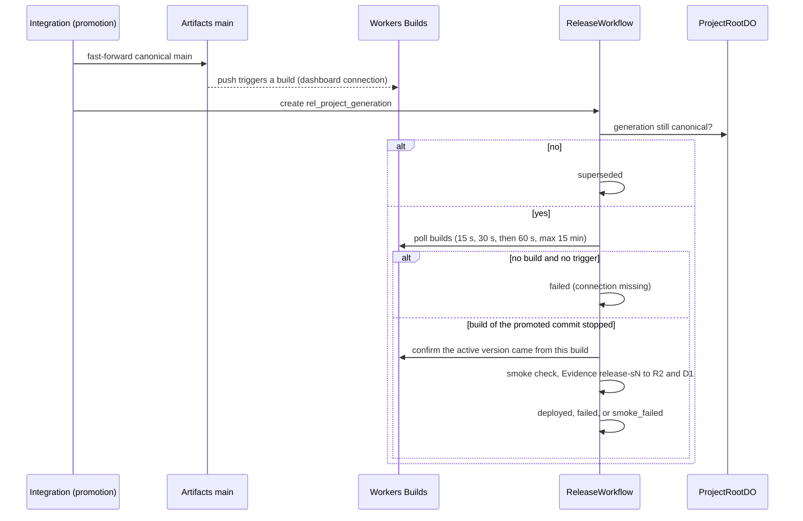

# ADR 0018: Release through Workers Builds on Artifacts

- Status: Accepted 2026-10-09. Applied on dev and prod. Supersedes ADR 0014 in part (the token).
  The `cf` connection step did not work, so the ADR 0014 dashboard step still applies (Update
  2026-10-10).
- Decider: Project owner

## Context

AGENTS.md sections 21.3 and 37 define the release path: promotion moves the canonical Artifact,
Workers Builds builds it, the Worker is deployed, a smoke check runs, and release Evidence is
recorded. ADR 0014 parked this path because the Builds connection to an Artifacts repo had no
documented API. The `cf` CLI now creates that connection (`cf builds workers create`). Cloudflare
provider 5.27 still has no Workers Builds resource.

## Decision

### Connection: one-time `cf` command, not the dashboard

- Terraform still owns the release target Worker (`cloudflare_worker.acme_shop`,
  `rhumbatron-acme-shop-<env>`, workers.dev on), but none of its versions.
- A person connects the Worker once with `cf builds workers create`: Artifacts repo of the demo
  Project in `rhumbatron-projects-<env>`, branch `main`, deploy command
  `npx wrangler@4.149.0 deploy`. This replaces the dashboard step of ADR 0014. It stays one
  documented exception to section 11.4 until the provider or a Terraform adapter can own it.
- Workers Builds owns the release Worker's versions and deployments. They are runtime release
  data (section 2.1), so Terraform shows no drift.
- The release target is a D1 row (`release_targets`, migration 0015): Project, Worker name,
  Worker tag (the Builds API `external_script_id`), and URL. The migration seeds Acme Shop Live on
  dev only where that Project exists. Prod has no row until prod has its own connection and a
  prod-named fixture (ADR 0017 open item 5).

### Trigger: the promotion push

- Promotion fast-forwards canonical `main` (ADR 0013). After the push lands, promotion starts
  `ReleaseWorkflow` with instance ID `rel_<project>_<generation>` (section 60: one release per
  generation). A promotion retry starts nothing new. Rhumbatron never calls a Builds write API.
- Starting a release marks any older `queued` or `building` release of the Project `superseded`.

### Observation: ReleaseWorkflow (integration Worker)

1. Confirm that the generation is still canonical (ProjectRootDO). If not, the release is
   `superseded`. Else emit `build.started`.
2. Poll `GET /builds/workers/{tag}/builds` with backoff (15 s, 30 s, then 60 s) for at most
   15 minutes. Only a build whose trigger commit is the promoted commit counts. If there is no
   build and no trigger, the connection is missing, and the release fails at once.
3. Emit `build.completed`. A failed build makes the release `failed`, with `deployment.failed`.
4. Confirm the deployment: the Worker's newest deployment version maps back to this build
   (`GET /workers/scripts/{name}/deployments`, `GET /builds/builds?version_ids=`). Emit
   `deployment.completed` with the version ID. If retries do not confirm it, the release is
   `failed`.
5. Smoke check the release URL: `/` returns 200; `/api/products` returns 200 JSON; up to two static
   GET routes the Change added (from its contract Evidence) answer 2xx, 401, or 403, not 404. The
   check retries once after 20 s, because a fresh deployment can take seconds to serve.
6. Evidence goes to R2 and `evidence_index` in the Candidate Evidence model, check ID
   `release-s<generation>`. The API keeps `release-*` rows out of Candidate verification views; they
   never feed a promotion gate.
7. If the smoke check passes, the release is `deployed`. Else it is `smoke_failed`, with
   `release.smoke_failed`. A probe without a response is a gap, never a pass (section 34.4.1).

Statuses: `queued -> building -> deployed | failed | smoke_failed`, and `queued | building ->
superseded`. Final states do not change, except that failure injection (P13-12) may move
`deployed` to `smoke_failed`.

### Failure semantics (section 42.10)

- A failed release never moves the Canonical Generation back and never deletes history.
- Recovery is a new canonical transition: a new Change and promotion (a fix, or a revert as a new
  generation). There is no "re-release the same generation" path.
- P13-12 injection: `POST /v1/projects/:projectId/releases/inject-failure` (FIXTURES_ENABLED
  guard) probes the live release URL with the normal probes plus a route that does not exist. Its
  real 404 fails the smoke check through the same path, marked `injected: true`.

### Runtime token

- Terraform variable `builds_api_token` (sensitive), loaded by `scripts/tf.ts` from the Keychain
  item `rhumbatron-cloudflare-builds-token` for dev and prod. Bound as `secret_text`
  `BUILDS_API_TOKEN` on the integration Worker only, with `BUILDS_ACCOUNT_ID`.
- Scope: user-scoped, Workers Builds Configuration Edit and Workers Scripts Read. The code sends
  GET requests only and never logs the token. A narrower read-only scope, if one becomes
  available, needs only a new Keychain value and an apply, not a code change.
- No account-wide Workers Scripts Edit token exists at runtime: Workers Builds deploys with its own
  build token, which belongs to this Worker's trigger.

## Consequences

- Cost: Workers Builds Free has 3,000 build minutes per month and one concurrent build. Builds run
  only on promotion. ReleaseWorkflow uses about 6 steps plus 2 per poll (about 16 for a 2-minute
  build) of the 3,000 Workflows steps per day. Each poll is 1 to 2 API GETs; the smoke check is 3 to
  5 fetches, 2 R2 writes, and 1 D1 write.
- One concurrent build: a promotion during a running build queues behind it, and the older release
  becomes `superseded`.
- A new release Project needs its own `cf builds workers create` and a `release_targets` row in a
  new migration.
- Replace the `cf` step with a Terraform resource or adapter when one can own Artifacts
  connections.

## Update (2026-10-10)

- The release workflow, the `rhumbatron-release-<env>` Workflow, and the `BUILDS_API_TOKEN` binding
  are applied on dev and prod.
- `cf builds workers create` did not make the connection. The Builds API rejects request bodies
  with provider type `cloudflare_artifacts` as invalid (error 12065). The one-time dashboard
  connection of ADR 0014 is still needed, and no Workers Builds trigger exists yet. Until one
  exists, a started release fails at once with "connection missing" (step 2).
- Prod has no `release_targets` row, so promotion on prod starts no release (ADR 0017, open item 5).

## Diagram

Release of one promoted generation (`workers/integration/src/release-workflow.ts`).

## Update (2026-10-10, later)

The dashboard connection now exists for `rhumbatron-acme-shop-dev`. It has trigger `4fb2e3cf-ac43-4cd3-8107-855a94059a7b`, branch `main`, deploy command `npx wrangler@4.149.0 deploy`, and a dedicated build token. The default token that the dashboard offered belonged to another project and lacked Artifacts permissions. That caused a 401, and a new token fixed it. See docs/operations/release.md.
