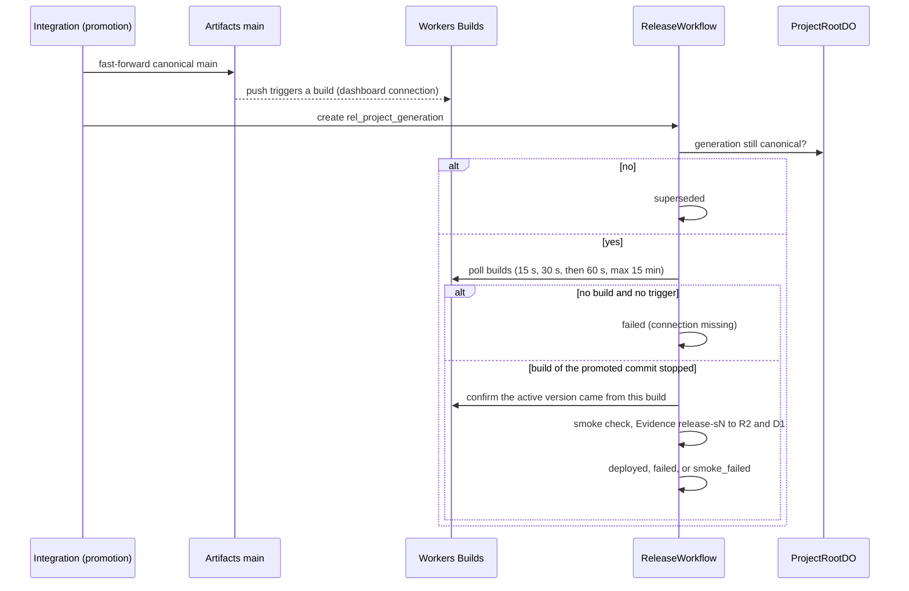

# ADR 0018: Release paths

## Context

AGENTS.md sections 21.3 and 37 define the release path: promotion moves the canonical Artifact,
a build and deploy follow, a smoke check runs, and release Evidence is recorded. Two release paths
exist. A Project with a live app releases by moving its app pointer (ADR 0020). A Project with a
`release_targets` row releases through Workers Builds. This ADR defines `ReleaseWorkflow` and the
Workers Builds path.

Cloudflare provider 5.27 has no Workers Builds resource. The Builds API rejects connection request
bodies with provider type `cloudflare_artifacts` (error 12065). The `cf` CLI cannot create the
connection either. No account-wide Workers Scripts Edit secret exists at runtime.

## Decision

### Connection

- Terraform owns the release target Worker (`cloudflare_worker.acme_shop`,
  `rhumbatron-acme-shop-prod`, workers.dev on) and none of its versions. Workers Builds owns its
  versions and deployments. They are runtime release data (section 2.1), so Terraform shows no drift.
- A person connects the Worker once in the dashboard: Worker, Settings, Builds, Connect, Artifacts
  namespace `rhumbatron-projects-prod`, the Project's repo, production branch `main`, deploy command
  `npx wrangler@4.149.0 deploy`, and a build token dedicated to this Worker. The token that the
  dashboard offers by default can belong to another project and lack Artifacts permissions.
  `cf builds triggers list --external-script-id <worker tag>` checks the connection. This is the one
  documented exception to the Terraform-only rule for this path.
- The release target is a D1 row (`release_targets`): Project, Worker name, Worker tag (the Builds
  API `external_script_id`), and URL. A Project without a row, and without a live app, starts no
  release.
- The Acme Shop fixture carries `src/worker.ts` and `wrangler.jsonc` for this Worker.

### Trigger: the promotion push

- Promotion fast-forwards canonical `main` (ADR 0013). After the push lands, promotion starts
  `ReleaseWorkflow` with instance ID `rel_<project>_<generation>` (one release per generation). A
  promotion retry starts nothing new. Rhumbatron never calls a Builds write API.
- Starting a release marks any older `queued` or `building` release of the Project `superseded`.

### ReleaseWorkflow (integration Worker), Workers Builds path

1. Confirm that the generation is still canonical (ProjectRootDO). If not, the release is
   `superseded`. Else emit `build.started`.
2. Poll `GET /builds/workers/{tag}/builds` with backoff (15 s, 30 s, then 60 s) for at most
   15 minutes. Only a build whose trigger commit is the promoted commit counts. If there is no
   build and no trigger, the connection is missing, and the release fails at once.
3. Emit `build.completed`. A failed build makes the release `failed`, with `deployment.failed`.
4. Confirm the deployment: the Worker's newest deployment version maps back to this build
   (`GET /workers/scripts/{name}/deployments`, `GET /builds/builds?version_ids=`). Emit
   `deployment.completed` with the version ID. If retries do not confirm it, the release is `failed`.
5. Smoke check the release URL: `/` returns 200; `/api/products` returns 200 JSON; up to two static
   GET routes the Change added (from its contract Evidence) answer 2xx, 401, or 403, not 404. The
   check retries once after 20 s.
6. Evidence goes to R2 and `evidence_index`, check ID `release-s<generation>`. The API keeps
   `release-*` rows out of Candidate verification views. They never feed a promotion gate.
7. If the smoke check passes, the release is `deployed`. Else it is `smoke_failed`, with
   `release.smoke_failed`. A probe without a response is a gap, never a pass (section 34.4.1).

Statuses: `queued -> building -> deployed | failed | smoke_failed`, and `queued | building ->
superseded`. Final states do not change, except that failure injection may move `deployed` to
`smoke_failed`. The live app path of the same workflow is in ADR 0020.

### Failure semantics (section 42.10)

- A failed release never moves the Canonical Generation back and never deletes history.
- Recovery is a new canonical transition: a new Change and promotion (a fix, or a revert as a new
  generation). No "re-release the same generation" path exists.
- `POST /v1/projects/:projectId/releases/inject-failure` (`FIXTURES_ENABLED` guard) probes the live
  release URL with the normal probes plus a route that does not exist. Its real 404 fails the smoke
  check through the same path, marked `injected: true`.

### Runtime token

- Terraform variable `builds_api_token` (sensitive), loaded by `scripts/tf.ts` from the Keychain
  item `rhumbatron-cloudflare-builds-token`. Bound as `secret_text` `BUILDS_API_TOKEN` on the
  integration Worker only, with `BUILDS_ACCOUNT_ID`.
- Scope: user-scoped, Workers Builds Configuration Edit and Workers Scripts Read. The code sends GET
  requests only and never logs the token.

## Consequences

- Workers Builds Free includes 3,000 build minutes per month and one concurrent build. Builds run only
  on promotion. The Workers Builds path uses about 6 steps plus 2 per poll of the 3,000 Workflows
  steps per day.
- A promotion during a running build queues behind it, and the older release becomes `superseded`.
- A new release Project needs its own dashboard connection and a `release_targets` row from a new
  migration.

## Diagram

Release of one promoted generation, Workers Builds path (`workers/integration/src/release-workflow.ts`).

