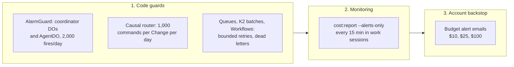
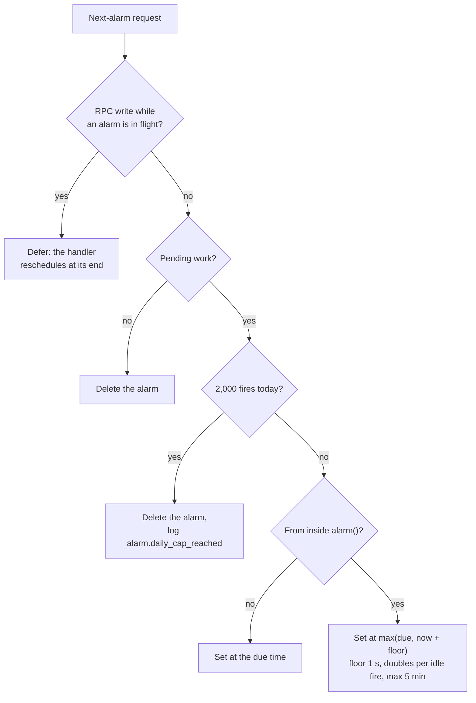

# ADR 0019: Runaway-billing guards

## Context

Cloudflare has no hard spend cap. On Workers Paid, Durable Object requests, duration, and storage
rows above the included amounts bill. They do not fail. A Durable Object alarm that sets itself
again with no stop condition can make trillions of storage operations. The public incident
"cloudflare-108k" (serverlesshorrors.com) is a five-figure bill from one such alarm. Without code
guards, the invoice is the first signal of such a loop.

The ProjectRootDO and ResourceShardDO outbox alarms are the paths that can loop. Without a guard, a
due outbox row that cannot publish (for example, no K2 binding) sets the alarm again at once. The
guards below put a limit on them.

## Decision

Three layers.

1. Code guards (first line).
   - `workers/coordinator/src/alarm-guard.ts`:
     - No pending work means no alarm.
     - An alarm set from inside `alarm()` is at least 1 s in the future. The delay doubles for
       each idle fire, up to 5 min.
     - Each object stops at 2,000 fires per UTC day and logs `alarm.daily_cap_reached`.
   - AgentDO sends each of its own schedules through the same daily cap. It runs its one-minute
     run check as an interval schedule (`scheduleEvery(60)`). Each fire goes through
     `admitSchedule`.
   - The Causal Router allows at most 1,000 wake, dispatch, and compose commands per Change per
     UTC day (D1 `usage_counters`).
   - Queues have bounded retries and a dead-letter consumer that never sends again.
   - Workflows have step retry limits and deadlines.
2. Monitoring. During work sessions, run `bun run cost:report --alerts-only` every 15 minutes.
3. Account budget alerts (backstop). The account sends an email to the owner when usage-based
   spend reaches $10, $25, and $100 (`envs/global`, `var.budget_alert_usd`).
   - This is an adapter (AGENTS.md section 11.4): `terraform_data.budget_alerts` runs
     `scripts/budget-alerts.ts`.
   - Provider 5.27.0 (the locked version) rejects the alert type `billing_budget_alert`.
   - The Terraform API token has no Notifications permission, so the adapter writes through the
     operator's `cf` CLI login.
   - Only `terraform apply` invokes it. It reads before it writes, and it owns only
     `rhumbatron-budget-*` policies.
   - Replace it with `cloudflare_notification_policy` when the provider accepts the type.

## Consequences

- An alarm loop costs at most 2,000 fires per object per day.
- A capped ResourceShardDO stops lease expiry for the rest of the UTC day. Claims are advisory
  (ADR 0015), so this is safe.
- Budget alerts follow billing data with a delay. They find slow leaks and missed loops, not a
  spike within minutes. The code guards stop spikes.
- `local.paused` stops cron sweeps and Sandbox starts. It does not stop Durable Object alarms.
  The guards limit those.

## Alarm and batch behavior

- `AlarmGuard.run()` is the full body of each coordinator `alarm()`. It counts the fire first.
  While the handler runs, it holds RPC alarm writes. After the handler ends, it reads the pending
  work and sets the next alarm from it.
- The outbox fails a row at once when its K2 stream has no producer binding (`EVENTS_NN`). The
  `last_error` names the binding. A retry cannot add a binding, so the alarm stops.
- The event router dead-letters a K2 batch after 5 failed deliveries (`MAX_BATCH_FAILURES`, table
  `k2_batch_failures`). It records the batch in `dead_letters` (queue `k2-<consumer>`), marks its
  events processed, and acknowledges it.

## Diagram

The three layers.

One alarm decision (`planAlarm` in `workers/coordinator/src/alarm-guard.ts`).

