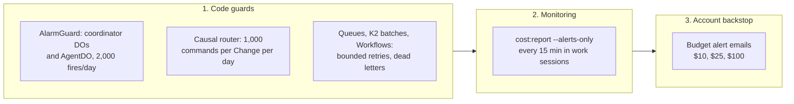
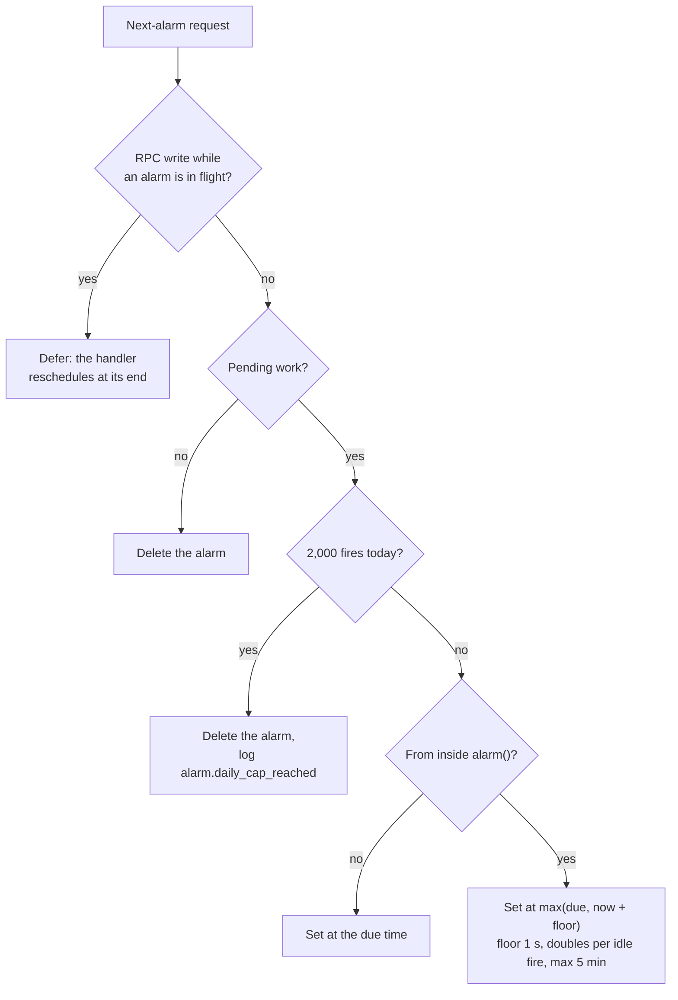

# ADR 0019: Runaway-billing guards

## Status
Accepted, 2026-10-09. Four alarm follow-ups are in Update (2026-10-10).

## Context
Cloudflare has no hard spend cap. On Workers Paid, Durable Object requests, duration, and storage
rows above the included amounts bill rather than fail. A public incident (serverlesshorrors.com,
"cloudflare-108k") was one Durable Object alarm that rescheduled itself with no stop condition:
trillions of storage operations and a five-figure bill, found only on the invoice.

An audit on 2026-10-09 found no live loop. Two paths had no bound: the ProjectRootDO and
ResourceShardDO outbox alarms. When a due outbox row could not publish (for example, no K2
binding), `setAlarm(now)` fired again at once, forever.

## Decision
Three layers.

1. Code guards (first line).
   - `workers/coordinator/src/alarm-guard.ts`:
     - No pending work means no alarm.
     - A reschedule from inside `alarm()` is at least 1 s out. It doubles per idle fire up to 5 min.
     - Each object stops at 2,000 fires per UTC day and logs `alarm.daily_cap_reached`.
   - AgentDO routes every self-schedule through the same daily cap.
   - The causal router caps wake, dispatch, and compose commands at 1,000 per Change per day
     (D1 `usage_counters`).
   - Queues keep bounded retries plus a dead-letter consumer that never re-sends.
   - Workflows keep step retry limits and deadlines.
2. Monitoring. `bun run cost:report --alerts-only` runs every 15 minutes during work sessions.
3. Account budget alerts (backstop). The account emails the owner when usage-based spend
   reaches $10, $25, and $100 (`envs/global`, `var.budget_alert_usd`).
   - This is a temporary adapter (AGENTS.md section 11.4): `terraform_data.budget_alerts` runs
     `scripts/budget-alerts.ts`.
   - Provider 5.27 (the latest) rejects alert type `billing_budget_alert`.
   - The Terraform API token has no Notifications permission, so the adapter writes through the
     operator's `cf` CLI login.
   - Only `terraform apply` invokes it. It reads before it writes, and it owns only
     `rhumbatron-budget-*` policies.
   - Replace it with `cloudflare_notification_policy` when the provider accepts the type.

## Consequences
- A runaway alarm now costs at most 2,000 fires per object per day, not unbounded.
- A capped ResourceShardDO stops lease expiry for the rest of the UTC day. Claims are advisory
  (ADR 0015), so this is safe.
- Budget alerts lag billing data. They catch slow leaks and missed loops, not a spike within
  minutes. The code guards handle spikes.
- `local.paused` stops cron sweeps and Sandbox starts. It does not stop Durable Object alarms.
  The guards bound those.

## Update (2026-10-10)

These follow-ups apply the same three layers. They need no new ADR.

- `AlarmGuard.run()` is the whole body of each coordinator `alarm()`. It counts the fire first,
  then defers RPC alarm writes while the handler is in flight, and sets the next alarm from the
  pending work it reads after the handler ends. Before this, an RPC write during the handler
  queued a second alarm that the handler then overrode (`clientDisconnected`, outcome `canceled`).
- AgentDO runs its one-minute run check as an interval schedule (`scheduleEvery(60)`) instead of
  a `schedule()` call from inside its own alarm. That removes one canceled alarm per minute per
  running run. Each fire still goes through `admitSchedule` and the daily cap.
- The outbox fails a row at once when its K2 stream has no producer binding (`EVENTS_NN`). The
  `last_error` names the binding. A retry cannot add a binding, so the alarm stops instead of
  firing with no progress.
- The event router dead-letters a K2 batch after 5 failed deliveries (`MAX_BATCH_FAILURES`,
  migration 0016 `k2_batch_failures`). It records the batch in `dead_letters` (queue
  `k2-<consumer>`), marks its events processed, and acknowledges it. Before this, K2 redelivered a
  failed batch forever.

## Diagram

The three layers.

One alarm decision (`planAlarm` in `workers/coordinator/src/alarm-guard.ts`).

