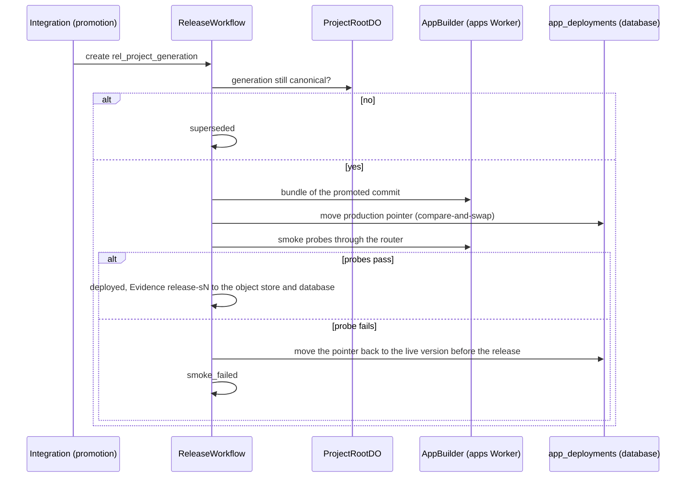
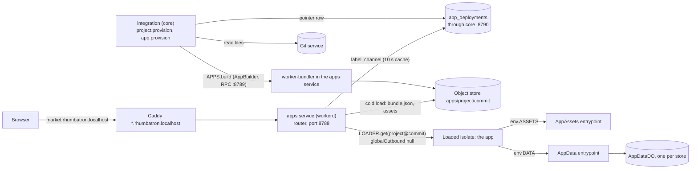

# ADR 0020: Live apps on workerd with the Worker Loader

## Context

Each Project is a live application:

- Apps run at `<label>.rhumbatron.localhost`. Candidate previews run at
  `<preview-id>--<label>.rhumbatron.localhost`.
- Generated apps have no real login. When an instruction asks for accounts, agents build a fake
  identity (a demo user picker).
- A user app needs no change to the Compose stack. The `apps` service and the Caddy wildcard
  route `*.rhumbatron.localhost` exist once for every app.

The `apps` service (`services/apps`) runs `workers/apps` on the open-source `workerd` runtime with
the `--experimental` flag. Its Worker Loader binding loads each app version as an isolate on
request. One process serves every app, with no container per app.

[Live apps](../architecture/live-apps.md) describes the request path, builds, previews, releases,
and rollback in full. This ADR states the decisions and their limits.

## Decision

### Runtime

- One Worker, `workers/apps` in the `apps` service, serves each app. It has a Worker Loader
  binding (`LOADER`). It loads an app version with `LOADER.get(id, ...)`. The ID is
  `<project>@<commit>` for production and `<project>@<commit>#<channel>` for a preview or version
  host. The callback reads the bundle from the object store only on a cold load. The ID is stable
  per commit, so a warm isolate serves each later request of that version.
- Host rules (`packages/protocol/src/app.ts`):
  - One label under `APPS_DOMAIN` (`rhumbatron.localhost`), at most 50 characters, with lowercase letters, digits, and
    single hyphens. `--` separates an 8-character preview ID from the label.
  - Reserved labels: `www`, `api`, `clerk`, `accounts`, `clkmail`, `app`, `apps`, `admin`, `mail`,
    `status`, `docs`, `static`, `cdn`, and each label that starts with `rhumbatron`. DKIM hosts
    contain a dot, so they are never a label.
  - The label is the slug. Slugs are unique per organization only, so the second choice is
    `<slug>-<6 characters of the Project ID>`. A reserved slug gets the suffix `-app`.
- Pointer: the product database table `app_deployments` (migration 0018), one row per Project and
  channel (`production` or `preview:<id>`), unique on (label, channel). The router reads it through
  the core internal API (`services/apps/CONTRACT.md`) and caches rows in the isolate for 10 s. A
  row keeps its last good bundle while a build runs or after a build fails. Status `removed`
  answers 410 for the app and all its previews.
- Router pages are plain HTML with no scripts and `noindex`:
  - 404: no app.
  - 410: the app is removed.
  - 503 with refresh: the app is building, a build failed with no earlier bundle, or a limit is
    reached.
  - 502: the app threw.
  - 200 "Nothing built yet": the tree has no code (ADR 0022).

### Bundles

- Format: `apps/<project>/<commit>/bundle.json` (modules, compatibility settings, asset manifest)
  plus one object per static asset under `.../assets/<path>`, in the evidence bucket. Previews use
  `app-previews/`. The builder writes `bundle.json` last. The commit is the content address, so the builder uses a
  stored bundle again and never builds it again.
- Builder: the `AppBuilder` entrypoint of the apps Worker, with `@cloudflare/worker-bundler` 0.2.6
  (esbuild-wasm). It runs in the apps Worker, so builds use no Sandbox time. npm dependencies come
  from the public registry at build time, through the workerd `internet` service (public
  addresses only).
- The integration module reads the build inputs of one commit through its `ARTIFACTS` binding (the
  git service): one read per directory and per file. It skips tests, benchmarks, lockfiles, and
  Markdown files. Then it calls `APPS.build(...)`. `APPS` is the RPC client of the apps service
  (`POST /rpc/AppBuilder/build` on port 8789).
- Limits: 400 files, 8 MB of source, 10 MB of modules, and 500 assets of at most 5 MB each. The
  compatibility flags must be in an allowlist: `nodejs_compat`, `nodejs_compat_v2`, `nodejs_als`,
  and `global_fetch_strictly_public`.
- `AppChecker` in the same Worker runs the `build`, `unit`, and `contract` checks of a Candidate in
  loaded Workers. It reads the composed tree from the code store in the object store
  (`source/<project>/blobs/` and the `code.json` of each tree). See
  [Source and verification](../architecture/source-and-verification.md#where-checks-run).

### Static assets

The router serves a matching asset before it runs the app. The `wrangler.jsonc` of the app sets
the rules: `assets.directory`, `not_found_handling` (`none`, `single-page-application`, or
`404-page`), and `run_worker_first`.

- An app whose client handles its own routes sets `not_found_handling` to
  `single-page-application` (`APP_CONVENTIONS`). A direct load of such a route then serves
  `public/index.html`.
- An app with `run_worker_first: true` gets each request.
- Apps can also call `env.ASSETS.fetch(request)`. `ASSETS` is the `AppAssets` entrypoint of the
  router, passed through `ctx.exports` with `props.bundleKey`.

### Per-app storage

`env.DATA` is a small string key-value store with `get`, `put`, `delete`, and
`list({ prefix, limit })`. It is the `AppData` entrypoint of the router with `props.storeName`.
Each store is one SQLite-backed `AppDataDO` actor. The workerd config declares it in
`durableObjectNamespaces`, with storage on `localDisk` in the `apps-data` volume. Production, each
preview, and each version host have separate stores, so a preview never writes production data.
Limits: keys up to 512 characters, values up to 128 KiB, and 10,000 keys.

An app exports no actor class. Each app stays a plain fetch Worker, so an app request does not go
through one object. Only storage calls reach `AppDataDO`.

### Security

- `globalOutbound` is `null`, so an app cannot reach the network.
- The router passes limits per request: 50 ms CPU and 20 subrequests (binding calls included). A
  limit hit returns 503. workerd does not enforce these limits.
- The app env holds only `ASSETS` and `DATA`. It has no Rhumbatron binding, secret, or token.
- Cookies (`workers/apps/src/cookies.ts`, `cookies.critical.test.ts`):
  - The router stores each app cookie under the `rba_` prefix on the host of the app. An app
    `Set-Cookie` for `name` becomes `rba_name`.
  - The router drops a `Set-Cookie` that has a `Domain` attribute. An app cannot set a cookie for
    `rhumbatron.localhost` or for another app.
  - A request to the app carries only the `rba_` cookies, with the prefix removed. Cookies that
    other hosts set for the whole parent domain never reach app code.
  - The router also strips the `cf-access-jwt-assertion` and
    `cf-access-authenticated-user-email` request headers.
- Real auth check: a build fails when `package.json` or an import names a real auth SDK or a
  password-hashing library (Clerk, Auth.js, Better Auth, Lucia, Supabase auth, Firebase auth,
  Auth0, Passport, Okta, Amplify, WorkOS, Stytch, Kinde, Descope, bcrypt, argon2), or when markup
  has a password field.
- Clerk cookies on `rhumbatron.localhost`:
  - `__session` and `__session_<suffix>` have no `Domain`. They are host-only on
    `rhumbatron.localhost`, and app hosts never get them.
  - The browser sends a cookie with `Domain=rhumbatron.localhost`, such as `__client_uat`, to app
    hosts. The router removes every cookie that does not have the `rba_` prefix.

### Fake identity

Apps have no real login (`APP_CONVENTIONS`, ADR 0022). When a goal asks for accounts or users, the
agents build a fake identity: a demo user picker stores the user in a cookie, and the server reads
the cookie.

### Provisioning

- `project.provision` (integration code) runs `provisionApp` after it seeds the source, when the
  `APPS` binding exists. `app.provision` does the same on request:
  `POST /v1/projects/:projectId/app` ("Deploy app" on the Project overview), for a retry or for a
  Project without an app.
- `GET /v1/projects/:projectId/app` returns `{ enabled, app }`. `enabled` is false without
  `APPS_DOMAIN`.
- When a Project is archived, its app becomes `removed` (410 at once). The cleanup deletes the
  `AppDataDO` stores, the `apps/<project>/` and `app-previews/<project>/` prefixes, and the preview and
  version rows. The production row stays as a tombstone (status `removed`, no commit, no bundle),
  so the hosts answer 410, not 404.

### Previews, releases, versions, rollback

These are runtime data. No change to the Compose stack runs at release time.

- **Preview.** After the checks, when the build check passed, CandidateVerificationWorkflow
  builds the composed commit and writes the row `preview:<first 8 characters of the Candidate
  ID>`. A Change keeps at most 3 previews. When it is full, the oldest preview of a stale,
  rejected, or promoted Candidate makes room. The workflow never removes the preview of a Candidate
  that can still ship. A failed preview build changes only the row.
  `GET /v1/candidates/:candidateId/preview` feeds "Open preview" on the Candidate page.
- **Release.** For a Project with an app, promotion starts `ReleaseWorkflow` (below). The bundle of
  the promoted commit comes from, in order: a stored bundle, the bundle of another commit with the
  same tree, the preview bundle copied from `app-previews/`, or a build. Then the production
  pointer moves by compare-and-swap on the row that the workflow read. Then the smoke probes
  (`release-model.ts`) run through the router (`AppBuilder.probe`, fresh pointer read, no public
  route).
  - `/` must answer 2xx or 3xx and must not be a router status page ("Nothing built yet",
    "Building").
  - The probes also call up to 3 static GET routes (no path parameters) from the route table in
    the contract Evidence of the released Candidate. Routes that the Change added go first. Without
    a route table, the probes call only `/`.
  - A release that starts late never moves the pointer back to an older generation.
- **Smoke failure.** The pointer moves back to the version that is live before the release. This
  move is a recorded transition (`deployment.completed` with status `restored`). The release is
  `smoke_failed`. The Canonical Generation stays promoted.
- **Versions.** Each deployed generation also gets a version row `preview:v<generation, 7 digits>`
  that points at its production bundle, for example `v0000003--market.rhumbatron.localhost`. `v`
  is not a hex digit, so a version ID never equals a Candidate preview ID. A version host has its own data
  store and its own loader ID, so it never shares the isolate or the data of production.
- **Rollback.** `POST /v1/projects/:projectId/rollback` with `{ targetGeneration,
  expectedGeneration }` creates a rollback Change and Candidate. Its one commit is on the commit of
  Sn with the tree of Sk. Its required check reads the tree of that commit from the git service and
  compares it with the tree of Sk. Policy decides the human gate from the riskiest Change that the
  rollback undoes. Then the normal compare-and-swap promotes it (Sn -> Sn+1), and the release uses
  the stored bundle of Sk. Nothing in the history is deleted. The file index of the tree points at
  the rollback commit, so later Candidates compose on it.
- **Stale recomposition.** When canonical advances, a stale Candidate is composed again on the
  current Canonical State (same ChangeSets, a real merge, all checks). This occurs at most 6 times
  per lineage (`MAX_RECOMPOSES`). After that, the Candidate is blocked, and a person decides. Recompositions do not
  count against the Candidate limit. Triggers: verification finds the base behind, canonical moves during the checks,
  ProjectRootDO refuses the compare-and-swap, or a promotion settles the Candidates behind it
  (ADR 0013). A rollback Candidate, a Change that already promoted a sibling, and a closed,
  `needs_input`, `not_selected`, or duplicate Change never recompose (ADR 0023).

### ReleaseWorkflow (integration code)

The release path has four parts. Promotion moves canonical `main`. A build and a deploy follow.
A smoke check runs, and Rhumbatron records release Evidence. Only a Project with a live app
releases. A Project without a live app ends its Change at promotion.

- **Trigger.** Promotion fast-forwards canonical `main` (ADR 0013). After the push, promotion
  starts `ReleaseWorkflow` with instance ID `rel_<project>_<generation>`, so each generation has
  one release. A promotion retry starts no second release. When a release starts, it gives each
  `queued` or `building` release of a lower generation the status `superseded`.
- **Steps.**
  1. Confirm that the generation is still canonical (ProjectRootDO). If not, the release is
     `superseded`. Else record `build.started`.
  2. Get the bundle of the promoted commit and record `build.completed`. A failed build makes the
     release `failed`, with `deployment.failed`.
  3. Move the production pointer by compare-and-swap and record `deployment.completed`. A pointer
     that does not move makes the release `failed`. A newer live generation makes it `superseded`.
  4. Run the smoke check through the router. If it fails, a second check runs 10 s later.
  5. Write the Evidence to the object store and `evidence_index`, with check ID
     `release-s<generation>`. The API keeps `release-*` rows out of the Candidate verification
     views. They never feed a promotion gate.
  6. If the smoke check passes, the release is `deployed`. Else the pointer moves back (see Smoke
     failure), and the release is `smoke_failed`, with `release.smoke_failed`. A probe without a
     response is a gap, never a pass.
- **Statuses.** `queued -> building -> deployed | failed | smoke_failed`, and
  `queued | building -> superseded`. A final state does not change. One exception applies: failure
  injection can move `deployed` to `smoke_failed`. A release takes 6 to 9 workflow steps.
- **Failure semantics.** A failed release never moves the Canonical Generation
  back and never deletes history. Recovery is a further canonical transition: a Change and a promotion
  (a fix, or a rollback). No path releases the same generation again. The event router sweep ends
  a Change that is still `releasing` 45 minutes after promotion (`RELEASE_STUCK_AFTER_MS`).
- **Failure injection.** `POST /v1/projects/:projectId/releases/inject-failure` (Project owner
  or admin) probes the live app through the router with the normal probes plus a route
  that does not exist. Its real 404 fails the smoke check through the same path. The release
  record has `injected: true`.

### Removal, cost, and retention

- **Remove app.** `DELETE /v1/projects/:projectId/app` marks each row `removed` (410 on each host
  at once) and queues `app.remove`. The cleanup wipes the data stores (`AppBuilder.wipeData`),
  deletes both object prefixes and the preview and version rows. Then it reduces the production
  row to a tombstone (status `removed`, no commit, no bundle). The hosts answer 410. The Project and its
  history stay. "Deploy app" uses the tombstone again and publishes on the same label.
- **Cost.** At most 60 app builds per UTC day (`APP_BUILDS_PER_DAY`, `usage_counters`
  `app-builds`), checked before each build. Builds and app requests run on the local host and
  have no usage charge. The cap limits the host time that a loop of builds can take.
- **Retention.** Production bundles under `apps/` stay until the Project is deleted. Each promoted
  generation keeps its bundle, so a rollback never builds again. The daily sweep deletes the
  preview rows and their data stores after 7 days. Version rows never expire.
- **Object expiry.** Core runs the object expiry (`services/core/src/expiry.ts`). It deletes
  objects under `app-previews/` after 7 days, under `tmp/` after 7 days, and under `events/` after
  365 days. Objects under `apps/` and `evidence/` stay until the Project is deleted.

### Compose stack

- `services/apps/Dockerfile` bundles `workers/apps` (`services/apps/build.ts`), installs
  `workerd` 1.20261008.1 (compatibility date `2026-10-08`), and runs
  `workerd serve config.capnp --experimental` as a non-root user.
- Port 8788 serves the app hosts. Caddy sends `*.rhumbatron.localhost` to it. Explicit hosts
  (`rhumbatron.localhost`, `api`, `docs`) have their own Caddy site blocks, so the wildcard never
  captures them.
- Port 8789 serves `POST /rpc/<Entrypoint>/<method>` for core only. Caddy does not route it.
- The apps Worker reaches core only through the workerd external service `CORE` (`core:8790`),
  with the bearer `INTERNAL_TOKEN`. `DB` and `EVIDENCE` in the apps Worker are HTTP shims over that
  API (`workers/apps/src/platform/`).
- Migration `0018_app_deployments.sql` creates the pointer table.
- `APPS_DOMAIN` (`rhumbatron.localhost`) on core and on the apps service turns live apps on.

## Cost

Every item runs on the local host. None has a usage charge. The table shows the load per item.

| Item | Use | Limit |
|---|---|---|
| Loaded isolates | 1 per app version or preview host in use | memory of the `apps` container |
| Requests | 2 per app request (router and app), plus 1 per binding call | none |
| CPU | 50 ms per app request passed as a limit (not enforced); a build takes a few seconds | host CPU |
| Product database | 1 read per host per isolate per 10 s; 2 to 3 writes per build | none |
| Object store | 1 write per asset plus 1 per bundle; 1 read per cold load and per asset | disk of `objects-data` |
| Git service | 1 read per source file per build | none |
| `AppDataDO` | only when an app calls `DATA` | disk of `apps-data` |
| Sandbox | none | |
| App builds | 1 per preview, 1 per release without a stored or preview bundle | 60 per day (code cap) |

## Consequences

- Script that runs in the pages of an app shares the parent domain `rhumbatron.localhost`. It
  cannot read the host-only `__session`. But it can write a cookie for
  `Domain=rhumbatron.localhost` with `document.cookie` (cookie tossing), and the router cannot see
  that. The impact is a forced sign-out, or a sign-in as the account of the attacker on
  `rhumbatron.localhost`. A separate parent domain for apps removes this risk. A
  `Content-Security-Policy: sandbox` header also blocks it, but it breaks same-origin storage.
- The apps Worker carries the esbuild-wasm module (`esbuild.wasm`, written by
  `services/apps/build.ts`). Only the builder imports it. If the start of the apps service becomes
  slow, move the builder into its own Worker.
- `@cloudflare/worker-bundler` is experimental (0.x). The version is pinned, and only the builder
  imports its bundling API.
- Builds need access to the npm registry from the apps service. A failed build keeps the last good
  version live.

## Diagram

