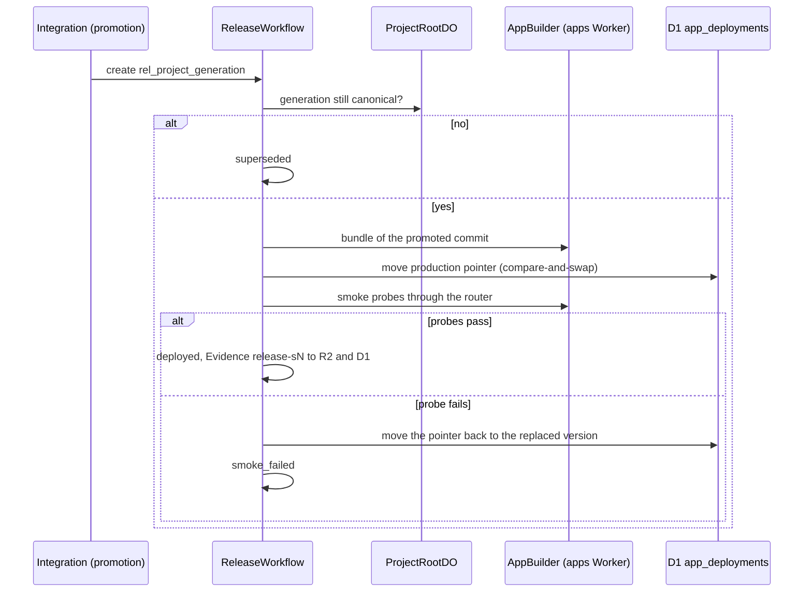
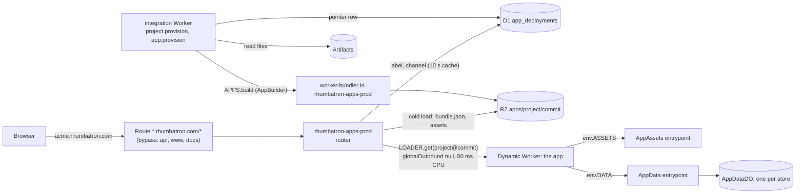

# ADR 0020: Live apps on Dynamic Workers

## Context

Each Project is a live application:

- Apps run at `<label>.rhumbatron.com`. Candidate previews run at
  `<preview-id>--<label>.rhumbatron.com`.
- Generated apps have no real login. When an instruction asks for accounts, agents build a fake
  identity (a demo user picker).
- User apps never need Terraform. Terraform creates only the one-time foundation.

A Cloudflare build connection per Project does not work: an Artifacts connection needs a dashboard
step, and one build runs at a time. Workers for Platforms adds a $25 base fee. Dynamic Workers are
in the frozen stack (AGENTS.md section 5.3) and Workers Paid includes them: 1,000 unique Dynamic
Workers created per month, and 10 M requests and 30 M CPU-ms shared with Workers.

[Live apps](../architecture/live-apps.md) describes the request path, builds, previews, releases,
and rollback in full. This ADR states the decisions and their limits.

## Decision

### Runtime

- One Worker, `rhumbatron-apps-prod` (`workers/apps`), serves each app. It has a Worker Loader
  binding (`LOADER`). It loads an app version with `LOADER.get(id, ...)`. The ID is
  `<project>@<commit>` for production and `<project>@<commit>#<channel>` for a preview or version
  host. The callback reads the bundle from R2 only on a cold load. The ID is stable per commit, so
  one version counts as one Dynamic Worker per day.
- Host rules (`packages/protocol/src/app.ts`):
  - One label under `rhumbatron.com`, at most 50 characters, with lowercase letters, digits, and
    single hyphens. `--` separates an 8-character preview ID from the label.
  - Reserved labels: `www`, `api`, `clerk`, `accounts`, `clkmail`, `app`, `apps`, `admin`, `mail`,
    `status`, `docs`, `static`, `cdn`, and each label that starts with `rhumbatron`. DKIM hosts
    contain a dot, so they are never a label.
  - The label is the slug. Slugs are unique per organization only, so the second choice is
    `<slug>-<6 characters of the Project ID>`. A reserved slug gets the suffix `-app`.
- Pointer: D1 `app_deployments` (migration 0018), one row per Project and channel (`production`
  or `preview:<id>`), unique on (label, channel). The router caches rows in the isolate for 10 s.
  No KV is used, so no KV write quota applies. A row keeps its last good bundle while a build runs
  or after a build fails. Status `removed` answers 410 for the app and all its previews.
- Pages: plain HTML, no scripts, `noindex`: 404 (no app), 410 (removed), 503 with refresh
  (building, build failed with no earlier bundle, limit reached), 502 (the app threw), and 200
  "Nothing built yet" (a tree with no code, ADR 0022).

### Bundles

- Format: `apps/<project>/<commit>/bundle.json` (modules, compatibility settings, asset manifest)
  plus one R2 object per static asset under `.../assets/<path>`. Previews use `app-previews/`.
  The builder writes `bundle.json` last. The commit is the content address: a stored bundle is
  used again, never built again.
- Builder: the `AppBuilder` entrypoint of the apps Worker, with `@cloudflare/worker-bundler` 0.2.6
  (esbuild-wasm). It runs in the Worker, not in the Sandbox, so builds use no container time.
  npm dependencies come from the public registry at build time.
- The integration Worker reads the build inputs of one commit through its Artifacts binding: one
  read per directory and per file. It skips tests, benchmarks, lockfiles, and Markdown files. Then
  it calls `APPS.build(...)` over the `APPS` service binding (`entrypoint = "AppBuilder"`).
- Limits: 400 files, 8 MB of source, 10 MB of modules, and 500 assets of at most 5 MB each. The
  compatibility flags must be in an allowlist: `nodejs_compat`, `nodejs_compat_v2`, `nodejs_als`,
  and `global_fetch_strictly_public`.
- `AppChecker` in the same Worker runs the `build`, `unit`, and `contract` checks of a Candidate in
  Dynamic Workers. It reads the composed tree from the R2 code store (`source/<project>/blobs/`
  and the `code.json` of each tree). See
  [Source and verification](../architecture/source-and-verification.md#where-checks-run).

### Static assets

The router serves a matching asset before it runs the app, as Workers static assets do
(`assets.directory` and `not_found_handling` from the `wrangler.jsonc` of the app). Apps can also
call `env.ASSETS.fetch(request)`. `ASSETS` is the `AppAssets` entrypoint of the router, passed
through `ctx.exports` with `props.bundleKey`. An app with `run_worker_first: true` gets each
request.

### Per-app storage

`env.DATA` is a small string key-value store with `get`, `put`, `delete`, and
`list({ prefix, limit })`. It is the `AppData` entrypoint of the router with `props.storeName`.
Each store is one SQLite-backed `AppDataDO`. Production, each preview, and each version host have
separate stores, so a preview never writes production data. Limits: keys up to 512 characters,
values up to 128 KiB, and 10,000 keys.

Rhumbatron does not use Durable Object facets. A facet needs the app to export a Durable Object
class, and then each app request goes through one Durable Object. With the binding, apps stay
plain fetch Workers, and only storage calls reach a Durable Object.

### Security

- `globalOutbound: null`: an app cannot reach the network.
- Limits per request: 50 ms CPU and 20 subrequests (binding calls included). A limit hit returns
  503.
- The app env holds only `ASSETS` and `DATA`. It has no Rhumbatron binding, secret, or token.
- Cookies (`workers/apps/src/cookies.ts`):
  - The router renames each app `Set-Cookie` to `rba_<name>` on the host of the app.
  - The router drops a `Set-Cookie` that has a `Domain` attribute.
  - Requests carry only the `rba_` cookies, without the prefix. Cookies that other hosts set for
    the whole zone never reach app code. The router removes the Access assertion headers.
- Real auth check: a build fails when `package.json` or an import names a real auth SDK or a
  password-hashing library (Clerk, Auth.js, Better Auth, Lucia, Supabase auth, Firebase auth,
  Auth0, Passport, Okta, Amplify, WorkOS, Stytch, Kinde, Descope, bcrypt, argon2), or when markup
  has a password field.
- Clerk cookies on `rhumbatron.com`, as the production clerk-js bundle from `clerk.rhumbatron.com`
  sets them (the sign-in pages set no cookies on the server):
  - `__session` and `__session_<suffix>` have no `Domain`. They are host-only on `rhumbatron.com`,
    and app hosts never get them.
  - `__client_uat` has `Domain=rhumbatron.com`, so browsers send it to app hosts. It is a
    timestamp, not a credential, and the router removes it.
  - `__client` is on `clerk.rhumbatron.com` (HttpOnly, set by the Frontend API).

### Fake identity

Apps have no real login (`APP_CONVENTIONS`, ADR 0022). The Acme Shop fixture shows the pattern in
`src/identity.ts`: it reads the user from the `x-user-id` header, then from the `acme_user` cookie,
else it uses the demo user `alice`. It rejects an unknown name (401).

### Provisioning

- `project.provision` (integration Worker) runs `provisionApp` after it seeds the source, when the
  `APPS` binding exists. `app.provision` does the same on request:
  `POST /v1/projects/:projectId/app` ("Deploy app" on the Project overview), for a retry or for a
  Project without an app.
- `GET /v1/projects/:projectId/app` returns `{ enabled, app }`. `enabled` is false without
  `APPS_DOMAIN`.
- Archiving a Project marks its app `removed` (410 at once). The cleanup deletes the `AppDataDO`
  stores, the `apps/<project>/` and `app-previews/<project>/` prefixes, and the preview and
  version rows. The production row stays as a tombstone (status `removed`, no commit, no bundle),
  so the hosts answer 410, not 404.

### Previews, releases, versions, rollback

These are runtime data. No Terraform runs at release time.

- **Preview.** After the checks, when the build check passed, CandidateVerificationWorkflow
  builds the composed commit and writes the row `preview:<first 8 characters of the Candidate
  ID>`. A Change keeps at most 3 previews. When it is full, the oldest preview of a stale,
  rejected, or promoted Candidate makes room. The workflow never removes the preview of a Candidate
  that can still ship. A failed preview build marks only the row.
  `GET /v1/candidates/:candidateId/preview` feeds "Open preview" on the Candidate page.
- **Release.** For a Project with an app, promotion starts `ReleaseWorkflow` (below). The bundle of
  the promoted commit comes from, in order: a stored bundle, the bundle of another commit with the
  same tree, the preview bundle copied from `app-previews/`, or a build. Then the production
  pointer moves by compare-and-swap on the row that the workflow read. Then the smoke probes
  (`release-model.ts`) run through the router (`AppBuilder.probe`, fresh pointer read, no public
  route).
  - `/` must answer 2xx or 3xx and must not be a router status page ("Nothing built yet",
    "Building").
  - Up to 3 static GET routes (no path parameters) from the route table in the contract Evidence of
    the released Candidate are also probed, the routes that the Change added first. Without a route
    table, only `/` is probed.
  - A release that starts late never moves the pointer back to an older generation.
- **Smoke failure.** The pointer moves back to the version that it replaced, as a recorded
  transition (`deployment.completed` with status `restored`). The release is `smoke_failed`. The
  Canonical Generation stays promoted (AGENTS.md section 42.10).
- **Versions.** Each deployed generation also gets a version row `preview:v<generation, 7 digits>`
  that points at its production bundle, for example `v0000003--acme.rhumbatron.com`. `v` is not a
  hex digit, so a version ID never equals a Candidate preview ID. A version host has its own data
  store and its own Dynamic Worker ID, so it never shares the isolate or the data of production.
- **Rollback.** `POST /v1/projects/:projectId/rollback` with `{ targetGeneration,
  expectedGeneration }` creates a rollback Change and Candidate. Its one commit is on the commit of
  Sn with the tree of Sk. Its required check reads the tree of that commit from Artifacts and
  compares it with the tree of Sk. Policy decides the human gate from the riskiest Change that the
  rollback undoes. Then the normal compare-and-swap promotes it (Sn -> Sn+1), and the release uses
  the stored bundle of Sk. Nothing in the history is deleted. The file index of the tree points at
  the rollback commit, so later Candidates compose on it.
- **Stale recomposition.** A Candidate that is stale because canonical advanced is composed again
  on the current canonical state (same ChangeSets, a real merge, all checks), at most 2 times per
  lineage (`MAX_RECOMPOSES`). After that, it is blocked. Recompositions do not count against the
  Candidate limit. Triggers: verification finds the base behind, canonical moves during the checks,
  ProjectRootDO refuses the compare-and-swap, or a promotion settles the Candidates behind it
  (ADR 0013). A rollback Candidate, a Change that already promoted a sibling, and a closed,
  `needs_input`, `not_selected`, or duplicate Change never recompose (ADR 0023).

### ReleaseWorkflow (integration Worker)

AGENTS.md sections 21.3 and 37 define the release path: promotion moves canonical `main`, a build
and a deploy follow, a smoke check runs, and release Evidence is recorded. Only a Project with a
live app releases. A Project without one ends its Change at promotion.

- **Trigger.** Promotion fast-forwards canonical `main` (ADR 0013). After the push, promotion
  starts `ReleaseWorkflow` with instance ID `rel_<project>_<generation>` (one release per
  generation, section 60). A promotion retry starts no second release. A release start marks each
  older `queued` or `building` release of the Project `superseded`.
- **Steps.**
  1. Confirm that the generation is still canonical (ProjectRootDO). If not, the release is
     `superseded`. Else record `build.started`.
  2. Get the bundle of the promoted commit and record `build.completed`. A failed build makes the
     release `failed`, with `deployment.failed`.
  3. Move the production pointer by compare-and-swap and record `deployment.completed`. A pointer
     that does not move makes the release `failed`. A newer live generation makes it `superseded`.
  4. Run the smoke check through the router. If it fails, a second check runs 10 s later.
  5. Write the Evidence to R2 and `evidence_index`, with check ID `release-s<generation>`. The API
     keeps `release-*` rows out of the Candidate verification views. They never feed a promotion
     gate.
  6. If the smoke check passes, the release is `deployed`. Else the pointer moves back (see Smoke
     failure), and the release is `smoke_failed`, with `release.smoke_failed`. A probe without a
     response is a gap, never a pass (section 34.4.1).
- **Statuses.** `queued -> building -> deployed | failed | smoke_failed`, and
  `queued | building -> superseded`. A final state does not change, except that failure injection
  can move `deployed` to `smoke_failed`. A release takes 6 to 9 Workflow steps.
- **Failure semantics (section 42.10).** A failed release never moves the Canonical Generation
  back and never deletes history. Recovery is a new canonical transition: a Change and a promotion
  (a fix, or a rollback). No path releases the same generation again. The event router sweep ends
  a Change that is still `releasing` 45 minutes after promotion (`RELEASE_STUCK_AFTER_MS`).
- **Failure injection.** `POST /v1/projects/:projectId/releases/inject-failure` (only where
  `FIXTURES_ENABLED`) probes the live app through the router with the normal probes plus a route
  that does not exist. Its real 404 fails the smoke check through the same path. The release is
  marked `injected: true`.

### Removal, cost, and retention

- **Remove app.** `DELETE /v1/projects/:projectId/app` marks each row `removed` (410 on each host
  at once) and queues `app.remove`. The cleanup wipes the data stores (`AppBuilder.wipeData`),
  deletes both R2 prefixes and the preview and version rows, and then reduces the production row to
  a tombstone (status `removed`, no commit, no bundle). The hosts answer 410. The Project and its
  history stay. "Deploy app" uses the tombstone again and publishes on the same label.
- **Cost.** At most 60 app builds per UTC day (`APP_BUILDS_PER_DAY`, `usage_counters`
  `app-builds`), checked before each build. `bun run cost:report` shows the requests and CPU of the
  apps router, the builds against the cap, the ready bundles as an upper limit on Dynamic Workers
  per month, and the bundle bytes in R2 (alert at 80 %).
- **Retention.** Production bundles under `apps/` have no lifecycle rule. Each promoted generation
  keeps its bundle, so a rollback never builds again. `app-previews/` expires after 7 days (R2
  lifecycle, `envs/prod`). The daily sweep deletes the preview rows and their data stores after the
  same 7 days. Version rows never expire.

### Terraform (`envs/prod`)

- `terraform_data.apps_worker` runs `scripts/apps-deploy.ts`. It makes one full script upload with
  the bindings from Terraform. These include `{ "type": "worker_loader", "name": "LOADER" }` (the
  shape that Wrangler 4.149 uploads; provider 5.27 has no such binding type) and the `AppDataDO`
  migration (`v1` on the first upload, then the live tag). It turns off the workers.dev subdomain
  if it is on. It reads before it writes, and it runs again only when the bundle or config hash
  changes. `apps_worker_teardown` deletes the Worker on a real destroy only. Replace both with a
  `cloudflare_worker_version` resource when the provider supports the binding (AGENTS.md section
  11.4).
- The integration Worker binds `APPS` (service, entrypoint `AppBuilder`).
- The R2 lifecycle rule expires `app-previews/` after 7 days.
- D1 migration `0018_app_deployments.sql` creates the pointer table.
- `local.apps.routing = true` creates the proxied wildcard record `*` (`AAAA 100::`), the route
  `*.rhumbatron.com/*` to the apps Worker, the bypass routes below, and `APPS_DOMAIN` on the API.

### Routing

The Cloudflare Workers routes documentation says that a route can run on a Custom Domain hostname
and takes precedence on the same hostname. So `*.rhumbatron.com/*` alone captures `api`, `www`, and
`docs`. The apex does not match `*.`. The Clerk records are DNS-only, so no Worker route runs on
them. Explicit DNS records have priority over the wildcard record.

A route without a Worker cancels less specific patterns, and the most specific pattern wins. So
routing adds one route without a Worker for each custom-domain host (`local.apps.bypass_hosts`:
`api`, `www`, and `docs`), before the wildcard route. A request to those hosts skips route Workers
and reaches its custom-domain Worker. A Worker custom domain that is added to the zone needs a
bypass host in `local.apps.bypass_hosts`. To remove the wildcard, set `routing = false` and apply.

## Cost

| Item | Use | Included (Workers Paid) |
|---|---|---|
| Dynamic Workers created | 1 per app version or preview loaded per day | 1,000 per month |
| Requests | 2 per app request (router and app), plus 1 per binding call | 10 M per month, shared |
| CPU | at most 50 ms per app request; a build takes a few seconds | 30 M ms per month, shared |
| D1 | 1 read per host per isolate per 10 s; 2 to 3 writes per build | 5 M reads, 100 k writes per day |
| R2 | 1 write per asset plus 1 per bundle; 1 read per cold load and per asset | 1 M Class A, 10 M Class B per month |
| Artifacts | 1 read per source file per build | 10,000 operations per month, shared |
| Durable Objects | only when an app calls `DATA` | included |
| Sandbox | none | |
| App builds | 1 per preview, 1 per release without a stored or preview bundle | 60 per day (code cap) |

## Consequences

- Script that runs in the pages of an app shares the registrable domain with `rhumbatron.com`. It
  cannot read the host-only `__session`. But it can write a cookie for `Domain=rhumbatron.com` with
  `document.cookie` (cookie tossing), and the router cannot see that. Impact: a forced sign-out, or
  a sign-in as the account of the attacker on `rhumbatron.com`. A separate zone for apps removes
  this risk. A `Content-Security-Policy: sandbox` header also blocks it, but it breaks same-origin
  storage.
- The router Worker carries the esbuild-wasm module (about 4 MB compressed of the 10 MB limit).
  Only the builder imports it, but it adds to the upload of the router. If cold starts become slow,
  move the builder into its own Worker.
- `@cloudflare/worker-bundler` is experimental (0.x). The version is pinned, and only the builder
  imports its bundling API.
- Builds need access to the npm registry from the Worker. A failed build keeps the last good
  version live.

## Diagram

