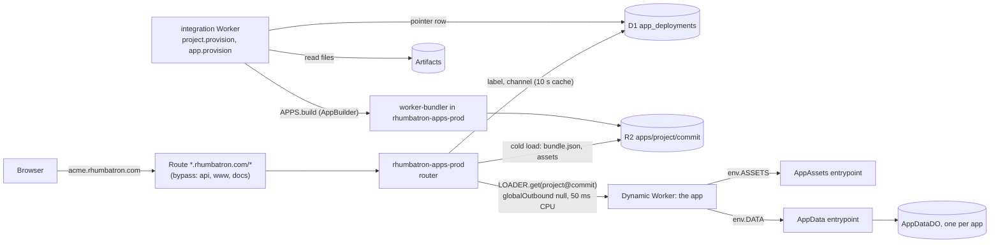

# ADR 0020: Live apps on Dynamic Workers

## Context
Every Project is a live application:

- Apps run at `<label>.rhumbatron.com`. Candidate previews run at `<preview-id>--<label>.rhumbatron.com`.
- Generated apps have no real login. When an instruction asks for accounts, agents build a fake
  identity (a demo user picker).
- User apps never need Terraform. Terraform creates only the one-time foundation.

Workers Builds per Project cannot work (Artifacts connections need a dashboard step, and one build
runs at a time; ADR 0018). Workers for Platforms adds a $25 base fee. Dynamic Workers are in the frozen
stack (AGENTS.md section 5.3) and included in Workers Paid: 1,000 unique Dynamic Workers created
per month, 10 M requests and 30 M CPU-ms shared with Workers.

## Decision

### Runtime
- One Worker, `rhumbatron-apps-prod` (`workers/apps`), serves every app. It has a Worker Loader
  binding (`LOADER`) and loads an app version with `LOADER.get("<project>@<commit>", ...)`. The
  callback reads the bundle from R2 only on a cold load. The ID is stable per commit, so one
  version counts as one Dynamic Worker per day.
- Host rules (`packages/protocol/src/app.ts`): one label under `rhumbatron.com`, at most 50
  characters, lowercase letters, digits, and single hyphens; `--` separates an 8-character
  preview id. Reserved labels: `www`, `api`, `clerk`, `accounts`, `clkmail`,
  `app`, `apps`, `admin`, `mail`, `status`, `docs`, `static`, `cdn`, and anything starting with
  `rhumbatron`. DKIM hosts contain a dot, so they can never be a label. Slugs are unique per
  organization only, so the label is the slug, else `<slug>-<6 chars of the Project ID>`.
- Pointer: D1 `app_deployments` (migration 0018), one row per Project and channel (`production`
  or `preview:<id>`), unique on (label, channel). The router caches rows in the isolate for 10 s.
  No KV, so no KV write quota. A row keeps serving its last good bundle while a new build runs or
  after it fails. Status `removed` answers 410 for the app and all its previews.
- Pages: plain HTML, no scripts, `noindex`: 404 (no app), 410 (removed), 503 with refresh
  (building, build failed with no earlier bundle, limit reached), 502 (app threw).

### Bundles
- Format: `apps/<project>/<commit>/bundle.json` (modules, compatibility settings, asset
  manifest) plus one R2 object per static asset under `.../assets/<path>`. Previews use
  `app-previews/`, which an R2 lifecycle rule expires after 7 days. `bundle.json` is written last.
  The commit is the content address: a stored bundle is reused, never rebuilt.
- Builder: `AppBuilder` entrypoint of the apps Worker, with `@cloudflare/worker-bundler` 0.2.6
  (esbuild-wasm). It runs in the Worker, not in the Sandbox, so builds use no container time
  (the Sandbox cap is 20 h per month in prod). npm dependencies come from the public
  registry at build time. The integration Worker reads the build inputs of one commit through
  its Artifacts binding (one read per file; it skips tests, benchmarks, lockfiles, and docs).
  It then calls `APPS.build(...)` over a service binding with `entrypoint = "AppBuilder"`.
- The canonical source in R2 is only a file index (`source/<project>/<tree>/index.json`), so
  file contents come from Artifacts.
- Limits: 400 files, 8 MB of source, 10 MB of modules, 500 assets of at most 5 MB each.
  Compatibility flags are limited to an allowlist (`nodejs_compat`, `nodejs_compat_v2`,
  `nodejs_als`, `global_fetch_strictly_public`).

### Static assets
The router serves a matching asset before it runs the app, as Workers static assets do
(`assets.directory` and `not_found_handling` from the app's `wrangler.jsonc`). Apps can also call
`env.ASSETS.fetch(request)`: `ASSETS` is the router's `AppAssets` entrypoint, passed through
`ctx.exports` with `props.bundleKey`, per the Dynamic Workers static assets guide. An app with
`run_worker_first: true` gets every request.

### Per-app storage
`env.DATA` is a small string key-value store: `get`, `put`, `delete`, `list({ prefix, limit })`.
It is the router's `AppData` entrypoint with `props.storeName`; each store is one SQLite-backed
`AppDataDO`. Production and each preview have separate stores, so a preview never writes
production data. Limits: keys up to 512 characters, values up to 128 KiB, 10,000 keys.

Durable Object facets are not used. A facet needs the app to export a Durable Object
class, and every app request then goes through one Durable Object. With the binding, apps stay
plain fetch Workers and only storage calls reach a Durable Object. The Acme template keeps its
in-memory store.

### Security
- `globalOutbound: null`: an app cannot reach the network.
- Limits per request: 50 ms CPU, 20 subrequests (binding calls included). A hit returns 503.
- The app env holds only `ASSETS` and `DATA`. No Rhumbatron binding, secret, or token.
- Cookies (`workers/apps/src/cookies.ts`):
  - Every app `Set-Cookie` is renamed to `rba_<name>` on the app's own host.
  - A `Set-Cookie` with any `Domain` attribute is dropped.
  - Requests carry only the `rba_` cookies, with the prefix removed. Cookies that other hosts set
    for the whole zone never reach app code. Access assertion headers are removed.
- Real auth check: a build fails when `package.json` or an import names a real auth SDK or a
  password-hashing library (Clerk, Auth.js, Better Auth, Lucia, Supabase auth, Firebase auth,
  Auth0, Passport, Okta, Amplify, WorkOS, Stytch, Kinde, Descope, bcrypt, argon2), or markup has a
  password field.
- Clerk cookies on rhumbatron.com, as the production clerk-js bundle served by
  `clerk.rhumbatron.com` sets them (the sign-in pages set no cookies on the server):
  - `__session` and `__session_<suffix>` are set with no `Domain`: host-only on rhumbatron.com.
    App hosts never receive them.
  - `__client_uat` is set on the registrable domain (`Domain=rhumbatron.com`), so browsers send it
    to app hosts. It is a timestamp, not a credential, and the router strips it.
  - `__client` lives on `clerk.rhumbatron.com` (HttpOnly, set by the Frontend API).

### Fake identity
Apps have no real login. The Acme template's `src/identity.ts` resolves the user from the
`x-user-id` header, then the `acme_user` cookie, else the demo user `alice`. An unknown name is
rejected (401). The template's tests cover both cases.

### Provisioning
- `project.provision` (integration Worker) runs `provisionApp` after the source is seeded, when
  the `APPS` binding exists. `app.provision` does the same on request:
  `POST /v1/projects/:projectId/app` ("Deploy app" on the Project overview), for a retry or a
  Project without an app.
- `GET /v1/projects/:projectId/app` returns `{ enabled, app }`. `enabled` is false without
  `APPS_DOMAIN`.
- Archiving a Project marks its app `removed` (410 at once). Its cleanup deletes the
  `AppDataDO` stores, the `apps/<project>/` and `app-previews/<project>/` prefixes, and the preview
  and version rows. The production row stays as a tombstone (status `removed`, no commit, no
  bundle), so the hosts keep answering 410, not 404.

### Previews, releases, versions, rollback
These are runtime data. No Terraform runs at release time.

- **Preview.** CandidateVerificationWorkflow builds the composed commit after the
  checks, when the build check passed, and writes the row `preview:<candidate-id 8>` with its
  Candidate and Change. A Change keeps at most 3 previews (the Candidate limit); when full, the
  oldest preview of a stale, rejected, or promoted Candidate makes room, and a preview of a
  Candidate that can still ship is never evicted. A failed preview build marks only the row.
  `GET /v1/candidates/:id/preview` feeds "Open preview" on the Candidate page.
- **Release.** For a Project with an app, promotion starts the release as before, and
  ReleaseWorkflow takes the app path: the bundle of the promoted commit (stored; another commit
  with the same tree; the preview bundle copied from `app-previews/`, which expires after 7 days;
  else a build), then the production pointer moves by compare-and-swap on the row it read, then
  the `release-model.ts` smoke probes run through the router (`AppBuilder.probe`, fresh pointer
  read, no public route needed). The probes are generic: `/` must answer 2xx or 3xx and not a
  router status page ("Nothing built yet", "Building"), plus up to 3 static GET routes (no path
  params) from the app's own route table in the released Candidate's contract Evidence, the
  routes the Change added first. Without a route table only `/` is probed. A Project on the
  Workers Builds path (ADR 0018) keeps its `/api/products` JSON probe. A late release never moves
  the pointer back to an older generation. Projects with an app do not use Workers Builds.
- **Smoke failure.** The pointer moves back to the version it replaced, as a new
  recorded transition (`deployment.completed` with status `restored`), and the release is
  `smoke_failed`. Canonical keeps the promoted generation (AGENTS.md section 42.10).
- **Versions.** Each deployed generation also gets a version row
  `preview:v<generation, 7 digits>` that points at its production bundle, for example
  `v0000003--acme.rhumbatron.com`. `v` is not a hex digit, so a version id never equals a
  Candidate preview id. A version host has its own data store and its own Dynamic Worker ID
  (`<project>@<commit>#<channel>`), so it never shares production's isolate or data.
- **Rollback.** `POST /v1/projects/:id/rollback` with `{ targetGeneration,
  expectedGeneration }` creates a rollback Change and Candidate whose one commit sits on Sn's
  commit with Sk's tree. Its required check reads that commit's tree from Artifacts and compares
  it with Sk's tree. The human gate follows policy for the riskiest Change it undoes. It then
  promotes by the normal compare-and-swap (Sn -> Sn+1) and releases with Sk's stored bundle.
  Nothing in the history is deleted. The tree's file index is pointed at the new commit, so new
  Candidates compose on it.
- **Stale recomposition.** A Candidate that goes stale because canonical advanced is
  composed again on the new canonical state (same ChangeSets, real merge, full checks), at most
  2 times per lineage, then it is marked blocked. Recompositions do not count against the
  Candidate limit. Triggers: verification finds the base behind, canonical moved during the
  checks, a refused compare-and-swap, or the sweep after each promotion.

### Removal, cost, and retention
- **Remove app.** `DELETE /v1/projects/:id/app` marks every row `removed` (410 on every
  host at once) and queues `app.remove`. Cleanup wipes the data stores (`AppBuilder.wipeData`),
  deletes both R2 prefixes and the preview and version rows, then reduces the production row to a
  tombstone (status `removed`, no commit, no bundle): the hosts keep answering 410. The Project
  and its history stay; "Deploy app" revives the tombstone and publishes again on the same label.
- **Cost.** At most 60 app builds per day (`usage_counters` `app-builds`), checked before
  each build. `bun run cost:report` shows the apps router requests and CPU, builds against the cap,
  ready bundles as an upper bound on Dynamic Workers per month, and bundle bytes in R2 (alert at
  80 %).
- **Retention.** Production bundles under `apps/` have no lifecycle rule: every promoted
  generation keeps its bundle, so a rollback never rebuilds. `app-previews/` expires after 7 days
  (R2 lifecycle, `envs/prod`); the daily sweep deletes preview rows and their data stores after
  the same 7 days. Version rows are never expired.

### Terraform (`envs/prod`)
- `terraform_data.apps_worker` runs `scripts/apps-deploy.ts`: one full script upload with the
  bindings from Terraform, including `{ "type": "worker_loader", "name": "LOADER" }` (the shape
  Wrangler 4.149 uploads; provider 5.27 has no such binding type), and the `AppDataDO` migration
  (`v1` first, then the live tag). It turns the workers.dev subdomain off if it is on. It reads
  before it writes and re-runs only when the bundle or config hash changes.
  `apps_worker_teardown` deletes the Worker on a real destroy only. A `cloudflare_worker_version`
  resource that supports the binding would replace both (AGENTS.md section 11.4).
- The integration Worker binds `APPS` (service, entrypoint `AppBuilder`).
- R2 lifecycle: `app-previews/` expires after 7 days.
- D1 migration `0018_app_deployments.sql` creates the pointer table.
- `local.apps.routing = true` in `envs/prod` creates the proxied wildcard record `*` (`AAAA 100::`),
  the route `*.rhumbatron.com/*` to the apps Worker, the bypass routes below, and `APPS_DOMAIN` on
  the API.

### Routing
Cloudflare's Workers routes docs say that a route can fetch Custom Domains and takes precedence on
the same hostname. So `*.rhumbatron.com/*` alone would capture `api`, `www`, and `docs`. The apex
does not match `*.`. The Clerk records are DNS-only, so no Worker route runs on them, and explicit
DNS records keep priority over the wildcard record.

A route without a Worker negates less specific patterns, and the most specific pattern wins. So
routing adds one route without a Worker per custom-domain host (`local.apps.bypass_hosts`: `api`,
`www`, and `docs`), created before the wildcard route. A request to those hosts bypasses route
Workers and reaches its custom-domain Worker. A new Worker custom domain in the zone needs a new
bypass host in `local.apps.bypass_hosts`. Setting `routing = false` and applying removes the wildcard.

## Cost
| Item | Use | Included (Workers Paid) |
|---|---|---|
| Dynamic Workers created | 1 per app version or preview loaded per day | 1,000 per month |
| Requests | 2 per app request (router and app), plus 1 per binding call | 10 M per month, shared |
| CPU | at most 50 ms per app request; a build is a few seconds | 30 M ms per month, shared |
| D1 | 1 read per host per isolate per 10 s; 2 to 3 writes per build | 5 M reads, 100 k writes per day |
| R2 | 1 write per asset plus 1 per bundle; 1 read per cold load and per asset | 1 M Class A, 10 M Class B per month |
| Artifacts | 1 read per source file per build (about 20 for Acme) | 10,000 operations per month, shared |
| Durable Objects | only when an app calls `DATA` | included |
| Sandbox | none | |
| App builds | 1 per preview, 1 per release without a stored or preview bundle | 60 per day (code cap) |

## Consequences
- Script that runs in an app's pages shares the registrable domain with rhumbatron.com. It cannot
  read the host-only `__session`, but it can write a cookie for `Domain=rhumbatron.com` with
  `document.cookie` (cookie tossing), which the router cannot see. Impact: a forced sign-out or a
  login as the attacker's own account on rhumbatron.com. A separate zone for apps removes this;
  a `Content-Security-Policy: sandbox` header would also block it but breaks same-origin storage.
- The router Worker carries the esbuild-wasm module (about 4 MB compressed of 10 MB). It is
  imported only by the builder, but it adds to the router's upload. If cold starts suffer, move
  the builder into its own Worker.
- `@cloudflare/worker-bundler` is experimental (0.x). It is pinned and only the builder imports
  its bundling API.
- Builds need the npm registry to be reachable from the Worker. A failed build leaves the last
  good version live.

## Diagram

