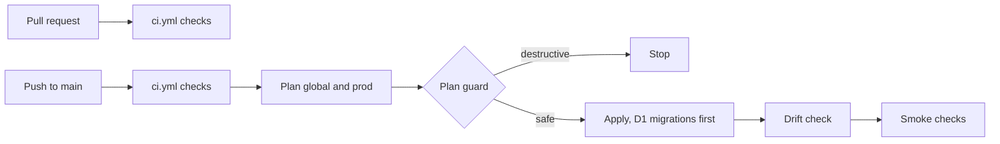

# ADR 0031: CI/CD with GitHub Actions and Terraform

## Status

Accepted.

## Context

Terraform is the only path for Cloudflare changes. Credentials must stay out of Git. The repository is public, so pull requests from forks must not reach the deploy secrets.

## Decision

Rhumbatron uses two GitHub Actions workflows.

- `ci.yml` runs on each pull request. It uses no secrets and no remote state. It runs lint, guardrails, binding drift, knip, sherif, the D1 migration guard, typecheck, critical tests, build, bundles, the Terraform checks (fmt, validate with `-backend=false`, tflint), and gitleaks.
- `production.yml` runs on each push to `main`. It calls `ci.yml`. Then the `deploy` job plans and applies Terraform for `envs/global` and `envs/prod`, plans again to find drift, and runs the smoke checks.

The deploy job uses the GitHub environment `production`. The environment holds the secrets, and its branch policy allows only `main`. A pull request cannot use the environment, so it cannot read the secrets.

Two guards protect production:

- `scripts/plan-guard.ts` reads each saved plan. It stops the deploy when the plan deletes a D1 database, an R2 bucket, a KV namespace, a Queue, a Workflow, a Worker, a Worker custom domain, a DNS record, the AI Gateway, a teardown adapter, or a Durable Object class. A manual run with `allow_destructive` applies such a plan.
- `scripts/check-migrations.ts` keeps D1 migrations append-only and numbered. It refuses `DROP TABLE`, `DROP COLUMN`, and `RENAME` without the line `-- destructive: reviewed`.

Only one deploy runs at a time (`concurrency: production`). A newer push waits for the running deploy.

Pull requests get no Terraform plan. A plan needs the production secrets, and the secrets stay on `main`.

## Consequences

- A merge to `main` is a production deploy.
- Terraform applies the D1 migrations before the new Worker versions. The old Workers keep serving during the apply, so each migration must work with the old code. Schema removals come in a later migration.
- A failed apply leaves the resources that it already changed. The next push continues from the current state.
- A failed smoke check leaves the new versions live. A fix or a revert goes out as a new push.
- The checks against prod that cost money or take long (`journeys`, `test:ui`, `lighthouse`) stay on a developer machine.

## Diagram

