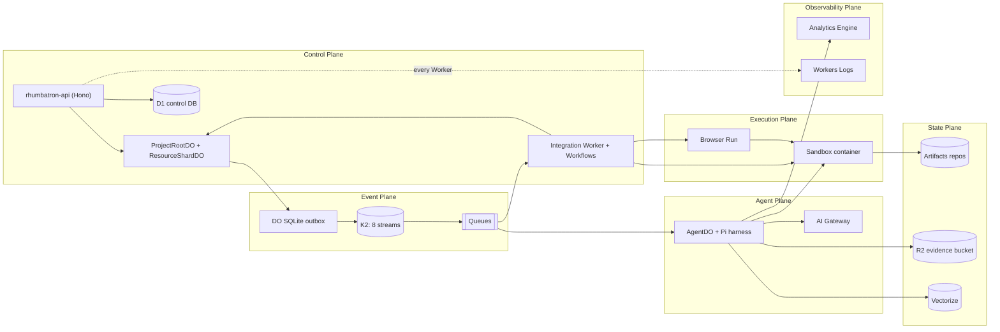
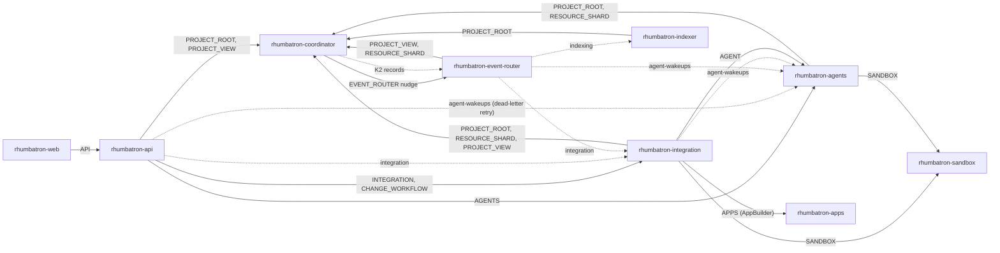
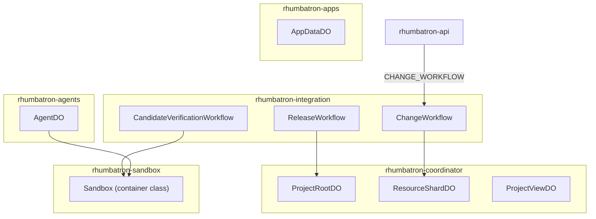
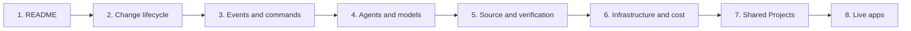

# Rhumbatron architecture guide

This guide describes the code on `main` with text, tables, and diagrams.
Each page records the differences from `AGENTS.md`.

## Product summary

1. A user submits a goal for one Project. The goal becomes a Change.
2. An intake gate checks the request. An unclear, duplicate, or conflicting request waits for its requester (ADR 0025).
3. A Root Planner model splits the goal into a Work Graph of small Tasks.
4. Agents run the ready Tasks in parallel. A Task that changes source works in its own Artifacts fork and Sandbox directory.
5. Each Agent publishes a ChangeSet and declares a typed Intent.
6. Deterministic code compares the Intents and finds semantic conflicts that Git cannot see.
7. Complementary Tasks integrate into one Candidate. Two conflicting designs become two Candidates.
8. A CandidateVerificationWorkflow runs executable checks on each Candidate.
   Only `checked_supported` Evidence with status `pass` satisfies a required check.
9. Sibling Candidates wait for each other. Then the system selects one winner (ADR 0026).
10. Policy or a person promotes the winner. ProjectRootDO advances the Canonical Generation with compare-and-swap.
11. For a Project with a live app, a ReleaseWorkflow moves the live app pointer and runs a smoke check (ADR 0020).

> Many Agents can propose many futures. Only verified evidence can advance the Canonical State.

## The six planes

The code follows the six planes of `AGENTS.md` section 8.
Arrows show the main direction of calls and data.

| Plane | What the code uses | Main source |
|---|---|---|
| Control | `rhumbatron-api`, ProjectRootDO, ResourceShardDO, D1, the integration Worker | `workers/api`, `workers/coordinator`, `workers/integration` |
| Event | DO SQLite outbox, K2 streams, Queues, Workflows | `workers/coordinator/src/outbox.ts`, `workers/event-router` |
| Agent | AgentDO, Pi harness, AI Gateway, Workers AI (Clef-flash; intake gate embeddings and reranker) | `workers/agents`, `packages/model-router`, `workers/integration/src/intake.ts` |
| Execution | Sandbox container, Browser Run, Dynamic Workers | `workers/sandbox`, `workers/integration/src/browser-check.ts`, `workers/apps` |
| State | Artifacts, R2, D1, DO SQLite, KV (`CONFIG`), Vectorize | `workers/integration`, `workers/indexer` |
| Observability | Analytics Engine (`METRICS`, `EVENT_METRICS`), Workers Logs, AI Gateway logs | `workers/agents`, `workers/indexer`, `workers/event-router` |

The browser check drives Browser Run from the integration Worker.
Browser Run reaches the composed app in the Sandbox only through request interception (`containerFetch`).

Differences from `AGENTS.md`:

- D1 `project_policies` is the source of truth for the Project policy. No API writes it.
  The KV namespace `rhumbatron-config-prod` (binding `CONFIG` on the integration Worker) holds a 5-minute snapshot (`workers/integration/src/policy.ts`).
  Readers use the policy as follows:

  | Reader | Policy source |
  |---|---|
  | Promotion, approval, human edit, rollback | Stored row through the KV snapshot. Without a row: `DEFAULT_POLICY`, which protects no resource. |
  | Verification plan, approval gate, auto-promotion decision, composition compatibility check | Stored row through the KV snapshot, read once per verification run. Without a row: `DEFAULT_POLICY`, which protects no resource. |
  | Conflict detection, conflict review, Product Graph | `protectedResources` of the stored row only. Without a row: nothing is protected. |

- No OpenTelemetry tracing is configured. The Durable Object Workers set `traces.enabled = false`.

## Deployables map

Rhumbatron has nine Workers. The docs site `rhumbatron-docs-prod` is a tenth, assets-only Worker at `docs.rhumbatron.com`.
Each Worker name is `rhumbatron-<component>-prod`.

The first diagram shows how the Workers call each other.
Solid arrows are service bindings, Workflow bindings, or cross-script Durable Object bindings.
Dotted arrows are Queue messages or K2 records.

The second diagram shows which Worker hosts each Durable Object class and each Workflow class.

| Worker | Hosts | Main bindings (Terraform names) | Triggers |
|---|---|---|---|
| `rhumbatron-web` | TanStack Start app and static assets | `API` (service) | Custom domains `rhumbatron.com` and `www.rhumbatron.com` |
| `rhumbatron-api` | Hono product API | `DB`, `EVIDENCE`, `PROJECT_ROOT`, `PROJECT_VIEW`, `AGENTS`, `INTEGRATION`, `INTEGRATION_COMMANDS`, `AGENT_WAKEUPS`, `CHANGE_WORKFLOW` | Custom domain `api.rhumbatron.com` |
| `rhumbatron-coordinator` | ProjectRootDO, ResourceShardDO, ProjectViewDO | Own DO classes, `EVENT_ROUTER` (service), K2 producers `EVENTS_00` to `EVENTS_07` | Durable Object calls and alarms |
| `rhumbatron-event-router` | K2 pull consumer, causal router, dead-letter consumer | `DB`, `EVIDENCE`, `PROJECT_VIEW`, `RESOURCE_SHARD`, `AGENT_WAKEUPS`, `INTEGRATION_COMMANDS`, `INDEXING`, `AI`, `EVENT_METRICS`, `K2_STREAM_IDS`, `K2_CONSUMER_TOKEN` | Cron `* * * * *`, `nudge` RPC, `rhumbatron-dead-letter-prod` Queue |
| `rhumbatron-integration` | ChangeWorkflow, CandidateVerificationWorkflow, ReleaseWorkflow, approval and promotion RPC | `DB`, `EVIDENCE`, `CONFIG`, `AGENT_WAKEUPS`, `VERIFICATION_COMMANDS`, `RELEASE_COMMANDS`, `RESOURCE_SHARD`, `PROJECT_ROOT`, `PROJECT_VIEW`, `AGENT`, `SANDBOX`, `CHANGE_WORKFLOW`, `CANDIDATE_WORKFLOW`, `RELEASE_WORKFLOW`, `ARTIFACTS`, `BROWSER`, `APPS`, `AI`, AI Gateway variables | `rhumbatron-integration-prod`, `rhumbatron-verification-prod`, and `rhumbatron-release-prod` Queues, RPC |
| `rhumbatron-agents` | AgentDO (Agents SDK `Agent` with Pi harness) | `DB`, `AGENT`, `SANDBOX`, `PROJECT_ROOT`, `RESOURCE_SHARD`, `ARTIFACTS`, `EVIDENCE`, `METRICS`, `AI`, `MEMORY`, AI Gateway variables | `rhumbatron-agent-wakeups-prod` Queue, `sandboxSmoke` and `goalSuggestions` RPC |
| `rhumbatron-indexer` | Symbol, dependency, Product Graph, and vector indexes | `DB`, `EVIDENCE`, `PROJECT_ROOT`, `ARTIFACTS`, `MEMORY`, `AI`, `METRICS` | `rhumbatron-indexing-prod` Queue only |
| `rhumbatron-sandbox` | `Sandbox` container class from `@cloudflare/sandbox` | Image `docker.io/cloudflare/sandbox:0.12.6`, instance type `basic`, `max_instances` 1 | Cross-script DO binding only |
| `rhumbatron-apps` | Live apps of Projects on Dynamic Workers, `AppDataDO`, `AppBuilder` RPC (ADR 0020) | `LOADER` (Worker Loader), `DB`, `EVIDENCE`, `APP_DATA` (DO) | Route `*.rhumbatron.com/*`, `APPS` service binding |

Notes:

- `AGENTS.md` section 12 lists seven deployables. The code adds `rhumbatron-sandbox` (ADR 0012) and `rhumbatron-apps` (ADR 0020).
  The provider cannot attach a container to a DO class in another Worker, so the Sandbox class has its own Worker.
- Terraform sources: `infrastructure/terraform/envs/prod/main.tf` and `docs.tf`.

## Reading order

Each page uses concepts from the pages before it.

1. [Change lifecycle](change-lifecycle.md): one goal from the browser to a release, and the status state machines.
2. [Events and commands](events-and-commands.md): the outbox, K2, the event router, Queues, and idempotency.
3. [Agents and models](agents-and-models.md): AgentDO, the Pi loop, model routing, providers, and the Context Packet.
4. [Source and verification](source-and-verification.md): Artifacts repos and forks, the Sandbox, checks, coverage, selection, and promotion.
5. [Infrastructure and cost](infrastructure-and-cost.md): Terraform roots, adapters, state, cost guards, and the pause switch.
6. [Shared Projects and simultaneous requests](shared-projects.md): membership, roles, the intake gate, and how the system decides between open requests.
7. [Live apps](live-apps.md): app hosts, the apps Worker, previews, the production pointer, rollback, and removal.

Related documents:

- [Tech stack](tech-stack.md): each technology in use, its function, and its differences from `AGENTS.md`.
- `AGENTS.md`: the authoritative build plan.
- `docs/adr/`: one record per architecture decision. This guide cites ADRs by number.
- `docs/BUILD_STATUS.md`: current phase, blockers, and caps.
