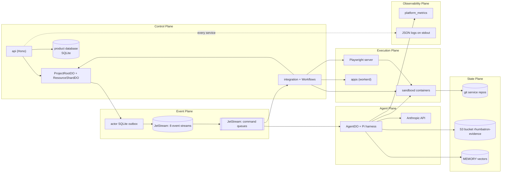
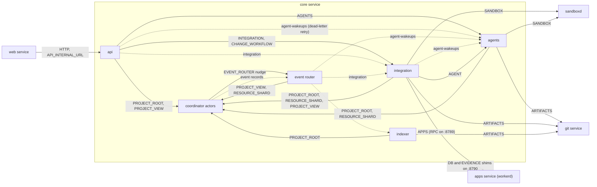
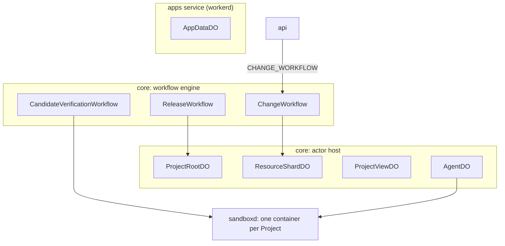
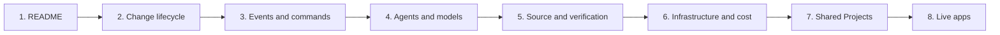

# Rhumbatron architecture guide

This guide describes the code on `main` with text, tables, and diagrams.

## Product summary

1. A user submits a goal for one Project. The goal becomes a Change.
2. An intake gate checks the request. An unclear, duplicate, or conflicting request waits for its requester (ADR 0025).
3. A Root Planner model splits the goal into a Work Graph of small Tasks.
4. Agents run the ready Tasks in parallel. A Task that changes source works in its own Git fork and Sandbox directory.
5. Each Agent publishes a ChangeSet and declares a typed Intent.
6. Deterministic code compares the Intents and finds semantic conflicts that Git cannot see.
7. Complementary Tasks integrate into one Candidate. Two conflicting designs become two Candidates.
8. A CandidateVerificationWorkflow runs executable checks on each Candidate.
   Only `checked_supported` Evidence with status `pass` satisfies a required check.
9. Sibling Candidates wait for each other. Then the system selects one winner (ADR 0026).
10. Policy or a person promotes the winner. ProjectRootDO advances the Canonical Generation with compare-and-swap.
11. For a Project with a live app, a ReleaseWorkflow moves the live app pointer and runs a smoke check (ADR 0020).

> Many Agents can propose many futures. Only verified evidence can advance the Canonical State.

## The six planes

The code has six planes.
Arrows show the main direction of calls and data.

| Plane | What the code uses | Main source |
|---|---|---|
| Control | The API, ProjectRootDO, ResourceShardDO, the product database, the integration module | `workers/api`, `workers/coordinator`, `workers/integration` |
| Event | Actor SQLite outbox, JetStream event streams and command queues, the workflow engine | `workers/coordinator/src/outbox.ts`, `workers/event-router`, `packages/platform/src/messaging`, `packages/platform/src/workflows` |
| Agent | AgentDO, Pi harness, the Anthropic API, Clef-flash on Claude Haiku, the `embed` and `rerank` servers (intake gate) | `workers/agents`, `packages/model-router`, `workers/integration/src/intake.ts`, `packages/platform/src/ai/models.ts` |
| Execution | sandboxd containers, the Playwright server, the apps service on `workerd` | `services/sandboxd`, `workers/integration/src/browser-check.ts`, `services/apps`, `workers/apps` |
| State | The git service, the S3 bucket, the product database, actor SQLite, `CONFIG`, `MEMORY` | `services/git`, `packages/platform/src/sql`, `packages/platform/src/objects`, `workers/integration`, `workers/indexer` |
| Observability | `METRICS` and `EVENT_METRICS` rows, JSON logs | `packages/platform/src/sql/metrics.ts`, `packages/platform/src/log.ts` |

The integration module drives the Playwright server for the browser check.
The browser reaches the composed app in the Sandbox only through request interception (`containerFetch`).

Policy and tracing:

- The `project_policies` table is the source of truth for the Project policy. No API writes it.
  `CONFIG` holds a 5-minute snapshot (`workers/integration/src/policy.ts`).
  Each reader gets the policy from one source:

  | Reader | Policy source |
  |---|---|
  | Promotion, approval, human edit, rollback | Stored row through the `CONFIG` snapshot. Without a row: `DEFAULT_POLICY`, which protects no resource. |
  | Verification plan, approval gate, auto-promotion decision, composition compatibility check | Stored row through the `CONFIG` snapshot, read once per verification run. Without a row: `DEFAULT_POLICY`, which protects no resource. |
  | Conflict detection, conflict review, Product Graph | `protectedResources` of the stored row only. Without a row: nothing is protected. |

- Rhumbatron configures no tracing.

## Services map

Rhumbatron runs as one Docker Compose stack (ADR 0034).
[Infrastructure and cost](infrastructure-and-cost.md) lists every service, network, and volume.
The application code is in `workers/*`. The `core` service loads six of these modules into one Bun process. The `apps` service runs `workers/apps` on `workerd`.

The first diagram shows how the modules and services call each other.
Solid arrows are in-process calls, actor stubs, Workflow bindings, or HTTP calls between services.
Dotted arrows are queue messages or event stream records.

The second diagram shows where each actor class and each Workflow class runs.

| Module | Runs in | Hosts | Triggers |
|---|---|---|---|
| `apps/web` | `web` service | TanStack Start app and static assets | `https://rhumbatron.localhost` |
| `workers/api` | `core` | Hono product API and the live socket route | `https://api.rhumbatron.localhost`, and `/live/*` on the web host |
| `workers/coordinator` | `core` | ProjectRootDO, ResourceShardDO, ProjectViewDO | Actor calls and alarms |
| `workers/event-router` | `core` | Event log consumer, causal router, dead-letter consumer, housekeeping sweep | The sweep at the start of each minute, the `nudge` call, the `dead-letter` queue |
| `workers/integration` | `core` | ChangeWorkflow, CandidateVerificationWorkflow, ReleaseWorkflow, approval and promotion calls | The `integration`, `verification`, and `release` queues, in-process calls |
| `workers/agents` | `core` | AgentDO (Agents SDK `Agent` with the Pi harness) | The `agent-wakeups` queue, `sandboxSmoke` and `goalSuggestions` calls |
| `workers/indexer` | `core` | Symbol, dependency, Product Graph, and vector indexes | The `indexing` queue only |
| `workers/apps` | `apps` service | Live apps of Projects through the Worker Loader, `AppDataDO`, the app builder and checker (ADR 0020) | `https://<slug>.rhumbatron.localhost`, RPC from core |

Notes:

- Every module in core gets the same environment, built in `services/core/src/main.ts`. [Infrastructure and cost](infrastructure-and-cost.md#bindings-in-core) lists the bindings.
- The apps service reaches the product database and the bucket only through the internal shims of core (`services/apps/CONTRACT.md`). Loaded apps have no network.
- The docs site is static files in the `edge` service at `https://docs.rhumbatron.localhost`.

## Reading order

Each page uses concepts from the pages before it.

1. [Change lifecycle](change-lifecycle.md): one goal from the browser to a release, and the status state machines.
2. [Events and commands](events-and-commands.md): the outbox, the event log, the event router, the queues, and idempotency.
3. [Agents and models](agents-and-models.md): AgentDO, the Pi loop, model routing, providers, and the Context Packet.
4. [Source and verification](source-and-verification.md): Git repositories and forks, the Sandbox, checks, coverage, selection, and promotion.
5. [Infrastructure and cost](infrastructure-and-cost.md): the Compose services, networks, and volumes, what costs money, and the guards.
6. [Shared Projects and simultaneous requests](shared-projects.md): membership, roles, the intake gate, and how the system decides between open requests.
7. [Live apps](live-apps.md): app hosts, the apps service, previews, the production pointer, rollback, and removal.

Related documents:

- [Tech stack](tech-stack.md): each technology in use and its function.
- `docs/adr/`: one record per architecture decision. This guide cites ADRs by number.
- `docs/BUILD_STATUS.md`: current phase, blockers, and caps.
- [Local stack](../operations/local-stack.md): start, stop, and inspect the stack.
