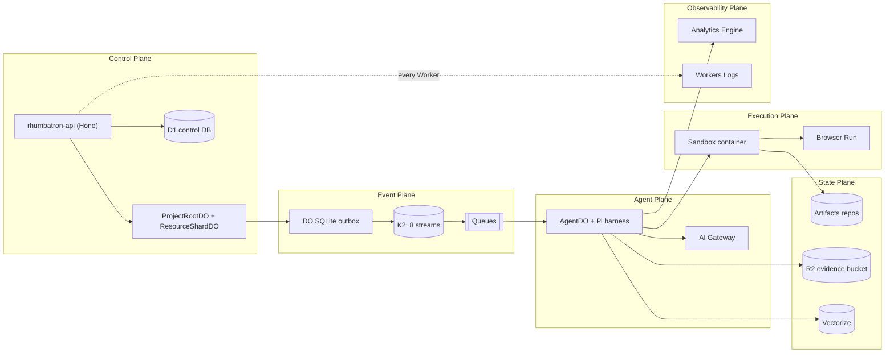
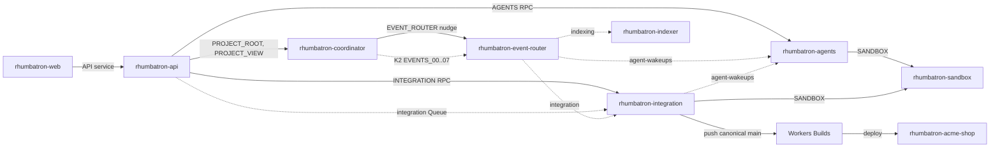
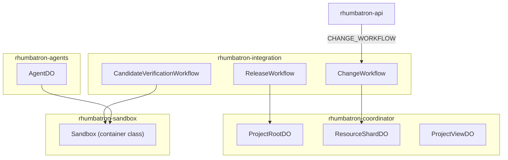
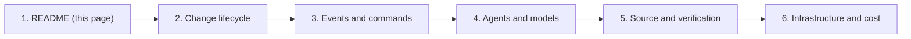

# Rhumbatron architecture guide

This guide uses diagrams to explain how Rhumbatron works.
Each diagram matches the code at the time of writing.
When the code and `AGENTS.md` differ, this guide describes the code and records the difference.

## Product summary

Rhumbatron accepts a product goal for one Project.
A Root Planner model splits the goal into a Work Graph of small Tasks.
Agents run the ready Tasks in parallel, each in its own Artifacts fork and Sandbox directory.
Each Agent publishes a ChangeSet and a typed Intent.
Deterministic code compares the Intents and finds semantic conflicts that Git cannot see.
When two designs conflict, Rhumbatron composes two Candidate futures.
A Verification Workflow runs executable checks on each Candidate.
Only `checked_supported` Evidence with status `pass` can satisfy a required check.
A human approves a gated Candidate.
ProjectRootDO then advances the Canonical Generation with compare-and-swap.
Workers Builds builds the promoted source.
A Release Workflow observes the deployment.

> Many Agents can propose many futures. Only verified evidence can advance the Canonical State.

## The six planes

The code follows the six planes of `AGENTS.md` section 8.
Arrows show the main direction of calls and data.

| Plane | What the code uses | Main source |
|---|---|---|
| Control | `rhumbatron-api`, ProjectRootDO, ResourceShardDO, D1 | `workers/api`, `workers/coordinator` |
| Event | DO SQLite outbox, K2 streams, Queues, Workflows | `workers/coordinator/src/outbox.ts`, `workers/event-router` |
| Agent | AgentDO, Pi harness, AI Gateway, Workers AI (Clef-flash) | `workers/agents`, `packages/model-router` |
| Execution | Sandbox container, Browser Run | `workers/sandbox`, `workers/integration/src/candidate-sandbox.ts` |
| State | Artifacts, R2, D1, DO SQLite, KV (`CONFIG`), Vectorize | `workers/integration`, `workers/indexer` |
| Observability | Analytics Engine (`METRICS`, `EVENT_METRICS`), Workers Logs, AI Gateway logs | `workers/agents`, `workers/indexer`, `workers/event-router` |

Differences from `AGENTS.md`:

- The KV namespace `rhumbatron-config-<env>` (binding `CONFIG` on the integration Worker) holds only a 5-minute snapshot of the Project policy. D1 `project_policies` is the source of truth. No API writes it yet, so a Project without a row uses the default policy. Only promotion and approval read the policy. Candidate verification still plans with the default policy.
- No OpenTelemetry tracing is configured. Durable Object Workers set `traces.enabled = false`.

## Deployables map

There are eight Rhumbatron Workers plus one release target Worker for the Acme Shop demo.
Each Worker is named `rhumbatron-<component>-<env>`, where `<env>` is `dev` or `prod`.

The first diagram shows how the Workers call each other.
Solid arrows are service bindings or cross-script Durable Object bindings.
Dotted arrows are Queue messages or K2 records.

The second diagram shows which Worker hosts each Durable Object class and each Workflow class.

| Worker | Hosts | Main bindings (Terraform names) | Triggers |
|---|---|---|---|
| `rhumbatron-web` | TanStack Start app and static assets | `API` (service) | Custom domain: `dev.rhumbatron.com`, or `rhumbatron.com` and `www` in prod |
| `rhumbatron-api` | Hono product API | `DB`, `EVIDENCE`, `PROJECT_ROOT`, `PROJECT_VIEW`, `AGENTS`, `INTEGRATION`, `INTEGRATION_COMMANDS`, `AGENT_WAKEUPS`, `CHANGE_WORKFLOW` | Custom domain: `api-dev.rhumbatron.com` or `api.rhumbatron.com` |
| `rhumbatron-coordinator` | ProjectRootDO, ResourceShardDO, ProjectViewDO | Own DO classes, `EVENT_ROUTER` (service), K2 producers `EVENTS_00` to `EVENTS_07` | DO alarms only |
| `rhumbatron-event-router` | K2 pull consumer, causal router, dead-letter consumer | `DB`, `EVIDENCE`, `PROJECT_VIEW`, `RESOURCE_SHARD`, `AGENT_WAKEUPS`, `INTEGRATION_COMMANDS`, `INDEXING`, `AI`, `K2_STREAM_IDS`, `K2_CONSUMER_TOKEN` | Cron `* * * * *`, `nudge` RPC, `rhumbatron-dead-letter` Queue |
| `rhumbatron-integration` | ChangeWorkflow, CandidateVerificationWorkflow, ReleaseWorkflow, approval and promotion RPC | `DB`, `EVIDENCE`, `AGENT_WAKEUPS`, `RESOURCE_SHARD`, `PROJECT_ROOT`, `SANDBOX`, `CANDIDATE_WORKFLOW`, `RELEASE_WORKFLOW`, `ARTIFACTS`, `BROWSER`, AI Gateway variables, `BUILDS_API_TOKEN` | `rhumbatron-integration` Queue, RPC |
| `rhumbatron-agents` | AgentDO (Agents SDK `Agent` with Pi harness) | `DB`, `AGENT`, `SANDBOX`, `PROJECT_ROOT`, `RESOURCE_SHARD`, `ARTIFACTS`, `EVIDENCE`, `METRICS`, `AI`, `MEMORY`, AI Gateway variables | `rhumbatron-agent-wakeups` Queue, `sandboxSmoke` RPC |
| `rhumbatron-indexer` | Symbol, dependency, Product Graph, and vector indexes | `DB`, `EVIDENCE`, `PROJECT_ROOT`, `ARTIFACTS`, `MEMORY`, `AI`, `METRICS` | `rhumbatron-indexing` Queue only |
| `rhumbatron-sandbox` | `Sandbox` container class from `@cloudflare/sandbox` | Image `docker.io/cloudflare/sandbox:0.12.6`, instance type `basic`, `max_instances` 1 | Cross-script DO binding only |
| `rhumbatron-acme-shop` | Release target for the Acme Shop demo | None in Terraform. Workers Builds owns its versions | `workers.dev` URL |

Notes:

- `AGENTS.md` section 12 lists seven deployables. The code adds `rhumbatron-sandbox` because the provider cannot attach a container to a DO class in another Worker (ADR 0012).
- The release Worker is in Terraform (`cloudflare_worker.acme_shop`). Its Workers Builds connection is a one-time dashboard step (ADR 0014). The live release is blocked until that connection has a build trigger (`docs/BUILD_STATUS.md`).

## Reading order

Read the pages in this order.
Each page uses concepts from the pages before it.

1. [Change lifecycle](change-lifecycle.md): one goal from the browser to a release, plus the status state machines.
2. [Events and commands](events-and-commands.md): the outbox, K2, the event router, Queues, and idempotency.
3. [Agents and models](agents-and-models.md): AgentDO, the Pi loop, model routing, providers, and the Context Packet.
4. [Source and verification](source-and-verification.md): Artifacts repos and forks, the Sandbox, checks, coverage, and promotion.
5. [Infrastructure and cost](infrastructure-and-cost.md): Terraform roots, adapters, state, cost guards, and the pause switch.

Related documents:

- `AGENTS.md`: the authoritative build plan.
- `docs/adr/`: one record per architecture decision. This guide cites ADRs by number.
- `docs/BUILD_STATUS.md`: current phase, blockers, and caps.
