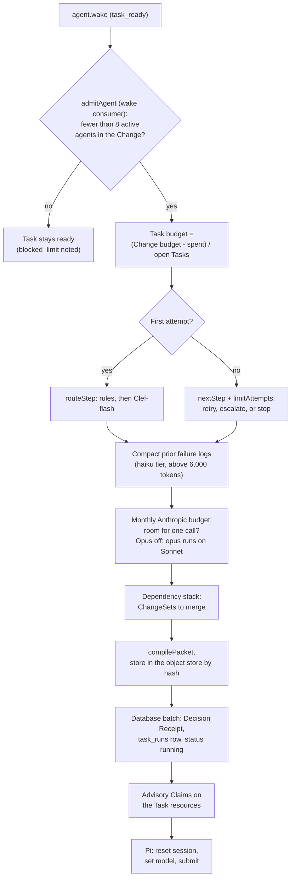
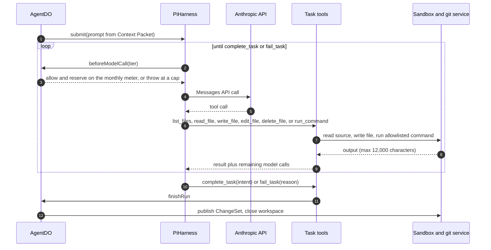
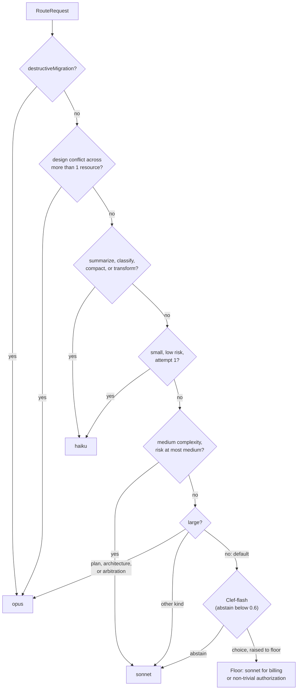
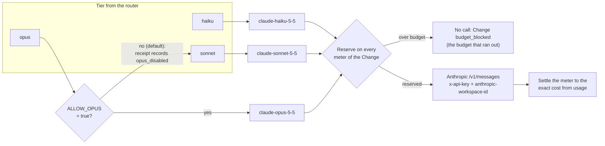
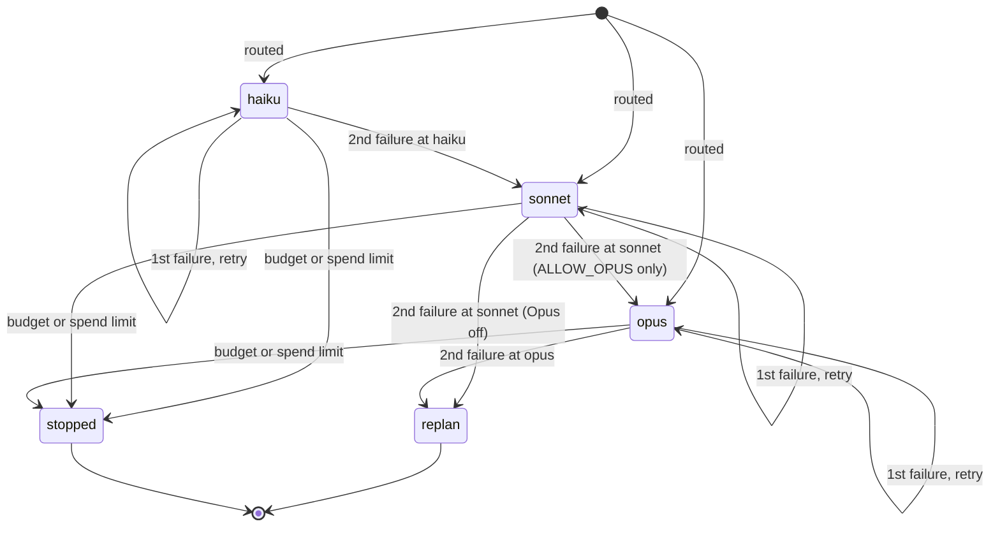
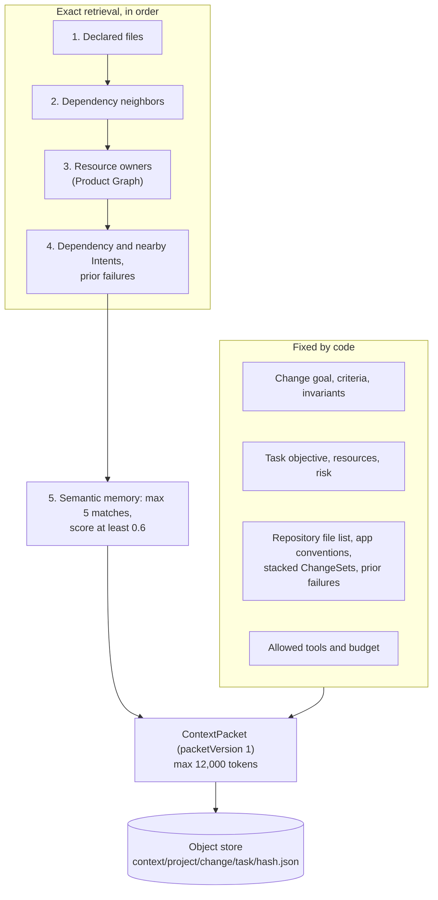
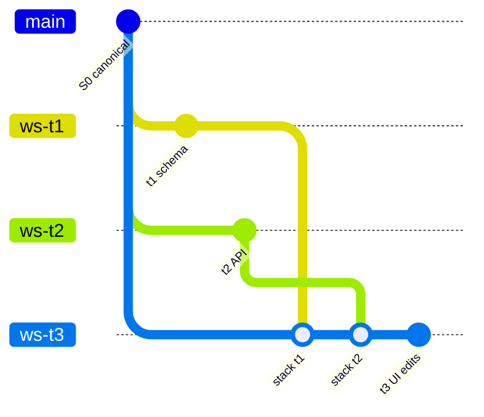

# Agents and models

This page covers the Agent Plane: AgentDO, the Pi harness loop, model routing, the model provider, escalation, the Context Packet, and stacked workspaces.

Main source files:

- `workers/agents/src/agent-do.ts`: AgentDO, run start, run end, budgets.
- `workers/agents/src/wake-consumer.ts`: the `agent-wakeups` queue consumer.
- `workers/agents/src/limits.ts`: Change limits and budget-stop text.
- `workers/agents/src/workspace.ts`: the Task workspace and the command allowlist.
- `packages/model-router/src`: routing rules, Clef-flash routing, escalation, budgets, prices, the spend meter, and the Anthropic client (`gateway-client.ts`).
- `packages/context-compiler/src`: Context Packet assembly and retrieval order.

## AgentDO

AgentDO is one durable logical Agent. The actor host in `packages/platform` runs it (ADR 0034).
It extends the Agents SDK `Agent` class and implements the `AgentRuntime` interface (`start`, `resume`, `cancel`, `getState`).
`resume` records the event and starts no work.
Pi types stay inside `agent-do.ts`, `models.ts`, and `task-tools.ts` in `workers/agents/src`.
Each Task has one Agent. The Agent ID is `agt_<task>`.

AgentDO keeps its run state in its own actor SQLite file (`agent_runs`, `run_tool_logs`, `run_meter`, `run_workspaces`).
The product database holds the shared view (`tasks`, `task_runs`, `decision_receipts`).
AgentDO sleeps when no run is active.
While a run is active, an interval schedule checks it every 60 seconds.
After 15 checks, AgentDO ends the run as `timeout`.
A check that finds the Task `cancelled` stops the run.

### Run start pipeline

`start()` runs deterministic steps before the first model call.
A refusal fails or blocks the Task and names the exact reason.

Notes:

- `spent` is the cost of the Task runs of the Change plus its conflict reviews.
- A Change with spend and no budget left stops the Task with limit `change_budget`.
- A run starts only when every meter of the Change has room for its first call (`refusedMeter`).
- When a meter is full, the Task stops with the limit of that meter.
- Claims are advisory (ADR 0015). A Claim that another Agent holds does not block the run.
- The shard then records `claim.contended`, and conflict detection uses that signal.
- A Claim lease lasts 120 seconds. The one-minute run check and each model call renew a lease at half-life.
- Every run end releases the Claims of the run.

### Pi harness loop

Pi runs the model and tool loop.
AgentDO gates every model request and records every failed response.

The Task tools are `list_files`, `read_file`, `write_file`, `edit_file`, `delete_file`, `run_command`, `complete_task`, and `fail_task`.
`read_file` returns at most 40,000 characters from the start of a file, cut at a line boundary (`fileWindow` in `task-tools.ts`).
A longer file ends with a note that names the next line. `fromLine` reads on from that line.
`edit_file` changes a file with exact text edits (`applyEdits`). Each `oldText` must occur exactly once, in order.
When one edit does not match, `edit_file` writes nothing, and the result names the edit.
The agents change files with `edit_file`, so a model response stays small as the app grows.
Only Task kinds `implement`, `migrate`, and `test` get a workspace.
For other kinds, `write_file`, `edit_file`, `delete_file`, and `run_command` return "This Task has no workspace".
The first workspace tool call forks the canonical repository and opens a Sandbox checkout.
A Project without source gets only `complete_task` and `fail_task`.

Caps inside one run:

| Cap | Value | Source |
|---|---|---|
| Model calls per run | haiku 16, sonnet 32, opus 32 | `MAX_CALLS_PER_RUN` in `packages/model-router/src/budget.ts` |
| Run spend | At most the Task budget | `checkRunBudget` in `budget.ts` |
| File reads per run | 12 reads, 40,000 characters each (`fromLine` reads on) | `agent-do.ts`, `task-tools.ts` |
| Command output | 12,000 characters, 180 s timeout | `workspace.ts` |
| Open Sandboxes per Change | 4 | `CHANGE_LIMITS` in `limits.ts` |
| Pi retries | 1 retry for a transient error, 2 s base delay | `agent-do.ts` |

A run that reaches its call cap or its spend cap ends as `run_call_cap`.
This end counts as a failure at the tier (see [Escalation](#escalation)).

Commands must match the allowlist (`commandAllowed` in `workspace.ts`): `bun install`, `bun install --frozen-lockfile`, `bun test [paths]`, `bun run typecheck|test|bench|contract|build`, `bun run <name>` when `<name>` is a script in the workspace `package.json`, `bunx tsc --noEmit`, `git status|diff|log`, and `ls`.
The command tool refuses shell metacharacters and a script name that starts with `-`.
A script runs in the same Sandbox, with the same network policy, as `bun test`.
With `bun run build`, an agent checks that its UI builds.
The workspace then discards the files that the build wrote, so the ChangeSet holds no build output.
Candidate composition builds the app again (see [Live apps](live-apps.md#client-assets-built-by-the-app)).

## Model routing

The code uses three tier names: `haiku`, `sonnet`, and `opus`.
Every tier calls Anthropic Claude directly through the Messages API at `ANTHROPIC_BASE_URL` (default `https://api.anthropic.com`, ADR 0021).
Opus is off by default. The `opus` tier runs on Sonnet unless `ALLOW_OPUS` is `"true"`.
Compose sets `ALLOW_OPUS` from `.env` (default `false`).

### Deterministic rules, then Clef-flash

`routeByRules` picks a base tier and applies floors.
Clef-flash runs only on a first attempt, and only when the rules end at `default`.
Clef-flash calls count against the shared `clef-flash` counter of 200 calls per UTC day.
A Clef-flash answer never goes below the floor.

The floor also applies on the rule path.
Billing and non-trivial authorization raise the tier to at least `sonnet`.
A small, low-risk Task is trivial.
Every route writes a Decision Receipt (`decision_receipts` in the product database) and a `model.route.decided` Event.
A receipt holds no private reasoning.

### Tiers and the provider

| Tier | Model | Thinking | Pi output cap |
|---|---|---|---|
| haiku | `claude-haiku-5-5` | Off in `complete()`. Adaptive, low effort in Pi. | 8,000 tokens: one `write_file` call holds a whole page file |
| sonnet | `claude-sonnet-5-5` | Adaptive, medium effort, text omitted | 16,000 tokens: a 40,000-character file fits one `write_file` call |
| opus | `claude-sonnet-5-5` while Opus is off. `claude-opus-5-5` when `ALLOW_OPUS` is `"true"`. | Adaptive, high effort, text omitted | 16,000 tokens |

Two call paths use the same base URL, headers, prices, and meter:

- Pi agent runs (`workers/agents/src/models.ts`) use the Anthropic Messages API client of Pi.
- Pi puts `cache_control` on the system prompt, the tool definitions, and the latest message. Pi prices each response from its usage fields.
- `complete()` (`packages/model-router/src/gateway-client.ts`) serves the Root Planner, the intake gate, the request review, conflict review, context compaction, the acceptance check, and the Integration Judge.
- Each caller goes through `meteredComplete()`. `complete()` caches the system prompt.
- On a follow-up call, `complete()` sends a whole assistant turn again, with its thinking blocks. The caller sets the output cap.

The intake gate and the request comparison use their own fixed models and fixed rules. See [Shared Projects](shared-projects.md).

### Spend limits

Rhumbatron computes the exact cost of each call.
The cost includes uncached input, output with thinking, cache reads, and cache writes at Anthropic list prices (`ANTHROPIC_PRICES` in `packages/model-router/src/models.ts`).

| Limit | Value | Where |
|---|---|---|
| Monthly Anthropic budget | `ANTHROPIC_MONTHLY_BUDGET_USD`: default $100 in Compose (code fallback $10 when the value is absent) | `usage_counters`, counter `anthropic-usd-micro`, one row per `YYYY-MM` |
| Model calls per UTC day | 1,000 for agent runs, conflict review, and compaction (`AGENT_DAILY_CALL_CAP`) | `usage_counters`, counter `agent-model-calls` |
| Clef-flash calls per UTC day | 200, shared by routing, intake, and the causal router | `usage_counters`, counter `clef-flash` |
| Request, Project, and user budgets | `changes.budget_usd`, `projects.monthly_budget_usd`, `users.monthly_budget_usd` (ADR 0030) | `usage_counters`, counters `change-usd-micro:<id>`, `project-usd-micro:<id>`, `user-usd-micro:<id>` |

Before each call that a Change pays for, Rhumbatron reserves an estimate on every meter of the Change.
One database batch writes all the reservations or none of them.
After the call, each meter settles to its exact cost (`reserveMeters`, `settleMeters` in `packages/model-router/src/budget-meters.ts`).
See [Costs runbook, Budget scopes](../operations/costs.md#budget-scopes).
A refused reservation, a 429 or 402 that is not a rate limit, and an Anthropic billing error are `spend_limited` events.
`spend_limited` is a budget stop. It never retries and never tries another provider.

## Escalation

`nextAttempt` (`workers/agents/src/limits.ts`) decides what happens after a failed run.
It applies `nextStep` and then `limitAttempts` to the whole failure history of the Task in `task_runs`.
Transport failures never escalate.
Two intelligence failures at one tier move the Task up one tier.

Rules:

- A failed run reads every failure of the Task in the current attempt window, its own included.
- A retry or escalation schedules the next attempt 5 seconds later. An escalation emits `agent.escalated` with `from`, `to`, and `reason`.
- The next `start()` reads the same rows, applies the same rules, and routes to the same tier.
- When a person raises a budget after a stop, a fresh attempt window opens (`tasks.attempts_reset_at`, `restoreAfterBudgetRaise`).
- The fresh window applies after a repeated-failure stop, and after a request, Project, or user budget stop.
- A run that goes over its share of the request budget ends as `run_cost_cap`. A run whose call a budget refused ends with the name of that budget.
- The fresh window keeps these failed runs from stopping the Task again before its next run.
- When the attempt limit stops a Task and its latest failure is `run_cost_cap`, the stop is a request budget stop (`change_budget`).
- A transport failure (`rate_limited`, `timeout`, `transient`) retries one time at the same tier. A second transport failure in a row fails the Task.
- When the latest failure is a transport failure and the tier has no attempts left, the Task stops without escalation.
- The daily call cap and the monthly, Project, user, and request budgets stop the Task at once. The Task becomes `blocked`, and the Change becomes `budget_blocked` with the exact limit.
- `replan` is a budget stop with limit `max_attempts_per_tier`. A person decides the next step. The Task becomes `blocked`, and the Change becomes `budget_blocked`.
- `limitAttempts` allows at most 2 attempts per tier. It counts every earlier run at that tier.
- A promotion advances the generation, then writes the file index of the promoted tree.
- A Task that starts between these two steps waits up to 12 seconds for the index (6 waits of 2 s).
- When the index is still missing, the start fails, and the wake queue delivers the wake again. The Task never reads "no source repository" for a Project with source.
- Conflicting dependency ChangeSets fail the Task at once (`dependency_merge_conflict`).
- The integration code then runs the dependency that did not merge again, on top of the others. See [Change lifecycle](change-lifecycle.md#part-3-from-candidates-to-a-release).
- When a Task fails or stops, its pending dependents become `blocked`.
- The Decision Receipt of the next run records an escalation (reason `two_failures_at_<tier>` or `max_attempts_at_<tier>`).
- Every attempt gets a fresh Pi session.

## Context Packet assembly

The Context Compiler is deterministic and does no I/O.
`workers/agents/src/retrieval.ts` loads the inputs.
`compilePacket` orders, trims, and renders them.
The model never chooses its own scope.

Rules:

- Every item carries `itemId`, `source`, `sourceVersion`, and `capturedAt`.
- Over the token limit, `compilePacket` drops the lowest-priority items first. It drops semantic matches before all other items.
- AgentDO stores the packet hash on the `task_runs` row (`context_hash`). Two runs with the same hash have the same inputs.
- Semantic retrieval uses the `MEMORY` vector index: exact cosine similarity over the vectors of one Project.
- Query embeddings come from the `embed` service (bge-small-en-v1.5, 384 dimensions). At most 1,000 query embeddings run per UTC day.
- Retrieval adds only files of the same Project that exist in the indexed tree.
- The indexer builds the exact indexes once per canonical tree, on the `index.build` command.
- Tool inputs and outputs go to the object store at `context/<project>/<change>/<task>/tools-<run>.json`. Model reasoning never goes there.

## Stacked workspaces

A Task with dependencies starts from canonical source plus the published ChangeSets of every Task it depends on (`stackFor` in `workers/agents/src/stack.ts`).
The order is topological, with dependencies first. ChangeSet creation time breaks a tie, then the Task ID.
The merge order is fixed for the whole run, so a Sandbox restore repeats the same merges.

The ChangeSet records this lineage in `intent_json.changeSet` (`ChangeSetIntent` in `packages/protocol/src/candidate.ts`):

| Field | Meaning |
|---|---|
| `fork`, `commit` | Git fork and commit of the ChangeSet |
| `baseCommit` | Canonical commit the fork started from |
| `stackedOn` | Dependency ChangeSet IDs merged before the first edit |
| `startCommit` | HEAD after the stacked merges |
| `files` | Every file that differs from `baseCommit` |
| `ownFiles` | Files this Task changed on top of its stack |
| `patchRef` | Object key of the stored `git diff`: from `startCommit` for a stacked workspace, from `baseCommit` for other workspaces |

`ws-t3` descends from `ws-t1` and `ws-t2`, so Candidate composition merges them as shared history.
The integrate rule can reopen a Task (`route_json.integrate`, [Source and verification](source-and-verification.md#sibling-candidates-and-selection)).
The reopened Task gets a dependency edge to the other Task, so its re-run stacks on the ChangeSet of the other Task.
Its Context Packet tells it to build against the real routes, field names, and data shapes of that ChangeSet.
