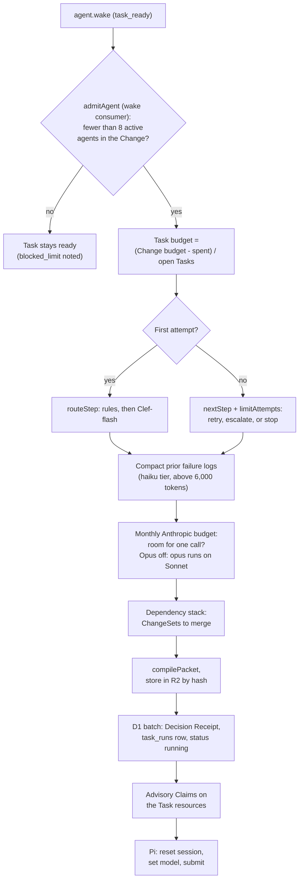
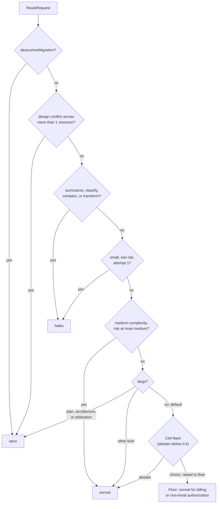
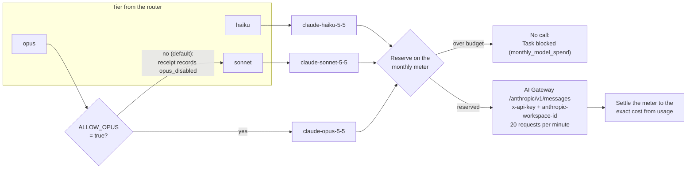
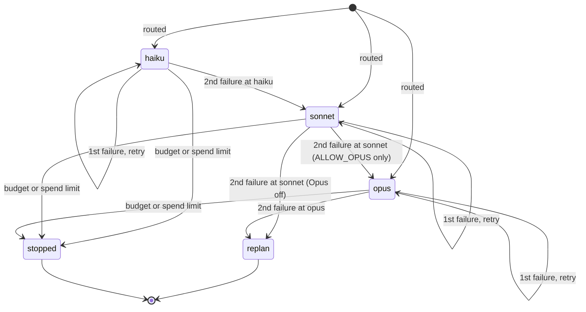
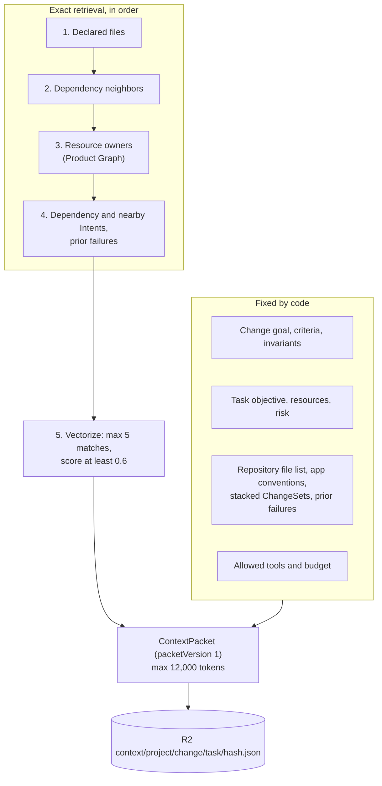
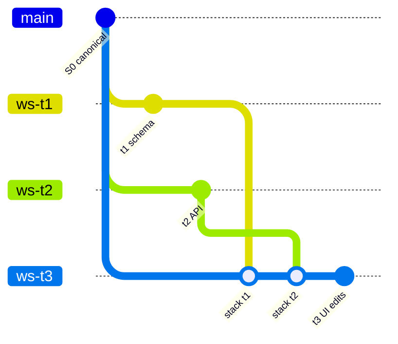

# Agents and models

This page covers the Agent Plane: AgentDO, the Pi harness loop, model routing, the model provider, escalation, the Context Packet, and stacked workspaces.

Main source files:

- `workers/agents/src/agent-do.ts`: AgentDO, run start, run end, budgets.
- `workers/agents/src/wake-consumer.ts`: the `rhumbatron-agent-wakeups` consumer.
- `workers/agents/src/limits.ts`: section 44 limits and budget-stop text.
- `workers/agents/src/workspace.ts`: the Task workspace and the command allowlist.
- `packages/model-router/src`: routing rules, Clef-flash routing, escalation, budgets, prices, the spend meter, and the gateway client.
- `packages/context-compiler/src`: Context Packet assembly and retrieval order.

## AgentDO

AgentDO is one durable logical Agent.
It extends the Agents SDK `Agent` class and implements the `AgentRuntime` interface (`start`, `resume`, `cancel`, `getState`).
`resume` records the event and starts no work.
Pi types stay inside `agent-do.ts`, `models.ts`, and `task-tools.ts` in `workers/agents/src` (section 25).
There is one Agent per Task. The Agent ID is `agt_<task>`.

AgentDO keeps its run state in DO SQLite (`agent_runs`, `run_tool_logs`, `run_meter`, `run_workspaces`).
D1 holds the shared view (`tasks`, `task_runs`, `decision_receipts`).
AgentDO sleeps when no run is active.
While a run is active, an interval schedule checks it every 60 seconds.
After 15 checks the run is stuck and ends as `timeout`.
A check that finds the Task `cancelled` stops the run.

### Run start pipeline

`start()` runs deterministic steps before the first model call.
A refusal fails or blocks the Task with an exact reason.

Notes:

- `spent` is the cost of the Change's Task runs plus its conflict reviews.
- A Change with spend and no budget left stops the Task with limit `max_cost_usd_per_change`.
- Claims are advisory (ADR 0015). A Claim that another Agent holds does not block the run. The shard records `claim.contended`, and conflict detection uses that signal.
- A Claim lease is 120 seconds. The one-minute run check and each model call renew a lease at half-life. Every run end releases the Claims of the run.

### Pi harness loop

Pi runs the model and tool loop.
AgentDO gates every model request and records every failed response.

The Task tools are `list_files`, `read_file`, `write_file`, `delete_file`, `run_command`, `complete_task`, and `fail_task`.
Only Task kinds `implement`, `migrate`, and `test` get a workspace.
For other kinds, `write_file`, `delete_file`, and `run_command` return "This Task has no workspace".
The first workspace tool call forks the canonical Artifact and opens a Sandbox checkout.
A Project without source gets only `complete_task` and `fail_task`.

Caps inside one run:

| Cap | Value | Source |
|---|---|---|
| Model calls per run | haiku 16, sonnet 32, opus 32 | `MAX_CALLS_PER_RUN` in `packages/model-router/src/budget.ts` |
| Run spend | At most the Task budget | `checkRunBudget` in `budget.ts` |
| File reads per run | 12 reads, 24,000 characters each | `agent-do.ts` |
| Command output | 12,000 characters, 180 s timeout | `workspace.ts` |
| Open Sandboxes per Change | 4 | `CHANGE_LIMITS` in `limits.ts` |
| Pi retries | 1 retry for a transient error, 2 s base delay | `agent-do.ts` |

A run that reaches its call cap or its spend cap ends as `run_call_cap`.
That counts as a failure at the tier (see [Escalation](#escalation)).

Commands must match the allowlist: `bun install`, `bun install --frozen-lockfile`, `bun test [paths]`, `bun run typecheck|test|bench|contract`, `bunx tsc --noEmit`, `git status|diff|log`, and `ls`.
The command tool refuses shell metacharacters.

## Model routing

The code uses the tier names `haiku`, `sonnet`, and `opus` from `AGENTS.md`.
Every tier calls Anthropic Claude through the AI Gateway (ADR 0021).
Opus is off by default: the `opus` tier runs on Sonnet unless `ALLOW_OPUS` is `"true"`.
Terraform sets `ALLOW_OPUS` from `var.allow_opus` (default `false`).

### Deterministic rules, then Clef-flash

`routeByRules` (section 23.2) picks a base tier and applies floors.
Clef-flash runs only on a first attempt, and only when the rules end at `default`.
Clef-flash calls count against the shared `clef-flash` counter of 200 calls per UTC day.
A Clef-flash answer can never go below the floor.

The floor also applies on the rule path.
Billing and non-trivial authorization raise the tier to at least `sonnet`.
A small, low-risk Task is trivial.
Every route writes a Decision Receipt (`decision_receipts` in D1) and a `model.route.decided` Event.
A receipt holds no private reasoning.

### Tiers and the provider

| Tier | Model | Thinking | Pi output cap |
|---|---|---|---|
| haiku | `claude-haiku-5-5` | Off in `complete()`. Adaptive, low effort in Pi. | 4,000 tokens |
| sonnet | `claude-sonnet-5-5` | Adaptive, medium effort, text omitted | 8,000 tokens |
| opus | `claude-sonnet-5-5` while Opus is off. `claude-opus-5-5` when `ALLOW_OPUS` is `"true"`. | Adaptive, high effort, text omitted | 8,000 tokens |

Two call paths use the same gateway, headers, prices, and meter:

- Pi agent runs (`workers/agents/src/models.ts`) use Pi's Anthropic Messages API. Pi puts `cache_control` on the system prompt, the tool definitions, and the latest message. It prices each response from its usage fields.
- `complete()` (`packages/model-router/src/gateway-client.ts`) serves the Root Planner, the intake gate, the request review and arbiter, conflict review, context compaction, the acceptance check, and the Integration Judge. Each caller goes through `meteredComplete()`. `complete()` caches the system prompt and replays a whole assistant turn, thinking blocks included, on a follow-up call. The caller sets the output cap.

The intake gate and the request comparison use fixed models and fixed rules, not the routing rules above. See [Shared Projects](shared-projects.md).

### Spend limits

Cost per call is exact: uncached input, output with thinking, cache reads, and cache writes at Anthropic list prices (`ANTHROPIC_PRICES` in `packages/model-router/src/models.ts`).

| Limit | Value | Where |
|---|---|---|
| Monthly Anthropic budget | `ANTHROPIC_MONTHLY_BUDGET_USD`: $100 in prod (Terraform maximum $100, code fallback $10) | D1 `usage_counters`, counter `anthropic-usd-micro`, one row per `YYYY-MM`. The AI Gateway spend limit has the same value. |
| Model calls per UTC day | 400 for agent runs, conflict review, compaction, and the acceptance check | D1 `usage_counters`, counter `agent-model-calls` |
| Clef-flash calls per UTC day | 200, shared by routing, intake, and the causal router | D1 `usage_counters`, counter `clef-flash` |

Each call reserves an estimate on the monthly meter with one conditional statement, then settles to its exact cost.
These events are `spend_limited`: a refused reservation, a gateway spend-limit 429, and an Anthropic billing error.
`spend_limited` is a budget stop. It never retries and never tries another provider.

## Escalation

`nextAttempt` (`workers/agents/src/limits.ts`) decides what happens after a failed run.
It applies `nextStep` (section 23.3) and then `limitAttempts` (section 44) to the Task's whole failure history in D1 `task_runs`.
Transport failures never escalate (section 42.8).
Two intelligence failures at one tier move the Task up one tier.

Rules:

- A failed run reads every failure of the Task in the current attempt window, its own included. A retry or escalation schedules the next attempt 5 seconds later. An escalation emits `agent.escalated` with `from`, `to`, and `reason`.
- The next `start()` reads the same rows, applies the same rules, and routes to the same tier.
- A person's budget raise after a repeated-failure stop or a Change budget stop opens a new attempt window (`tasks.attempts_reset_at`, `restoreAfterBudgetRaise`). A run that exceeds its share of a small budget ends as `run_call_cap`, so without the new window two such runs would stop the Task again before any new run.
- A transport failure (`rate_limited`, `timeout`, `transient`) retries once at the same tier. A second transport failure in a row fails the Task. When the latest failure is a transport failure and the tier has no attempts left, the Task stops; it does not escalate.
- The daily call cap, the monthly budget, and the Change budget stop at once. The Task becomes `blocked`, and the Change becomes `budget_blocked` with the exact limit.
- `replan` is a budget stop with limit `max_attempts_per_tier`. No automatic re-plan runs. The Task becomes `blocked`, and the Change becomes `budget_blocked`.
- `limitAttempts` allows at most 2 attempts per tier and counts every earlier run at that tier.
- Conflicting dependency ChangeSets fail the Task at once (`dependency_merge_conflict`).
- When a Task fails or stops, its pending dependents become `blocked`.
- The Decision Receipt of the next run records an escalation (reason `two_failures_at_<tier>` or `max_attempts_at_<tier>`).
- Every attempt gets a fresh Pi session (section 23.3).

## Context Packet assembly

The Context Compiler is deterministic and does no I/O.
`workers/agents/src/retrieval.ts` loads the inputs.
`compilePacket` orders, trims, and renders them.
The model never chooses its own scope (section 27.5).

Rules:

- Every item carries `itemId`, `source`, `sourceVersion`, and `capturedAt`.
- Over the token limit, `compilePacket` drops the lowest-priority items first. Vectorize matches go first.
- AgentDO stores the packet hash on the `task_runs` row (`context_hash`). Two runs with the same hash have the same inputs.
- Vectorize gets at most 1,000 query embeddings per UTC day. It adds only files of the same Project that exist in the indexed tree.
- `rhumbatron-indexer` builds the exact indexes once per canonical tree, on the `index.build` command.
- Tool inputs and outputs go to R2 at `context/<project>/<change>/<task>/tools-<run>.json`. Model reasoning never goes there.

## Stacked workspaces

A Task with dependencies starts from canonical source plus the published ChangeSets of every Task it depends on (`stackFor` in `workers/agents/src/stack.ts`).
The order is topological, with dependencies first. Ties break on ChangeSet creation time, then Task ID.
The merge order is fixed for the whole run, so a Sandbox restore repeats the same merges.

The ChangeSet records this lineage in `intent_json.changeSet` (`ChangeSetIntent` in `packages/protocol/src/candidate.ts`):

| Field | Meaning |
|---|---|
| `fork`, `commit` | Artifacts fork and commit of the ChangeSet |
| `baseCommit` | Canonical commit the fork started from |
| `stackedOn` | Dependency ChangeSet IDs merged before the first edit |
| `startCommit` | HEAD after the stacked merges |
| `files` | Every file that differs from `baseCommit` |
| `ownFiles` | Files this Task changed on top of its stack |
| `patchRef` | R2 key of the stored `git diff`, from `startCommit` when stacked, else from `baseCommit` |

`ws-t3` descends from `ws-t1` and `ws-t2`, so Candidate composition merges them as shared history, not as concurrent edits.
The integrate rule can reopen a Task (`route_json.integrate`, [Source and verification](source-and-verification.md#sibling-candidates-and-selection)).
The reopened Task gets a dependency edge to the other Task, so its re-run stacks on the other Task's ChangeSet.
Its Context Packet tells it to build against the real routes, field names, and data shapes of that ChangeSet.
