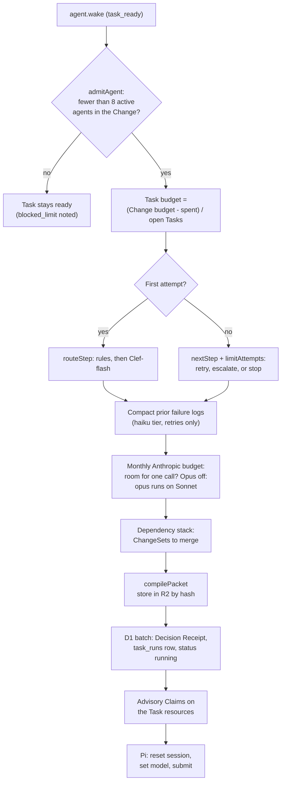
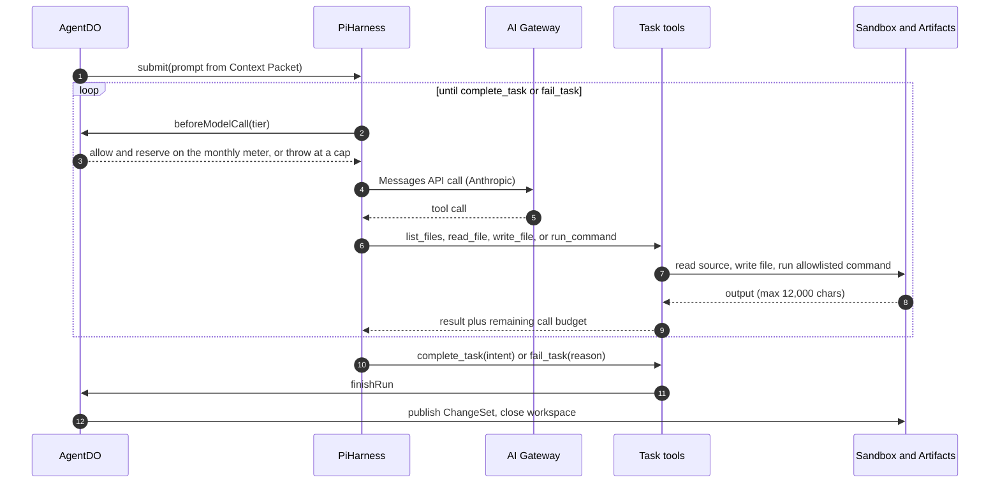
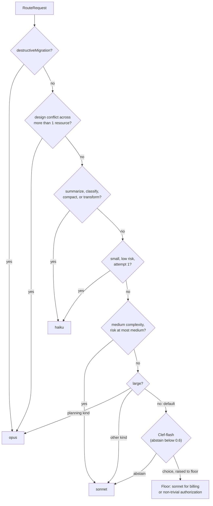
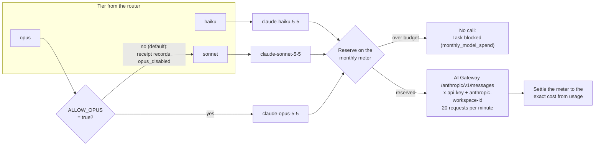
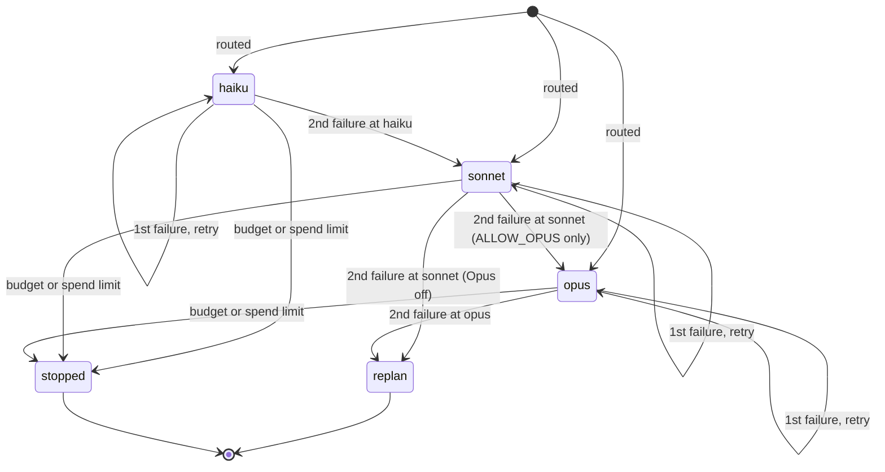
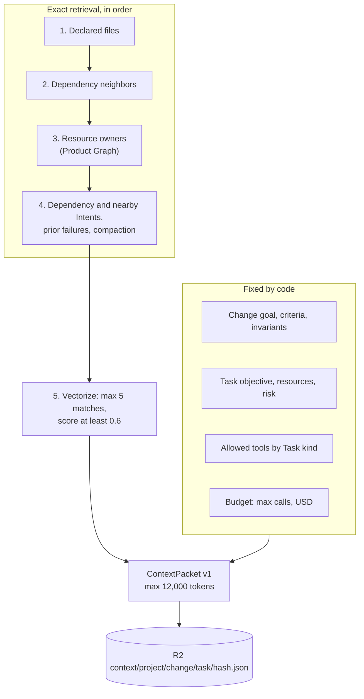
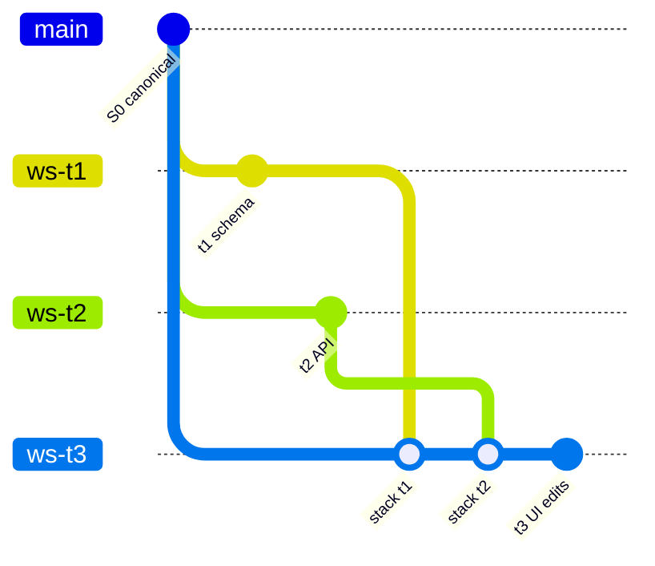

# Agents and models

This page explains the Agent Plane: AgentDO, the Pi harness loop, model routing, providers, escalation, the Context Packet, and stacked workspaces.

Main source files:

- `workers/agents/src/agent-do.ts`: AgentDO, run start, run end, budgets.
- `workers/agents/src/wake-consumer.ts`: the `agent-wakeups` consumer.
- `workers/agents/src/limits.ts`: section 44 limits and budget-stop text.
- `packages/model-router/src`: routing rules, Clef, escalation, budgets, providers, gateway client.
- `packages/context-compiler/src`: Context Packet assembly and retrieval order.

## AgentDO

AgentDO is one durable logical Agent.
It extends the Agents SDK `Agent` class and implements the `AgentRuntime` interface (`start`, `resume`, `cancel`, `getState`).
Pi types stay inside AgentDO and `workers/agents/src/models.ts` (section 25).
There is one Agent per Task.
The Agent ID is `agt_<task>`.

AgentDO stores its own run rows in DO SQLite (`agent_runs`, `run_tool_logs`).
D1 holds the shared view (`task_runs`, `decision_receipts`, `tasks`).
AgentDO sleeps when no run is active.
While a run is active, one interval schedule checks it every 60 seconds.
After 15 checks the run is stuck and ends as `timeout`.

### Run start pipeline

`start()` runs deterministic steps before the first model call.
Each refusal fails or blocks the Task with an exact reason.

Claims are advisory (ADR 0015).
A Claim held by another Agent does not block the run.
The shard records `claim.contended`, and conflict detection uses that signal.
A Claim lease is 120 seconds and renews at half-life, on the one-minute run check.

### Pi harness loop

Pi runs the model and tool loop.
AgentDO wraps every model request with a budget gate and records every failure.

Caps inside one run:

| Cap | Value | Source |
|---|---|---|
| Model calls per run | haiku 16, sonnet 32, opus 32 | `MAX_CALLS_PER_RUN` |
| File reads per run | 12 reads, 24,000 characters each | `agent-do.ts` |
| Command output | 12,000 characters, 180 s timeout | `workspace.ts` |
| Pi retries | 1 retry for a transient error, 2 s base delay | `agent-do.ts` |
| Run spend | Must stay at or below the Task budget share | `checkRunBudget` |

Commands must match an allowlist: `bun install`, `bun test`, `bun run typecheck|test|bench`, `bunx tsc --noEmit`, `git status|diff|log`, and `ls`.
The command tool refuses shell metacharacters.

## Model routing

The code uses the tier names `haiku`, `sonnet`, and `opus` from `AGENTS.md`.
Every tier calls Anthropic Claude through the AI Gateway (ADR 0021).
Opus is off by default: the opus tier runs on Sonnet unless `ALLOW_OPUS` is `"true"`.

### Deterministic rules, then Clef-flash

`routeByRules` (section 23.2) picks a base tier and applies floors.
Clef-flash runs only on a first attempt, and only when the rules end at `default`.
A Clef choice can never go below the floor.

The floor also applies to the rule path.
Billing and non-trivial authorization raise the tier to at least `sonnet`.
Every route writes a Decision Receipt (`decision_receipts` in D1) and a `model.route.decided` Event.
A receipt has no private reasoning.

### Tiers and the provider

| Tier | Model | Thinking | Output cap |
|---|---|---|---|
| haiku | `claude-haiku-5-5` | off in `complete()`; adaptive, low effort in Pi | 4,000 |
| sonnet | `claude-sonnet-5-5` | adaptive, medium effort, text omitted | 8,000 |
| opus | `claude-sonnet-5-5` while Opus is off; `claude-opus-5-5` with `ALLOW_OPUS = true` | adaptive, high effort, text omitted | 8,000 |

Two call paths use the same gateway, header, prices, and meter:

- Pi agent runs (`workers/agents/src/models.ts`): Pi's Anthropic Messages API. Pi puts `cache_control` on the system prompt, the tool definitions, and the latest message, and prices each response from its usage fields.
- `complete()` (`packages/model-router/src/gateway-client.ts`) for the Root Planner, conflict review, and context compaction, always through `meteredComplete()`. It maps function tools to Anthropic tools, caches the system prompt, and replays a whole assistant turn, thinking blocks included, on a follow-up call.

Cost per call is exact: uncached input, output with thinking, cache reads, and cache writes at Anthropic list prices (`ANTHROPIC_PRICES` in `packages/model-router/src/models.ts`).
The monthly budget is `ANTHROPIC_MONTHLY_BUDGET_USD`: $100 in prod.
Each call reserves an estimate on the D1 meter (`usage_counters`, `anthropic-usd-micro` per `YYYY-MM`) with one conditional statement, then settles to its exact cost.
A refused reservation, a gateway spend-limit 429, or an Anthropic billing error is `spend_limited`: a budget stop, never a retry, and never another provider.
D1 `usage_counters` also holds the daily caps: 400 agent model calls per day and 200 Clef-flash calls.

## Escalation

`nextStep` (section 23.3) decides what happens after a failed run.
Transport failures never escalate.
Two intelligence failures at one tier move the Task up one tier.

Other rules:

- A transport failure (`rate_limited`, `timeout`, `transient`) retries once at the same tier. A second one in a row fails the Task.
- `budget_exhausted` and `spend_limited` stop at once. The Task becomes `blocked`, and the Change becomes `budget_blocked` with the exact limit.
- `replan` is a budget stop with limit `max_attempts_per_tier`. No automatic re-plan runs. The Task becomes `blocked`, and the Change becomes `budget_blocked`.
- `limitAttempts` also caps attempts at 2 per tier (section 44) and counts every earlier run at that tier.
- When a Task fails or stops, its pending dependents become `blocked`.
- An escalation records `agent.escalated`. Every retry gets a fresh Pi session (section 23.3).

## Context Packet assembly

The Context Compiler is deterministic and does no I/O.
`workers/agents/src/retrieval.ts` loads the inputs.
`compilePacket` orders, trims, and renders them.
The model never chooses its own scope (section 27.5).

Rules:

- Every item carries `itemId`, `source`, `sourceVersion`, and `capturedAt`.
- AgentDO stores the packet hash on the `task_runs` row (`context_hash`). Two runs with the same hash have the same inputs.
- Vectorize gets at most 1,000 query embeddings per day. It adds only files that exist in the indexed tree.
- `rhumbatron-indexer` builds the exact indexes once per canonical tree, on `index.build`.
- Tool inputs and outputs (never model reasoning) go to R2 at `context/<project>/<change>/<task>/tools-<run>.json`.

## Stacked workspaces

A Task with dependencies does not start from bare canonical source.
Its workspace starts from canonical plus the published ChangeSets of every Task it depends on, in topological order (`stackFor` in `workers/agents/src/stack.ts`).
The merge order is fixed for the whole run, so a Sandbox restore repeats the same merges.

The ChangeSet records this lineage in `intent_json.changeSet`:

| Field | Meaning |
|---|---|
| `baseCommit` | Canonical commit the fork started from |
| `stackedOn` | Dependency ChangeSet IDs merged before the first edit |
| `startCommit` | HEAD after the stacked merges |
| `files` | Every file that differs from `baseCommit` |
| `ownFiles` | Files this Task changed on top of its stack |

Because `ws-t3` descends from `ws-t1` and `ws-t2`, Candidate composition merges them as shared history, not as concurrent edits.
Conflicting dependency ChangeSets fail the Task at once (`dependency_merge_conflict`). No retry or tier can fix them.
