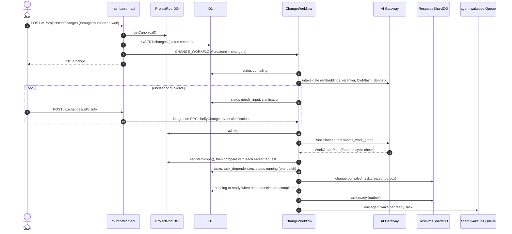
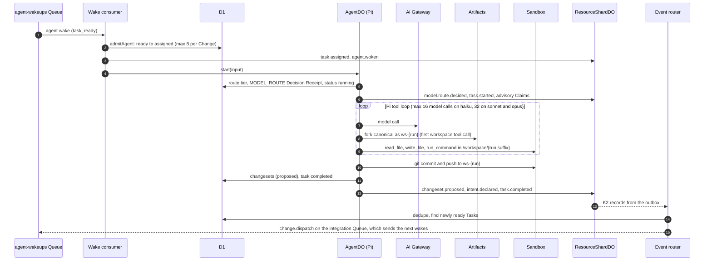
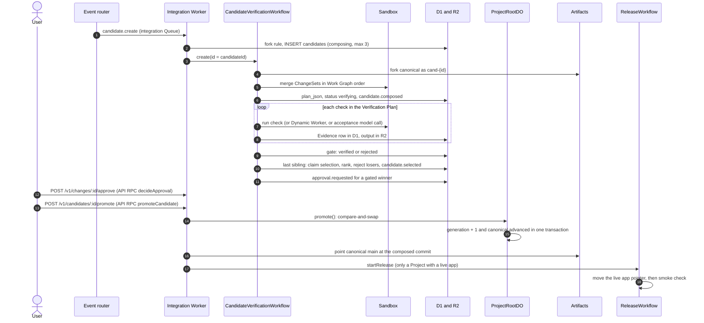
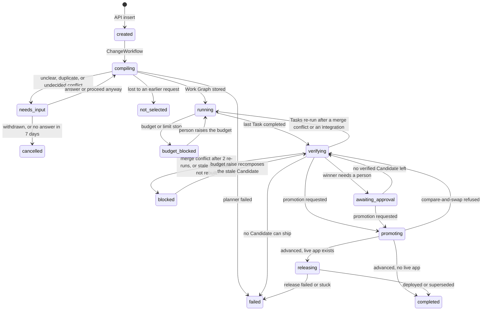
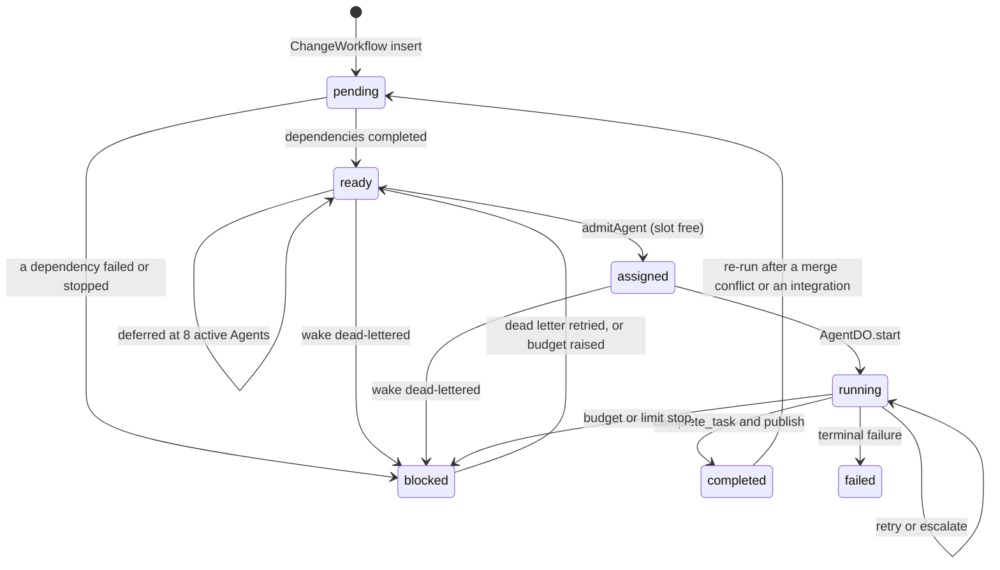
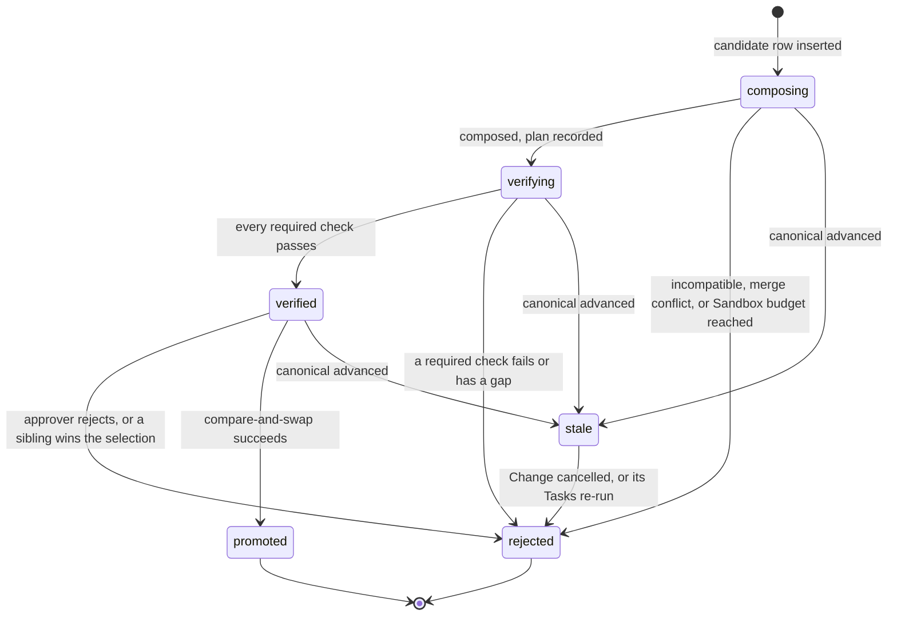
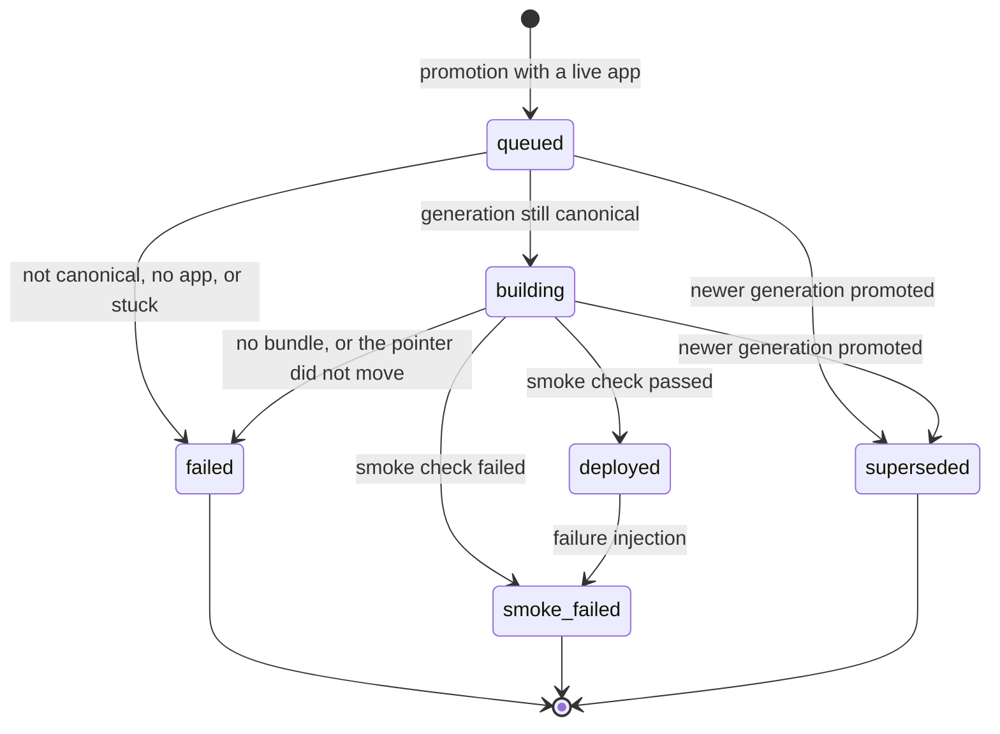

# Change lifecycle

This page follows one user goal from the browser to a release in three sequence diagrams.
Then it shows the status state machines.

The path uses these stable IDs (`AGENTS.md` section 60):

| Object | ID rule | Source |
|---|---|---|
| Change | `chg_<uuid>`. Idempotent on `clientRequestId` per requester. | `workers/api/src/projects.ts` |
| ChangeWorkflow instance | The Change ID | `workers/api/src/projects.ts` |
| Task | `tsk_<change>_<key>`, where `<change>` is the Change ID without `chg_` and `<key>` is `t1`, `t2`, ... | `workers/integration/src/change-workflow.ts` |
| Agent | `agt_<task>`: one logical Agent per Task | `workers/integration/src/dispatch.ts` |
| Task run | `run_<task>_<attempt>` | `workers/agents/src/agent-do.ts` |
| ChangeSet | `cs_<run>` | `workers/agents/src/agent-do.ts` |
| Candidate | `cand_` plus the first 24 hex characters of the SHA-256 composition key | `workers/integration/src/candidate-create.ts` |
| Release | `rel_<project>_<generation>` | `workers/integration/src/release-model.ts` |

## Part 1: from goal to ready Tasks

The API stores the Change and starts one ChangeWorkflow (request field `startPlanning`, default `true`).
The API returns before any model call (section 58).
The ChangeWorkflow runs the intake gate, calls the Root Planner, and compares the plan with the other open requests.
Then it stores the Work Graph and dispatches the ready Tasks.
An unclear, duplicate, or conflicting request waits for its requester (`needs_input`).
[Shared Projects](shared-projects.md#the-intake-gate) describes the intake gate, the request comparison, and the system arbiter (ADR 0025).

Notes:

- The Root Planner routes to the `opus` tier (`taskKind = plan`, `complexity = large`). With `ALLOW_OPUS` set to `false` (the Terraform default), the `opus` tier runs on Sonnet 5.5 (ADR 0021).
- The prompt asks for 2 to 8 Tasks. The schema accepts 1 to 12 (`MAX_TASKS_PER_CHANGE`). The planner makes at most two model calls: the plan and one repair turn.
- A UI Task that calls routes of another Task must depend on that Task. The prompt states the rule. `parsePlan` (`workers/integration/src/root-planner.ts`) also repairs the plan without a model call. A UI Task and an API Task on the same area (first resource segment, `todos` in `todos:ui` and `todos:api`) with no dependency path between them get the edge UI → API.
- The Work Graph JSON goes to R2 at `work-graphs/<project>/<change>.json`.
- Change Events go to the ResourceShardDO that owns `change:<id>`. This keeps ProjectRootDO cold (section 13.1).
- The API writes the Change to ProjectViewDO directly.
- The intake gate records `change.intake.reviewed` and an `INTAKE` Decision Receipt in D1 `change_decisions`. An answer records `change.clarification.answered`.
- A `needs_input` Change waits for the event `clarification` and reads D1 once a day. After 7 days without an answer, the Change is `cancelled`. After 3 answered rounds, the Change plans without another question.

## Part 2: from a wake to a published ChangeSet

Each wake starts one AgentDO run.
The Agent works in its own Artifacts fork and Sandbox directory.
When the run ends, the Agent publishes a ChangeSet and declares a typed Intent.
The ResourceShardDO then detects conflicts.
[Agents and models](agents-and-models.md) describes the run, model routing, and the Pi loop.

Notes:

- Only Task kinds `implement`, `migrate`, and `test` get a workspace. Other kinds get read-only file tools.
- A Task with dependencies starts on a stacked workspace: canonical plus the dependency ChangeSets. See [Agents and models](agents-and-models.md#stacked-workspaces).
- Conflict detection is deterministic and runs before `task.completed`. A model review (Sonnet tier, then Opus tier) runs later from a durable schedule, never on the run path.
- Conflict detection and conflict review read protected resources from the Project policy row (D1 `project_policies`, `protectedResources`). A Project without a row, or with a row that does not parse, has no protected resources there.
- When the last Task completes, AgentDO moves the Change to `verifying` and records `verification.started` with reason `work_graph_completed`.

## Part 3: from Candidates to a release

The causal router turns `verification.started` into one `candidate.create` command.
The integration Worker applies the integrate rule, then the fork rule.
It starts one CandidateVerificationWorkflow per Candidate.
Sibling Candidates on one base wait for each other. The last one to settle selects the winner (ADR 0026).
Policy or a person promotes the winner. ProjectRootDO runs the compare-and-swap.

Notes:

- Integrate before fork: a `confirmed` or `fork_required` conflict between two Tasks on different semantic resources (an API and its UI) creates no Candidate. The dependent Task gets a dependency edge and re-runs once on a stacked workspace with the other Task's ChangeSet. The Change returns to `running`. One Candidate then holds both ChangeSets.
- `candidate.create` waits while a conflict review reserved in the last 10 minutes is still open. The last Queue delivery composes anyway.
- A verified Candidate does not promote while a sibling on the same base still composes or verifies. A winner that does not meet every acceptance criterion never auto-promotes: the Change is `awaiting_approval`. See [Source and verification](source-and-verification.md#sibling-candidates-and-selection).
- Auto-promotion applies when the winner needs no human approval and the Project's policy `autoPromoteRiskTiers` lists the Change risk tier. The policy is the D1 `project_policies` row; without a row it is `DEFAULT_POLICY` (`policy-1` in `workers/integration/src/candidate-composer.ts`), which lists `low`. The CandidateVerificationWorkflow then calls `promoteCandidate` with actor `system:auto-promotion`, and `canonical.promotion.requested` records `trigger: "auto"`. All section 36 preconditions apply (`autoPromoteDecision` in `packages/evidence/src/promotion.ts`).
- The Change is `promoting` during the compare-and-swap. After it, the Change is `releasing` when the Project has a live app, else `completed`. The release ends the Change as `completed` (deployed or superseded) or `failed`. See [Live apps](live-apps.md#promotion-and-release).
- Every end after promotion records `change.completed` or `change.failed`. The projector maps `build.started` to `releasing`. These Events move ProjectViewDO out of `promoting` (section 13.3).
- A Change still `releasing` 45 minutes after promotion is stuck (`RELEASE_STUCK_AFTER_MS`). Every 5 minutes, the event router reads `changes` by `(status, updated_at)` and queues one `release.recover` per stuck Change (at most 10 per sweep). The integration Worker then re-checks the Change:
  1. A release that already finished settles the Change.
  2. A `queued` or `building` release becomes `failed`, and the Change becomes `failed`.
  3. A Project without a live app completes the Change.
  4. A Project with a live app but no release row gets a `failed` release row, and the Change becomes `failed`.
  The generation stays promoted. The next promotion releases as usual.
- After `canonical.advanced`, the causal router marks every other `composing`, `verifying`, or `verified` Candidate on an older base `stale`. The router does not compose. It queues one `candidates.recompose` command. Promotion runs the same sweep (`settleStaleBehind` in `workers/integration/src/recompose.ts`). The sweep takes each `verified` Candidate on an older base, and each `stale` Candidate whose Change has no other active Candidate and none on a newer base. The order against the router sweep has no effect.
- Every stale Candidate ends in one of three states: a new Candidate on the new canonical state, a `blocked` Change with a plain reason, or a closed Change. A lineage recomposes at most 2 times (`MAX_RECOMPOSES`). A Change never waits in `verifying` with nothing running.

## Status state machines

The enums are in `packages/protocol/src`.
The diagrams show only the transitions that the code writes.

### Change status

The pure rules are in `workers/integration/src/change-status.ts`.

| Rule | Source |
|---|---|
| A person can cancel a Change in `created`, `compiling`, `needs_input`, `running`, `verifying`, `awaiting_approval`, `budget_blocked`, or `blocked`. A Change with a promoted Candidate cannot be cancelled. | `CANCELLABLE_FROM`, `cancelChange` in `change-commands.ts` |
| A later request that wins the system arbiter makes an earlier Change `not_selected` from any of these statuses, and also from `failed` or `completed`, when the earlier Change has no promoted Candidate. See [Shared Projects](shared-projects.md#the-system-arbiter). | `request-check.ts` |
| A merge conflict makes the Change re-run the conflicting Tasks on the new base. After 2 re-runs the Change is `blocked` with the reason "The request could not be merged with newer changes twice. Submit it again." | `MAX_REBASE_RERUNS` in `rebase.ts` |
| The Change ends as `failed` when every Candidate on the newest base is `rejected` for a reason other than a merge conflict or a cancel, and no Candidate of the Change is `composing`, `verifying`, `verified`, or `promoted`. `blocked_reason` starts with "No Candidate passed its required checks:" and quotes the Candidate reasons. `change.failed` records it with `phase: "verification"`. | `verificationDeadEnd` |
| A refused compare-and-swap returns the Change to its status before `promoting`. | `leavePromoting` in `promotion.ts` |
| A verified Candidate can also promote from `running` or `budget_blocked`. | `PROMOTABLE_FROM` |
| `completed`, `cancelled`, `failed`, and `not_selected` are terminal. | `TERMINAL_CHANGE_STATUSES` |

`POST /v1/changes/:changeId/cancel`:

1. Cancels the open Tasks and rejects the open Candidates (reason `change cancelled`).
2. A cancel during `compiling` stores the planned Tasks as `cancelled` and records no compile.
3. A running CandidateVerificationWorkflow checks the Change at each step boundary. It stops before it uses more Sandbox or Browser Run time.
4. Dispatch runs only for a `running` Change.
5. An active Agent run stops at its next run check (every 60 s).

`POST /v1/changes/:changeId/budget` raises `budget_usd`. The budget cannot go down.

1. A `budget_blocked` Change returns to `running`. `running` is the only status that a budget stop interrupts.
2. Its budget-stopped Tasks become `ready` again with a new attempt window, and their blocked dependents become `pending`.
3. The normal dispatch runs (section 44 rule 5).
4. On a `verifying`, `blocked`, or `awaiting_approval` Change, the same call retries a merge-conflict re-run within its bound and recomposes a stale Candidate.

### Task status

A Change cancel moves the open Tasks (`pending`, `ready`, `assigned`, `running`, `blocked`) to `cancelled`.
A merge-conflict re-run sets a Task to `ready` directly when none of its dependencies re-runs.

### Candidate status

`composed` is in the enum and in RPC results. D1 rows go from `composing` directly to `verifying`.
Rhumbatron never retries a stale Candidate blind (section 42.9). A new Candidate on the new base replaces it.

### Release status

The allowed transitions are in `NEXT` (`workers/integration/src/release-model.ts`).
A failed release never deletes canonical history.
Recovery is a new canonical transition (section 42.10).
