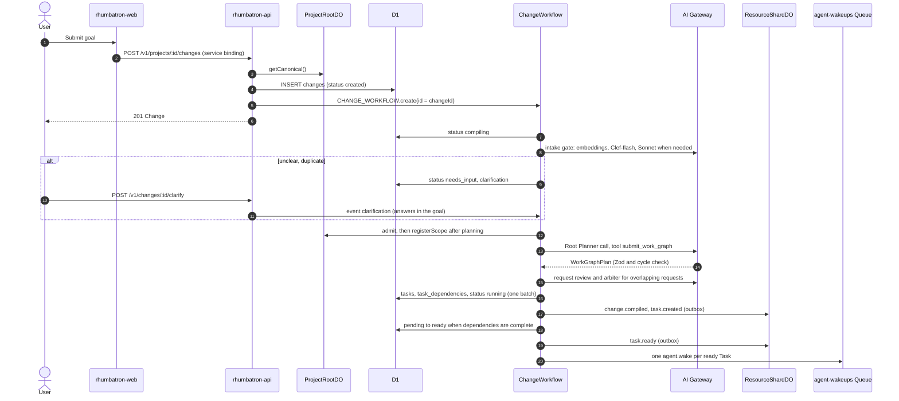
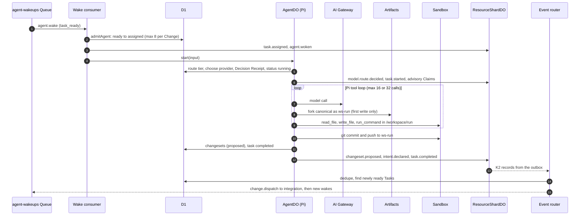
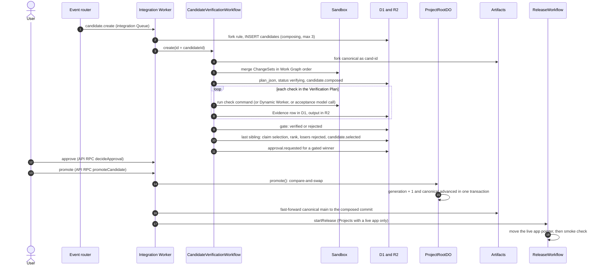
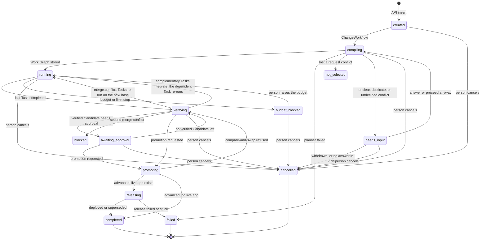
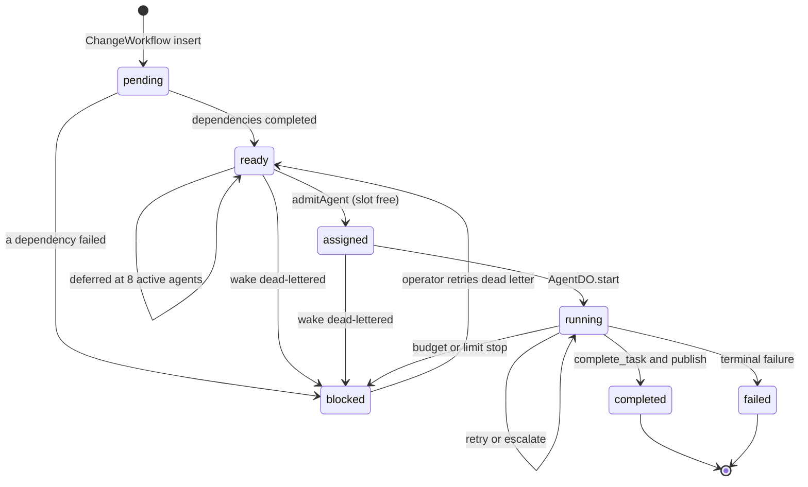
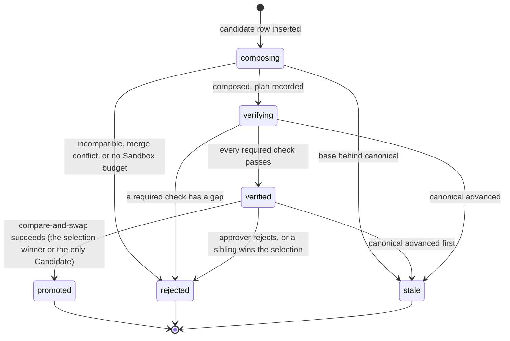
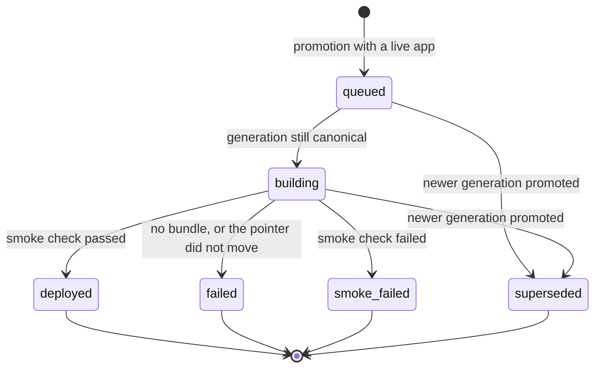

# Change lifecycle

This page follows one user goal from the browser to a release.
It splits the path into three sequence diagrams, then shows the status state machines.

The path uses these stable IDs (section 60 of `AGENTS.md`):

| Object | ID rule | Source |
|---|---|---|
| Change | `chg_<uuid>`, idempotent on `clientRequestId` | `workers/api/src/projects.ts` |
| ChangeWorkflow instance | The Change ID | `workers/api/src/projects.ts` |
| Task | `tsk_<change>_<key>`, for example `tsk_..._t3` | `workers/integration/src/change-workflow.ts` |
| Agent | `agt_<task>`: one logical Agent per Task | `workers/integration/src/dispatch.ts` |
| Task run | `run_<task>_<attempt>` | `workers/agents/src/agent-do.ts` |
| ChangeSet | `cs_<run>` | `workers/agents/src/agent-do.ts` |
| Candidate | `cand_` plus 24 hex characters of the SHA-256 composition key | `workers/integration/src/candidate-create.ts` |
| Release | `rel_<project>_<generation>` | `migrations/d1/0015_releases.sql` |

## Part 1: from goal to ready Tasks

The API stores the Change and starts one ChangeWorkflow.
The ChangeWorkflow runs the intake gate, calls the Root Planner, compares the plan with the other open requests, stores the Work Graph, and dispatches the ready Tasks.
The API returns before any model call (section 58).
An unclear, duplicate, or conflicting request waits for its requester (`needs_input`) instead of building (ADR 0025, [Shared Projects](shared-projects.md)).

Notes:

- The routing rules send the Root Planner to the `opus` tier (`taskKind = plan`, `complexity = large`). The prompt asks for 2 to 8 Tasks. The schema accepts 1 to 12 (`MAX_TASKS_PER_CHANGE`).
- A UI Task that calls routes another Task of the plan defines must depend on that Task. The prompt states the rule, and `parsePlan` (`workers/integration/src/root-planner.ts`) repairs a plan without a model call: a UI Task and an API Task on the same area (first resource segment, `todos` in `todos:ui` and `todos:api`) with no dependency path between them get the edge UI → API. The UI agent then runs on a stacked workspace with the real API.
- The Work Graph JSON goes to R2 at `work-graphs/<project>/<change>.json`.
- Change events go to the ResourceShardDO that owns `change:<id>`. This keeps ProjectRootDO cold (section 13.1).
- The API updates ProjectViewDO directly with the new Change.
- The intake gate records `change.intake.reviewed` and an `INTAKE` Decision Receipt in D1 `change_decisions`. An answer records `change.clarification.answered`.
- A `needs_input` Change waits for the event `clarification`, re-reads D1 once a day, and is cancelled after 7 days without an answer. After 3 answered rounds it plans without another question.

## Part 2: from a wake to a published ChangeSet

Each wake becomes one AgentDO run.
The Agent works in its own Artifacts fork and Sandbox directory.
When the run ends, the Agent publishes a ChangeSet and declares a typed Intent.
The ResourceShardDO then detects conflicts.

Notes:

- Only Task kinds `implement`, `migrate`, and `test` get a workspace. Other kinds get read-only file tools.
- A Task with dependencies starts on a stacked workspace: canonical plus the dependency ChangeSets. See [Agents and models](agents-and-models.md#stacked-workspaces).
- Conflict detection is deterministic. A model review (Sonnet tier, then Opus tier) runs later from a durable schedule, never on the run path.
- Protected resources for conflict detection and review come from the Project's stored policy (D1 `project_policies`, `protectedResources`). Each detection or review run reads the row once. A Project without a row, or with a row that does not parse, has no protected resources there.
- When the last Task completes, AgentDO moves the Change to `verifying` and records `verification.started` with reason `work_graph_completed`.

## Part 3: from Candidates to a release

The causal router turns `verification.started` into one `candidate.create` command.
The integration Worker applies the integrate rule, then the fork rule, and starts one CandidateVerificationWorkflow per Candidate.
When a Change has sibling Candidates on one base, the last one to settle selects the winner (ADR 0026).
Policy or a person promotes the winner. ProjectRootDO runs the compare-and-swap.

Notes:

- Integrate before fork: a `confirmed` or `fork_required` conflict between two Tasks on different semantic resources (an API and its UI) creates no Candidate. The dependent Task gets a dependency edge and re-runs once on a stacked workspace with the other Task's ChangeSet, and the Change returns to `running`. The re-run's completion records `verification.started` again, and one Candidate holds both ChangeSets. See [Source and verification](source-and-verification.md#sibling-candidates-and-selection).
- Siblings never race. A verified Candidate does not promote while a sibling on the same base still composes or verifies. The last run to settle claims the selection with one conditional D1 update and ranks the group: promotable first, then most acceptance criteria met, then fewer gaps, then more passing checks. A tie goes to the Integration Judge (one Sonnet call over the Evidence). Without a valid preference the Change is `awaiting_approval` and a person picks. Losers become `rejected` with the comparison as the reason. A winner that does not meet every acceptance criterion, or has no acceptance result, never auto-promotes: the Change is `awaiting_approval` with the reason, and a person approves and promotes it or cancels the Change. See [Source and verification](source-and-verification.md#sibling-candidates-and-selection).
- Promotion is a human action in the UI, except under policy `autoPromoteRiskTiers`. Auto-promotion applies when the verified Candidate needs no human approval and `autoPromoteRiskTiers` lists the Change risk tier (`low` in `policy-1`). Then the CandidateVerificationWorkflow calls the same `promoteCandidate` path with actor `system:auto-promotion`. `canonical.promotion.requested` then records `trigger: "auto"`. All section 36 preconditions still apply. A Candidate that needs approval never promotes automatically (`autoPromoteDecision` in `packages/evidence/src/promotion.ts`).
- Only a Project with a live app releases. See [Live apps](live-apps.md).
- The Change is `promoting` during the compare-and-swap. After it, the Change is `releasing` when the Project has a live app, else `completed`. The release then ends the Change as `completed` (deployed or superseded) or `failed`.
- Every end after promotion records `change.completed` or `change.failed`. `build.started` records `releasing`. These Events move ProjectViewDO out of `promoting` (section 13.3).
- A Change still `releasing` 45 minutes after promotion is stuck (`RELEASE_STUCK_AFTER_MS`). Every 5 minutes the event router reads `changes` by `(status, updated_at)` and queues one `release.recover` per stuck Change. The integration Worker then marks a queued or building release `failed`. It records a release that never started as a `failed` release row. Then it fails the Change. If the Project has no live app, the Worker completes the Change instead. The reason is on the release row and in the Event. The generation stays promoted. The next promotion releases as usual.
- After `canonical.advanced`, the causal router marks every other in-flight Candidate on an older base `stale`.

## Status state machines

The enums are in `packages/protocol/src`.
The diagrams show only the transitions that the code writes.

### Change status

A Candidate that fails on a merge conflict makes the Change re-run the conflicting Tasks on the new base (`workers/integration/src/rebase.ts`). After two such re-runs the Change becomes `blocked` with the reason "The request could not be merged with newer changes twice. Submit it again."
The pure rules are in `workers/integration/src/change-status.ts`.
A refused compare-and-swap returns the Change to its status before `promoting`.
A verified Candidate can also promote from `running` or `budget_blocked`.

- `POST /v1/changes/:changeId/cancel` works until promotion starts.
  It cancels the open Tasks and rejects the open Candidates (reason `change cancelled`).
  A cancel during `compiling` stores the planned Tasks as `cancelled` and records no compile.
  A running CandidateVerificationWorkflow checks the Change at each step boundary and stops before it uses more Sandbox or Browser Run time.
  Dispatch runs only for a `running` Change.
  An active Agent run stops at its next one-minute run check.
- `POST /v1/changes/:changeId/budget` raises `budget_usd`. The budget can never go down.
  A `budget_blocked` Change returns to `running`, because `running` is the only status that a budget stop interrupts.
  Its budget-stopped Tasks become ready again, and their blocked dependents become pending.
  Then the normal dispatch runs (section 44 rule 5).

### Task status

A Change cancel moves the open Tasks to `cancelled`. A budget raise moves the budget-stopped Tasks from `blocked` back to `ready`.

### Candidate status

`composed` is in the enum and in RPC results, but D1 rows go from `composing` directly to `verifying`.
Rhumbatron never retries a stale Candidate blind (section 42.9). A new Candidate on the new base replaces it.

### Release status

A failed release never deletes canonical history.
Recovery is a new canonical transition (section 42.10).
