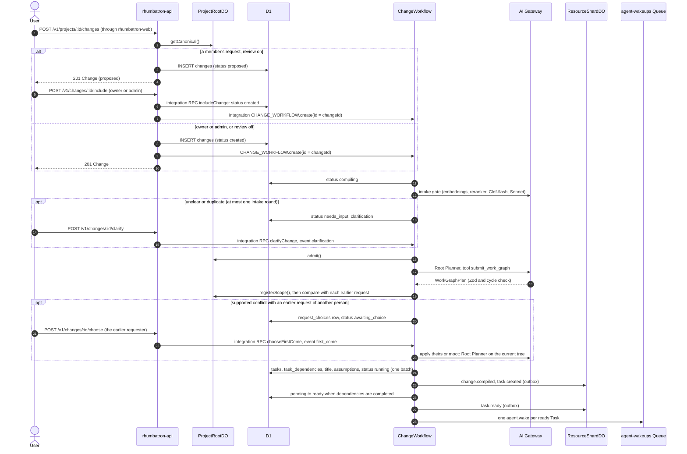
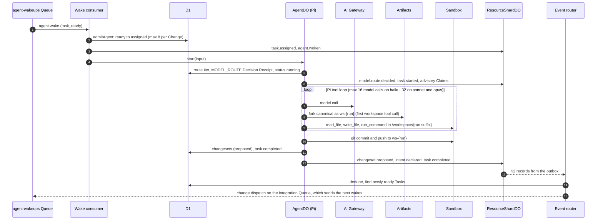
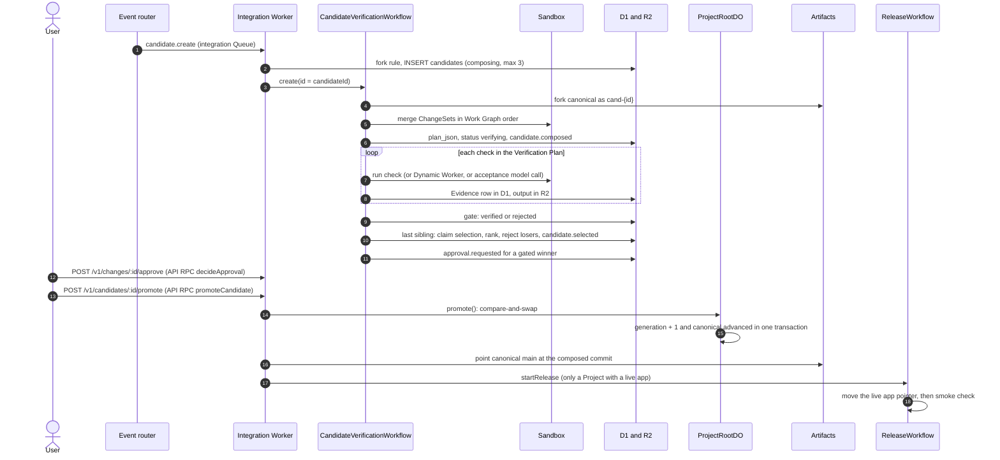
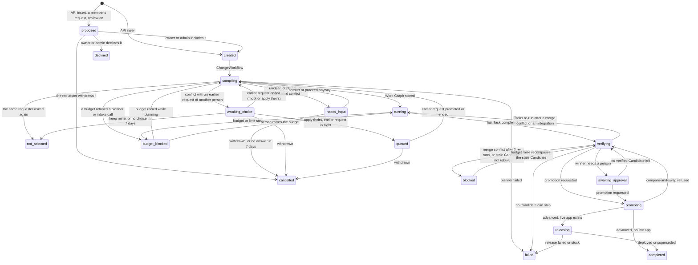
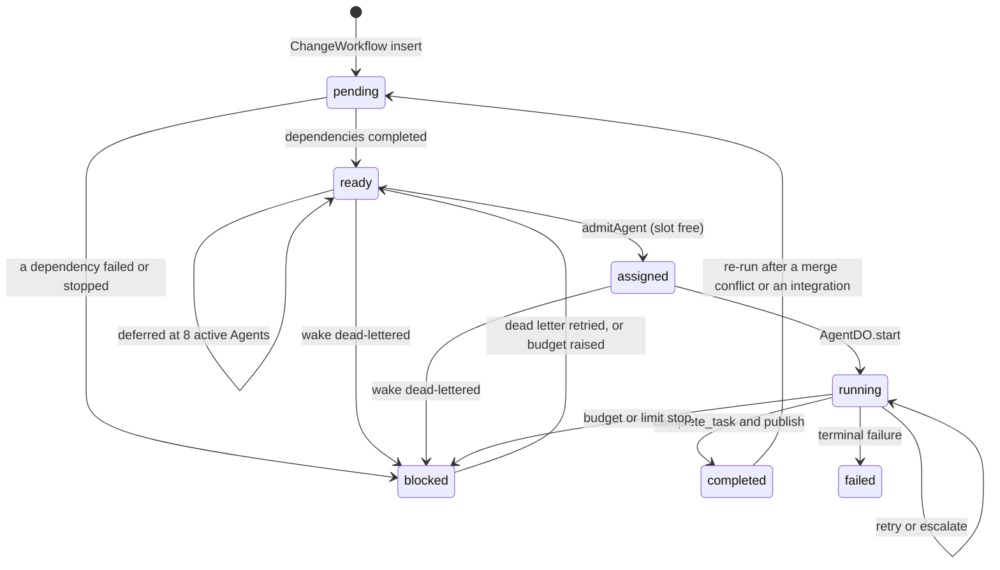
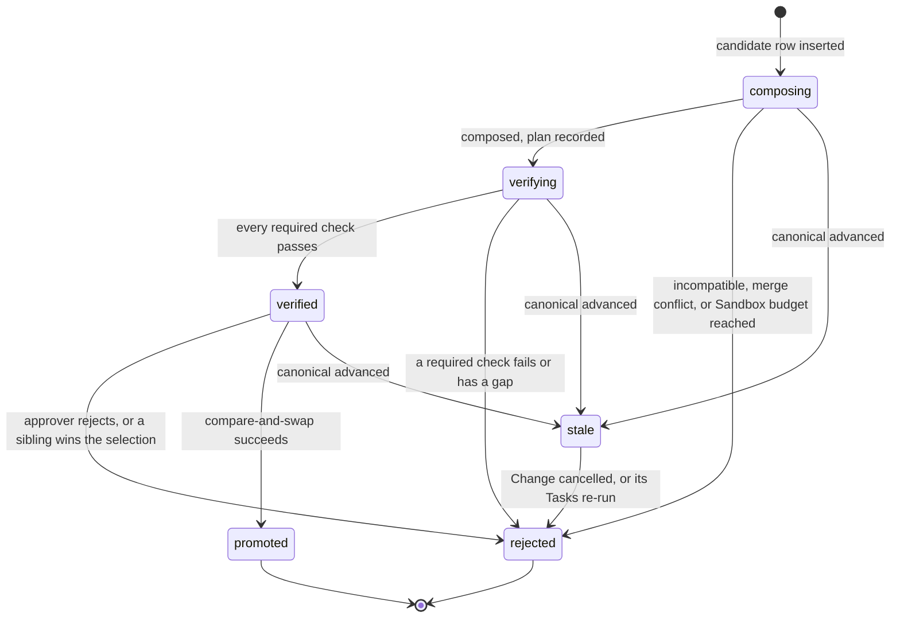
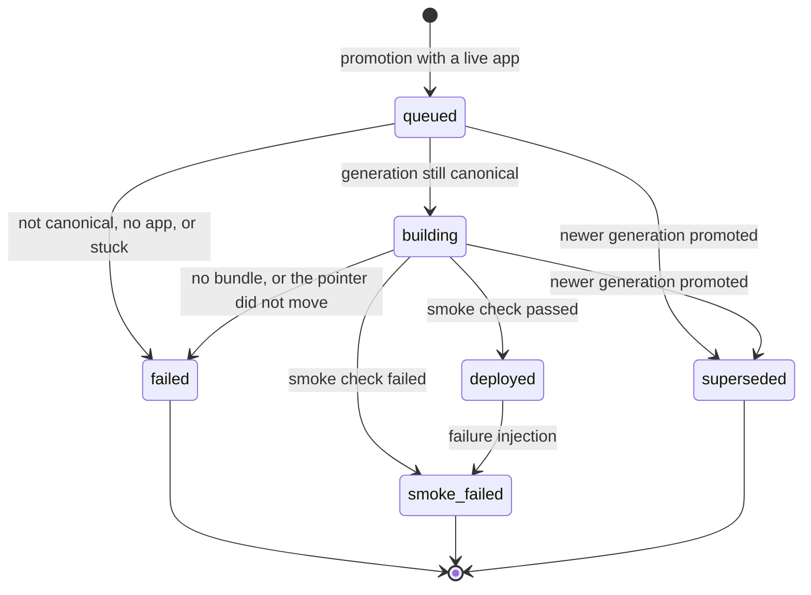

# Change lifecycle

This page follows one user goal from the browser to a release in three sequence diagrams.
Then it shows the status state machines.

The path uses these stable IDs:

| Object | ID rule | Source |
|---|---|---|
| Change | `chg_<uuid>`. Idempotent on `clientRequestId` per requester. | `workers/api/src/projects.ts` |
| ChangeWorkflow instance | The Change ID | `workers/api/src/projects.ts` |
| Task | `tsk_<change>_<key>`, where `<change>` is the Change ID without `chg_` and `<key>` is `t1`, `t2`, ... | `workers/integration/src/change-workflow.ts` |
| Agent | `agt_<task>`: one logical Agent per Task | `workers/integration/src/dispatch.ts` |
| Task run | `run_<task>_<attempt>` | `workers/agents/src/agent-do.ts` |
| ChangeSet | `cs_<run>` | `workers/agents/src/agent-do.ts` |
| Candidate | `cand_` plus the first 24 hex characters of the SHA-256 composition key | `workers/integration/src/candidate-create.ts` |
| Release | `rel_<project>_<generation>` | `workers/integration/src/release-model.ts` |

## Part 1: from goal to ready Tasks

The API stores the Change and starts one ChangeWorkflow (request field `startPlanning`, default `true`).
The API returns before any model call.
A member's request waits for review first (ADR 0028). While the Project setting `memberRequestReview` is on, the API stores the request as `proposed` and starts no ChangeWorkflow.
When an owner or admin includes the request, the Change becomes `created` at the current Canonical Generation. The integration Worker then starts the ChangeWorkflow with the same instance ID.
[Shared Projects](shared-projects.md#request-review) describes the review.
The ChangeWorkflow runs the intake gate, calls the Root Planner, and compares the plan with the other open requests.
Then it stores the Work Graph and dispatches the ready Tasks.
An unclear, duplicate, or conflicting request waits for its requester (`needs_input`).
A request that conflicts with an earlier request of another person waits for that person's choice (`awaiting_choice`, ADR 0032). After "apply theirs", the request is `queued`, and it plans again after the earlier request promotes or ends.
The intake gate reads the request as a change to the current app: the canonical file paths, the `package.json` name and description, the start of the `README.md`, and recent request titles.
It asks only when two readings build materially different products. Each question has its own answer, with the readings as options and "Something else". Small details, such as colors, sizes, and defaults, go to the Root Planner as assumptions.
The intake gate asks at most one round. After an answer, or after "Build it as it is", the request goes to planning.
[Shared Projects](shared-projects.md#the-intake-gate) describes the intake gate, the request comparison, and first-come conflicts (ADR 0025, ADR 0032).

Notes:

- The Root Planner routes to the `opus` tier (`taskKind = plan`, `complexity = large`). With `ALLOW_OPUS` set to `false` (the Terraform default), the `opus` tier runs on Sonnet 5.5 (ADR 0021).
- The plan has a short `title` for the request, at most 6 words. The planner sees the goal with the clarification answers, so the title names the final request. `parsePlan` cuts the title to 48 characters at a word boundary. A missing title never causes a repair turn. The ChangeWorkflow writes it to D1 `changes.title` with the Tasks. Without a title, the API shows `fallbackTitle(goal)` (`packages/protocol/src/change-title.ts`).
- The plan has `assumptions`: up to 8 small product details that the goal leaves open and that the planner decided, for example colors, sizes, or defaults. The planner also gets the open details that the intake gate found. `parsePlan` drops bad entries and cuts the list, so assumptions never cause a repair turn. The ChangeWorkflow writes them to D1 `changes.assumptions_json` (migration `0032_change_assumptions.sql`). The Change page shows them as "Assumptions". To change one, the requester sends a follow-up request.
- The prompt asks for 2 to 8 Tasks. The schema accepts 1 to 12 (`MAX_TASKS_PER_CHANGE`). The planner makes at most two model calls: the plan and one repair turn.
- A UI Task that calls routes of another Task must depend on that Task. The prompt states the rule. `parsePlan` (`workers/integration/src/root-planner.ts`) also repairs the plan without a model call. It adds the edge UI → API between a UI Task and an API Task on the same area when no dependency path joins them. The area is the first resource segment, for example `todos` in `todos:ui` and `todos:api`.
- Every UI Task edits `public/index.html`, and every API Task edits `src/app.ts`. Two Tasks of one kind built in parallel on one base do not merge. So `parsePlan` also runs Tasks of one kind in plan order when no dependency path joins them: the later key depends on the earlier key (`serializeSameSurface`). A UI Task and an API Task still run in parallel.
- The Work Graph JSON goes to R2 at `work-graphs/<project>/<change>.json`.
- Change Events go to the ResourceShardDO that owns `change:<id>`. This keeps ProjectRootDO cold.
- The API writes the Change to ProjectViewDO directly.
- The intake gate records `change.intake.reviewed` and an `INTAKE` Decision Receipt in D1 `change_decisions`. An answer records `change.clarification.answered`.
- An `awaiting_choice` or `queued` Change waits for the event `first_come`. It runs `advanceFirstCome` after each wake, and at the latest every 6 hours while the choice is open and every hour while queued. After 7 days without a choice, the Change is `not_selected`.
- A `needs_input` Change waits for the event `clarification` and reads D1 once a day. After 7 days without an answer, the Change is `cancelled`. The intake gate asks at most one round. The request comparison can ask more. After 3 answered rounds in total, the Change plans without another question.

## Part 2: from a wake to a published ChangeSet

Each wake starts one AgentDO run.
The Agent works in its own Artifacts fork and Sandbox directory.
When the run ends, the Agent publishes a ChangeSet and declares a typed Intent.
The ResourceShardDO then detects conflicts.
[Agents and models](agents-and-models.md) describes the run, model routing, and the Pi loop.

Notes:

- Only Task kinds `implement`, `migrate`, and `test` get a workspace. Other kinds get read-only file tools.
- A Task with dependencies starts on a stacked workspace: canonical plus the dependency ChangeSets. See [Agents and models](agents-and-models.md#stacked-workspaces).
- Conflict detection is deterministic and runs before `task.completed`. A model review (Sonnet tier, then Opus tier) runs later from a durable schedule and stays off the run path.
- Conflict detection and conflict review read protected resources from the Project policy row (D1 `project_policies`, `protectedResources`). A Project without a row, or with a row that does not parse, has no protected resources there.
- When the last Task completes, AgentDO moves the Change to `verifying` and records `verification.started` with reason `work_graph_completed`.

## Part 3: from Candidates to a release

The causal router turns `verification.started` into one `candidate.create` command.
The integration Worker applies the integrate rule, then the fork rule.
It starts one CandidateVerificationWorkflow per Candidate.
Sibling Candidates on one base wait for each other. The last one to settle selects the winner (ADR 0026).
Policy or a person promotes the winner. ProjectRootDO runs the compare-and-swap.

Notes:

- The integrate rule runs before the fork rule. A `confirmed` or `fork_required` conflict between two Tasks on different semantic resources (an API and its UI) creates no Candidate. The dependent Task gets a dependency edge and re-runs once on a stacked workspace with the other Task's ChangeSet. The Change returns to `running`. One Candidate then holds both ChangeSets.
- Two Tasks of one Change that run in parallel on the same base can edit the same file. Their ChangeSets then do not merge. The system re-runs one Task on top of the other Task's work. No model decides this (`settle.ts` and `rebase.ts` in `workers/integration/src`):
  - A Candidate is rejected with `file_conflict` on the current base. The failed Task gets dependency edges to the other Tasks of that Candidate. It re-runs on a stacked workspace with their ChangeSets, together with every Task built on it. The Change returns to `running`.
  - A Task fails with `dependency_merge_conflict`: two of its dependencies do not merge. `task.failed` queues `change.settle`. The dependency that did not merge gets edges to the dependencies before it. It re-runs on their work, with every Task built on it. `conflict.integrated` records this with `trigger: "dependency_merge_conflict"`, and a `TASK_RESTACK` Decision Receipt records the decision.
  - A dependency ChangeSet does not merge with the canonical base: another request promoted while this Change ran. That dependency and every Task built on it re-run on the current canonical state with the rebase instruction. The Change takes the new base generation. `candidate.rebase_requested` records this with `trigger: "dependency_merge_conflict"`.
  - A Change gets at most 2 of these re-runs (`MAX_TASK_RESTACKS`).
  - The re-run Task gets the integrate instruction: build on the real routes, field names, and data shapes of the other Task's ChangeSet.
- A Change with no Task left to run never stays `running`. When a Task failed and no Task is ready, assigned, or running, the Change ends `failed`. `blocked_reason` names the Task and its reason, for example "The Task on canvas:activity failed: ... Submit the request again." `change.failed` records it with `phase: "tasks"`.
- Every 5 minutes, the event router also finds open Changes that are quiet for 3 minutes to 6 hours and cannot move on their own. These are `running` Changes with no Task at work, and `verifying` Changes with no live Candidate. It queues one `change.settle` per Change, at most 10 per sweep. The integration Worker re-checks the Change. Then it re-runs the work, dispatches the Tasks that are ready, or ends the Change with its reason.
- `candidate.create` waits while a conflict review reserved in the last 10 minutes is still open. The last Queue delivery composes anyway.
- A verified Candidate does not promote while a sibling on the same base still composes or verifies. A winner that does not meet every acceptance criterion never auto-promotes. Its Change goes to `awaiting_approval`. See [Source and verification](source-and-verification.md#sibling-candidates-and-selection).
- Auto-promotion applies when the winner needs no human approval, meets every acceptance criterion, and the Project's policy `autoPromoteRiskTiers` lists the Change risk tier. The policy is the D1 `project_policies` row. Without a row, the policy is `DEFAULT_POLICY` (`policy-1` in `workers/integration/src/candidate-composer.ts`). It lists `low` and `medium` in `autoPromoteRiskTiers`, and `high` and `critical` in `humanGateRiskTiers`. The CandidateVerificationWorkflow then calls `promoteCandidate` with actor `system:auto-promotion`, and `canonical.promotion.requested` records `trigger: "auto"`. Every promotion precondition applies (`autoPromoteDecision` in `packages/evidence/src/promotion.ts`).
- These Candidates always wait for a person:
  - a `high` or `critical` Change;
  - an authorization change at any tier (the plan sets `humanApprovalRequired`);
  - a winner with an acceptance shortfall;
  - a Change without a risk tier, or with a tier that a stored policy does not list as automatic.

  A destructive migration has the tier `critical` (Root Planner), so it waits too.
- A Candidate that waits for a person is never silent. The Change goes to `awaiting_approval`. The Candidate status reason states why. `approval.requested` records `reason` and `trigger` (`policy` or `acceptance`). The inbox tells the owner, the admins, and the requester. The Change page shows the reason under Needs attention. An owner or admin approves the Candidate (when approval is required), then ships it with Ship on the Change page or Promote on the Candidate page. Both call `POST /v1/candidates/:id/promote`.
- The Change is `promoting` during the compare-and-swap. After it, the Change is `releasing` when the Project has a live app, else `completed`. The release ends the Change as `completed` (deployed or superseded) or `failed`. See [Live apps](live-apps.md#promotion-and-release).
- Every end after promotion records `change.completed` or `change.failed`. The projector maps `build.started` to `releasing`. These Events move ProjectViewDO out of `promoting`.
- A Change that is still `releasing` 45 minutes after promotion is stuck (`RELEASE_STUCK_AFTER_MS`). Every 5 minutes, the event router reads `changes` by `(status, updated_at)` and queues one `release.recover` per stuck Change (at most 10 per sweep). The integration Worker then re-checks the Change:
  1. A release that already finished settles the Change.
  2. A `queued` or `building` release becomes `failed`, and the Change becomes `failed`.
  3. A Project without a live app completes the Change.
  4. A Project with a live app but no release row gets a `failed` release row, and the Change becomes `failed`.
  The generation stays promoted. The next promotion releases as usual.
- After `canonical.advanced`, the causal router marks every other `composing`, `verifying`, or `verified` Candidate on an older base `stale`. The router does not compose. It queues one `candidates.recompose` command. Promotion runs the same sweep (`settleStaleBehind` in `workers/integration/src/recompose.ts`). The sweep takes each `verified` Candidate on an older base. It also takes each `stale` Candidate whose Change has no other active Candidate and none on a newer base. The order of the two sweeps has no effect.
- Every stale Candidate ends in one of three states: a new Candidate on the new canonical state, a `blocked` Change with a plain reason, or a closed Change. A lineage recomposes at most 2 times (`MAX_RECOMPOSES`). A Change never waits in `verifying` with nothing running.

## Status state machines

The enums are in `packages/protocol/src`.
The diagrams show only the transitions that the code writes.

### Change status

The pure rules are in `workers/integration/src/change-status.ts`.

| Rule | Source |
|---|---|
| A person can cancel a Change in `proposed`, `created`, `compiling`, `needs_input`, `awaiting_choice`, `queued`, `running`, `verifying`, `awaiting_approval`, `budget_blocked`, or `blocked`. Nobody can cancel a Change with a promoted Candidate. | `CANCELLABLE_FROM` in `change-status.ts`, `CANCEL_FROM` and `cancelChange` in `change-commands.ts` |
| Only an owner or admin moves a `proposed` Change: include to `created`, decline to `declined`. Each update has a guard on `proposed`. A repeat returns the stored result. | `includeChange`, `declineChange` in `change-commands.ts` |
| A later conflicting request of the same requester makes the earlier Change `not_selected` from any of these statuses, and also from `failed` or `completed`, when the earlier Change has no promoted Candidate. See [Shared Projects](shared-projects.md#the-same-requester-asks-twice). | `request-check.ts` |
| Only the earlier requester chooses for an `awaiting_choice` Change. The system records `expired` after 7 days, or `moot` when the earlier request ends without a build. The later requester can withdraw the Change. `advanceFirstCome` applies each step with a guard on `awaiting_choice` or `queued`. See [Shared Projects](shared-projects.md#first-come-requests-of-two-people). | `firstComeStep`, `advanceFirstCome` in `first-come.ts` |
| A merge conflict makes the Change re-run the conflicting Tasks: on the new base, or on top of the sibling work when the base did not move. After 2 re-runs the Change is `blocked` with the reason "The work of this request did not merge after two re-runs. Submit it again." | `MAX_REBASE_RERUNS` in `rebase.ts` |
| A `running` Change with a failed Task and no Task ready, assigned, or running ends as `failed`. `blocked_reason` names the Task and its reason. A `verifying` Change with no live Candidate, whose re-runs are used up, ends as `failed` with the reason of its newest Candidate: "No Candidate passed its required checks: ...", or "The agents' work did not merge (...)" when the newest rejection is a merge. Both end with "Submit the request again." | `settleChange` in `settle.ts` |
| The Change ends as `failed` when every Candidate on the newest base is `rejected` for a reason other than a merge conflict or a cancel, and no Candidate of the Change is `composing`, `verifying`, `verified`, or `promoted`. `blocked_reason` starts with "No Candidate passed its required checks:" and quotes the Candidate reasons. `change.failed` records it with `phase: "verification"`. | `verificationDeadEnd` |
| A refused compare-and-swap returns the Change to its status before `promoting`. | `leavePromoting` in `promotion.ts` |
| A verified Candidate can also promote from `running` or `budget_blocked`. | `PROMOTABLE_FROM` |
| `completed`, `cancelled`, `failed`, `not_selected`, and `declined` are terminal. | `TERMINAL_CHANGE_STATUSES` |

`POST /v1/changes/:changeId/cancel`:

1. Cancels the open Tasks and rejects the open Candidates (reason `change cancelled`).
2. A cancel during `compiling` stores the planned Tasks as `cancelled` and records no compile.
3. A running CandidateVerificationWorkflow checks the Change at each step boundary. It stops before it uses more Sandbox or Browser Run time.
4. Dispatch runs only for a `running` Change.
5. An active Agent run stops at its next run check (every 60 s).

`POST /v1/changes/:changeId/budget` raises `budget_usd`. The budget cannot go down.

1. A `budget_blocked` Change returns to `running`. A Change that a budget stopped while planning (it has no Tasks) returns to `compiling`, and a new ChangeWorkflow instance plans it again. `compiling` and `running` are the only statuses that a budget stop interrupts.
2. Its budget-stopped Tasks become `ready` again with a new attempt window, and their blocked dependents become `pending`.
3. The normal dispatch runs.
4. On a `verifying`, `blocked`, or `awaiting_approval` Change, the same call retries a merge-conflict re-run within its bound and recomposes a stale Candidate.

A raise of the Project monthly budget (`PATCH /v1/projects/:projectId`) or of a user monthly budget (`PATCH /v1/me/budget`) runs the same restore for each Change that budget stopped (`resumeBudgetBlocked` in `change-commands.ts`, ADR 0030).

### Task status

A Change cancel moves the open Tasks (`pending`, `ready`, `assigned`, `running`, `blocked`) to `cancelled`.
A merge-conflict re-run sets a Task to `ready` directly when none of its dependencies re-runs.

### Candidate status

`composed` is in the enum and in RPC results. D1 rows go from `composing` directly to `verifying`.
Rhumbatron never retries a stale Candidate blind. A new Candidate on the new base replaces it.

### Release status

The allowed transitions are in `NEXT` (`workers/integration/src/release-model.ts`).
A failed release never deletes canonical history.
Recovery is a new canonical transition.
