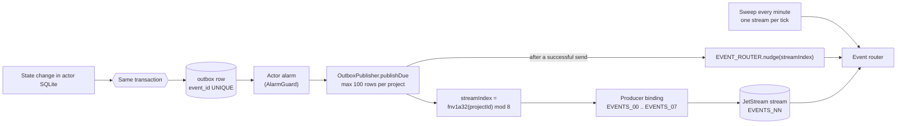
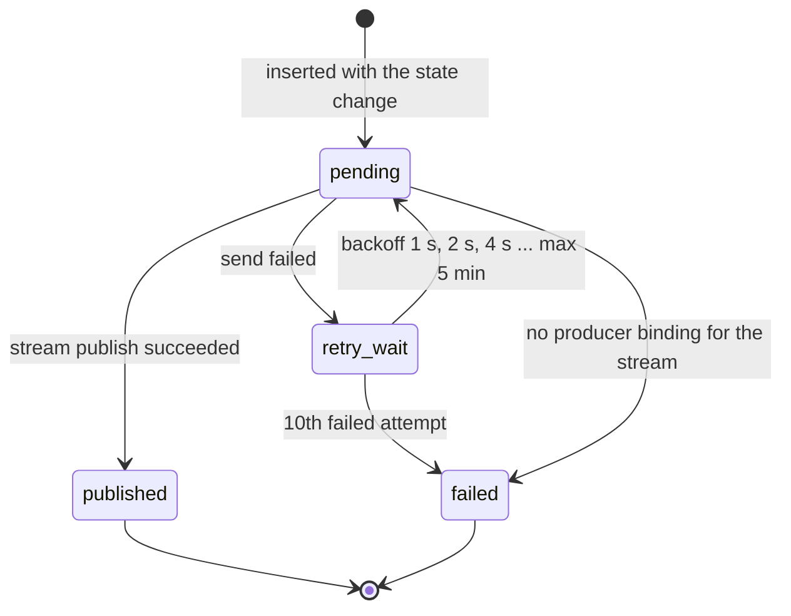
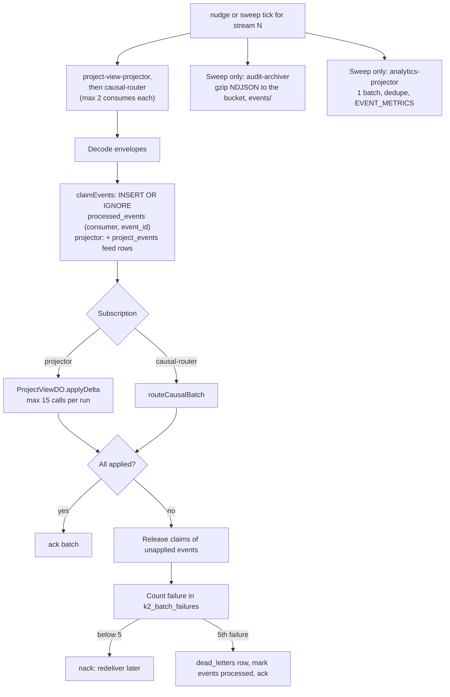
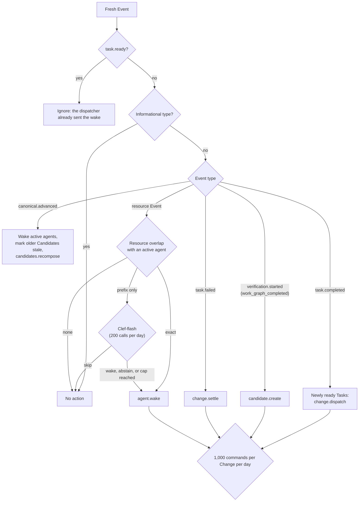
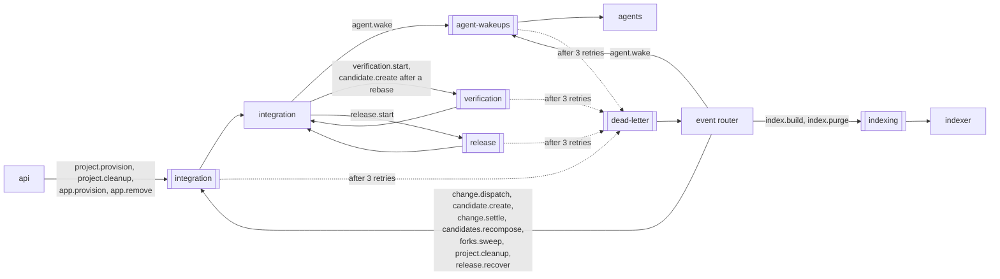
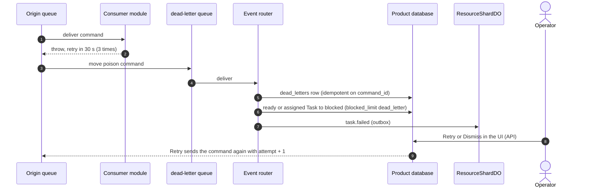
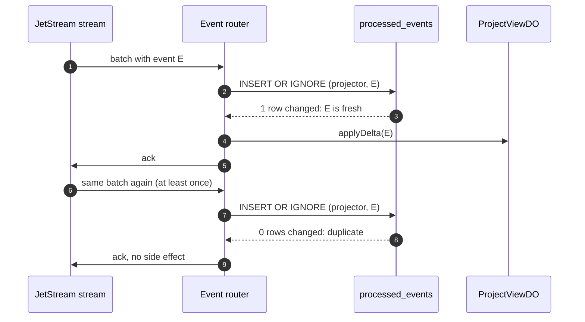

# Events and commands

Rhumbatron keeps facts and work apart.

- An Event is an immutable fact, for example `task.completed`. Events travel on the event log: eight NATS JetStream streams.
- A Command is a request for work, for example `agent.wake`. Commands travel on queues: one JetStream work-queue stream.

No authoritative state change writes to the event log directly.
An actor writes the state change and the Event in one SQLite transaction (the outbox).
A publisher sends the outbox rows to the event log later.

Core creates the streams at start (`packages/platform/src/messaging/jetstream.ts`). The `nats` service stores them on the `nats-data` volume.

## Envelopes

Both envelopes are Zod schemas in `packages/protocol/src`.

| Envelope | Key fields | Stable key | File |
|---|---|---|---|
| Event | `eventId`, `eventType`, `eventVersion`, `tenantId`, `projectId`, `changeId`, `taskId`, `actor`, `resource`, `canonicalGeneration`, `causedBy`, `correlationId`, `timestamp`, `payload` | `eventId` | `event.ts` |
| Command | `commandId`, `commandType`, `projectId`, `changeId`, `taskId`, `attempt`, `createdAt`, `deadline`, `payload` | `commandId` | `command.ts` |

`EVENT_TYPES` in `event.ts` is the closed list of Event types.

Most Change Events get a deterministic ID from `stableEventId` in `workers/integration/src/events.ts`.
The ID is `evt_` plus the first 16 bytes of SHA-256 over the Change ID, the Event type, the Task ID, and an optional key.
A retried Workflow step writes the same Event ID again, and the outbox ignores the repeat.
ProjectRootDO and ResourceShardDO use `crypto.randomUUID()` for Events that they create in their own transaction (for example `canonical.advanced` and `claim.acquired`).
The transaction runs once, so a retry keeps the same ID.

## Transactional outbox to the event log

Two actor classes own an outbox: ProjectRootDO and ResourceShardDO.
ProjectRootDO writes `project.created`, `artifact.promoted`, and `canonical.advanced`.
ResourceShardDO writes all other Events.
Change Events go to the shard that owns `change:<id>` (`appendChangeEvents` in `workers/integration/src/events.ts`).

Rules in the code (`workers/coordinator/src/outbox.ts`, `packages/platform/src/messaging/jetstream.ts`):

- There are 8 streams, `EVENTS_00` to `EVENTS_07`, on the subjects `events.00` to `events.07`. Core creates them at start.
- Retention is 7 days (`max_age`, limits retention, file storage).
- JetStream drops a second publish with the same `event-id` header inside a 2-hour window.
- One Project always maps to one stream. Its Events stay in order on that stream.
- The nudge is an in-process call to the event router. The sweep catches what the nudge misses. The sweep visits one stream per minute, so each stream gets a sweep every 8 minutes.
- `AlarmGuard` (`alarm-guard.ts`) limits each actor to 2,000 alarm fires per UTC day. An alarm with no due work is deleted.

### Outbox row states

A failed row stays in the table with `last_error`, so an operator can see it.
If NATS is down, the state change is still correct. Only the dashboard lags.

## Event router: the event log consumer

The event router runs in core. It reads the streams through the `EVENT_LOG` binding.
Each subscription is a durable JetStream pull consumer with explicit ack. One consume fetches at most 100 records. A nack redelivers the batch after 30 s. An unacknowledged batch comes back after 5 minutes.
Core calls the router's `scheduled` handler at the start of each minute (`scheduleSweep` in `services/core/src/main.ts`).
Every nudge and every sweep tick runs two subscriptions on one stream: `project-view-projector`, then `causal-router`.
The sweep tick also runs one `audit-archiver` batch.
A sweep tick without maintenance or the release sweep also runs one `analytics-projector` batch.

Notes (`workers/event-router/src/index.ts`):

- The router releases the claim rows before a nack. Otherwise a redelivery skips the events as duplicates.
- Events that the 15-call `applyDelta` cap defers lose their claim and come back with the next delivery. A deferral does not count as a failure.
- A skipped event batch gets a `dead_letters` row. An operator can only dismiss it (`poison-batch.ts`).
- A dead letter closes without an operator: `succeeded` when the same command later succeeds, and `superseded` when a later `change.settle` of the same Change runs or when its Change ends (the 5-minute sweep closes the dead letters of `completed`, `failed`, `cancelled`, `not_selected`, and `declined` Changes).
- The archive key is `events/<yyyy>/<mm>/<dd>/stream-<NN>/part-<firstMs>-<hash>.ndjson.gz` in the `rhumbatron-evidence` bucket. Core deletes archive objects after 365 days (`services/core/src/expiry.ts`).
- There are four subscriptions per stream: `causal-router`, `project-view-projector`, `audit-archiver`, and `analytics-projector`. The client creates each durable consumer when it first reads it.
- `analytics-projector` (`analytics.ts`) maps lifecycle Events to metric names (`change_created`, `task_*`, `agent_wakeup`, `model_route`, `candidate_*`, `promotion_*`, `release_completed`, and others). It writes one data point per fresh Event, at most 100 per tick, to `EVENT_METRICS`. Other modules write their own data points to `METRICS`. Both are rows in the `platform_metrics` table.

### Sweep housekeeping

The every-minute sweep also runs two bounded housekeeping jobs (`workers/event-router/src/maintenance.ts`):

| Tick | Work |
|---|---|
| 04:17 UTC, once a day | Queues one `forks.sweep`. Queues `project.cleanup` and `index.purge` for up to 10 archived Projects. Queues an `index.build` backfill for up to 10 active Projects without a ready index. Deletes at most 5,000 `processed_events` rows older than 14 days. |
| Minute 4, 9, 14 ... of each hour | Queues one `release.recover` for each Change still `releasing` 45 minutes after promotion, at most 10 per sweep. Queues one `change.settle` for each open Change that is quiet for 3 minutes to 6 hours and cannot move on its own, at most 10 per sweep. Queues one `index.purge` for each deleted Project that still has index rows, at most 10 per sweep. See [Change lifecycle](change-lifecycle.md#part-3-from-candidates-to-a-release). |

## Causal routing

The causal router decides which Agents wake after each fresh Event (`workers/event-router/src/causal.ts`, `packages/causal-router`).
Deterministic rules run first. Clef-flash decides only a prefix resource overlap. A Clef-flash question is one Claude Haiku call with a forced tool call (`packages/platform/src/ai/models.ts`).

Notes:

- Resource Events are `intent.declared`, `intent.changed`, `challenge.created`, `changeset.proposed`, `claim.released`, and `claim.expired`.
- Clef-flash abstains below a probability of 0.7. An abstention wakes the Agent.
- The 1,000-command cap counts `change.dispatch`, `candidate.create`, `change.settle`, and `agent.wake`. The router logs the dropped commands as errors.
- `artifact.promoted` and `canonical.advanced` both queue `index.build` for the indexer. The cap does not count `index.build` or `candidates.recompose`.
- After `canonical.advanced`, the router marks the promoted Candidate `promoted` and every other open Candidate on an older base `stale`. A Change in `awaiting_approval` with no verified Candidate returns to `verifying`. The `candidates.recompose` command then settles each stale Candidate. See [Change lifecycle](change-lifecycle.md#part-3-from-candidates-to-a-release).
- `task.completed` and `task.failed` free an Agent slot. When a ready Task waits at the 8-agent limit, the router dispatches the Change again.
- The wake consumer checks relevance again. A stale wake ends at once and counts as a false wakeup in `METRICS` (`workers/agents/src/wake-consumer.ts`).

## Queues

Each queue is one subject, `cmd.<queue>`, on the JetStream work-queue stream `COMMANDS`.
Core runs one durable consumer, `q-<queue>`, per queue (`runQueueConsumer` in `packages/platform/src/messaging/jetstream.ts`).

- Delivery is at least once, with explicit ack.
- A send with a `commandId` carries the message ID `<queue>:<commandId>`. JetStream drops a repeat inside a 2-hour window.
- A message stays in the stream for at most 14 days.
- A handler that throws, or that calls `retry`, gets a redelivery after the delay that the handler sets.
- After the last retry the consumer sends the message to `dead-letter` and terminates it.
- A handler can hold a batch for up to 15 minutes. The consumer extends the ack deadline every 30 s while the handler runs.

| Queue | Consumer | Batch | Concurrency | Retries | Retry delay | Dead-letter queue |
|---|---|---|---|---|---|---|
| `agent-wakeups` | agents | 10 | 2 | 3 | 30 s | `dead-letter` |
| `integration` | integration | 10 | 2 | 3 | 30 s | `dead-letter` |
| `verification` | integration | 5 | 2 | 3 | 30 s | `dead-letter` |
| `release` | integration | 5 | 2 | 3 | 30 s | `dead-letter` |
| `indexing` | indexer | 1 | 1 | 3 | 30 s | none (the indexer records the failure in `project_indexes`) |
| `dead-letter` | event router | 5 | 1 | 5 | 60 s | none (dropped and logged) |

The integration module consumes the `integration`, `verification`, and `release` queues with one handler.

Two commands start Workflows: `verification.start` (one per Candidate) and `release.start` (one per promoted generation with a live app).
Each command carries a stable `commandId` and the idempotency key (Candidate ID or release ID).
The consumer uses that key as the Workflow instance ID, so a redelivery finds the existing instance.
The producer starts the Workflow directly only if the send fails (`workers/integration/src/workflow-commands.ts`).

The integration consumer also limits its own work (`MAX_DELIVERIES = 4` in `workers/integration/src/index.ts`):

1. A bounded command with more work asks for another delivery after 10 s.
2. A `candidate.create` that waits for a conflict review asks for another delivery after 45 s. Its last delivery composes anyway.
3. A thrown error retries after 30 s.
4. On the 4th delivery the consumer acknowledges the message. It does not send it to the dead-letter queue.

The daily 04:17 UTC tick queues `forks.sweep` and `project.cleanup` again.

### Dead-letter path

Notes (`workers/event-router/src/dead-letter.ts`, `workers/api/src/dead-letters.ts`):

- A command without a Task, or with a Task that already runs, puts the reason on the Change instead. Only a blocked Task records `task.failed`.
- Retry sends `agent.wake` to `agent-wakeups` and every other command to `integration`.
- The dead-letter consumer never re-sends a command. Only an operator action re-sends it.

## Idempotency and dedupe

Every retry boundary has a stable key, so a retry never creates a second logical result.

| Boundary | Key | Where the code enforces it |
|---|---|---|
| Event publish | `eventId` | `outbox.event_id UNIQUE`; shard `appendEvents` uses `INSERT OR IGNORE` |
| Event consume | `(consumer, event_id)` | `processed_events`, `INSERT OR IGNORE`, kept 14 days |
| Wake command | `cmd_<task>_ready` (dispatch), `cmd_<event>_<task>` (router) | Wake consumer treats a ready wake for a Task that the same Agent holds as a duplicate; `admitAgent` assigns once |
| Dead-letter record | `command_id` | `dead_letters`, `UNIQUE` |
| Change creation | `(project_id, client_request_id)` | Unique constraint and `ON CONFLICT DO NOTHING` |
| Workflow start | Instance ID = Change ID, Candidate ID, or release ID | The workflow engine rejects a second instance with the same ID |
| Workflow start command | `cmd_<candidate>_verify`, `cmd_<release>_release` | `workflowStartFor` maps the command to that instance ID |
| Candidate composition | SHA-256 composition key | Candidate ID derives from the key |
| Promotion | Candidate ID + expected generation | `decidePromotion` returns `already_promoted` |
| Release | `rel_<project>_<generation>` | `releases` primary key |
| Event batch failure | `(consumer, batch_key)` | `k2_batch_failures` |
| Event archive object | Event IDs of the batch | Same key, so a redelivery overwrites the same object |
| Command publish | `<queue>:<commandId>` | JetStream message ID, 2-hour duplicate window |
| Event stream publish | `event-id` header | JetStream message ID, 2-hour duplicate window |

This sequence shows a duplicate event delivery.
The second delivery finds the claim row and applies nothing.

