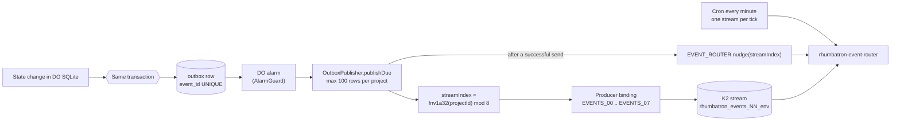
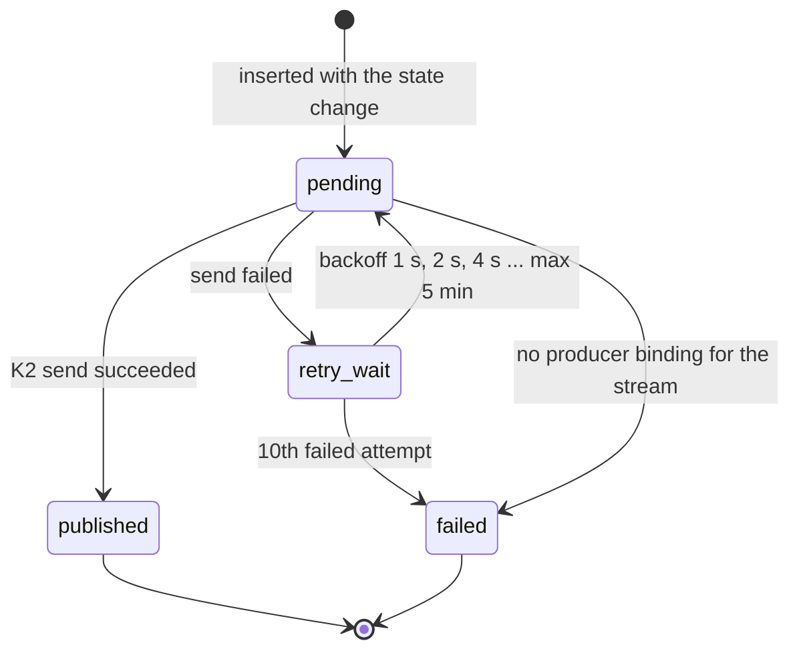
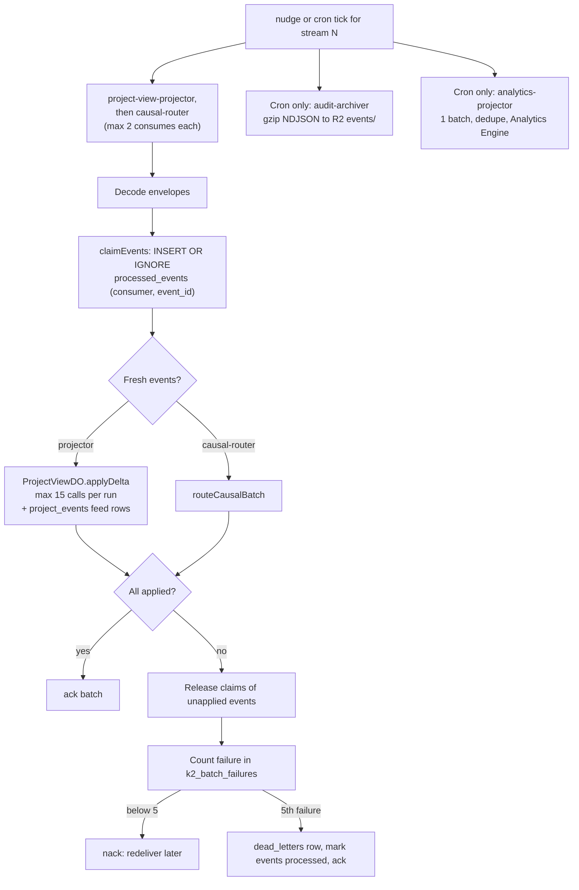
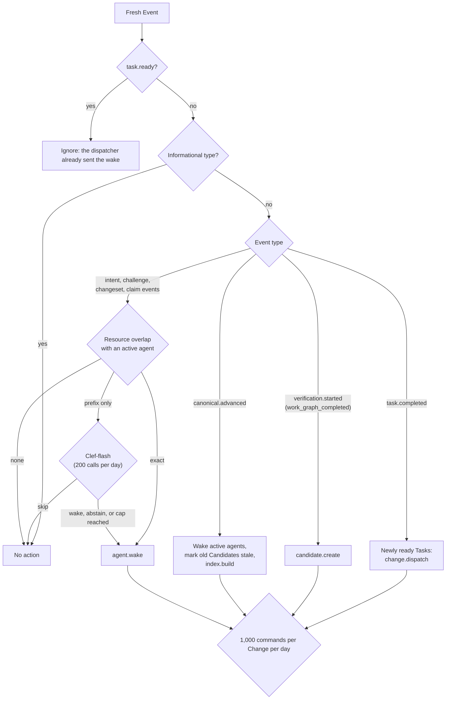
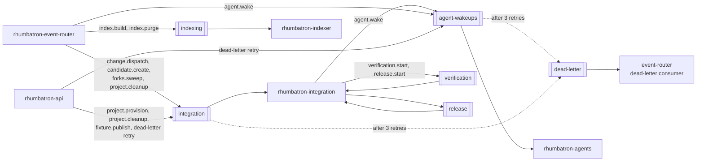
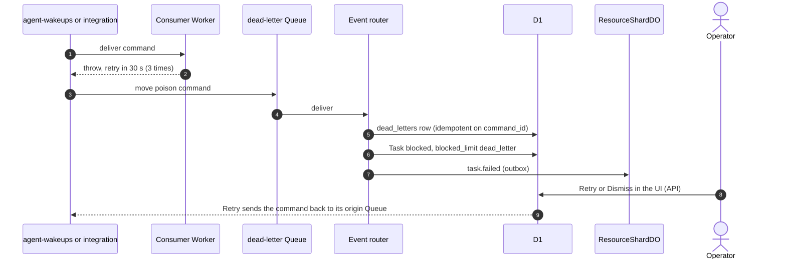
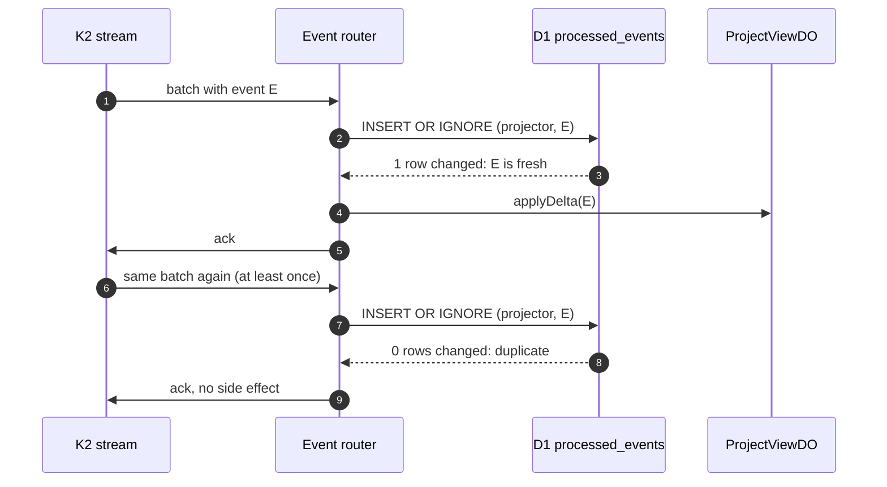

# Events and commands

Rhumbatron keeps facts and work apart.

- An **Event** is an immutable fact, for example `task.completed`. Events travel on K2.
- A **Command** is a request for work, for example `agent.wake`. Commands travel on Queues.

No authoritative state change writes to K2 directly.
A Durable Object writes the state change and the Event in one SQLite transaction (the outbox).
A publisher sends the outbox rows to K2 later.

## Envelopes

Both envelopes are Zod schemas in `packages/protocol/src`.

| Envelope | Key fields | Stable key | File |
|---|---|---|---|
| Event | `eventId`, `eventType`, `eventVersion`, `tenantId`, `projectId`, `changeId`, `taskId`, `actor`, `resource`, `canonicalGeneration`, `causedBy`, `correlationId`, `timestamp`, `payload` | `eventId` | `event.ts` |
| Command | `commandId`, `commandType`, `projectId`, `changeId`, `taskId`, `attempt`, `createdAt`, `deadline`, `payload` | `commandId` | `command.ts` |

Most Change Events get a deterministic ID from `stableEventId` in `workers/integration/src/events.ts`.
The ID is `evt_` plus 16 bytes of SHA-256 over the Change ID, the Event type, the Task ID, and an optional key.
A retried Workflow step therefore writes the same Event again, and the outbox ignores it.
ProjectRootDO uses `crypto.randomUUID()` inside its own transaction.
This is safe because the transaction runs once.

## Transactional outbox to K2

Two Durable Object classes own an outbox: ProjectRootDO and ResourceShardDO.
ProjectRootDO writes project-wide facts (`project.created`, `artifact.promoted`, `canonical.advanced`).
ResourceShardDO writes everything else, because Change events go to the shard that owns `change:<id>`.

Rules in the code:

- There are 8 streams, named `rhumbatron_events_00_prod` through `rhumbatron_events_07_prod`. `AGENTS.md` uses hyphens. K2 names allow only letters, digits, and underscores (ADR 0006).
- Retention is 7 days (`retention_seconds = 604800`).
- One project always maps to one stream, so its Events stay in order on that stream.
- The nudge is best effort. The cron sweep is the backstop. The cron visits one stream per minute, so each stream gets a sweep every 8 minutes.
- A Terraform precondition fails the plan if the account would have more than 20 K2 streams.

### Outbox row states

A failed row stays in the table with `last_error`, so an operator can see it.
If K2 is down, the state change is still correct. Only the dashboard lags (section 42.6).

## Event router: K2 pull consumer

The event router pulls from K2 over HTTP with `K2_CONSUMER_TOKEN`.
It runs two subscriptions per stream on every nudge and every cron tick.
The cron tick also runs the `audit-archiver` subscription.
On a tick without maintenance or the release sweep, it also runs one `analytics-projector` batch.

Notes:

- The subrequest budget is at most 37 per invocation, below the Workers Free limit of 50.
- The router releases the claim rows before a nack. Without that step, a redelivery would skip the events as duplicates.
- The archive key is `events/<day>/stream-<NN>/part-<firstMs>-<hash>.ndjson.gz`. The R2 lifecycle expires `events/` after 365 days.
- Terraform creates four subscriptions: `causal-router`, `project-view-projector`, `audit-archiver`, and `analytics-projector`.
- `analytics-projector` (`workers/event-router/src/analytics.ts`) maps lifecycle Events to section 41.1 metric names (`change_created`, `task_*`, `agent_wakeup`, `model_route`, `candidate_*`, `promotion_*`, `release_completed`, and others). It writes one data point for each Event to the `rhumbatron_event_metrics_<env>` dataset (binding `EVENT_METRICS`). This separate dataset keeps these points apart from the source points in `METRICS`. Dedupe uses `processed_events` like the other consumers. It skips maintenance and release-sweep ticks, so a tick stays at 46 subrequests or fewer. The expected volume is about 1,000 points on a busy day, and the free limit is 100,000.

## Causal routing

The causal router decides which Agents wake after each fresh Event.
Deterministic rules come first. Clef-flash on Workers AI decides only an ambiguous resource overlap.

Notes:

- Clef-flash abstains below a probability of 0.7. An abstention wakes the Agent, which is the safe default.
- `artifact.promoted` and `canonical.advanced` both queue `index.build` for the indexer.
- When a Task completes or fails, it frees an Agent slot. If a ready Task waits at the 8-agent limit, the router dispatches the Change again.
- The wake consumer checks relevance again. A stale wake ends at once and counts as a false wakeup in Analytics Engine.

## Queues

All Queues are named `rhumbatron-<purpose>-<env>`.
Terraform creates six Queues (`modules/async`) with 1 day of message retention.
All six carry traffic.

| Queue | Consumer | Batch | Retries | Retry delay | Dead-letter Queue |
|---|---|---|---|---|---|
| `agent-wakeups` | `rhumbatron-agents` | 10 | 3 | 30 s | `dead-letter` |
| `integration` | `rhumbatron-integration` | 10 | 3 | 30 s | `dead-letter` |
| `indexing` | `rhumbatron-indexer` | 1, concurrency 1 | 3 | 30 s | none (failure recorded in `project_indexes`) |
| `dead-letter` | `rhumbatron-event-router` | 5 | 5 | 60 s | none (dropped and logged) |
| `verification` | `rhumbatron-integration` | 5 | 3 | 30 s | `dead-letter` |
| `release` | `rhumbatron-integration` | 5 | 3 | 30 s | `dead-letter` |

Two commands start Workflows: `verification.start` (one per Candidate) and `release.start` (one per promoted generation with a live app).
Each command carries a stable `commandId` and the idempotency key (Candidate ID or release ID).
The consumer starts the existing Workflow with that key as the instance ID, so a redelivery finds the running instance.
The producer starts the Workflow directly only if the send fails (`workers/integration/src/workflow-commands.ts`).

The integration consumer also limits its own work.
A command that has more work asks for another delivery, at most 4 deliveries in total.
On the last delivery it acknowledges the message instead of sending it to the dead-letter Queue.
The daily maintenance tick at 04:17 UTC queues the bounded work again.

### Dead-letter path

The dead-letter consumer never re-sends a command by itself.
Only an operator action re-sends it (ADR 0019).

## Idempotency and dedupe

Every retry boundary has a stable key, so a retry never creates a second logical result.

| Boundary | Key | Where the code enforces it |
|---|---|---|
| Event publish | `eventId` | `outbox.event_id UNIQUE`; shard `appendEvents` ignores a repeat |
| Event consume | `(consumer, event_id)` | D1 `processed_events`, `INSERT OR IGNORE` |
| Wake command | `cmd_<task>_ready` | Wake consumer treats a Task that the same Agent already holds as a duplicate |
| Dead-letter record | `command_id` | D1 `dead_letters` |
| Change creation | `(project_id, client_request_id)` | D1 unique constraint and `ON CONFLICT DO NOTHING` |
| Workflow start | Instance ID = Change ID, Candidate ID, or release ID | Workflows reject a second instance with the same ID |
| Workflow start command | `cmd_<candidate>_verify`, `cmd_<release>_release` | `workflowStartFor` maps the command to that instance ID |
| Candidate composition | SHA-256 composition key | Candidate ID derives from the key |
| Promotion | Candidate ID + expected generation | `decidePromotion` returns `already_promoted` |
| Release | `rel_<project>_<generation>` | D1 `releases` primary key |
| K2 batch failure | `(consumer, batch_key)` | D1 `k2_batch_failures` |

This sequence shows a duplicate K2 delivery.
The second delivery finds the claim row and applies nothing.

