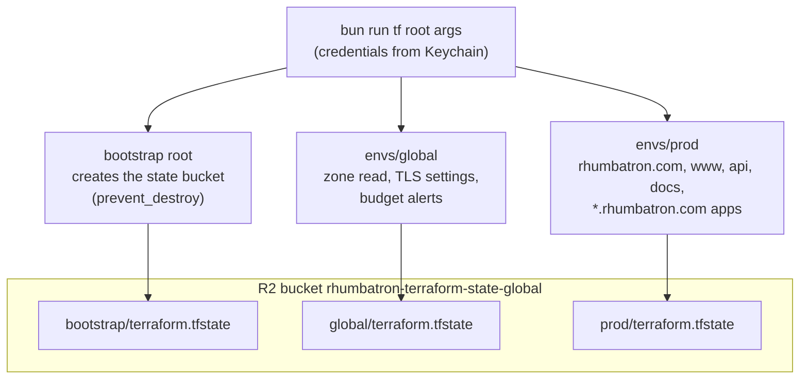
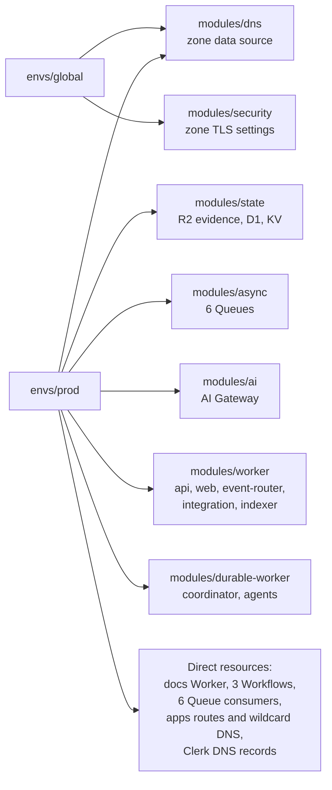
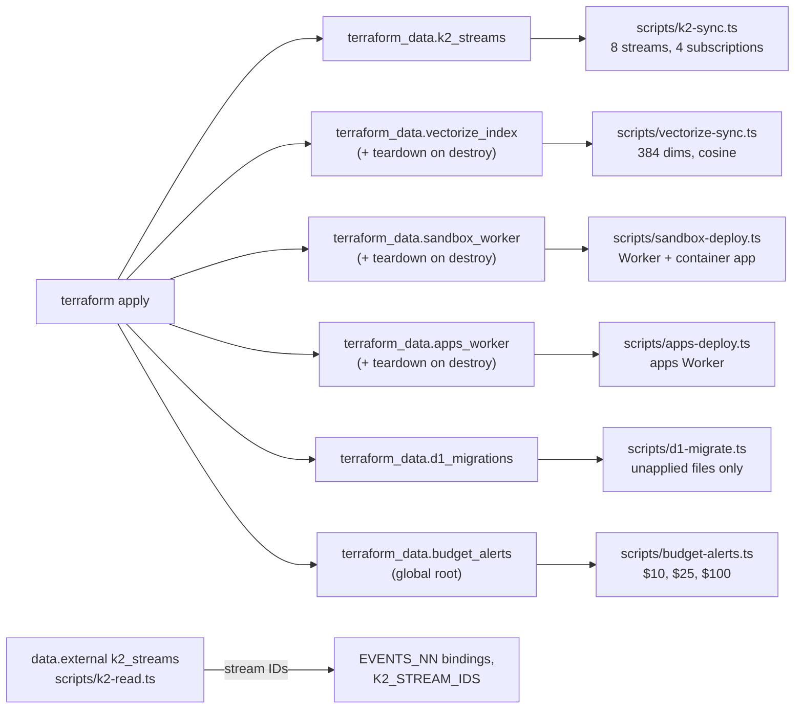
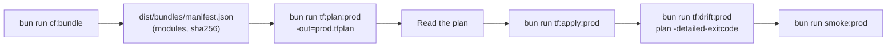
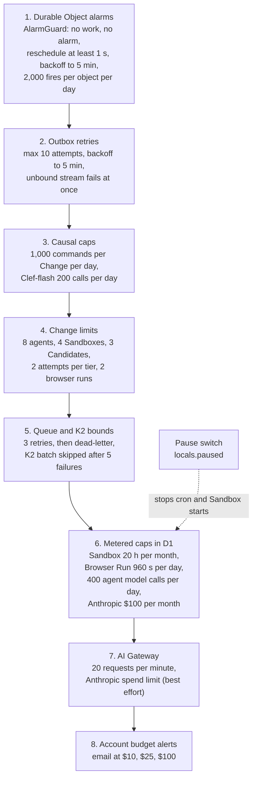
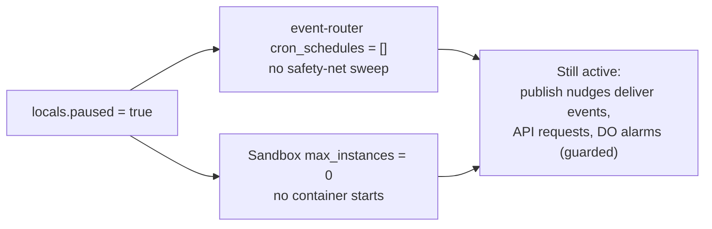

# Infrastructure and cost

This page explains how Terraform owns the Cloudflare control plane.
It also explains how the code keeps the bill inside free and included limits.

Main source files:

- `infrastructure/terraform/bootstrap`, `envs/global`, `envs/prod`, `modules/*`
- `scripts/tf.ts`, `scripts/build-workers.ts`, and the adapter scripts in `scripts/`
- `workers/coordinator/src/alarm-guard.ts`, `workers/event-router/src/causal.ts`, `workers/agents/src/limits.ts`
- ADR 0003 (Vectorize adapter), 0004 (bootstrap credentials), 0005 (DO Workers), 0006 (K2 adapter), 0012 (Sandbox Worker), 0017 (prod), 0019 (billing guards), 0020 (live apps), 0021 (Anthropic budget), 0024 (single prod environment)

## Terraform roots and state

There are three roots:

- `bootstrap` creates only the state bucket.
- `envs/global` owns account-wide and zone-wide singletons.
- `envs/prod` owns the one remote environment. Rhumbatron has no other remote environment.

All three keep state in one R2 bucket, with one key per root.

Rules:

- The backend is the S3 backend on R2 with `use_lockfile = true`.
- `scripts/tf.ts` loads the shared credentials and the secrets of the selected root from the macOS Keychain. A value that is already in the environment wins.
- `scripts/tf.ts` refuses `-auto-approve`.
- Provider: `cloudflare/cloudflare ~> 5.27`. Terraform `>= 1.16.0`. Prod also uses `hashicorp/external ~> 2.4` to read K2 stream IDs.
- The zone `rhumbatron.com` is a data source. No plan can delete the domain.

### Modules per root

`modules/observability` has no resources, and no root uses it.
Workers Logs settings are in `modules/worker` and `modules/durable-worker`.

Two Worker modules exist (ADR 0005):

- `modules/worker` uses `cloudflare_worker`, `cloudflare_worker_version`, and `cloudflare_workers_deployment` at 100 percent, plus custom domains and cron triggers.
- `modules/durable-worker` uses `cloudflare_workers_script`, because Cloudflare rejects Durable Object migrations in version uploads. The steady state is migration tag `v1 -> v1`.

Prod also has these checks:

- A `check` block warns when the Clerk publishable key is a development key (`pk_test_`).
- A precondition on `terraform_data.k2_streams` fails the plan when the account would have more than 20 K2 streams.

### Adapters

Provider 5.27 has no resource for K2 streams, Vectorize indexes, a container on a DO class, the apps Worker, D1 schema migrations, or billing budget alerts.
A `terraform_data` adapter covers each one.
Each adapter runs a Bun script, and only `terraform apply` can run it.
The shared API helper `scripts/lib/cloudflare-api.ts` and `scripts/d1-migrate.ts` refuse to run unless `RHUMBATRON_INVOKED_BY=terraform`.

Rules:

- Each adapter runs again when its input changes.
- The D1 migration adapter keys on the hash of every `*.sql` file in `migrations/d1`.
- `data.external k2_inventory` lists the K2 streams of the account at plan time, for the 20-stream precondition.
- A teardown runs only on a real destroy. A config change never deletes a live resource.

### Deployment loop

Deployment runs on a developer machine. `.github/workflows/ci.yml` runs checks only.
Rhumbatron never uses `wrangler deploy`.

A new bundle hash creates a new Worker version (`modules/worker`) or a new full script upload (`modules/durable-worker`).
Bindings carry the environment configuration, so one bundle serves every environment.

## Cost guard layers

Cloudflare has no hard spend cap (ADR 0019).
The code stacks independent guards, from the inner code paths out to the account.

| Layer | Cap | Where |
|---|---|---|
| DO alarm guard | 2,000 fires per object per UTC day | `workers/coordinator/src/alarm-guard.ts` (ProjectRootDO, ResourceShardDO, AgentDO schedules) |
| Outbox | 10 publish attempts per row | `workers/coordinator/src/outbox.ts` |
| Causal router | 1,000 commands per Change per day | `workers/event-router/src/causal.ts` |
| Clef-flash | 200 calls per day. The causal router, agent routing, and the intake gate share one `clef-flash` counter. | `causal.ts`, `agent-do.ts`, `workers/integration/src/intake.ts` |
| Active agents | 8 per Change | `workers/agents/src/limits.ts` |
| Coding Sandboxes | 4 open per Change, 1 container instance | `limits.ts`, Terraform `max_instances` |
| Candidates | 3 per Change | `workers/integration/src/candidate-create.ts` |
| Attempts | 2 per Task per tier | `limits.ts` |
| Model calls | 16 per run (Haiku) or 32 per run (Sonnet, Opus), 400 agent calls per day | `packages/model-router/src/budget.ts` |
| Change budget | `budgetUsd`, default 3 USD, max 100 USD | `packages/protocol/src/project.ts` |
| Queues | 3 retries, then `rhumbatron-dead-letter`. The indexing Queue has no dead-letter Queue and records the failure in D1. | `envs/prod/main.tf` queue consumers |
| K2 batches | A batch that fails 5 times is skipped and recorded | `workers/event-router/src/poison-batch.ts` |
| Sandbox time | 72,000 s (20 h) per month | `SANDBOX_MONTHLY_SECONDS` binding |
| Browser Run | 960 s per day, 55 s per session, 2 runs per Candidate | `BROWSER_DAILY_SECONDS` binding, `check-semantics.ts` |
| Embeddings | 2,000 texts per day, 10,000 vectors per account | `workers/indexer/src/handler.ts` |
| Vectorize queries | 1,000 query embeddings per day | `workers/agents/src/retrieval.ts` |
| Anthropic spend | 100 USD per calendar month, reserve then settle on the D1 meter | `ANTHROPIC_MONTHLY_BUDGET_USD` binding, `packages/model-router/src/spend-meter.ts` |
| Account | Alerts at 10, 25, 100 USD | `envs/global` |

Each Worker reads the Sandbox, Browser Run, and Anthropic caps from a binding and meters them in the prod D1 database.
A Worker without the Anthropic binding uses 10 USD per month (`ANTHROPIC_MONTHLY_BUDGET_FALLBACK_USD`).
Terraform refuses an Anthropic budget above 100 USD (variable validation in `envs/prod/variables.tf`).

A guard that trips stops new expensive work and keeps all state.
A concurrency limit applies backpressure. The work waits for a free slot.
A budget limit stops the work. The Task becomes `blocked`, and the Change becomes `budget_blocked` and names the exact limit.

## Pause switch

`envs/prod/main.tf` has `locals.paused`.
To pause:

1. Set `paused` to `true`.
2. Run the plan and read it.
3. Apply the plan.

All data stays.

The pause switch does not stop Durable Object alarms.
The alarm guard limits them (ADR 0019).
To resume, set `paused` to `false` and apply again.
See [pause-resume.md](../operations/pause-resume.md) for the full procedure.
