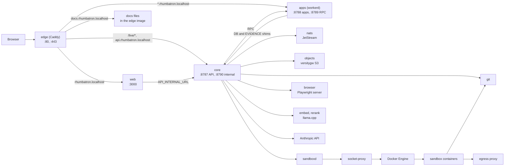
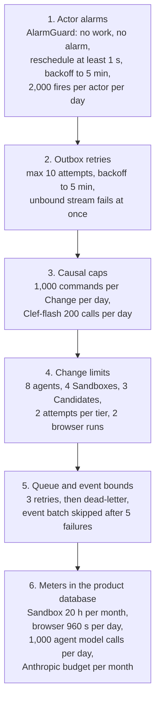

# Infrastructure and cost

Rhumbatron runs as one Docker Compose stack on one computer (ADR 0034).
This page lists the services, the networks, and the volumes of the stack.
It also explains what costs money and how the code limits it.

Main source files:

- `compose.yaml`, `services/*`, `containers/sandbox/Dockerfile`
- `services/core/src/main.ts` and `services/core/src/config.ts`
- `packages/platform/src/**`
- `workers/coordinator/src/alarm-guard.ts`, `workers/event-router/src/causal.ts`, `workers/agents/src/limits.ts`
- `packages/model-router/src/budget.ts`, `packages/model-router/src/spend-meter.ts`, `workers/integration/src/sandbox-meter.ts`
- ADR 0020 (live apps), ADR 0021 (Anthropic budget), ADR 0034 (the stack)

[local-stack.md](../operations/local-stack.md) tells an operator how to start, stop, and inspect the stack.

## Services

`bun run stack:up` writes `.env` and runs `docker compose up -d --build`.
Each service is one container.

| Service | Image or build | Role |
|---|---|---|
| `edge` | `services/edge/Dockerfile` (Caddy 2.11.7 with the docs site built in) | TLS from Caddy's local CA, routing by host name, WebSocket proxy. Serves the docs site from `/srv/docs`. |
| `web` | `apps/web/Dockerfile` | TanStack Start app on Bun. Calls core at `http://core:8787`. |
| `core` | `services/core/Dockerfile` | One Bun process. It hosts the API, the coordinator actors, the agents, integration and its Workflows, the event router, and the indexer. |
| `apps` | `services/apps/Dockerfile` (`workerd` 1.20261008.1) | Live apps and Candidate previews. Builds and checks app bundles for core (ADR 0020). |
| `git` | `services/git` | One bare Git repository per Project, Task fork, or Candidate fork. Smart HTTP with signed, scoped tokens. |
| `nats` | `nats:2.15.2-alpine` | JetStream: the command queues and the event log. |
| `objects` | `versity/versitygw:v1.10.0` | S3 bucket `rhumbatron-evidence` on plain files. |
| `browser` | `services/browser` (Playwright 1.64.1 server) | Browser checks. Core connects over WebSocket. |
| `embed` | `ghcr.io/ggml-org/llama.cpp:server-b12110` | `bge-small-en-v1.5` embeddings, 384 dimensions. |
| `rerank` | `ghcr.io/ggml-org/llama.cpp:server-b12110` | `bge-reranker-base` reranking. |
| `sandboxd` | `services/sandboxd` | Creates one sibling container per Sandbox ID through the socket proxy. |
| `socket-proxy` | `wollomatic/socket-proxy:1.13.2` | Allows only the Docker Engine calls that sandboxd uses. Rejects every bind mount. |
| `egress` | `services/sandboxd` (`bun src/egress.ts`) | HTTP(S) proxy for Sandboxes with a `host:port` allowlist: package registries, GitHub, and `git:8080`. |
| `sandbox-image` | `containers/sandbox` | Builds `rhumbatron/sandbox:local` and exits. |

Every long-running service has `restart: unless-stopped`.
`core` waits for healthy `nats` and `git`. `web` and `apps` wait for a healthy `core`.

### Host names

| Host | Service |
|---|---|
| `https://rhumbatron.localhost` | `web`. The path `/live/*` goes to `core`. |
| `https://api.rhumbatron.localhost` | `core` |
| `https://docs.rhumbatron.localhost` | The docs site in `edge` |
| `https://<slug>.rhumbatron.localhost`, `https://<previewId>--<slug>.rhumbatron.localhost` | `apps` |

### Networks

| Network | Members | Rule |
|---|---|---|
| `default` | All services except `socket-proxy` and `sandbox-image` | Normal Compose network with a route out, subnet `172.31.240.0/24`. `core` has the fixed address `172.31.240.10`: workerd in `apps` resolves `core` once, at start, so the address must not change when `core` restarts. |
| `rhumbatron_sbx` (`sbx`) | Sandboxes, `sandboxd`, `egress`, `git` | `internal: true`. A Sandbox reaches only `egress:4750`, `git:8080`, `sandboxd`, and other Sandboxes. |
| `rhumbatron_docker` (`docker`) | `sandboxd`, `socket-proxy` | `internal: true`. Only sandboxd reaches the socket proxy. |

Only `socket-proxy` mounts the Docker socket. `bun run check:guardrails` fails when another Compose service mounts it.

### Volumes

| Volume | Service | Contents |
|---|---|---|
| `core-data` | `core` | `rhumbatron.sqlite` (product tables, `CONFIG`, `MEMORY`, metrics), `workflows.sqlite`, and `actors/` (one SQLite file per actor and `registry.sqlite`) |
| `git-data` | `git` | Bare repositories and `_meta/git.sqlite` (repository metadata and tokens) |
| `objects-data` | `objects` | The objects of the `rhumbatron-evidence` bucket |
| `nats-data` | `nats` | JetStream streams and consumers (at most 10 GB file store) |
| `apps-data` | `apps` | `AppDataDO` storage of each live app (`/data/do`) |
| `caddy-data`, `caddy-config` | `edge` | The local CA, certificates, and Caddy state |
| `models` | `embed`, `rerank` | The downloaded model files, about 300 MB |

`docker compose down` keeps the volumes. `docker compose down -v` deletes all data.

### Bindings in core

`services/core/src/main.ts` builds one environment and gives it to every module in core.
The application code uses the binding names below.
`packages/platform` implements each binding.

| Binding | Backend |
|---|---|
| `DB` | `SqlDatabase`: `rhumbatron.sqlite` through `bun:sqlite`. Core applies each unapplied file of `migrations/d1` at start and records it in `d1_migrations`. |
| `CONFIG` | `KeyValueStore`: table `platform_kv` in the same file |
| `MEMORY` | `VectorIndex`: 384-dimension vectors in the same file. Exact cosine search inside one Project. |
| `METRICS`, `EVENT_METRICS` | `MetricsDataset`: table `platform_metrics`. Core deletes rows older than 30 days at start. |
| `EVIDENCE` | `ObjectBucket` on the `objects` service |
| `PROJECT_ROOT`, `RESOURCE_SHARD`, `PROJECT_VIEW`, `AGENT` | Actor namespaces of the actor host |
| `CHANGE_WORKFLOW`, `CANDIDATE_WORKFLOW`, `RELEASE_WORKFLOW` | The workflow engine |
| `AGENT_WAKEUPS`, `INTEGRATION_COMMANDS`, `VERIFICATION_COMMANDS`, `INDEXING`, `RELEASE_COMMANDS` | JetStream queue producers |
| `EVENTS_00` to `EVENTS_07`, `EVENT_LOG` | JetStream event stream producers, and the consumer client |
| `ARTIFACTS` | `GitServiceClient` for the `git` service |
| `SANDBOX` | The sandboxd client |
| `APPS` | The RPC client for the `apps` service |
| `BROWSER` | The WebSocket endpoint of the `browser` service |
| `AI` | `SmallModels`: `embed`, `rerank`, and Clef-flash questions to Claude Haiku |
| `EVENT_ROUTER`, `INTEGRATION`, `AGENTS` | In-process entrypoint objects |

## What costs money

Only model calls to the Anthropic API cost money.
All other services run on the local computer and have no usage charge.

| Item | Limit | Where |
|---|---|---|
| Anthropic spend | `ANTHROPIC_MONTHLY_BUDGET_USD` per calendar month, default 100 USD. Each call reserves an estimate on the meter, then settles to its exact cost. A refused reservation stops the call. | `packages/model-router/src/spend-meter.ts`, `usage_counters` row `anthropic-usd-micro` |
| Agent model calls | 1,000 per UTC day, 16 per run (Haiku), 32 per run (Sonnet, Opus) | `packages/model-router/src/budget.ts` |
| Clef-flash questions | 200 per UTC day, one shared `clef-flash` counter. Each question is one Claude Haiku call with a forced tool call. The spend meter does not record these calls. | `causal.ts`, `agent-do.ts`, `workers/integration/src/intake.ts`, `packages/platform/src/ai/models.ts` |
| Opus | `ALLOW_OPUS` is `false` by default. Each opus decision then runs on Sonnet (ADR 0021). | `.env`, `compose.yaml` |

Compose passes `ANTHROPIC_MONTHLY_BUDGET_USD` and `ALLOW_OPUS` from `.env`.
Code without the budget binding uses 10 USD per month (`ANTHROPIC_MONTHLY_BUDGET_FALLBACK_USD`). Core always sets the binding.

### Local caps

The local caps protect the computer, not a bill.
Core reads them from its environment. `compose.yaml` does not set them, so the defaults in `services/core/src/config.ts` apply.

| Variable | Default | Meaning |
|---|---|---|
| `SANDBOX_MONTHLY_SECONDS` | 72,000 (20 h) | Awake Sandbox time per calendar month, on the `sandbox-seconds` meter. A use reserves seconds first. At the cap, new Sandbox work stops. |
| `BROWSER_DAILY_SECONDS` | 960 | Browser check time per UTC day. One session lasts at most 55 s. A Candidate gets at most 2 runs. |
| `SANDBOX_MAX` | 4 | Live Sandbox containers in sandboxd. A call that needs one more fails with `ContainerUnavailableError`. |
| `SANDBOX_IDLE_MS` | 120,000 | sandboxd removes a Sandbox after this idle time, with its disk. |
| `SANDBOX_CPUS`, `SANDBOX_MEMORY_MB` | 2, 2048 | Resources of one Sandbox container. |

## Guard layers

The code stacks independent guards, from the inner code paths out to the meters.

| Layer | Cap | Where |
|---|---|---|
| Actor alarm guard | 2,000 fires per actor per UTC day | `workers/coordinator/src/alarm-guard.ts` (ProjectRootDO, ResourceShardDO, AgentDO schedules) |
| Outbox | 10 publish attempts per row | `workers/coordinator/src/outbox.ts` |
| Causal router | 1,000 commands per Change per day | `workers/event-router/src/causal.ts` |
| Clef-flash | 200 calls per day, shared by the causal router, agent routing, and the intake gate | `causal.ts`, `agent-do.ts`, `intake.ts` |
| Active agents | 8 per Change | `workers/agents/src/limits.ts` |
| Coding Sandboxes | 4 open per Change | `limits.ts` |
| Candidates | 3 per Change | `workers/integration/src/candidate-create.ts` |
| Attempts | 2 per Task per tier | `limits.ts` |
| Model calls | 16 per run (Haiku) or 32 per run (Sonnet, Opus), 1,000 agent calls per day | `packages/model-router/src/budget.ts` |
| Change budget | `budgetUsd`, default 3 USD, max 100 USD | `packages/protocol/src/project.ts` |
| Queues | 3 retries, then `dead-letter`. The indexing queue has no dead-letter queue and records the failure in `project_indexes`. | `services/core/src/main.ts` |
| Event batches | A batch that fails 5 times is skipped and recorded | `workers/event-router/src/poison-batch.ts` |
| Sandbox time | 72,000 s (20 h) per month | `SANDBOX_MONTHLY_SECONDS` |
| Browser checks | 960 s per day, 55 s per session, 2 runs per Candidate | `BROWSER_DAILY_SECONDS`, `check-semantics.ts` |
| Embeddings | 2,000 texts per day, 10,000 vectors in total | `workers/indexer/src/handler.ts` |
| Vector queries | 1,000 query embeddings per day | `workers/agents/src/retrieval.ts` |
| Anthropic spend | `ANTHROPIC_MONTHLY_BUDGET_USD` per calendar month | `spend-meter.ts` |

A guard that trips stops new expensive work and keeps all state.
A concurrency limit applies backpressure. The work waits for a free slot.
A budget limit stops the work. The Task becomes `blocked`, and the Change becomes `budget_blocked` and names the exact limit.

## Scale

Core owns all strong state: the actors, the workflows, and the product database.
One process owns every actor, so single-writer ownership needs no lease.
The stack therefore runs on one host. A second host needs a change to the actor host and the database.

## Logs and metrics

- Each service writes one JSON line per log event to stdout. Docker keeps the logs. `bun run stack:logs` follows them.
- `METRICS` and `EVENT_METRICS` rows stay in `platform_metrics` for 30 days.
- `GET /v1/projects/:projectId/cost` reports the meters of a Project and of the stack (`workers/api/src/cost.ts`).
- Rhumbatron configures no tracing.
