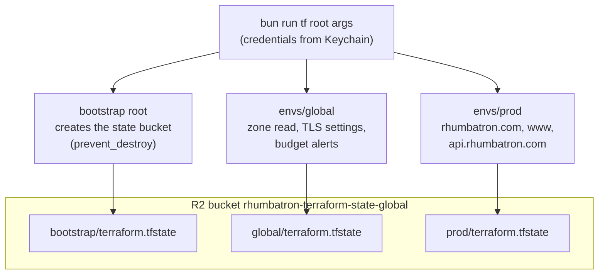
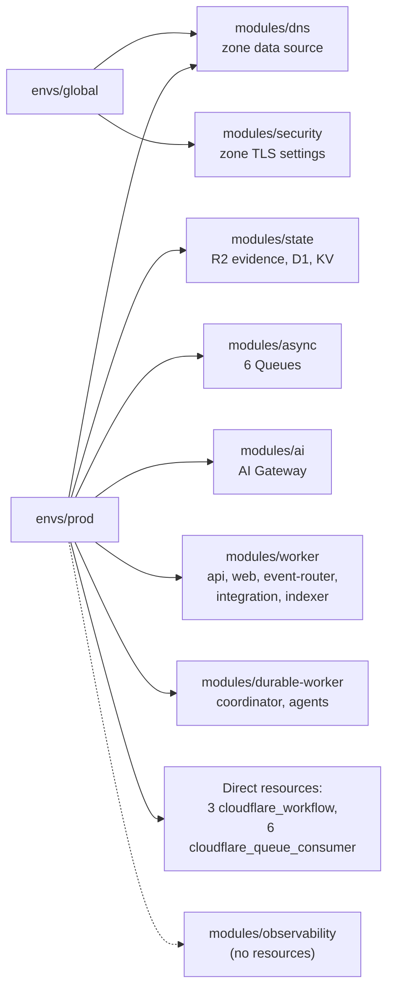
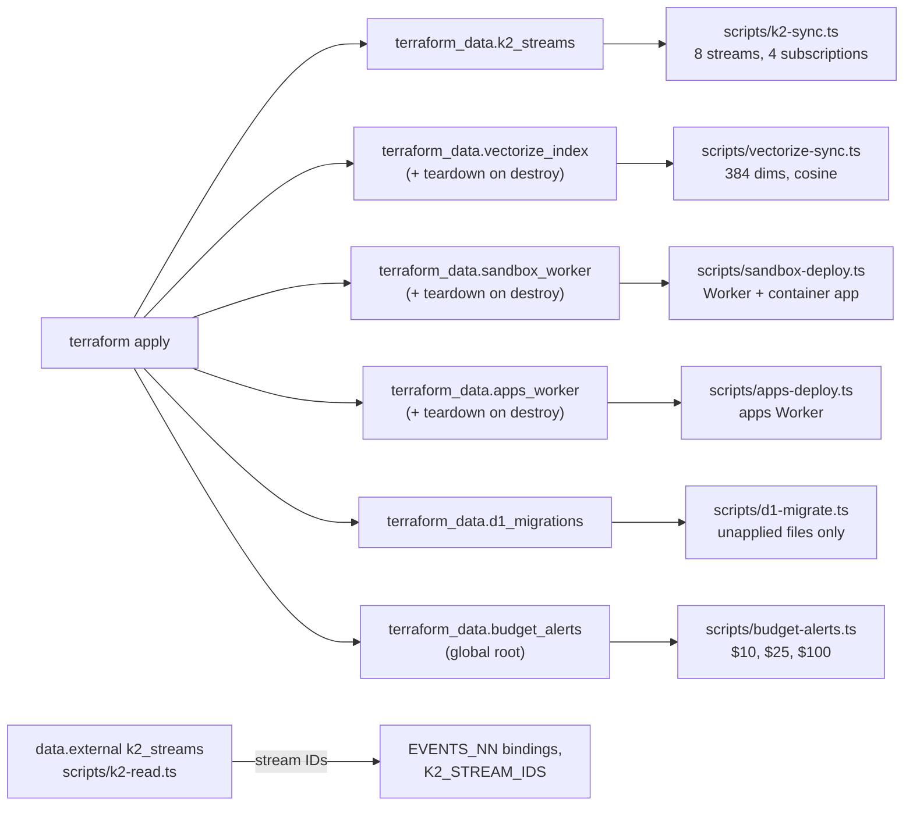
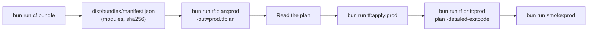
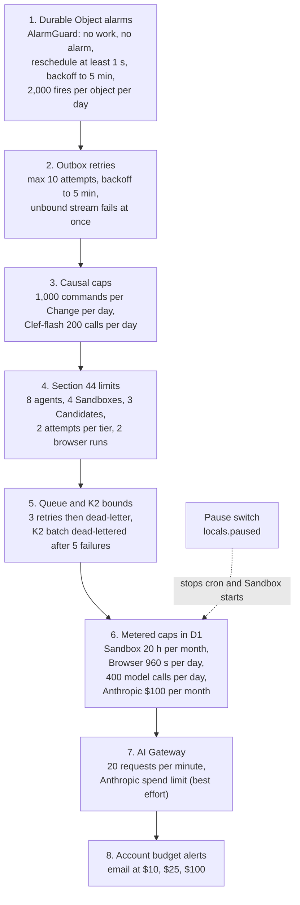
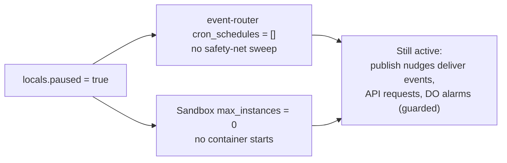

# Infrastructure and cost

This page explains how Terraform owns the Cloudflare control plane, and how the code keeps the bill inside free and included limits.

Main source files:

- `infrastructure/terraform/bootstrap`, `envs/global`, `envs/prod`, `modules/*`
- `scripts/tf.ts`, `scripts/build-workers.ts`, and the adapter scripts in `scripts/`
- `workers/coordinator/src/alarm-guard.ts`, `workers/event-router/src/causal.ts`, `workers/agents/src/limits.ts`
- ADR 0004 (bootstrap credentials), 0005 (DO Workers), 0006 (K2 adapter), 0012 (Sandbox Worker), 0017 (prod), 0019 (billing guards)

## Terraform roots and state

There are three roots.
`bootstrap` creates only the state bucket.
`global` owns account-wide and zone-wide singletons.
`prod` owns the one full environment.
All three keep state in one R2 bucket, with one key per root.

Rules:

- The backend is the S3 backend on R2 with `use_lockfile = true`.
- `scripts/tf.ts` loads secrets from the macOS Keychain for the one root that needs them. Values already in the environment take precedence.
- Provider: `cloudflare/cloudflare ~> 5.27`. Terraform `>= 1.16.0`.
- The zone `rhumbatron.com` is a data source. No plan can delete the domain.

### Modules per root

Two Worker modules exist (ADR 0005):

- `modules/worker` uses `cloudflare_worker`, `cloudflare_worker_version`, and `cloudflare_workers_deployment` at 100 percent, plus custom domains and cron triggers.
- `modules/durable-worker` uses `cloudflare_workers_script`, because Cloudflare rejects Durable Object migrations in version uploads. The steady state is migration tag `v1 -> v1`.

Prod has Clerk DNS records, a Clerk key check, and a K2 account-limit precondition.

### Adapters

Provider 5.27 has no resource for K2 streams, Vectorize indexes, a container on a DO class, the apps Worker, D1 schema migrations, or billing budget alerts.
A `terraform_data` adapter covers each one (AGENTS.md section 11.4).
Each adapter runs a Bun script, and only `terraform apply` can run it.
The shared API helper refuses to run unless `RHUMBATRON_INVOKED_BY=terraform`.

Each adapter re-runs when its content hash changes.
The D1 migration adapter keys on the hash of every file in `migrations/d1`.
A teardown runs only on a real destroy, so a config change never deletes a live resource.

### Deployment loop

Deployment runs on a developer machine. `.github/workflows/ci.yml` runs checks only.
The project never uses `wrangler deploy`.

A new bundle hash creates a new Worker version (`modules/worker`) or a new full script upload (`modules/durable-worker`).
Bindings carry the environment configuration.

## Cost guard layers

Cloudflare has no hard spend cap (ADR 0019).
The code stacks several independent guards, from the inner code paths out to the account.

| Layer | Cap | Where |
|---|---|---|
| DO alarm guard | 2,000 fires per object per UTC day | `workers/coordinator/src/alarm-guard.ts` (ProjectRootDO, ResourceShardDO, AgentDO schedules) |
| Outbox | 10 publish attempts per row | `workers/coordinator/src/outbox.ts` |
| Causal router | 1,000 commands per Change per day | `workers/event-router/src/causal.ts` |
| Clef-flash | 200 calls per day, one `clef-flash` counter shared by the router and agent routing | `causal.ts`, `agent-do.ts` |
| Active agents | 8 per Change | `workers/agents/src/limits.ts` |
| Coding Sandboxes | 4 open per Change, 1 container instance | `limits.ts`, Terraform `max_instances` |
| Candidates | 3 per Change | `workers/integration/src/candidate-create.ts` |
| Attempts | 2 per Task per tier | `limits.ts` |
| Model calls | 16 or 32 per run, 400 per day | `packages/model-router/src/budget.ts` |
| Change budget | `budgetUsd`, default 3 USD, max 100 | `packages/protocol/src/project.ts` |
| Sandbox time | 72,000 s per month | `SANDBOX_MONTHLY_SECONDS` binding |
| Browser Run | 960 s per day, 55 s per session, 2 runs per Candidate | `BROWSER_DAILY_SECONDS` binding, `check-semantics.ts` |
| Embeddings | 2,000 texts per day, 10,000 vectors per account | `workers/indexer/src/handler.ts` |
| Vectorize queries | 1,000 per day | `workers/agents/src/retrieval.ts` |
| Anthropic spend | 100 USD per calendar month, reserve then settle on the D1 meter | `ANTHROPIC_MONTHLY_BUDGET_USD` binding, `packages/model-router/src/spend-meter.ts` |
| Account | Alerts at 10, 25, 100 USD | `envs/global` |

A guard that trips stops new expensive work and keeps all state.
A concurrency limit applies backpressure. The work waits for a free slot.
A budget limit stops the work. The Task becomes `blocked`, and the Change becomes `budget_blocked` with the exact limit named.

### Caps

The prod caps are Anthropic 100 USD per calendar month, Sandbox
20 hours per month, and Browser Run 960 seconds per day. The Worker reads each cap from a binding and
meters it in the prod D1 database.

## Pause switch

`envs/prod/main.tf` has `locals.paused`.
To pause, set it to `true`.
Then plan and apply.
All data stays.

The pause switch does not stop Durable Object alarms.
The alarm guard limits them (ADR 0019).
To resume, set `paused` to `false` and apply again.
See `docs/operations/pause-resume.md` for the full steps.
