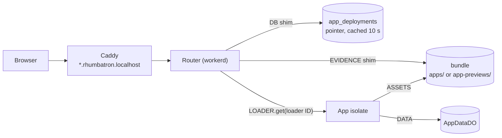
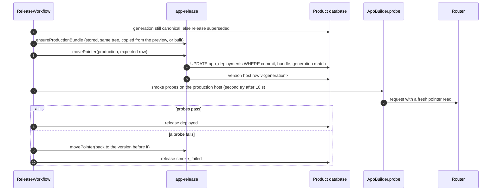

# Live apps

This page tells how Rhumbatron serves each Project as a live app (ADR 0020, ADR 0034).
It also tells how a Candidate gets a preview and how a promotion moves the live app.

Main source files:

- `workers/apps/src`: the router, `AppBuilder`, `AppChecker`, `AppDataDO`, the cookie rules, and the bundle format.
- `workers/apps/src/platform/workerd.ts`: the entry module on workerd, with the shims for `DB` and `EVIDENCE`.
- `services/apps`: the workerd config, the image, and the RPC client for core ([README](../../services/apps/README.md), [CONTRACT](../../services/apps/CONTRACT.md)).
- `workers/integration/src/app-provision.ts`, `app-release.ts`, `app-release-model.ts`, `preview-smoke.ts`, `rollback.ts`
- `workers/integration/src/release-workflow.ts`: the release steps.
- `packages/protocol/src/app.ts`: host rules, limits, and `APP_CONVENTIONS`.

## Hosts

Every app host has one label under `rhumbatron.localhost` (`APPS_DOMAIN`).
One label keeps each host inside the wildcard certificate that Caddy issues for `*.rhumbatron.localhost`.

| Host | Serves |
|---|---|
| `<slug>.rhumbatron.localhost` | The production app of the Project. |
| `<previewId>--<slug>.rhumbatron.localhost` | The preview of one Candidate. The preview ID is the first 8 characters after `cand_`. |
| `v0000001--<slug>.rhumbatron.localhost` | One promoted generation. `v` and 7 digits name the generation. |

Rules:

- The label comes from the Project slug. When another Project has the label, the label adds 6 characters of the Project ID.
- A reserved label gets the suffix `-app`. `RESERVED_APP_LABELS` lists the reserved labels, for example `www`, `api`, `docs`, and `clerk`.
- Every label that starts with `rhumbatron` is also reserved.
- A label has at most 50 characters.
- A host with a reserved, unknown, or invalid label gets a plain 404 page.
- A preview host and a version host each have their own data store. They read and write only that store.

## The apps service

The `apps` service runs `workers/apps` on the open-source `workerd` runtime.
Caddy sends every `*.rhumbatron.localhost` host except `api` and `docs` to port 8788.
Core calls the RPC entrypoints on port 8789. Caddy does not route port 8789.
Compose starts `apps` after `core` is healthy, and restarts `apps` when `core` restarts.

| Part | Role |
|---|---|
| Router (default `fetch`) | Maps the host to an app, reads the pointer, and runs the app. |
| `AppBuilder` | RPC entrypoint that core reaches as `env.APPS`. Methods: `build` (bundle), `probe` (one request through the router with a fresh pointer read), `check` (runs `AppChecker`), and `wipeData` (deletes app data stores). |
| `AppChecker` | Runs the `build`, `unit`, and `contract` checks in loaded Workers. Only `AppBuilder.check` calls it. See [Source and verification](source-and-verification.md#where-checks-run). |
| `AppDataDO` | One SQLite instance for each production app, preview, and version host. It is a workerd actor namespace (`durableObjectNamespaces` in `config.capnp`) on local disk, `/data/do` on the `apps-data` volume. It stores the key-value data of the app. |
| `AppAssets`, `AppData` | The `ASSETS` and `DATA` bindings that the router gives to each app. |
| `LOADER` | The workerd Worker Loader binding. It starts each app as its own isolate. |

The apps service reads the pointer rows and the bundles through core at `core:8790`, with the `INTERNAL_TOKEN` bearer token.
`DB` is an HTTP shim to the product database. `EVIDENCE` is an HTTP shim to the object store.
`core` has the fixed address `172.31.240.10`, because workerd resolves the name `core` one time, at start.
The global `fetch` of the platform Worker reaches public addresses only. The bundle builder uses it to get npm packages.

Each request follows these steps:

1. The router parses the host.
2. The router reads the pointer rows of the host from `app_deployments`. Each isolate keeps them in a cache for 10 s.
3. The router serves a static asset first, unless the bundle sets `runWorkerFirst`. Then it runs the app in its own isolate.
4. The app has no network (`globalOutbound: null`).
5. The router gives each request a limit of 50 ms CPU and 20 subrequests. These limits are advisory on workerd.
6. An app error answers 502. A limit error answers 503.
7. The app env holds only `ASSETS` and `DATA`.

The `wrangler.jsonc` of the app sets `assets.directory` and `assets.not_found_handling`.
The value `none` answers 404 for an unknown path.
The value `single-page-application` serves `public/index.html` for an unknown path.
An app whose client handles its own routes sets `single-page-application` (`APP_CONVENTIONS`).
Then a direct load or a reload of a client route shows the app.

The router keeps app cookies apart from Rhumbatron cookies (`workers/apps/src/cookies.ts`):

- The router stores each app cookie under the prefix `rba_` on the host of the app.
- A request to the app carries only the `rba_` cookies, without the prefix.
- The router drops each `Set-Cookie` from the app that has a `Domain` attribute.

The router has a page for each other state: `building` (503), `failed` (503), an app with no code (200, "Nothing built yet"), and `removed` (410).
A pointer row keeps the last good bundle while a later build runs or fails. A failed build never stops a live app.

`DATA` is a string key-value store. A key has at most 512 characters and a value at most 128 KiB. A store holds at most 10,000 keys.

## Builds

The integration code reads the source of one commit from the git service and calls `AppBuilder.build` with the files.
The builder bundles the files in the apps service with the `@cloudflare/worker-bundler` library (esbuild). It uses no Sandbox time.
It writes the bundle to the object store under `apps/<project>/<commit>/`. It uses a stored bundle of the same commit again.
Tests, benchmarks, lockfiles, and Markdown files stay out of the build (`isAppBuildInput`).
A deterministic failure returns a reason, and the builder does not retry it.
A build fails when it finds real authentication in the app.

The cap is 60 app builds per UTC day (`APP_BUILDS_PER_DAY`, counter `app-builds` in `usage_counters`).

### Client assets built by the app

The builder serves the files under `public/` as the commit holds them.
An app can build its client itself, for example React and Tailwind bundled by `scripts/build.ts` to `public/app.js` and `public/app.css`.
For such an app, Candidate composition runs the build of the app in the Sandbox (`workers/integration/src/app-build.ts`):

1. After the ChangeSets merge, composition reads the composed `package.json`. When it has no `build` script, composition runs no build.
2. When it has a `build` script, composition runs `bun install` and then `bun run build`, with a 120 s timeout.
3. Composition commits the files that the build changed (`Build <candidate>`) on top of the merges.
4. The Candidate commit, the preview, the promotion, and the release all serve the assets that the composed sources make.
5. A failed build commits nothing. Its exit code and output tail are the `build` Evidence (`fail`, `checked_supported`). A build timeout is a gap.
6. The required `client-assets` check compares the composed commit with the base. See [Source and verification](source-and-verification.md#which-checks-run).

The Sandbox time of the build counts on the reservation of the verification workflow.
Agents edit the client sources, not the generated files (`APP_CONVENTIONS`).
A `bun run build` in an agent workspace keeps no output, so sibling ChangeSets never conflict on generated files.

## Preview of a Candidate

The verification workflow builds the composed commit of a Candidate and points the preview host at it.
The preview bundle is under `app-previews/<project>/<commit>/`.
A Change has at most 3 previews.
Core deletes objects under `app-previews/` 7 days after their upload (the object expiry in `services/core/src/expiry.ts`).
The daily `forks.sweep` deletes preview rows 7 days after their last update, with their data stores (`expirePreviews`).
A failed preview build marks only the preview row.

Every Project with a live app has a required `preview-smoke` check (kind `smoke`).
The check runs the release probes on the exact preview host through `AppBuilder.probe`.
It reads only the preview host and its data store.

- The home page must answer 2xx or 3xx with the page of the app.
- Each `GET` route of the contract without parameters must answer 2xx, 400, 401, 403, or 422.
- A 400, 401, 403, or 422 shows a deployed route that checks its input or its caller.
- A 404 (route not deployed) or a 5xx (crash) fails the check.

A missing or failed preview is a gap, and the Candidate cannot promote.
Sibling Candidates of one Change each get a preview. Only the selection winner promotes and releases (ADR 0026).

The browser check starts its own copy of the composed app in the Sandbox. See [Source and verification](source-and-verification.md).

## Promotion and release

The promotion runs as in [Source and verification](source-and-verification.md#promotion-preconditions).
Then `ReleaseWorkflow` starts for the Project. It has 6 to 9 steps and uses no Sandbox.
A Project without a live app starts no release.

- The pointer moves by compare-and-swap on the row that the workflow read. A lost race fails the step. The retry decides again from the current row.
- When a later generation is live, the release gets the status `superseded`.
- A bundle copied from a preview costs only object copies. The builder does not run.
- A smoke failure moves the pointer back to the version before it.
- The smoke failure is a recorded transition with the Event `release.smoke_failed`. The Canonical Generation stays promoted.
- Every promoted generation keeps a version host `v<generation>--<slug>`.

## Rollback

A rollback is a canonical transition from `Sn` to `Sn+1` (`requestRollback`).
The tree of `Sn+1` equals the tree of an earlier generation `Sk`.
The request names `expectedGeneration`. Rhumbatron refuses the request when the Canonical Generation is different.
Rhumbatron creates a rollback Change and Candidate.
It writes one commit with the tree of `Sk` in the Candidate fork.
It records one required check: the tree of that commit equals the tree of `Sk`.
Policy decides the human gate from the riskiest Change that the rollback undoes.
Then the promotion and the release run as for any Candidate.
The release points production at the bundle of `Sk` and uses that bundle again.
Deterministic code decides a rollback. No model takes part.

## Remove app and delete Project

"Remove app" keeps the Project. It sets every `app_deployments` row of the Project to `removed`.
Every host of the app answers 410 within 10 seconds, because each router isolate keeps pointer rows for 10 seconds.
Cleanup then deletes the previews and the bundles and wipes the data stores.
The production row stays as a tombstone. The host keeps its label and answers 410.

Deleting a Project deletes all of its data: the live app, the git repositories, the objects, the database rows, and the actor storage.
[cleanup.md](../operations/cleanup.md) has the list.
