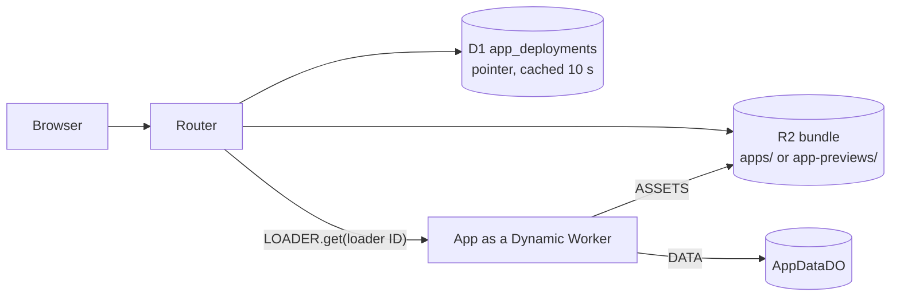
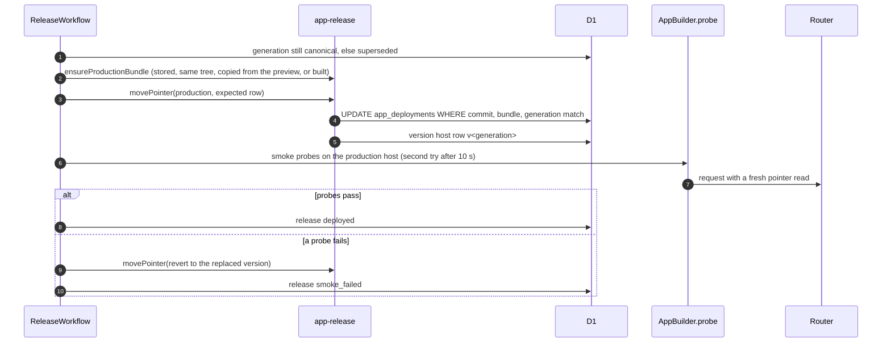

# Live apps

This page explains how Rhumbatron serves each Project as a live app, how a Candidate gets a preview, and how a promotion moves the live app (ADR 0020).

Main source files:

- `workers/apps/src`: the router, `AppBuilder`, `AppChecker`, `AppDataDO`, and the bundle format.
- `workers/integration/src/app-provision.ts`, `app-release.ts`, `app-release-model.ts`, `preview-smoke.ts`, `rollback.ts`
- `workers/integration/src/release-workflow.ts`: the release steps.
- `packages/protocol/src/app.ts`: host rules and limits.
- `infrastructure/terraform/envs/prod/main.tf`: the apps Worker, the wildcard DNS record, and the routes.

## Hosts

Every app host has one label under `rhumbatron.com`.
One label keeps the hosts inside Universal SSL.

| Host | Serves |
|---|---|
| `<slug>.rhumbatron.com` | The production app of the Project. |
| `<previewId>--<slug>.rhumbatron.com` | The preview of one Candidate. The preview ID is the first 8 characters after `cand_`. |
| `v0000001--<slug>.rhumbatron.com` | One promoted generation. `v` and 7 digits name the generation. |

Rules:

- The label comes from the Project slug. If the slug is taken, the label adds 6 characters of the Project ID.
- A reserved label gets the suffix `-app`. Reserved labels are `www`, `api`, `docs`, `clerk`, other Rhumbatron and Clerk names, and every label that starts with `rhumbatron` (`RESERVED_APP_LABELS`).
- A label has at most 50 characters. A host with a reserved, unknown, or invalid label gets a plain 404.
- A preview host and a version host each have their own data store. They never read or write production data.

## The apps Worker

`rhumbatron-apps-prod` has these parts:

| Part | Role |
|---|---|
| Router (default `fetch`) | Maps the host to an app, reads the pointer, and runs the app. |
| `AppBuilder` | RPC entrypoint on the `APPS` service binding of the integration Worker. Methods: `build` (bundle), `probe` (one request through the router with a fresh pointer read), `check` (runs `AppChecker`), and `wipeData` (deletes app data stores). |
| `AppChecker` | Runs the `build`, `unit`, and `contract` checks in Dynamic Workers. Only `AppBuilder.check` calls it. See [Source and verification](source-and-verification.md#where-checks-run). |
| `AppDataDO` | One SQLite Durable Object per production app, per preview, and per version host. It stores the key-value data of the app. |
| `AppAssets`, `AppData` | The `ASSETS` and `DATA` bindings that the router gives to each app. |
| `LOADER` | The Worker Loader binding that starts an app as a Dynamic Worker. |

Terraform deploys the Worker through the `terraform_data.apps_worker` adapter, because provider 5.27 has no `worker_loader` binding type.
The Worker also has the D1 binding `DB`, the R2 binding `EVIDENCE`, and the Durable Object binding `APP_DATA`.
Terraform owns these routing resources:

- The proxied wildcard DNS record `*.rhumbatron.com`.
- The route `*.rhumbatron.com/*` to the apps Worker.
- One route without a Worker for each of `api`, `www`, and `docs`. These keep the three hosts on their own Workers.

Each request follows these steps:

1. The router parses the host.
2. The router reads the pointer rows of the host from D1 `app_deployments`. Each isolate caches them for 10 s.
3. The router serves a static asset first, unless the bundle sets `runWorkerFirst`. Otherwise it runs the app as a Dynamic Worker.
4. The app runs with no network (`globalOutbound: null`), 50 ms CPU, and 20 subrequests per request. A limit hit answers 503. Another app error answers 502.
5. The app env holds only `ASSETS` and `DATA`. The router strips cookies of other hosts on the way in and `Domain` cookies on the way out.

The router has a page for each other state: `building` (503), `failed` (503), an app with no code (200), and `removed` (410).
A pointer row keeps the last good bundle while a newer build runs or fails. A failed build never takes a live app down.

`DATA` is a string key-value store. A key has at most 512 characters and a value at most 128 KiB. A store holds at most 10,000 keys.

## Builds

The integration Worker reads the source of one commit from Artifacts and calls `AppBuilder.build` with the files.
The builder bundles the files with `@cloudflare/worker-bundler` in the Worker. It uses no Sandbox time.
It writes the bundle to R2 and reuses a stored bundle of the same commit.
Tests, benchmarks, lockfiles, and Markdown files stay out of the build.
A deterministic failure returns a reason and is not retried. A build that finds real authentication in the app fails.

The cap is 60 app builds per UTC day (`APP_BUILDS_PER_DAY`, counter `app-builds` in `usage_counters`).

### Client assets built by the app

The builder serves the files under `public/` as they are in the commit. It does not run the app's own build.
An app can build its client itself, for example React and Tailwind bundled by `scripts/build.ts` to `public/app.js` and `public/app.css`.
For such an app, Candidate composition runs the app's build in the Sandbox (`workers/integration/src/app-build.ts`):

1. After the ChangeSets merge, composition reads the composed `package.json`. Without a `build` script, no build runs.
2. With a `build` script, composition runs `bun install` and then `bun run build` (120 s timeout).
3. Composition commits the files that the build changed (`Build <candidate>`) on top of the merges. The Candidate commit, the preview, the promotion, and the release then all serve the assets built from the composed sources.
4. A failed build commits nothing. Its exit code and output tail are the `build` Evidence (`fail`, `checked_supported`). A build timeout is a gap.
5. The required `client-assets` check compares the composed commit with the base. See [Source and verification](source-and-verification.md#which-checks-run).

The Sandbox time of the build counts on the reservation of the verification workflow.
Agents edit the client sources, not the generated files (`APP_CONVENTIONS`). A `bun run build` in an agent workspace does not keep its output, so sibling ChangeSets never conflict on generated files.

## Preview of a Candidate

The verification workflow builds the composed commit of a Candidate and points the preview host at it.
A Change has at most 3 previews.
The R2 lifecycle rule deletes bundles under `app-previews/` after 7 days. The integration Worker sweep then expires the preview rows and their data.
A failed preview build marks only the preview row. It does not change the verification result.

Every Project with a live app has a required `preview-smoke` check (kind `smoke`).
The check runs the release probes on the exact preview host through `AppBuilder.probe`.
It does not touch production or the production data store.
A missing or failed preview is a gap, and the Candidate cannot promote.
Sibling Candidates of one Change each get a preview. Only the selection winner promotes and releases (ADR 0026).

## Promotion and release

The promotion runs as in [Source and verification](source-and-verification.md#promotion-preconditions).
Then `ReleaseWorkflow` starts for the Project. It has 6 to 9 steps and uses no Sandbox.
A Project without a live app starts no release.

- The pointer moves by compare-and-swap on the row that the workflow read. A lost race fails the step, and the retry decides again from the new row.
- A newer generation that is already live makes the release `superseded`.
- A bundle copied from a preview costs only R2 operations.
- A smoke failure moves the pointer back to the version that it replaced. The failure is a recorded transition with the Event `release.smoke_failed`. The Canonical Generation stays promoted.
- Every promoted generation keeps a version host `v<generation>--<slug>`.

## Rollback

A rollback is a new canonical transition from `Sn` to `Sn+1`. The new tree equals the tree of an earlier generation `Sk` (`requestRollback`).
The request names `expectedGeneration`. Rhumbatron refuses a request from an old page.
Rhumbatron creates a rollback Change and Candidate, writes one commit with the tree of `Sk` in the Candidate fork, and records one required check: the tree of that commit equals the tree of `Sk`.
Policy decides the human gate from the riskiest Change that the rollback undoes.
Then the promotion and the release run as for any Candidate. The release points production at the bundle of `Sk` and does not rebuild it.
No model decides a rollback.

## Remove app and delete Project

"Remove app" keeps the Project. It sets every `app_deployments` row of the Project to `removed`, and every host of the app answers 410 within 10 seconds (the router caches pointer rows for 10 seconds in each isolate).
Cleanup then deletes the previews and bundles and wipes the data stores. The production row stays as a tombstone, so the host keeps its label and keeps answering 410.

Deleting a Project removes all of its data: the live app, the Artifacts repositories, the R2 objects, the D1 rows, and the Durable Object storage.
The list is in [cleanup.md](../operations/cleanup.md).
