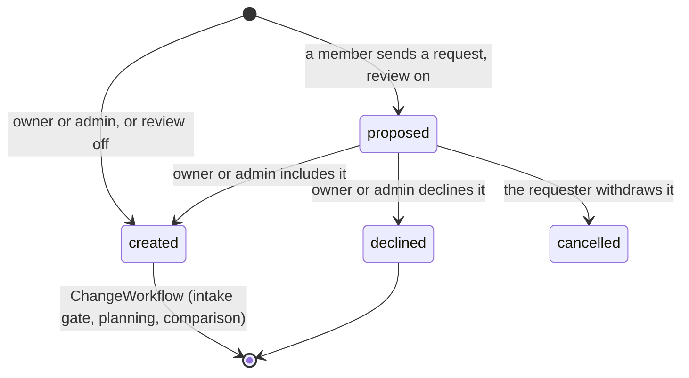
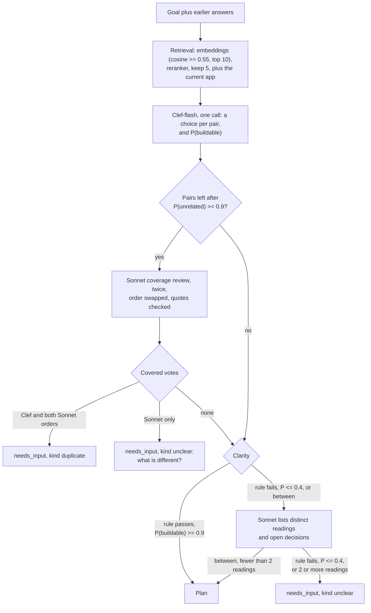
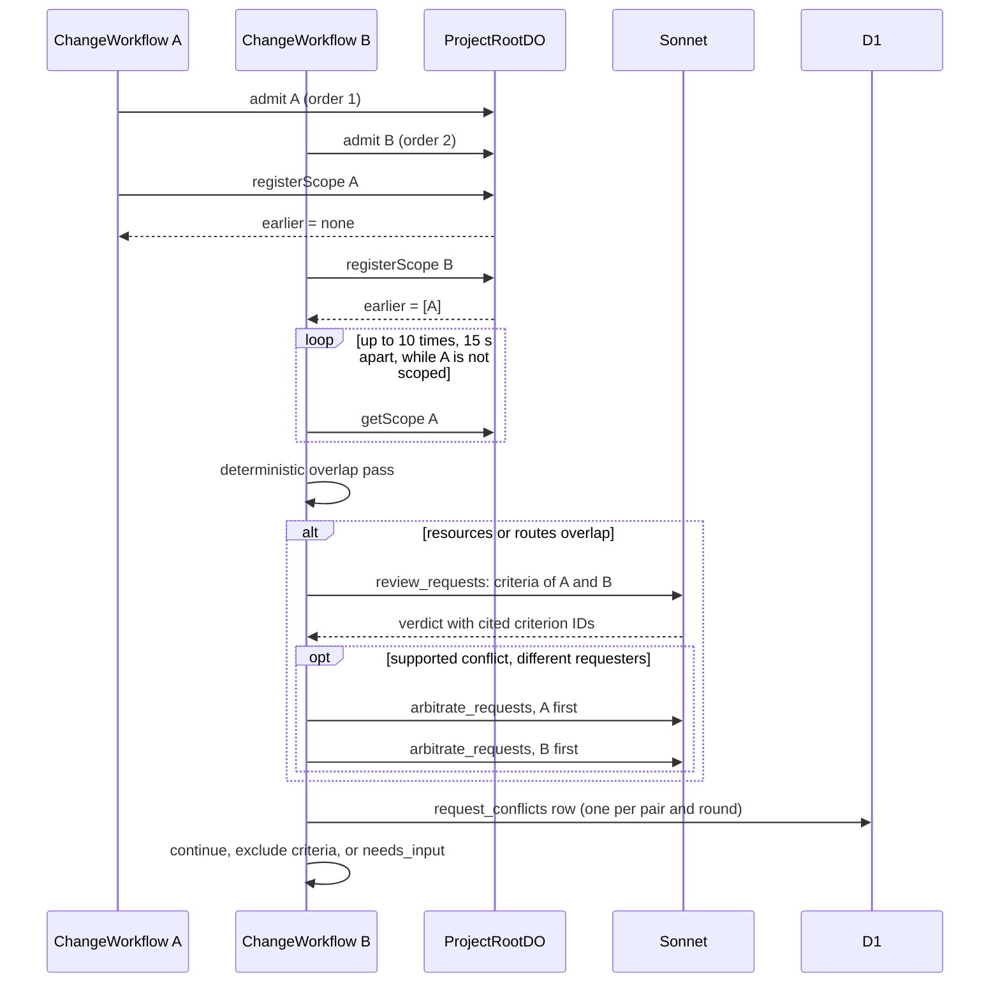
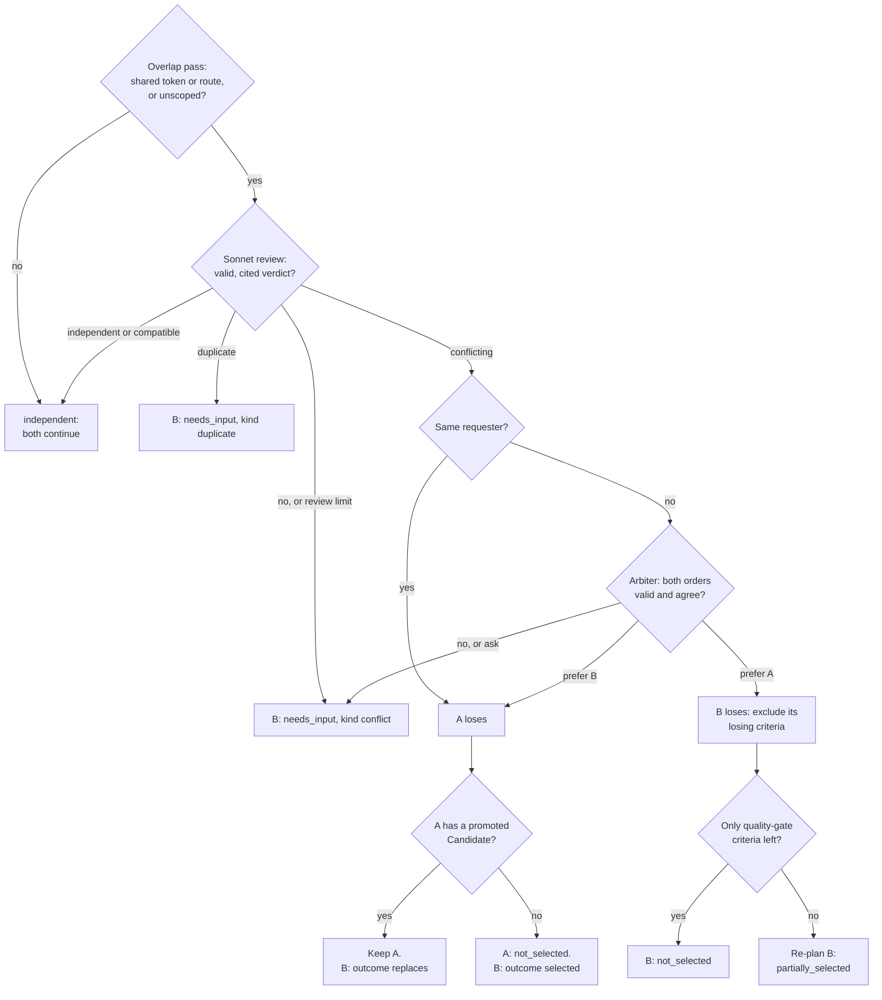

# Shared Projects and simultaneous requests

This page covers Project membership and roles, request review, the intake gate, the comparison of simultaneous requests, and the system arbiter.
A role decides who can act. It never decides between two requests: the system does (ADR 0025, ADR 0028).

Main source files:

| File | Contents |
|---|---|
| `migrations/d1/0022_shared_projects.sql` | `project_members`, `project_invitations`, request columns on `changes`, `request_conflicts` |
| `migrations/d1/0024_intake_and_system_decisions.sql` | `clarification_json`, `clarification_answers_json`, the `duplicate` verdict, pair rounds, `change_decisions` |
| `migrations/d1/0029_roles_and_request_review.sql` | The roles `owner`, `admin`, `member`, `viewer`; invitation roles; `projects.member_request_review`; the `review_*` columns on `changes` |
| `packages/protocol/src/roles.ts` | `ProjectRole`, the permission matrix `PERMISSIONS`, `can`, `needsReview`, `canInvite`, `canChangeRole`, `canRemoveMember`, `deniedMessage` |
| `workers/api/src/identity.ts` | `projectRole`, `canAccessProject` |
| `workers/api/src/members.ts` | Members, roles, invitations, the review fields, `GET /v1/changes/:changeId/request-conflicts` |
| `workers/api/src/changes.ts` | Cancel, budget, include, and decline of one Change |
| `workers/api/src/board.ts` | `GET /v1/projects/:projectId/board` |
| `workers/api/src/clarify.ts` | `POST /v1/changes/:changeId/clarify` |
| `workers/coordinator/src/request-scopes.ts` | Admission order and scope receipts in ProjectRootDO SQLite |
| `workers/integration/src/intake-context.ts` | Related requests, the current app summary, stored answers |
| `workers/integration/src/intake.ts` | The intake cascade and its citation checks |
| `workers/integration/src/request-policy.ts` | Overlap pass, review validation, arbiter, quality-gate rule |
| `workers/integration/src/request-check.ts` | `checkRequestPair`: one comparison of two Changes |
| `workers/integration/src/change-workflow.ts` | The steps `intake review` and `check other requests`, and the wait for an answer |
| `workers/integration/src/change-commands.ts` | `clarifyChange`, `closeNeedsInput`, `cancelChange`, `includeChange`, `declineChange`, `recordProposal` |

## Membership

Membership is per Project.
The D1 table `project_members` has one row for each user and Project.
A person sees only the Projects that they own or that were shared with them.
Rhumbatron does not use Clerk Organizations.

| Role | How the user gets it | Rank |
|---|---|---|
| `owner` | Project creation inserts the owner row. A partial unique index allows one owner for each Project. Nobody can assign, change, or remove the owner role. | 0 |
| `admin` | The owner invites the person as `admin`, or changes the role of a member. | 5 |
| `member` | The person accepts an invitation with the role `member` (the default). | 10 |
| `viewer` | The person accepts an invitation with the role `viewer`. | 30 |

`projectRole` reads the role from D1. The API never reads a role from the client.

- `owner`: the owner row, or a member of the organization that owns the Project.
- `admin`, `member`, `viewer`: the role of the caller's row in `project_members`.
- `null`: any other user. The API answers `404`.

The `rank` column (`ROLE_RANK`) only orders the members list.
`changes.created_by` holds the requester. `changes.requester_rank` holds the rank of the requester's role at request time, for display.
No build decision reads a role, `rank`, or `requester_rank`.

### Invitations

1. The owner or an admin sends `POST /v1/projects/:projectId/invitations` with an email address and a role (`admin`, `member`, or `viewer`; default `member`). Only the owner can invite an admin. The API changes the email to lowercase.
2. The invitation stays `pending` for 7 days. One `pending` invitation can exist for one Project and email. A repeat returns the same invitation. A repeat with another role changes the role of the pending invitation.
3. After 7 days the invitation expires. The owner or an admin can then send a new one.
4. `GET /v1/invitations` lists the pending invitations for the Clerk email addresses of the caller that have the status `verified`.
5. `POST /v1/invitations/:invitationId/accept` checks that the invitation email is one of these addresses. If not, the API answers `404`, as for a missing invitation.
6. The member row stores the user ID and the role of the invitation, not the email. A second accept returns the same result.

### Roles and permissions

`PERMISSIONS` in `packages/protocol/src/roles.ts` is the one permission matrix.
The API checks each action with `can(role, action)`. The web hides each control that `can` refuses.
A refused action gets `403` with the text of `deniedMessage`: "Only the project owner can ..." or "Only the project owner or an admin can ...".

| Action | owner | admin | member | viewer |
|---|---|---|---|---|
| Read the Project pages (`project.read`) | yes | yes | yes | yes |
| Send a request (`change.create`) | yes | yes | yes, with review | no |
| Answer, withdraw, or cancel your own request (`change.manageOwn`) | yes | yes | yes | no |
| Answer or cancel the request of another person (`change.manageAny`) | yes | yes | no | no |
| Include or decline a proposed request (`change.review`) | yes | yes | no | no |
| Raise a budget, compose, approve, or promote a Candidate | yes | yes | no | no |
| Publish or remove the app, roll back, inject a release failure | yes | yes | no | no |
| Retry or dismiss stopped work (dead letters), edit code directly | yes | yes | no | no |
| Provision the Project, run its checks | yes | yes | no | no |
| Invite people, change the role of a member or viewer, remove a member or viewer (`people.manage`) | yes | yes | no | no |
| Invite an admin, make or change an admin, remove an admin (`admins.manage`) | yes | no | no | no |
| Change the settings: name, default budget, Project monthly budget, member request review (`settings.edit`) | yes | yes | no | no |
| Delete the Project (`project.delete`) | yes | no | no | no |
| Leave the Project (`project.leave`) | no | yes | yes | yes |

- `PATCH /v1/projects/:projectId/members/:userId` changes a role. It never changes the owner row.
- `DELETE /v1/projects/:projectId/members/:userId` removes a person, or the caller leaves with their own user ID.
- A person who leaves gets their open requests cancelled first. A removed person gets their `proposed` requests cancelled. Past Changes stay with the Project.

## Request review

The Project setting `memberRequestReview` (D1 `projects.member_request_review`, default on) controls review.
While it is on, the request of a `member` starts as `proposed` (`needsReview`).
The requests of the owner and the admins never need review.
When the setting is off, a member's request goes to the system at once, as the request of an admin does.

A `proposed` Change has no ChangeWorkflow. It makes no model call and spends nothing.
ProjectRootDO does not admit it, so the request comparison and the arbiter do not see it.

- Create: the API inserts the Change with status `proposed` and `review_state = 'proposed'`. The integration Worker records `change.proposed` (`recordProposal`). The owner and the admins get the notification `request_proposed`.
- Include: `POST /v1/changes/:changeId/include` (`change.review`). `includeChange` moves the Change to `created` at the current Canonical Generation, stores who decided and when, records `change.included`, and starts the ChangeWorkflow with the Change ID as instance ID, as for a request without review. A repeat returns the same result and starts no second workflow. The requester gets `request_included`.
- Decline: `POST /v1/changes/:changeId/decline` with an optional `reason` (up to 500 characters). The Change becomes `declined` with `outcome = declined` and the reason. `declined` is terminal. The event is `change.declined`. The requester gets `request_declined`.
- Withdraw: the requester sends `POST /v1/changes/:changeId/cancel`. The Change becomes `cancelled`. Its `review.state` stays `proposed`, because nobody decided.
- An include or a decline on a Change that is not `proposed` returns `409`. A repeat of the same decision returns `repeated: true`.

Each Change response has `review`: `state` (`not_needed`, `proposed`, `included`, or `declined`), `decidedBy` (`userId`, `name`), `decidedAt`, and `reason`.

### Board

`GET /v1/projects/:projectId/board` reads the newest 100 Changes, their Tasks with the newest run of each, and the members, in one D1 batch.
Each Change is a card in one column (`BOARD_COLUMN_OF` in `packages/protocol/src/board.ts`):

| Column | Change statuses |
|---|---|
| `proposed` | `proposed` |
| `needs_answer` | `needs_input` |
| `building` | `created`, `compiling`, `running`, `budget_blocked`, `blocked` |
| `checking` | `verifying`, `awaiting_approval`, `promoting`, `releasing` |
| `shipped` | `completed` |
| `not_built` | `declined`, `not_selected`, `cancelled`, `failed` |

The `shipped` and `not_built` columns show the newest 20 cards each.
`people` lists each member with a role and each earlier requester who left (role `null`), with counts over the 100 Changes: `proposed`, `active` (`needs_answer`, `building`, `checking`), `shipped`, and `notBuilt`.
`canReview` is `true` for the owner and the admins.

## The intake gate

Each Change runs its own ChangeWorkflow.
The step `intake review` runs before the Root Planner.
It decides whether the request is clear and whether the app or another request already delivers it.
The cascade runs the cheap checks first.
A model never rejects a request at intake. The strongest result is a question to the requester.

### Retrieval

`loadRelatedRequests` reads up to 50 open Changes of the Project and the 20 most recent `completed` Changes.
An open Change has any status except `completed`, `failed`, `cancelled`, `not_selected`, and `declined`.
A `proposed` request is open. When it covers the new request, the question names it as "a request that <name> proposed (it waits for review)".
Each item is the goal plus the stored acceptance criteria.
Each text has a packet ID: `<changeId>:goal`, `<changeId>:c1`, and so on.

`retrieveRelated` then does these steps:

1. Embed the goal and each item with Workers AI `@cf/baai/bge-small-en-v1.5`.
2. Keep up to 10 items with a cosine similarity of 0.55 or more. If the embedding call fails, keep the items that share a non-generic word with the goal.
3. Order the shortlist with `@cf/baai/bge-reranker-base`. Keep 5.

The current app is one more target when its source is readable and has a `package.json`.
Its packet items are `canonical:files` (up to 60 paths), `canonical:deps` (dependency names of the root `package.json`), and `canonical:stack` (hints such as `react` or `angularjs`).
Cosine similarity only selects targets. It never decides.

### Clef-flash

One Clef-flash call answers two kinds of question:

- For each pair: `duplicate`, `already_covered`, `extends`, `overlaps`, or `unrelated`.
- For the request: `buildable` or `needs_detail`.

The call uses the D1 `clef-flash` daily counter (200 calls per UTC day). The integration, agents, and event router Workers share this counter.
When the counter is spent, Clef-flash abstains, and every later stage runs.
A pair drops only when `unrelated` has a probability of 0.9 or more.
Clef-flash alone never marks a duplicate.

### Duplicate check

Sonnet answers one question for each remaining pair: which criteria of the other request, or which features of the current app, already deliver the new request?
The tool is `coverage_review`.
A `duplicate` or `already_covered` verdict must quote source text with its packet ID.
`validateCoverage` checks each quote: the text must be in that source of that target.
A covered verdict without a valid quote counts as `unsupported`.
Sonnet runs twice: once with the new request first, once with the other items first.

| Clef-flash | Sonnet, first order | Sonnet, second order | Result |
|---|---|---|---|
| covered | covered | covered | `needs_input`, kind `duplicate` |
| not covered | covered | covered | `needs_input`, kind `unclear` |
| any | covered | not covered | `needs_input`, kind `unclear` |
| any | not covered | covered | `needs_input`, kind `unclear` |
| any | not covered | not covered | Continue to the clarity check. |

The question quotes the covering text: "This looks covered by "<goal>": "<quote>". What is different in your request?"

### Clarity

1. A rule runs first. A goal with fewer than two words that name a product object fails the rule. Generic words such as "add", "build", "feature", and "app" do not count. "Add kanban feature" fails the rule.
2. If the rule passes, a Clef-flash `buildable` probability of 0.9 or more makes the request clear. The request goes to planning.
3. In all other cases, one Sonnet call (`list_interpretations`) lists up to 4 different readings of the goal and up to 4 open product decisions. Each reading must quote the goal. Code drops a reading whose quote is not in the goal.
4. The request gets a question when the rule failed, when the probability is 0.4 or less, or when 2 or more readings remain. The readings go into the `options` of the question.
5. Otherwise the request goes to planning.

### Waiting for an answer

A question sets the Change to `needs_input`.
`clarification_json` holds the `ChangeClarification`: `kind` (`unclear`, `duplicate`, or `conflict`), `summary`, up to 3 `questions`, `relatedChangeId`, `relatedGoal`, `askedAt`, and `round` (1 to 3).
The requester gets the notification `request_needs_input`.

The workflow waits for the event `clarification`.
It reads the D1 row after each event and once a day.
After 7 days without an answer, the Change becomes `cancelled` with the reason "No answer within 7 days".

`POST /v1/changes/:changeId/clarify` accepts one of three bodies.
Only the requester, the Project owner, or an admin can call it.

| Body | Effect |
|---|---|
| `{ "answers": [{ "questionId": "q1", "text": "..." }] }` | The answers append to `clarification_answers_json`. The Change returns to `compiling`. The intake gate and the planner read the goal with the questions and answers. |
| `{ "action": "proceed_anyway" }` | The Change returns to `compiling`. It plans without the intake gate and without another question. |
| `{ "action": "withdraw" }` | The Change becomes `cancelled` with the reason "Withdrawn by the requester". |

When a `duplicate` Change ends by withdrawal or by the 7-day limit, it also gets `outcome = duplicate` and the related Change ID.
A request gets at most 3 rounds of questions. After the third answer, it plans without the intake gate and without another question.
The update is guarded on the open round. Of two answers to one round, one applies.
If the first workflow instance of the Change has ended, the answer starts a new instance with the ID `<changeId>_r<round>`.

Each intake run writes a Decision Receipt to `change_decisions` (`decision_type = 'INTAKE'`) and records the event `change.intake.reviewed`.
The receipt holds the retrieval scores, the Clef-flash probabilities, the Sonnet verdicts and quotes, and the cost. It holds no private reasoning.
The model cost counts against the Change budget. The gate skips a Sonnet call when the budget is spent.
An answer records `change.clarification.answered`.

## Comparing simultaneous requests

Two Changes of one Project can run at the same time.
After planning, the ChangeWorkflow step `check other requests` compares the Change with the earlier open Changes.

### Admission and registration

1. After the intake gate lets the Change plan, the workflow calls `admit` on ProjectRootDO. `admit` inserts a row in the SQLite table `request_scopes` and returns the admission order. The row starts with an empty scope (`scoped: false`).
2. After planning, the workflow calls `registerScope` with the criteria (each has an ID) and the semantic resources of the Work Graph.
3. `registerScope` runs in one ProjectRootDO transaction. It returns the scopes of all Changes with a lower admission order that are not released, and it stores this answer as a receipt.
4. A retry gets the same receipt. After an answer, the next pass keeps the receipt and updates the scope with the new criteria.

A Change that waits for an answer before planning has no admission, so it does not hold back other requests.
A `proposed` Change has no ChangeWorkflow, so it has no admission either. Its admission order starts when an owner or admin includes it.
The later-admitted Change of a pair does the comparison, once for each clarification round.
The workflow releases the scope of a Change that ends as `completed`, `failed`, `cancelled`, or `not_selected`.

### Unscoped earlier request

An earlier Change can still be in planning when the later Change registers. Its scope is then `scoped: false`.
The later workflow reads the scope again, up to 10 times, with 15 seconds between reads.
If the scope is still unscoped, the pair counts as overlapping.

### Deterministic overlap pass

`requestsOverlap` runs before any model call.
It returns `true` if one of the two Changes is not scoped.
Otherwise it compares two sets:

- Resource tokens. The code removes the `project:<slug>` prefix, splits on `:` and `-`, and drops the words `app`, `api`, `ui`, `project`, `frontend`, `backend`, `web`, and `src`. One shared token is an overlap.
- HTTP routes. The code finds the strings that start with `/` in the criteria text. One shared route is an overlap.

A pair with no overlap gets the verdict `independent`, with cost 0 and the receipt method `deterministic`.

### Review and citation validation

An overlapping pair gets one Sonnet review with the tool `review_requests`.
The verdict is `independent`, `compatible`, `conflicting`, or `duplicate`.

- Each conflict cites one criterion ID of each Change and a short reason.
- `dependentOnConflict` lists the criteria that only make sense if a conflicting criterion of the same side holds.
- For `duplicate`, `covered` maps each criterion of the later Change to the earlier criterion that delivers it, with a quote.

`validateRequestReview` rejects the answer in these cases (AGENTS.md section 34.4.2):

- The JSON does not match the schema, or the model returns no tool call or more than one.
- A conflict cites an ID that is not a criterion of that Change.
- The verdict is `conflicting` and the conflict list is empty, or the verdict is not `conflicting` and the conflict or dependent list is not empty.
- The verdict is `duplicate` and `covered` is empty, or the verdict is not `duplicate` and `covered` is not empty.
- A `covered` entry cites an unknown criterion, or its quote is not text of the cited earlier criterion.
- A dependent entry does not chain back to a cited conflict of its side.

A rejected answer, a provider error, and an abstention all become `unconfirmedReview`: verdict `conflicting`, `supported: false`, no cited criteria.
A review that cannot confirm compatibility never lets both requests proceed without a question.

Each comparison round of a Change makes at most 4 reviews, and only while its model spend is below the Change budget.
Past that limit, an overlapping pair gets the same unconfirmed result (receipt method `review-limit`).

`checkRequestPair` inserts the `request_conflicts` row with an unconfirmed receipt (`review-interrupted`) before it calls the model.
A retry reads the stored row and does not call the model again.
The arbiter result is stored the same way (`arbiter-interrupted`).

## The system arbiter

A supported `conflicting` review between different requesters goes to the arbiter.
The arbiter is the Sonnet tool `arbitrate_requests`. It runs twice: once with the earlier request as `a`, once with the later request as `a`.
It reads both goals, both criteria lists, the cited conflicts, and the current app items (`canonical:files`, `canonical:deps`, `canonical:stack`).
The prompt states that who asked never matters, and that the request that fits the current app wins.

The verdict is `prefer_a`, `prefer_b`, or `ask`.
The answer must cite at least one criterion (`side` and `id`) and at least one packet item (`a:goal`, `b:goal`, `conflict:N`, or a `canonical:` item).
`validateArbitration` checks every citation. An invalid answer counts as an unsupported `ask`.
`arbiterDecision` applies a preference only when both runs are valid and name the same request.
Two runs that each prefer the request they read first do not agree.
The arbiter runs only while the model spend of the Change is below its budget. Otherwise the result is `ask`.

When the same requester made both requests, no arbiter runs. The later request wins with `decided_by = system:same_requester`.

A question from the comparison uses the same `needs_input` status, notification, route, and 3-round limit as the intake gate.
For kind `conflict`, the Project owner and the admins also get the notification.
The question names the other request and up to 2 conflicting criterion pairs, and asks how the later request must change so both fit.
After an answer, the workflow runs the intake gate and the planner again, and compares the new criteria as a new round of the pair.
After `proceed_anyway` or the third answer, the comparison asks no question. A supported decision still applies. An undecided pair lets both requests continue.

`request_conflicts.policy` records the result: `system_arbiter`, `same_requester`, or `ask_requester`.
`decided_by` is `system:arbiter` or `system:same_requester`.
Each arbitration writes a Decision Receipt to `change_decisions` (`decision_type = 'REQUEST_ARBITER'`) with the two verdicts, their validity, and the cost.
The comparison records `conflict.reviewed` on the later Change, and on the winner when the winner is the earlier Change.

### The later Change loses

The workflow removes these criteria from the later Change (`losingCriterionIds`):

- The criteria that the review cited for the later Change.
- The valid `dependentOnConflict` entries that chain back to a cited criterion.
- A criterion that names a layout noun of a cited losing criterion (for example "card" or "grid") when the winner does not name that noun.

`nothingSelected` returns `true` when every remaining criterion only restates the quality gate, for example "typecheck, test and contract all pass".
In that case the Change stores the planned criteria and ends as `not_selected`, with the reason and the winner ID.
Otherwise the planner makes a new Work Graph for the remaining criteria.
The Change continues with `outcome = partially_selected`, and its reason starts with "Partially selected:".

### The earlier Change loses

- If the earlier Change has no promoted Candidate, `cancelChange` sets it to `not_selected` with the reason and the winner ID. Its open Tasks become `cancelled` and its open Candidates become `rejected`. The later Change gets `outcome = selected`.
- If the earlier Change has a promoted Candidate, the workflow does not undo the promotion. The later Change gets `outcome = replaces`.
- If `cancelChange` refuses because promotion has started, the later Change also gets `outcome = replaces`.

### Recompose guard

A stale Candidate of a losing Change never recomposes.
`recomposeDecision` (`workers/integration/src/app-release-model.ts`) skips a closed Change and a Change that cannot ship.
The insert in `recomposeStaleCandidate` (`workers/integration/src/recompose.ts`) also has a `WHERE EXISTS` condition. It refuses a Change with status `not_selected`, `cancelled`, or `needs_input`, or with outcome `not_selected` or `duplicate`.

## Web UI

- The Project page lists Changes in a table with a `Requested by` column.
- Each Change row has an outcome line: `Waiting for an admin to include it` for a `proposed` request, `Declined by <name>: <reason>`, `Not selected: <reason>` with the link "View the selected change", `Selected`, `Partially selected`, `Replaces earlier request`, or `Duplicate: <reason>`.
- The New change form is hidden from a viewer. When a member's requests need review, the form shows "An admin reviews requests before anything is built." under Submit.
- A `proposed` Change reads "Waiting for an admin to include it". The requester can withdraw it ("Withdraw request"). An owner or admin sees Include and Decline under Needs attention; Decline asks for an optional reason in place. A `declined` Change reads "Not built: declined by <name>: <reason>".
- A `needs_input` Change shows the summary, the questions, and a link to the related request. The requester, an admin, and the owner get the actions "Send answers", "Build it as it is", and "Withdraw request".
- The `Conflicting requests` card shows both goals, the cited criteria or covered quotes, and the winner. It reads `GET /v1/changes/:changeId/request-conflicts` (up to 10 `conflicting` or `duplicate` rows).
- The Board (`/projects/:projectId/board`, sidebar item after Changes) reads `GET /v1/projects/:projectId/board`. Columns: Proposed, Needs answer, Building, Checking, Shipped, Not built. "By person" shows one lane per person (initial, name, role, counts); "By stage" shows one lane; a Person filter narrows to one lane. A card shows the title (else the goal), the requester, the status, Tasks done of total, the agents at work (Task title, tier H, S or O, a pulse while running), and the age; it opens the Change. An owner or admin includes a Proposed card with Include or by dragging it to Building, and declines it with Decline. The card moves at once and moves back when the API refuses. Live signals refresh the Board; without the socket it polls every 10 seconds. On a phone the columns scroll sideways inside the Board.
- The Project header has a Share dialog for an owner or admin and a Members dialog for everyone else. The API shows invitations only to the owner and admins. It shows the email of a member only to the owner, admins, and that member.
- The People section and the Share dialog show each person's role. An owner or admin changes a role with a select per person and invites with a role; only the owner gives or removes the admin role. The owner role is never assignable.
- The Settings page (`/projects/:projectId/settings`) has these sections: General (name, slug, live app host, created date), People (members, roles, and invitations), Defaults (the default Change budget, 0.5 to 25 USD, the Project monthly budget, 1 to 100 USD with this month's spend, and "Member requests need review: On / Off"), Display (the Events page default view, Product or Systems, stored in the browser), and Danger zone (Delete project for the owner, Leave project for everyone else). A member or viewer sees the values as read-only, with the line "Only the project owner or an admin can change these."
- The Account page (`/account`, in the sidebar footer under the person's name) sets "My monthly budget" (1 to 100 USD) and shows this month's spend across Projects.
- The New change form has a Budget selector: "This request" with an amount, "Project budget" (only when the Project has a monthly budget), and "My budget" (only when the person set one). Each pool shows the money left this month. See [Costs runbook, Budget scopes](../operations/costs.md#budget-scopes).
- The home page has a `Shared with you` section and the pending invitations.
- The inbox shows `request_proposed` to the owner and admins ("<requester> proposed <title>", with Include and Decline links to the Change), and `request_included` and `request_declined` to the requester.
- The UI hides each control that a role cannot use (`apps/web/src/lib/permissions.ts` mirrors the API's role matrix): approve, promote, compose, roll back, publish or remove the app, raise a budget, resolve dead letters, and edit code are for the owner and admins. The API enforces the same rules.

## Limitation

The overlap pass can miss a contradiction.
Two requests can use unrelated words and touch unrelated resources.
Then no model reads the pair, and both Changes build.
The Change that promotes later builds on the tree of the earlier one.
No check protects the tests of the earlier Change from edits by a later Agent.

## Examples

Bob is a member. In these examples, Alice or an admin included each of Bob's requests, or the Project has member request review off.

### A duplicate request

Alice's Change C1 is running: "gta6 mission planner, calendar of missions, each day has a kanban list".
Bob asks: "Add kanban feature".

1. Retrieval finds C1. Clef-flash answers `already_covered` for the pair.
2. Both Sonnet orders answer `already_covered` and quote the C1 criterion "Each calendar day shows a kanban list".
3. The three votes agree. Bob's Change becomes `needs_input` with kind `duplicate`, before any planning.
4. Bob reads: "This looks covered by "gta6 mission planner, ...": "Each calendar day shows a kanban list". What is different in your request?"
5. Bob withdraws the request or states what is different.

The duplicate check runs before the clarity check, so Bob gets the duplicate question.

### A conflict that the system decides

Alice's Project has a React app. Alice's React request is running. Bob asks for an AngularJS rewrite.

1. The two requests overlap. The Sonnet review returns `conflicting` with valid citations.
2. The arbiter runs twice. Both runs prefer the React request and cite `canonical:deps` and the conflicting criteria.
3. The runs agree. The React request wins with `decided_by = system:arbiter`.
4. Bob's request loses its conflicting criteria. When only quality-gate criteria remain, it ends as `not_selected`, and the reason quotes the arbiter rationale.

When the two runs disagree, Bob's request becomes `needs_input` with kind `conflict`. Bob, Alice (the owner), and the admins get the notification.
