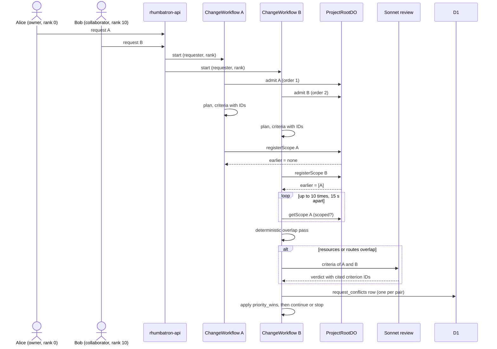
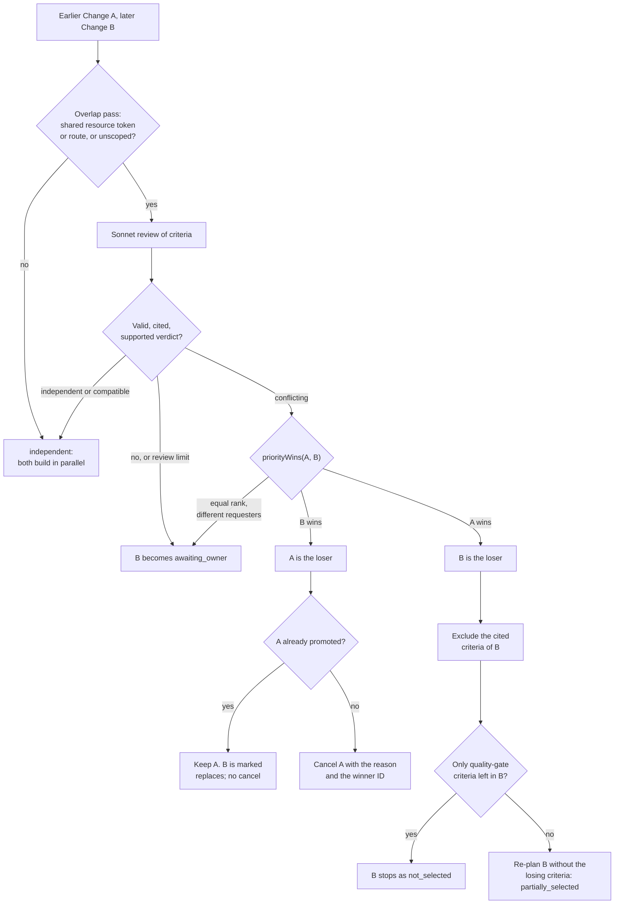

# Shared Projects and simultaneous requests

This page explains how several people use one Project at the same time.
It covers membership, the check that compares simultaneous requests, the `priority_wins` policy, and the owner override.
The plan is `docs/plans/phase-17a-shared-projects.md`.
This page describes the code.

Main source files:

- `migrations/d1/0022_shared_projects.sql`: members, invitations, request columns on `changes`, `request_conflicts`.
- `workers/api/src/identity.ts`: `projectRole`, `canAccessProject`, `ownerOnlyMessage`.
- `workers/api/src/members.ts`: invitations, members, request conflicts, override route.
- `workers/coordinator/src/request-scopes.ts`: serialized admission and scope receipts in ProjectRootDO.
- `workers/integration/src/request-policy.ts`: overlap pass, review validation, `priorityWins`, quality gate.
- `workers/integration/src/request-check.ts`: `checkRequestPair`, one comparison of two Changes.
- `workers/integration/src/change-workflow.ts`: the `check other requests` step.
- `workers/integration/src/change-commands.ts`: `overrideRequest`.

## Sharing a Project

Membership is per Project.
The table `project_members` holds one row for each user and Project.
A collaborator sees only the shared Project, not the other Projects of the owner.
Rhumbatron does not use Clerk Organizations for sharing.

| Role | Rank | How the user gets it |
|---|---|---|
| `owner` | 0 | The migration backfills one row for the owner of each existing Project. A partial unique index allows one owner for each Project. |
| `collaborator` | 10 | The user accepts an invitation. |

The API never reads a role or a rank from the client.
The rank is a snapshot.
Each Change stores `requested_by` (the `created_by` column) and `requester_rank` when it is created.
A later rank change does not rewrite old Changes.

`projectRole` returns `owner` for the owner row, or for a member of the organization that owns the Project.
It returns `collaborator` for a member of `project_members`.
It returns `null` otherwise, and the API answers `404`.

### Invitations

The owner invites a collaborator with `POST /v1/projects/:projectId/invitations` and an email address.
The API changes the email to lowercase.
An invitation is `pending` for 7 days.
It then expires, and the owner can send a new one.
Only one `pending` invitation can exist for one Project and email.

An invitation binds to a Clerk-verified email of the signed-in user.
The API reads the Clerk profile and keeps only the email addresses with verification status `verified`.
`GET /v1/invitations` lists the pending invitations for those addresses.
`POST /v1/invitations/:invitationId/accept` checks that the invitation email is in that list.
If it is not, the API gives the same answer as for a missing invitation.
The member row stores the immutable user ID, not the email.
Accepting twice is safe: the second call returns the same result.

### What a collaborator can do

A collaborator can open the Project, read its Changes and Candidates, and create a Change.
A collaborator can cancel their own Change.
All other actions are owner-only.
The API answers `403` with the text "Only the project owner can ...".

The owner-only actions in the code are:

- Share the Project, revoke an invitation, remove a member.
- Provision the Project and run its checks.
- Remove the Project.
- Compose a Candidate, approve a release, promote a Candidate.
- Publish the app, remove the app, roll back.
- Resolve stopped (dead-letter) work.
- Edit code directly.
- Raise a budget.
- Cancel the Change of another person.
- Choose between requests (the override route).
- Inject a release failure.

## Comparing simultaneous requests

One request is one Change.
Each Change runs its own ChangeWorkflow.
Two Changes of the same Project can run at the same time, so the workflow compares them after planning.
The comparison runs in the step `check other requests` of ChangeWorkflow.

### Admission and registration

The workflow admits the Change in ProjectRootDO before it plans.
`admit` inserts a row in the SQLite table `request_scopes` and returns the admission order.
The row starts with an empty scope (`scoped: false`) and the requester ID and rank.

After planning, the workflow calls `registerScope` with the criteria (each has an ID) and the semantic resources of the Work Graph.
ProjectRootDO runs this call in one serialized Durable Object.
It returns the scopes of all Changes with a lower admission order that are not released.
It stores this answer as a receipt.
A retry gets the same receipt, never a new order or a new earlier set.

Because of this, each pair of Changes is compared once.
The later-admitted Change of the pair does the comparison.
The earlier Change never compares itself with the later one.
The workflow releases the scope of a Change that ends as `completed`, `failed`, `cancelled` or `not_selected`.

### Waiting for an unscoped earlier request

An earlier Change can still plan when the later Change registers.
Its scope is then `scoped: false`.
The later workflow reads the scope again, up to 10 times, with a 15 second sleep between reads.
After the last read, the unscoped Change counts as overlapping.
Rhumbatron never treats an unknown scope as independent.

### Deterministic overlap pass

`requestsOverlap` runs before any model call.
It returns `true` if one of the two Changes is not scoped.
Otherwise it compares two sets:

- Resource tokens. The code removes the `project:<slug>` prefix, splits on `:` and `-`, and drops generic words such as `app`, `api`, `ui`, `web` and `src`. The two Changes overlap if one token is in both sets.
- HTTP routes. The code finds route strings that start with `/` in the criteria text. The two Changes overlap if one route is in both sets.

If the pair does not overlap, the verdict is `independent`, the cost is 0, and no model runs.
The receipt records the method `deterministic`.

### Review and citation validation

An overlapping pair gets one review from Sonnet.
The model calls the tool `review_requests` once.
It returns a verdict (`independent`, `compatible` or `conflicting`) and a list of conflicts.
Each conflict names one criterion ID of each Change and a short reason.

Application code then validates the answer (AGENTS.md section 34.4.2).
The answer is not valid in these cases:

- The JSON does not match the schema, or the model returns no tool call, or more than one.
- A conflict cites an ID that is not a criterion of that Change.
- The verdict is `conflicting` and the list is empty.
- The verdict is not `conflicting` and the list is not empty.

An invalid answer, a provider error, and an abstention all become `unconfirmedReview`: verdict `conflicting`, `supported: false`, no cited criteria.
A review that cannot confirm compatibility never lets both requests proceed.

A Change makes at most 4 reviews, and only while the planning and review spend is below the Change budget.
Past that limit an overlapping pair gets the same conservative result (receipt method `review-limit`).

`checkRequestPair` first inserts a `request_conflicts` row with a conservative receipt (`review-interrupted`).
It does this before it calls the model.
If the workflow stops after the call, the retry reads the stored review and does not spend again.

### Unconfirmed means the owner decides

If the review is `conflicting` and `supported` is false, the Change becomes `awaiting_owner`.
It does not wait for a model.
The owner chooses with the override route (see below).

## The priority_wins policy

`priorityWins(a, b)` takes the earlier Change `a` and the later Change `b`.
It uses the stored requester ID and rank.

| Case | Result |
|---|---|
| Same requester | The later request wins. It supersedes the earlier one. |
| Different requesters, different rank | The lower rank number wins. The owner (0) beats a collaborator (10). |
| Different requesters, equal rank | `awaiting_owner`. The owner must choose. |

Evidence still gates every release.
`priority_wins` only decides which request enters the Work Graph.

### The loser is the later Change

This is the common case, because the later Change does the comparison.
The workflow excludes the criteria that the review cited for the later Change.
It also excludes the criteria that depend on a cited one (`losingCriterionIds`).
The review lists them in `dependentOnConflict`, and code checks each entry like a citation.
A deterministic rule adds a criterion that names the losing layout, for example "card" or "grid", when the winner does not.
Example from prod: "Each card shows the recipe title" depends on "renders as a grid of cards", so it loses with it.
Then the workflow checks what remains.

`nothingSelected` returns true when every remaining criterion only restates the quality gate.
An example is "typecheck, test and contract all pass".
The planner adds such a criterion to most Changes, and it never conflicts.
Without this rule a loser would stay alive as a partial selection with nothing to build.
In that case the Change stores the planned criteria, so the user still sees the request, and ends as `not_selected` with the reason and the winner ID.

If a real criterion remains, the planner makes a new Work Graph for the selected criteria only.
The Change continues with `outcome = partially_selected`.
The text of the reason changes from "Not selected:" to "Partially selected:".

### The loser is the earlier Change

The workflow cancels the earlier Change with the reason and the winner ID.
If its work is running, it stops.
If the earlier Change already has a promoted Candidate, the workflow does not undo the promotion.
Promotion is final once Root commits it.
The winner gets `outcome = replaces`.
If the cancel is refused because promotion has started, the later Change gets `outcome = replaces` too.

## Owner override

The owner can choose a request that did not win.
`POST /v1/changes/:changeId/override` works only for a Change in status `not_selected` or `awaiting_owner`.
A collaborator gets `403`.

`overrideRequest` does not restart the old workflow, because a Workflow instance ID cannot restart.
It makes a new Change with a deterministic ID.
The new Change has the goal, requester and rank of the old Change and `supersedes_change_id` set to the old Change.
The old Change gets `outcome = overridden` and the owner as `outcome_decided_by`.

For each conflict where the old Change lost or was undecided, the code adds a new `request_conflicts` row.
Its policy is `owner_override` and the winner is the new Change.
The first row stays as history.
It then cancels the former winner with the reason "Replaced by the owner's choice", unless that Change already promoted.
When the new Change runs its own check, `checkRequestPair` finds the owner choice and does not call the review again.

### Recompose guard

`recomposeDecision` (`workers/integration/src/recompose.ts`) inserts a Candidate only if the Change is not blocked.
The insert has a `WHERE EXISTS` condition.
It refuses a Change with status `not_selected`, `cancelled` or `awaiting_owner`.
It also refuses a Change with outcome `not_selected` or `overridden`.
Without this guard, a stale recompose could ship the loser over the winner.

## What the UI shows

- The Project page lists Changes in a table with a `Requested by` column.
- Each Change row has an outcome line: `Waiting for the owner to choose`, `Not selected: <reason>` with a `(view winner)` link, `Selected`, `Partially selected`, `Replaces earlier request`, or `Replaced by owner`.
- The `Conflicting requests` card shows both goals, the cited criteria, the winner, and a `Use this instead` button for the owner.
- The Project header has a Share dialog and a members list for the owner. The API shows invitations to the owner only, and the email of a member only to the owner and to that member.
- The home page has a `Shared with you` section for Projects where the user is a collaborator, and pending invitations.
- The UI hides owner-only buttons for a collaborator. The API still enforces the rule.

## Known limitation

The review can miss a contradiction.
Two requests can use unrelated words and touch unrelated resources.
The overlap pass then finds no overlap, and no model reads the pair.
Both Changes ship in sequence, and the later one wins (last one wins).
The tests of the earlier Change usually fail on the later tree and stop it.
An agent can edit those tests.
Tests outside the source that agents can edit are not built yet.
Report such a miss as an incident.
Plan section 3 has the details.

## Example from production

On 2026-10-10 the Project `Birthday Weekend` (`bday-nncq6`) ran this case on prod.
Alice is the owner.
Her display name in the record is `Smoke Prod`.
Bob is a collaborator.

1. Alice asked: "Change the page background to dark navy with white text." She also asked for an "N left" count.
2. Bob asked: "Change the page background to light yellow." He also asked for a Clear completed button.
3. The two background requests overlapped, so the Sonnet review ran.
4. The Sonnet review returned `conflicting` and cited two criteria: "The home page background renders as light yellow" (Bob) and the criterion that the page "renders with a dark navy background and white text" (Alice).
5. Both citations were valid. The ranks were 0 and 10, so `priority_wins` chose Alice.
6. Bob's request became `not_selected` with the reason: "Not selected: it conflicts with Smoke Prod's request ..., which has higher priority (owner)."

The "N left" count and the Clear completed button did not overlap with each other or with the background requests.
They built in parallel and were not affected.
The owner could now press `Use this instead` on Bob's request to replace Alice's.
