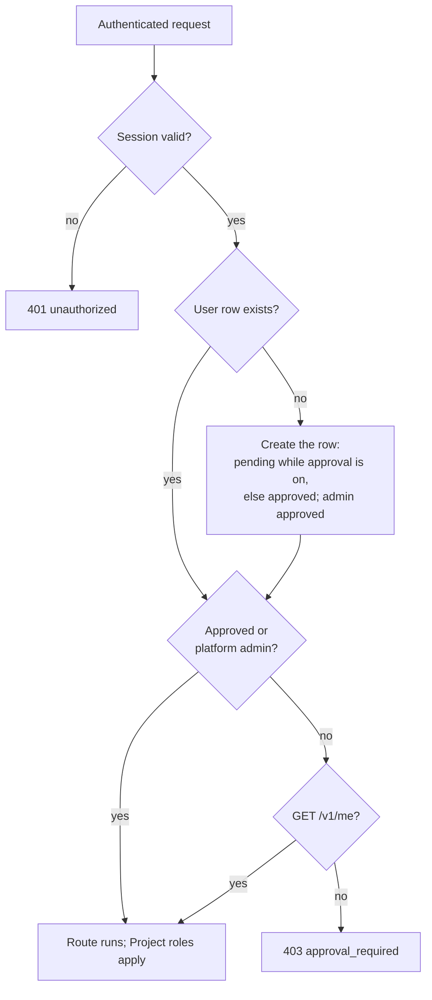
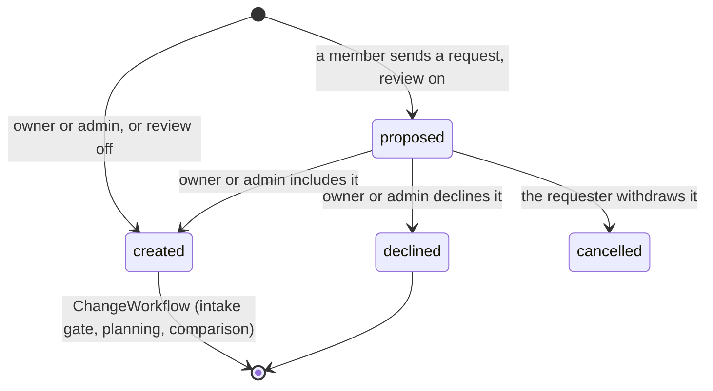
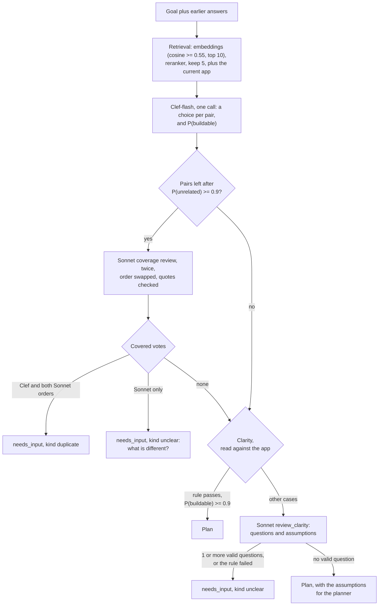
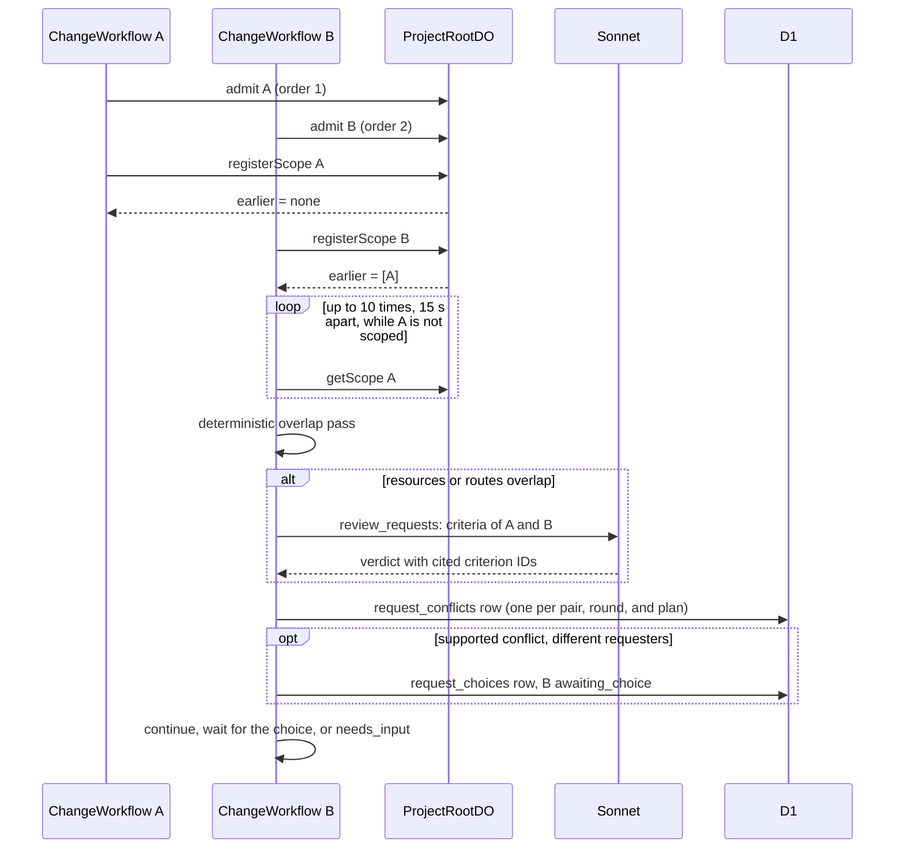
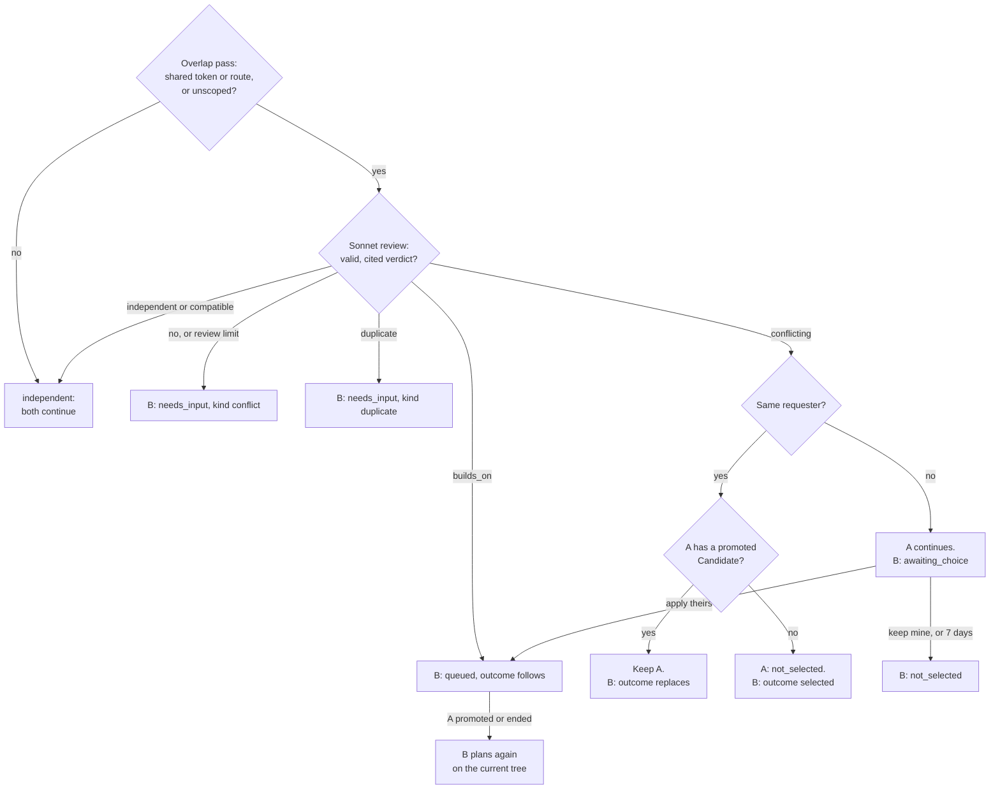
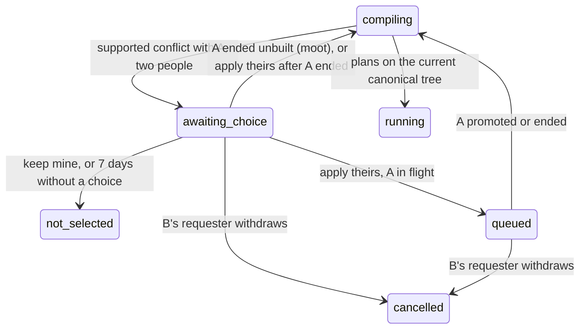

# Shared Projects and simultaneous requests

This page covers platform access, Project membership and roles, request review, the intake gate, the comparison of simultaneous requests, and first-come conflicts between people.
A role decides who can act. It never decides between two requests. The system compares them. In a conflict between two people, the person who asked first chooses (ADR 0025, ADR 0028, ADR 0032).

Main source files:

| File | Contents |
|---|---|
| `migrations/d1/0022_shared_projects.sql` | `project_members`, `project_invitations`, request columns on `changes`, `request_conflicts` |
| `migrations/d1/0024_intake_and_system_decisions.sql` | `clarification_json`, `clarification_answers_json`, the `duplicate` verdict, pair rounds, `change_decisions` |
| `migrations/d1/0029_roles_and_request_review.sql` | The roles `owner`, `admin`, `member`, `viewer`; invitation roles; `projects.member_request_review`; the `review_*` columns on `changes` |
| `migrations/d1/0032_change_assumptions.sql` | `changes.assumptions_json`: the details that the Root Planner decided |
| `migrations/d1/0033_first_come_choices.sql` | `request_choices`: one first-come question per earlier and later request |
| `migrations/d1/0035_platform_admin_and_access.sql` | `users.access_status`, `platform_settings`, `admin_audit` |
| `workers/api/src/access.ts` | The access gate, `isPlatformAdmin`, and the admin audit rows |
| `workers/api/src/admin.ts` | The `/v1/admin/*` routes |
| `packages/protocol/src/first-come.ts` | `conflictPolicy`, `firstComeStep`, `canChooseFirstCome`, `RequestWait`, `ChooseRequest` |
| `packages/protocol/src/roles.ts` | `ProjectRole`, the permission matrix `PERMISSIONS`, `can`, `needsReview`, `canInvite`, `canChangeRole`, `canRemoveMember`, `deniedMessage` |
| `workers/api/src/identity.ts` | `projectRole`, `canAccessProject` |
| `workers/api/src/members.ts` | Members, roles, invitations, the review fields, `GET /v1/changes/:changeId/request-conflicts` |
| `workers/api/src/changes.ts` | Cancel, budget, include, and decline of one Change |
| `workers/api/src/board.ts` | `GET /v1/projects/:projectId/board` |
| `workers/api/src/clarify.ts` | `POST /v1/changes/:changeId/clarify` |
| `workers/api/src/first-come.ts` | `GET /v1/changes/:changeId/request-waits`, `POST /v1/changes/:changeId/choose` |
| `workers/coordinator/src/request-scopes.ts` | Admission order and scope receipts in ProjectRootDO SQLite |
| `workers/integration/src/intake-context.ts` | Related requests, the current app summary, the app context of the clarity check, stored answers, `intakeMayAsk` |
| `workers/integration/src/intake.ts` | The intake cascade and its citation checks |
| `workers/integration/src/request-policy.ts` | Overlap pass, review validation, quality-gate rule |
| `workers/integration/src/request-check.ts` | `checkRequestPair`: one comparison of two Changes |
| `workers/integration/src/first-come.ts` | `askFirstRequester`, `advanceFirstCome`, `chooseFirstCome`, `wakeAfterFirst` |
| `workers/integration/src/change-workflow.ts` | The steps `intake review` and `check other requests`, the wait for an answer, and the first-come wait |
| `workers/integration/src/change-commands.ts` | `clarifyChange`, `closeNeedsInput`, `cancelChange`, `includeChange`, `declineChange`, `recordProposal` |

## Access gate

Before a person can open any Project, the platform must approve them (ADR 0033).
`users.access_status` holds `approved`, `pending`, or `declined`.
`requireAuth` runs the gate after it verifies the Clerk session.

1. The gate reads the status of the user and the setting `signup_approval_required` in one D1 query.
2. The first request of a new person creates the user row. While the setting is `"true"`, the row is `pending`. Otherwise it is `approved`.
3. A platform admin (a user ID in `PLATFORM_ADMIN_USER_IDS`) is always approved.
4. A person who is `pending` or `declined` gets 403 `approval_required` with `details.status`. Only `GET /v1/me` answers. It returns `accessStatus`, so the web can show one full-page message and no Project data. Sign-out is a Clerk action in the browser.
5. A platform admin approves or declines each pending person, or approves all of them (`/v1/admin/*`). Turning the setting off approves nobody.

The API decides admin rights from the session user ID only. A request field never names an admin.
Each platform admin gets the notification `access_request` while a person is pending. The person gets `access_decided` after the decision.
Project roles apply only after the gate: an approved person sees only the Projects that they own or that another person shares with them.

## Membership

Membership is per Project.
The D1 table `project_members` has one row for each user and Project.
A person sees only the Projects that they own or that another person shares with them.
Rhumbatron does not use Clerk Organizations.

| Role | How the user gets it | Rank |
|---|---|---|
| `owner` | Project creation inserts the owner row. A partial unique index allows one owner for each Project. Nobody can assign, change, or remove the owner role. | 0 |
| `admin` | The owner invites the person as `admin`, or changes the role of a member. | 5 |
| `member` | The person accepts an invitation with the role `member` (the default). | 10 |
| `viewer` | The person accepts an invitation with the role `viewer`. | 30 |

`projectRole` reads the role from D1. The API never reads a role from the client.

- `owner`: the owner row, or a member of the organization that owns the Project.
- `admin`, `member`, `viewer`: the role of the caller's row in `project_members`.
- `null`: any other user. The API answers `404`.

The `rank` column (`ROLE_RANK`) only orders the members list.
`changes.created_by` holds the requester. `changes.requester_rank` holds the rank of the requester's role at request time, for display.
No build decision reads a role, `rank`, or `requester_rank`.

### Invitations

1. The owner or an admin sends `POST /v1/projects/:projectId/invitations` with an email address and a role (`admin`, `member`, or `viewer`; default `member`). Only the owner can invite an admin. The API changes the email to lowercase.
2. The invitation stays `pending` for 7 days. One `pending` invitation can exist for one Project and email. A repeat returns the same invitation. A repeat with another role changes the role of the pending invitation.
3. After 7 days the invitation expires. The owner or an admin can then send a new one.
4. `GET /v1/invitations` lists the pending invitations for the Clerk email addresses of the caller that have the status `verified`.
5. `POST /v1/invitations/:invitationId/accept` checks that the invitation email is one of these addresses. If not, the API answers `404`, as for a missing invitation.
6. The member row stores the user ID and the role of the invitation. It does not store the email. A second accept returns the same result.

### Roles and permissions

`PERMISSIONS` in `packages/protocol/src/roles.ts` is the one permission matrix.
The API checks each action with `can(role, action)`. The web hides each control that `can` refuses.
A refused action gets `403` with the text of `deniedMessage`: "Only the project owner can ..." or "Only the project owner or an admin can ...".

| Action | owner | admin | member | viewer |
|---|---|---|---|---|
| Read the Project pages (`project.read`) | yes | yes | yes | yes |
| Send a request (`change.create`) | yes | yes | yes, with review | no |
| Answer, withdraw, or cancel your own request (`change.manageOwn`) | yes | yes | yes | no |
| Answer or cancel the request of another person (`change.manageAny`) | yes | yes | no | no |
| Include or decline a proposed request (`change.review`) | yes | yes | no | no |
| Raise a budget, compose, approve, or promote a Candidate | yes | yes | no | no |
| Publish or remove the app, roll back, inject a release failure | yes | yes | no | no |
| Retry or dismiss stopped work (dead letters), edit code directly | yes | yes | no | no |
| Provision the Project, run its checks | yes | yes | no | no |
| Invite people, change the role of a member or viewer, remove a member or viewer (`people.manage`) | yes | yes | no | no |
| Invite an admin, make or change an admin, remove an admin (`admins.manage`) | yes | no | no | no |
| Change the settings: name, default budget, Project monthly budget, member request review (`settings.edit`) | yes | yes | no | no |
| Delete the Project (`project.delete`) | yes | no | no | no |
| Leave the Project (`project.leave`) | no | yes | yes | yes |

- `PATCH /v1/projects/:projectId/members/:userId` changes a role. It never changes the owner row.
- `DELETE /v1/projects/:projectId/members/:userId` removes a person, or the caller leaves with their own user ID.
- When a person leaves, the API first cancels their open requests. When the API removes a person, it cancels their `proposed` requests. Past Changes stay with the Project.

## Request review

The Project setting `memberRequestReview` (D1 `projects.member_request_review`, default on) controls review.
While it is on, the request of a `member` starts as `proposed` (`needsReview`).
The requests of the owner and the admins never need review.
When the setting is off, a member's request goes to the system at once, as the request of an admin does.

A `proposed` Change has no ChangeWorkflow. It makes no model call and spends nothing.
ProjectRootDO does not admit it, so the request comparison does not see it.

- Create: the API inserts the Change with status `proposed` and `review_state = 'proposed'`. The integration Worker records `change.proposed` (`recordProposal`). The owner and the admins get the notification `request_proposed`.
- Include: `POST /v1/changes/:changeId/include` (`change.review`). `includeChange` moves the Change to `created` at the current Canonical Generation and stores who decided and when. It records `change.included` and starts the ChangeWorkflow with the Change ID as instance ID, as for a request without review. A repeat returns the same result and starts no second workflow. The requester gets `request_included`.
- Decline: `POST /v1/changes/:changeId/decline` with an optional `reason` (up to 500 characters). The Change becomes `declined` with `outcome = declined` and the reason. `declined` is terminal. The event is `change.declined`. The requester gets `request_declined`.
- Withdraw: the requester sends `POST /v1/changes/:changeId/cancel`. The Change becomes `cancelled`. Its `review.state` stays `proposed`, because nobody decided.
- An include or a decline on a Change that is not `proposed` returns `409`. A repeat of the same decision returns `repeated: true`.

Each Change response has `review`: `state` (`not_needed`, `proposed`, `included`, or `declined`), `decidedBy` (`userId`, `name`), `decidedAt`, and `reason`.

### Board

`GET /v1/projects/:projectId/board` reads the newest 100 Changes, their Tasks with the newest run of each, and the members, in one D1 batch.
Each Change is a card in one column (`BOARD_COLUMN_OF` in `packages/protocol/src/board.ts`):

| Column | Change statuses |
|---|---|
| `proposed` | `proposed` |
| `needs_answer` | `needs_input`, `awaiting_choice` |
| `building` | `created`, `queued`, `compiling`, `running`, `budget_blocked`, `blocked` |
| `checking` | `verifying`, `awaiting_approval`, `promoting`, `releasing` |
| `shipped` | `completed` |
| `not_built` | `declined`, `not_selected`, `cancelled`, `failed` |

The `shipped` and `not_built` columns show the newest 20 cards each.
`people` lists each member with a role and each earlier requester who left (role `null`), with counts over the 100 Changes: `proposed`, `active` (`needs_answer`, `building`, `checking`), `shipped`, and `notBuilt`.
`canReview` is `true` for the owner and the admins.
A card of an `awaiting_choice` or `queued` Change has `waiting`: the earlier request, its requester, and `state` (`choosing` or `after_first`).

## The intake gate

Each Change runs its own ChangeWorkflow.
The step `intake review` runs before the Root Planner.
It decides whether the request is clear and whether the app or another request already delivers it.
The cascade runs the cheap checks first.
A model never rejects a request at intake. The strongest result is a question to the requester.

The intake gate asks at most one round for each request.
After an answer, or after "Build it as it is", the request goes to planning, and the intake gate does not run again.

### Retrieval

`loadRelatedRequests` reads up to 50 open Changes of the Project and the 20 most recent `completed` Changes.
An open Change has any status except `completed`, `failed`, `cancelled`, `not_selected`, and `declined`.
A `proposed` request is open. When it covers the new request, the question names it as "a request that <name> proposed (it waits for review)".
Each item is the goal plus the stored acceptance criteria.
Each text has a packet ID: `<changeId>:goal`, `<changeId>:c1`, and so on.

`retrieveRelated` then does these steps:

1. Embed the goal and each item with Workers AI `@cf/baai/bge-small-en-v1.5`.
2. Keep up to 10 items with a cosine similarity of 0.55 or more. If the embedding call fails, keep the items that share a non-generic word with the goal.
3. Order the shortlist with `@cf/baai/bge-reranker-base`. Keep 5.

The current app is one more target when its source is readable and not empty.
Its packet items are `canonical:files` (up to 60 paths), `canonical:deps` (dependency names of the root `package.json`), and `canonical:stack` (hints such as `react` or `angularjs`).
Cosine similarity only selects targets. It never decides.

### Clef-flash

One Clef-flash call answers two kinds of question:

- For each pair: `duplicate`, `already_covered`, `extends`, `overlaps`, or `unrelated`.
- For the request: `buildable` or `needs_detail`.

The call uses the D1 `clef-flash` daily counter (200 calls per UTC day). The integration, agents, and event router Workers share this counter.
When the counter is spent, Clef-flash abstains, and every later stage runs.
A pair drops only when `unrelated` has a probability of 0.9 or more.
Clef-flash alone never marks a duplicate.

### Duplicate check

For each remaining pair, Sonnet finds the criteria of the other request, or the features of the current app, that already deliver the new request.
The tool is `coverage_review`.
A `duplicate` or `already_covered` verdict must quote source text with its packet ID.
`validateCoverage` checks that each quote is text of the cited source of that target.
A covered verdict without a valid quote counts as `unsupported`.
Sonnet runs twice: once with the new request first, once with the other items first.

| Clef-flash | Sonnet, first order | Sonnet, second order | Result |
|---|---|---|---|
| covered | covered | covered | `needs_input`, kind `duplicate` |
| not covered | covered | covered | `needs_input`, kind `unclear` |
| any | covered | not covered | `needs_input`, kind `unclear` |
| any | not covered | covered | `needs_input`, kind `unclear` |
| any | not covered | not covered | Continue to the clarity check. |

The question quotes the covering text: "This looks covered by "<goal>": "<quote>". What is different in your request?"

### Clarity

The clarity check reads the request as a change to the current app.
`appContext` (`intake-context.ts`) builds the app context with no model call and no extra D1 read:

| Field | Source |
|---|---|
| `files`, `fileCount` | Up to 60 paths of the canonical tree |
| `name`, `description` | The root `package.json` |
| `readme` | The first 600 characters of the root `README.md` |
| `requests` | Up to 10 titles of the related requests: in-flight requests first, then the latest shipped requests |

Clef-flash gets a shorter copy (40 paths, 300 README characters).
So "Change to 16 color palette" in a canvas app that has a palette is clear.

1. A rule runs first. A goal with fewer than two words that name a product object fails the rule. Generic words such as "add", "build", "feature", and "app" do not count. "Add kanban feature" fails the rule.
2. If the rule passes, a Clef-flash `buildable` probability of 0.9 or more makes the request clear. The request goes to planning with no Claude call. Clef-flash can only clear a request. It never asks alone.
3. In all other cases, one Sonnet call (`review_clarity`) reads the request and the app context. It returns:
   - `questions`: only for a part of the request that two readings build as materially different products (a different feature, object, page, or user). Each question has one text, a quote of the goal, and 2 to 4 readings as options.
   - `assumptions`: small details that the request leaves open, such as colors, sizes, labels, or defaults. Each is one sentence with the choice that the builder makes.
4. `validateClarity` shapes the questions. It keeps a question only when its quote is in the goal, its text asks one thing (one question mark, no semicolon list), and it has 2 or more distinct options. It removes options such as "Other", because the form adds "Something else". It keeps at most 3 questions with at most 4 options each, and at most 6 assumptions.
5. The request gets a question when one or more questions remain. When the rule failed and no question remains, the request gets one open question: "What should <goal> do?".
6. Otherwise the request goes to planning. The assumptions go to the Root Planner as open details. The planner decides each one and records it.

Small details are never questions. The Root Planner records the details it decided in `assumptions` of the Work Graph. The ChangeWorkflow writes them to D1 `changes.assumptions_json` (migration `0032_change_assumptions.sql`). The Change page shows them as "Assumptions". To change one, the requester sends a follow-up request.

### Waiting for an answer

A question sets the Change to `needs_input`.
`clarification_json` holds the `ChangeClarification`: `kind` (`unclear`, `duplicate`, or `conflict`), `summary`, up to 3 `questions`, `relatedChangeId`, `relatedGoal`, `askedAt`, and `round` (1 to 3).
Each question has its own answer. A question with `options` shows the readings as choices, plus "Something else" with a text field. The form sends an answer for each question that the person answered. The Root Planner decides the part that an unanswered question leaves open.
The requester gets the notification `request_needs_input`.

The workflow waits for the event `clarification`.
It reads the D1 row after each event and once a day.
After 7 days without an answer, the Change becomes `cancelled` with the reason "No answer within 7 days".

`POST /v1/changes/:changeId/clarify` accepts one of three bodies.
Only the requester, the Project owner, or an admin can call it.

| Body | Effect |
|---|---|
| `{ "answers": [{ "questionId": "q1", "text": "..." }] }` | The answers append to `clarification_answers_json`. The Change returns to `compiling`. The planner and the request comparison read the goal with the questions and answers. The intake gate does not run again. |
| `{ "action": "proceed_anyway" }` | The Change returns to `compiling`. It plans without the intake gate and without another question. |
| `{ "action": "withdraw" }` | The Change becomes `cancelled` with the reason "Withdrawn by the requester". |

When a `duplicate` Change ends by withdrawal or by the 7-day limit, it also gets `outcome = duplicate` and the related Change ID.
The intake gate asks at most one round (`intakeMayAsk`). The request comparison can ask more rounds. A request gets at most 3 rounds of questions in total. After the third answer, it plans without another question.
The update has a guard on the open round. When two answers arrive for one round, only one applies.
If the first workflow instance of the Change has ended, the answer starts a new instance with the ID `<changeId>_r<round>`.

Each intake run writes a Decision Receipt to `change_decisions` (`decision_type = 'INTAKE'`) and records the event `change.intake.reviewed`.
The receipt holds the retrieval scores, the Clef-flash probabilities, the Sonnet verdicts and quotes, and the cost. It holds no private reasoning.
The model cost counts against the Change budget. The gate skips a Sonnet call when the budget is spent.
An answer records `change.clarification.answered`.

## Comparing simultaneous requests

Two Changes of one Project can run at the same time.
After planning, the ChangeWorkflow step `check other requests` compares the Change with the earlier open Changes.

### Admission and registration

1. After the intake gate lets the Change plan, the workflow calls `admit` on ProjectRootDO. `admit` inserts a row in the SQLite table `request_scopes` and returns the admission order. The row starts with an empty scope (`scoped: false`).
2. After planning, the workflow calls `registerScope` with the criteria and the semantic resources of the Work Graph. Each criterion has an ID.
3. `registerScope` runs in one ProjectRootDO transaction. It returns each scope that has a lower admission order and is not released. It stores this answer as a receipt.
4. A retry gets the same receipt. After an answer, the next pass keeps the receipt and updates the scope with the new criteria.

A Change that waits for an answer before planning has no admission, so it does not delay other requests.
A `proposed` Change has no ChangeWorkflow, so it has no admission either. Its admission order starts when an owner or admin includes it.
The later-admitted Change of a pair does the comparison, once for each clarification round and once for each plan after a first-come wait.
The workflow releases the scope of a Change that ends as `completed`, `failed`, `cancelled`, or `not_selected`.

### Unscoped earlier request

An earlier Change can still be in planning when the later Change registers. Its scope is then `scoped: false`.
The later workflow reads the scope again, up to 10 times, with 15 seconds between reads.
If the scope is still unscoped, the pair counts as overlapping.

### Deterministic overlap pass

`requestsOverlap` runs before any model call.
It returns `true` if one of the two Changes is not scoped.
Otherwise it compares two sets:

- Resource tokens. The code removes the `project:<slug>` prefix, splits on `:` and `-`, drops the words `app`, `api`, `ui`, `project`, `frontend`, `backend`, `web`, and `src`, and reduces each word to a plain stem (`gifts`, `gifting`, and `gifted` are all `gift`). One shared token is an overlap.
- HTTP routes. The code finds the strings that start with `/` in the criteria text. One shared route is an overlap.

A pair with no overlap gets the verdict `independent`, with cost 0 and the receipt method `deterministic`.

### Review and citation validation

An overlapping pair gets one Sonnet review with the tool `review_requests`.
The verdict is `independent`, `compatible`, `builds_on`, `conflicting`, or `duplicate`.

- `compatible` means that each request can be built from the current code alone, and neither needs or changes what the other creates.
- `builds_on` means that the later request adds to, changes, or uses something that the earlier request creates: a feature, page, route, setting, or data shape. `builds` lists each such criterion of the later Change with the earlier criterion that it builds on and a short reason.
- Each conflict cites one criterion ID of each Change and a short reason.
- For `duplicate`, `covered` maps each criterion of the later Change to the earlier criterion that delivers it, with a quote.

`validateRequestReview` rejects the answer in these cases:

- The JSON does not match the schema, or the model returns no tool call or more than one.
- A conflict cites an ID that is not a criterion of that Change.
- The verdict is `conflicting` and the conflict list is empty, or the verdict is not `conflicting` and the conflict list is not empty.
- The verdict is `duplicate` and `covered` is empty, or the verdict is not `duplicate` and `covered` is not empty.
- The verdict is `builds_on` and `builds` is empty, or the verdict is not `builds_on` and `builds` is not empty, or a `builds` entry cites an unknown criterion.
- A `covered` entry cites an unknown criterion, or its quote is not text of the cited earlier criterion.

A rejected answer, a provider error, and an abstention all become `unconfirmedReview`: verdict `conflicting`, `supported: false`, no cited criteria.
A review that cannot confirm compatibility never lets both requests proceed without a question.

Each comparison round of a Change makes at most 8 reviews (`MAX_PAIR_REVIEWS`), and only while its model spend is below the Change budget.
Past that limit, an overlapping pair gets the same unconfirmed result (receipt method `review-limit`).

`checkRequestPair` inserts the `request_conflicts` row with an unconfirmed receipt (`review-interrupted`) before it calls the model.
A retry reads the stored row and does not call the model again.

## Deciding a compared pair

`conflictPolicy` (`packages/protocol/src/first-come.ts`) decides from the review and the two requesters.
No role, rank, or model preference takes part.

| Review | Requesters | Policy | Result |
|---|---|---|---|
| `independent` or `compatible` | Any | `none` | Both requests continue. |
| `builds_on`, cited | Any | `follow` | A continues. The system records the choice `apply_theirs` (`chosen_by` `system:builds_on`). B is `queued` and plans after A promoted or ended, on the tree that has A's work. Nobody gets a question. |
| `duplicate`, cited and quoted | Any | `duplicate` | B: `needs_input`, kind `duplicate`. |
| `conflicting`, unsupported, or the review limit | Any | `ask_requester` | B: `needs_input`, kind `conflict`. |
| `conflicting`, supported | The same person | `same_requester` | B replaces A. |
| `conflicting`, supported | Two people | `first_come` | A continues. B waits for the choice of A's requester. |

A question from the comparison uses the same `needs_input` status, notification, and route as the intake gate, with a limit of 3 rounds.
For kind `conflict`, the Project owner and the admins also get the notification.
The question names the other request and up to 2 conflicting criterion pairs, and asks how the later request must change so both fit.
After an answer, the workflow runs the planner again, and compares the new criteria as a new round of the pair. The intake gate does not run again.
After `proceed_anyway` or the third answer, the comparison asks no question. The `first_come` and `same_requester` rules still apply. An unsupported pair lets both requests continue.

`request_conflicts.policy` records the result: `first_come`, `same_requester`, or `ask_requester`.
`decided_by` is the user ID of the earlier requester for `first_come`, `system:same_requester`, or `system:request_review` for a question.
The comparison records `conflict.reviewed` on the later Change, with the policy.

### First come: requests of two people

The earlier request A keeps working without change (ADR 0032).
The later request B waits. It does not plan again, build, or spend while it waits.

1. `askFirstRequester` inserts one `request_choices` row for the pair (`rw_<A>_<B>`, `INSERT OR IGNORE`), with `asked_user_id` = A's requester and the waiting workflow instance ID. B moves from `compiling` to `awaiting_choice`. The event is `change.choice.requested`.
2. The workflow stores B's planned title and criteria, so the wait shows what B asks for.
3. A's requester gets `request_choice_needed`. The owner, the admins, and B's requester do not get it.
4. A's requester sends `POST /v1/changes/<B>/choose` with `{ "choice": "keep_mine" }` or `{ "choice": "apply_theirs" }`. The API checks `canChooseFirstCome`. The caller must be the asked user and have `change.manageOwn`. Any other member of the Project gets `403`. The update has a guard on `choice IS NULL`. A repeat of the same choice returns `repeated: true`. Another choice returns `409`.
5. `advanceFirstCome` applies the next step (`firstComeStep`):

| Step | When | Effect on B |
|---|---|---|
| `end_kept` | `keep_mine` | `not_selected`, outcome `not_selected`, winner A, decided by A's requester. Reason: `Not selected: <name> chose to keep their version of "<A>".` |
| `expire` | No choice within 7 days | The choice is `expired`. B ends as for `keep_mine`, with the reason `<name> did not choose within 7 days, so their version of "<A>" stays.` |
| `moot` | A ends without a build (`cancelled`, `failed` without promotion, `not_selected`, `declined`) before a choice | The choice is `moot`. B returns to `compiling` and plans at once. |
| `queue` | `apply_theirs`, A is in flight | `queued`, outcome `follows`, reason `<name> chose to apply this request after "<A>".` |
| `resume` | `moot`, or `apply_theirs` after A has a promoted Candidate or a terminal status | `compiling` at the current Canonical Generation. The event is `change.resumed`. |

The choice events are `change.choice.made` (`keep_mine`, `apply_theirs`, `expired`, or `moot`).
B's requester gets `request_not_selected` after `keep_mine` or `expired`, and `request_choice_made` after `apply_theirs`.

The wait:

- The ChangeWorkflow of B waits with `step.waitForEvent` (type `first_come`). The timeout is 6 hours while the choice is open and 1 hour while B is `queued`. After each wake or timeout, the workflow runs `advanceFirstCome`, so the D1 rows decide. A lost event only adds delay.
- The choose command sends the event. When A ends, `releaseRequestScope` calls `wakeAfterFirst`. Each B that waits on A moves to its next step, and its workflow wakes.
- The workflow re-checks at most 150 times (`FIRST_COME_CHECKS`). If it ends while B waits, the end of A starts a new instance `<B>_f<n>`.

The plan after the wait:

- B plans only after A promoted or ended, so it never plans against a stale base. The planner reads the canonical tree at planning time.
- B does not run the intake gate again.
- B compares its new criteria with the other earlier requests. The pair rows of this plan have the suffix `_q<n>`, so an old review is not reused. The pair with A has the stored `apply_theirs` choice, so B continues.

### The same requester asks twice

When the same requester made both requests, the later request wins with `decided_by = system:same_requester`.

- If the earlier Change has no promoted Candidate, `cancelChange` sets it to `not_selected` with the reason and the winner ID. Its open Tasks become `cancelled` and its open Candidates become `rejected`. The later Change gets `outcome = selected`.
- If the earlier Change has a promoted Candidate, the workflow does not undo the promotion. The later Change gets `outcome = replaces`.
- If `cancelChange` refuses because promotion has started, the later Change also gets `outcome = replaces`.

### Recompose guard

A stale Candidate of a losing Change never recomposes.
`recomposeDecision` (`workers/integration/src/app-release-model.ts`) skips a closed Change and a Change that cannot ship.
The insert in `recomposeStaleCandidate` (`workers/integration/src/recompose.ts`) also has a `WHERE EXISTS` condition. It refuses a Change with status `not_selected`, `cancelled`, or `needs_input`, or with outcome `not_selected` or `duplicate`.

## Web UI

- The Project page lists Changes in a table with a `Requested by` column.
- Each Change row has an outcome line: `Waiting for an admin to include it` for a `proposed` request, `Declined by <name>: <reason>`, `Not selected: <reason>` with the link "View the selected change", `Selected`, `Follows: <reason>`, `Replaces earlier request`, or `Duplicate: <reason>`. A `needs_input` Change reads "Waiting for an answer from the requester". An `awaiting_choice` Change reads "Waiting for the person who asked first to choose". A `queued` Change reads "Queued: plans when the earlier request finishes".
- The New change form is hidden from a viewer. When a member's requests need review, the form shows "An admin reviews requests before anything is built." under Submit.
- The New change form is at the top of the Project overview, under the stat strip. It shows one goal field until the field gets focus or text. In a Project with no Changes, the full form shows. The header of each Project page has a "New change" button. The button opens the overview with `?new=1`, opens the form, and moves focus to the goal. The button is hidden from a viewer, on an archived Project, and on screens narrower than 720px. An archived Project has no New change form.
- A `proposed` Change reads "Waiting for an admin to include it". The requester can withdraw it ("Withdraw request"). An owner or admin sees Include and Decline under Needs attention. Decline asks for an optional reason in place. A `declined` Change reads "Not built: declined by <name>: <reason>".
- A `needs_input` Change shows the summary, the questions, and a link to the related request. The requester, an admin, and the owner get the actions "Send answers", "Build it as it is", and "Withdraw request".
- The first-come card (`apps/web/src/components/change/first-come-card.tsx`) reads `GET /v1/changes/:changeId/request-waits`.
  - On the earlier request, an open question reads "<name>'s request conflicts with yours", with the conflicting criteria. The earlier requester gets "Keep mine" and "Apply theirs after mine". Everyone else reads who chooses.
  - On the later request, it reads "Waiting for <name> to choose" with the conflicting criteria and the date when the earlier version stays. After "apply theirs", it reads "Waiting for "<title>" to finish".
- The `Conflicting requests` card shows both goals, the cited criteria or covered quotes, and the winner. It reads `GET /v1/changes/:changeId/request-conflicts` (up to 10 `conflicting` or `duplicate` rows).
- The Board (`/projects/:projectId/board`, sidebar item after Changes) reads `GET /v1/projects/:projectId/board`. The columns are Proposed, Needs answer, Building, Checking, Shipped, and Not built. "By person" shows one lane per person (initial, name, role, counts). "By stage" shows one lane. A Person filter shows only one lane. A card shows these items:
  - the title (else the goal), the requester, and the status;
  - the wait: "Waiting for <name> to choose" or "Waiting for "<title>" to finish";
  - Tasks done of total;
  - the agents at work: Task title, tier H, S, or O, and a pulse while the Task runs;
  - the age.

  A click on a card opens the Change. An owner or admin includes a Proposed card with Include or by a drag to Building, and declines it with Decline. The card moves at once and moves back when the API refuses. Live signals refresh the Board. Without the socket, the Board polls every 10 seconds. On a phone, the columns scroll sideways inside the Board.
- The Project header has a Share dialog for an owner or admin and a Members dialog for everyone else. The API shows invitations only to the owner and admins. It shows the email of a member only to the owner, admins, and that member.
- The People section and the Share dialog show each person's role. An owner or admin changes a role with a select per person and invites with a role. Only the owner gives or removes the admin role. The owner role is never assignable.
- The Settings page (`/projects/:projectId/settings`) has these sections:
  - General: name, slug, live app host, created date.
  - People: members, roles, and invitations.
  - Defaults: the default Change budget (0.5 to 25 USD), the Project monthly budget (1 to 100 USD, with this month's spend), and "Member requests need review: On / Off".
  - Display: the Events page default view (Product or Systems), stored in the browser.
  - Danger zone: Delete project for the owner, Leave project for everyone else.

  A member or viewer sees the values as read-only, with the line "Only the project owner or an admin can change these."
- The Account page (`/account`, in the sidebar footer under the person's name) sets "My monthly budget" (1 to 100 USD) and shows this month's spend across Projects.
- The New change form shows the spending limit on one line, for example "Spending limit: $3.00 for this request (Project default)". "Change" opens the choices in place: "This request only" with an amount, "Project budget" (only when the Project has a monthly budget), and "My budget" (only when the person set one). Each pool shows the money left this month. An amount that is not valid keeps the choices open. See [Costs runbook, Budget scopes](../operations/costs.md#budget-scopes).
- The home page has a `Shared with you` section and the pending invitations.
- The inbox shows `request_proposed` to the owner and admins ("<requester> proposed <title>", with Include and Decline links to the Change), and `request_included` and `request_declined` to the requester.
- The inbox shows `request_choice_needed` to the earlier requester only. It reads "<name>'s request conflicts with yours" and links to their own Change, where they make the choice. The later requester gets `request_choice_made` ("<name> will apply your request after theirs").
- A verified Candidate that waits for a person gives `approval_required` (no decision yet) or `promotion_ready` (approved, or no approval needed). The owner and admins get it as an action item. The requester gets it as an attention item ("Your request waits for an owner or admin"). The body states why the Candidate waits (the Candidate status reason). The link opens the Change, where an owner or admin approves the Candidate or ships it with Ship.
- The UI hides each control that a role cannot use. `apps/web/src/lib/permissions.ts` mirrors the role matrix of the API. Only the owner and admins see approve, promote and Ship, compose, roll back, publish or remove the app, raise a budget, resolve dead letters, and edit code. The API enforces the same rules.

## Limitation

The overlap pass can miss a contradiction.
Two requests can use unrelated words and touch unrelated resources.
Then no model reads the pair, and both Changes build.
The Change that promotes later builds on the tree of the earlier one.
The acceptance check of the later Change judges the kept criteria of the earlier one (below).

A compatible later request plans at the same time as the earlier one.
A later request that builds on the earlier one waits and plans on the earlier work, so the two requests never build the same feature twice.
The inbox tells the later requester "Your request builds on <name>'s request".

When a request plans or re-runs after other requests went live, it keeps their work (`kept-criteria.ts` in `workers/integration/src`):

- The kept criteria are the acceptance criteria of the other requests of the Project whose Candidate promoted after this request was created, newest first, at most 12. Criteria that only restate the quality gate and the request's own criteria are left out. A live request that conflicts with this one (first come or same requester) is left out: this request was chosen to replace it.
- The Task instruction lists them: keep every one of them working, and do not remove, replace, or hide them.
- The acceptance check judges them with the request's own criteria, each marked "Keep (from an earlier request)". A kept criterion that is not met holds the Candidate for a person, like any unmet criterion.

## Examples

Bob is a member. In these examples, Alice or an admin included each of Bob's requests, or the Project has member request review off.

### A duplicate request

Alice's Change C1 is running: "gta6 mission planner, calendar of missions, each day has a kanban list".
Bob asks: "Add kanban feature".

1. Retrieval finds C1. Clef-flash answers `already_covered` for the pair.
2. Both Sonnet orders answer `already_covered` and quote the C1 criterion "Each calendar day shows a kanban list".
3. The three votes agree. Bob's Change becomes `needs_input` with kind `duplicate`, before any planning.
4. Bob reads: "This looks covered by "gta6 mission planner, ...": "Each calendar day shows a kanban list". What is different in your request?"
5. Bob withdraws the request or states what is different.

The duplicate check runs before the clarity check, so Bob gets the duplicate question.

### A conflict between two people

Sudhanva's Project "Place" is empty. Sudhanva asks "build a canvas like r/place". The planner chooses a palette of 4 colors.
While that request builds, Maanasa asks "Change to 16 color palette".

1. The two requests overlap. The Sonnet review returns `conflicting` and cites the palette criteria: 4 colors against 16 colors.
2. The requesters are two people, so the policy is `first_come`. Sudhanva's request keeps building.
3. Maanasa's request becomes `awaiting_choice`. Her Change page and her Board card read "Waiting for Sudhanva to choose".
4. Sudhanva gets `request_choice_needed`. His Change page shows "Maanasa's request conflicts with yours" with "Keep mine" and "Apply theirs after mine".
5. Sudhanva chooses "Apply theirs after mine". Maanasa's request becomes `queued` with outcome `follows`, and she gets `request_choice_made`.
6. Sudhanva's canvas promotes. Maanasa's request returns to `compiling` at the new Canonical Generation. It plans on the canvas app and changes the palette to 16 colors.

If Sudhanva chooses "Keep mine", Maanasa's request ends as `not_selected` with the reason `Not selected: Sudhanva chose to keep their version of "Canvas".`
