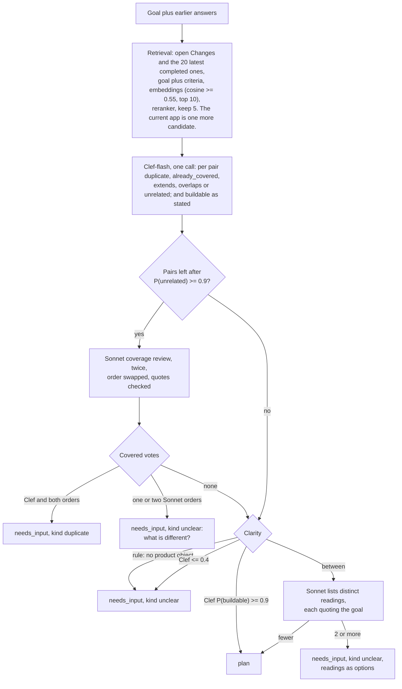
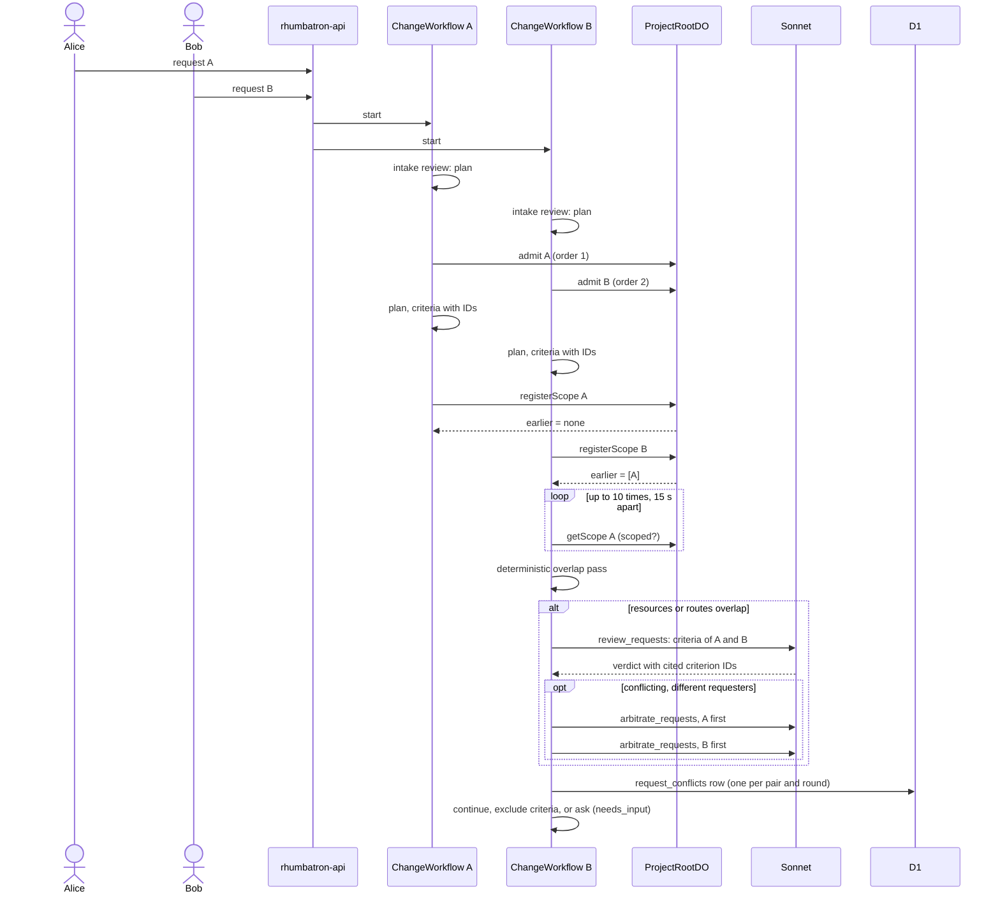
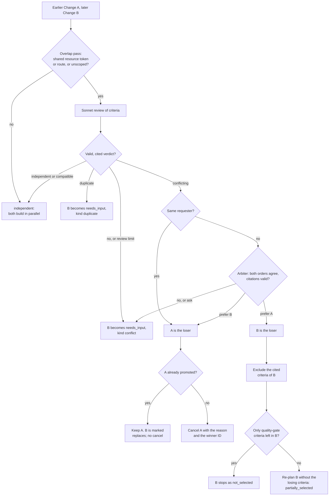

# Shared Projects and simultaneous requests

This page explains how several people use one Project at the same time.
It covers membership, the intake gate that checks each request before planning, the check that compares simultaneous requests, and the system arbiter.
The system decides what gets built. The role of a person never decides between two requests.
ADR 0025 records the decision.

Main source files:

- `migrations/d1/0022_shared_projects.sql`: members, invitations, request columns on `changes`, `request_conflicts`.
- `migrations/d1/0024_intake_and_system_decisions.sql`: `clarification_json`, `clarification_answers_json`, the `duplicate` verdict, pair rounds, `change_decisions`.
- `workers/api/src/identity.ts`: `projectRole`, `canAccessProject`, `ownerOnlyMessage`.
- `workers/api/src/members.ts`: invitations, members, request conflicts.
- `workers/api/src/clarify.ts`: `POST /v1/changes/:changeId/clarify`.
- `workers/coordinator/src/request-scopes.ts`: serialized admission and scope receipts in ProjectRootDO.
- `workers/integration/src/intake-context.ts`: related requests, the current app summary, stored answers.
- `workers/integration/src/intake.ts`: the intake cascade (retrieval, Clef-flash, Sonnet) and its citation checks.
- `workers/integration/src/request-policy.ts`: overlap pass, review validation, the arbiter, quality gate.
- `workers/integration/src/request-check.ts`: `checkRequestPair`, one comparison of two Changes.
- `workers/integration/src/change-workflow.ts`: the `intake review` and `check other requests` steps, and the wait for an answer.
- `workers/integration/src/change-commands.ts`: `clarifyChange`, `closeNeedsInput`.

## Sharing a Project

Membership is per Project.
The table `project_members` holds one row for each user and Project.
A collaborator sees only the shared Project, not the other Projects of the owner.
Rhumbatron does not use Clerk Organizations for sharing.

| Role | How the user gets it |
|---|---|
| `owner` | Project creation inserts the owner row. A partial unique index allows one owner for each Project. |
| `collaborator` | The user accepts an invitation. |

The API never reads a role from the client.
The `rank` column of `project_members` (owner 0, collaborator 10) only orders the members list.
Each Change stores `requested_by` (the `created_by` column) and `requester_rank`, the role of the requester when the request was made.
The UI shows the role. No build decision reads it.

`projectRole` returns `owner` for the owner row, or for a member of the organization that owns the Project.
It returns `collaborator` for a member of `project_members`.
It returns `null` otherwise, and the API answers `404`.

### Invitations

The owner invites a collaborator with `POST /v1/projects/:projectId/invitations` and an email address.
The API changes the email to lowercase.
An invitation is `pending` for 7 days.
It then expires, and the owner can send a new one.
Only one `pending` invitation can exist for one Project and email.

An invitation binds to a Clerk-verified email of the signed-in user.
The API reads the Clerk profile and keeps only the email addresses with verification status `verified`.
`GET /v1/invitations` lists the pending invitations for those addresses.
`POST /v1/invitations/:invitationId/accept` checks that the invitation email is in that list.
If it is not, the API gives the same answer as for a missing invitation.
The member row stores the immutable user ID, not the email.
Accepting twice is safe: the second call returns the same result.

### What a collaborator can do

A collaborator can open the Project, read its Changes and Candidates, and create a Change.
A collaborator can cancel and answer their own Change.
The owner role is for administration only.
All other actions are owner-only.
The API answers `403` with the text "Only the project owner can ...".

The owner-only actions in the code are:

- Share the Project, revoke an invitation, remove a member.
- Change the Project settings.
- Provision the Project and run its checks.
- Remove the Project.
- Compose a Candidate, approve a release, promote a Candidate.
- Publish the app, remove the app, roll back.
- Resolve stopped (dead-letter) work.
- Edit code directly.
- Raise a budget.
- Cancel the Change of another person.
- Inject a release failure.

The owner can also answer a question on the Change of another person (`POST /v1/changes/:changeId/clarify`).

## The intake gate

Each Change runs its own ChangeWorkflow.
The step `intake review` runs before the Root Planner.
It decides whether the request is clear and whether it asks for something new.
Rhumbatron never starts to build a request that it does not understand, or one that the app or another request already delivers.

The cascade runs the cheap checks first.
It asks a stronger or an independent model before it stops a request.
A model never rejects a request: the worst outcome is a question to the requester.

### Retrieval

`loadRelatedRequests` reads the open Changes of the Project (any status except `completed`, `failed`, `cancelled` and `not_selected`) and the 20 most recent completed Changes.
Each item is the goal plus the stored acceptance criteria.
Each text has a packet ID: `<changeId>:goal`, `<changeId>:c1`, and so on.

`retrieveRelated` embeds the new goal and each item with Workers AI `@cf/baai/bge-small-en-v1.5`.
It keeps up to 10 items with a cosine similarity of 0.55 or more.
If the embedding call fails, it keeps the items that share a product word with the goal.
`@cf/baai/bge-reranker-base` then orders the shortlist, and the gate keeps 5.
The current app is always one more candidate when the repository is not empty.
Its packet items are `canonical:files` (paths from the canonical file listing), `canonical:deps` (dependency names of the root `package.json`) and `canonical:stack` (hints such as `react` or `angularjs`).
Cosine only shortlists. It never decides.

### Clef-flash

One Clef-flash call answers two kinds of question.
For each pair it chooses `duplicate`, `already_covered`, `extends`, `overlaps` or `unrelated`.
For the request it scores "buildable as stated".
The call counts against the `clef-flash` daily counter (200 per UTC day) that the agents and event router Workers share.
When the counter is spent, every answer is unknown, and the next stage runs.

Clef-flash can only clear.
A pair drops only when `unrelated` has a probability of 0.9 or more.
Clef-flash alone never marks a duplicate.

### Duplicate check

Sonnet answers one question for each remaining pair: which criteria of the existing request, or which features of the current app, already deliver the new request?
The tool is `coverage_review`.
A `duplicate` or `already_covered` verdict must quote the source text with its packet ID.
Code checks each quote (`validateCoverage`): the text must be in that source of that target.
A verdict with a quote that is not in the packet counts as `unsupported`.

Sonnet runs twice, once with the new request first and once with the existing items first, because a model can prefer the item it reads first.

| Clef-flash | Sonnet, first order | Sonnet, second order | Result |
|---|---|---|---|
| covered | covered | covered | `needs_input`, kind `duplicate` |
| any | covered | not covered | `needs_input`, kind `unclear` |
| any | not covered | covered | `needs_input`, kind `unclear` |
| covered | not covered | not covered | Go on: Clef-flash alone does not stop a request. |

The question quotes the covering criteria: "This looks covered by "<goal>": "<quote>". What is different in your request?"

### Clarity

A rule runs first: a goal with fewer than two words that name a product object (not words such as "add", "build", "feature" or "app") is unclear.
"build the kanban" and "Add kanban feature" are unclear by this rule.
Then the Clef-flash score decides: 0.9 or more is clear, 0.4 or less is unclear.
Between the two, one Sonnet call (`list_interpretations`) lists the materially different readings of the request, each with a quote of the goal, and the product decisions that the request leaves open.
Code drops a reading whose quote is not in the goal.
Two or more readings make the request unclear, and the question shows them as options.

### Waiting for an answer

When the gate asks, the Change becomes `needs_input`.
`clarification_json` holds the `ChangeClarification`: `kind` (`unclear`, `duplicate` or `conflict`), `summary`, up to 3 `questions`, `relatedChangeId`, `relatedGoal`, `askedAt` and `round`.
The requester gets the notification `request_needs_input`.

The workflow waits for the event `clarification`.
It reads the D1 row after each event and once a day, so a lost event only delays it.
After 7 days without an answer the Change becomes `cancelled` with the reason "No answer within 7 days".

`POST /v1/changes/:changeId/clarify` takes one of three bodies.
Only the requester or the Project owner can call it.

| Body | Effect |
|---|---|
| `{ "answers": [{ "questionId": "q1", "text": "..." }] }` | The answers append to `clarification_answers_json`. The Change returns to `compiling`. The next intake and the planner read the goal with the questions and answers. |
| `{ "action": "proceed_anyway" }` | The Change returns to `compiling` and plans without another question. |
| `{ "action": "withdraw" }` | The Change becomes `cancelled` with the reason "Withdrawn by the requester". A duplicate keeps `outcome = duplicate` and the related Change. |

A request gets at most 3 rounds of questions.
After the third answer it plans without another question.
The update is guarded on the open round, so two answers to one round store one.
If the first workflow instance of a Change has already ended, the answer starts a new instance with the ID `<changeId>_r<round>`.

Each intake decision is a Decision Receipt in `change_decisions` (`decision_type = 'INTAKE'`) and the event `change.intake.reviewed`.
The receipt holds the retrieval scores, the Clef-flash probabilities, the Sonnet verdicts and quotes, and the cost. It never holds private reasoning.
The model cost counts against the Change budget, and the gate skips a Sonnet call when the budget is spent.

## Comparing simultaneous requests

Two Changes of the same Project can run at the same time, so the workflow also compares them after planning.
The comparison runs in the step `check other requests` of ChangeWorkflow.

### Admission and registration

The workflow admits the Change in ProjectRootDO after the intake gate lets it plan.
`admit` inserts a row in the SQLite table `request_scopes` and returns the admission order.
The row starts with an empty scope (`scoped: false`) and the requester ID.
A Change that waits for an answer before planning is not admitted, so it never holds back other requests.

After planning, the workflow calls `registerScope` with the criteria (each has an ID) and the semantic resources of the Work Graph.
ProjectRootDO runs this call in one serialized Durable Object.
It returns the scopes of all Changes with a lower admission order that are not released.
It stores this answer as a receipt.
A retry gets the same receipt, never a new order or a new earlier set.
After an answer, the next pass keeps the receipt and updates the scope with the new criteria.

Because of this, each pair of Changes is compared once for each round of questions.
The later-admitted Change of the pair does the comparison.
The workflow releases the scope of a Change that ends as `completed`, `failed`, `cancelled` or `not_selected`.

### Waiting for an unscoped earlier request

An earlier Change can still plan when the later Change registers.
Its scope is then `scoped: false`.
The later workflow reads the scope again, up to 10 times, with a 15 second sleep between reads.
After the last read, the unscoped Change counts as overlapping.
Rhumbatron never treats an unknown scope as independent.

### Deterministic overlap pass

`requestsOverlap` runs before any model call.
It returns `true` if one of the two Changes is not scoped.
Otherwise it compares two sets:

- Resource tokens. The code removes the `project:<slug>` prefix, splits on `:` and `-`, and drops generic words such as `app`, `api`, `ui`, `web` and `src`. The two Changes overlap if one token is in both sets.
- HTTP routes. The code finds route strings that start with `/` in the criteria text. The two Changes overlap if one route is in both sets.

If the pair does not overlap, the verdict is `independent`, the cost is 0, and no model runs.
The receipt records the method `deterministic`.

### Review and citation validation

An overlapping pair gets one review from Sonnet.
The model calls the tool `review_requests` once.
It returns a verdict (`independent`, `compatible`, `conflicting` or `duplicate`) and its citations.
Each conflict names one criterion ID of each Change and a short reason.
A duplicate lists in `covered`, for each criterion of the later Change, the criterion of the earlier Change that delivers it, with a quote of its text.

Application code then validates the answer (AGENTS.md section 34.4.2).
The answer is not valid in these cases:

- The JSON does not match the schema, or the model returns no tool call, or more than one.
- A conflict cites an ID that is not a criterion of that Change.
- The verdict is `conflicting` and the conflict list is empty, or the verdict is not `conflicting` and the list is not empty.
- The verdict is `duplicate` and `covered` is empty, or a `covered` quote is not text of the cited earlier criterion.

An invalid answer, a provider error, and an abstention all become `unconfirmedReview`: verdict `conflicting`, `supported: false`, no cited criteria.
A review that cannot confirm compatibility never lets both requests proceed.

A Change makes at most 4 reviews, and only while its model spend is below the Change budget.
Past that limit an overlapping pair gets the same conservative result (receipt method `review-limit`).

`checkRequestPair` first inserts a `request_conflicts` row with a conservative receipt (`review-interrupted`).
It does this before it calls the model.
If the workflow stops after the call, the retry reads the stored review and does not spend again.
The arbiter result is stored the same way.

## The system arbiter

A supported `conflicting` review between different requesters goes to the arbiter.
The arbiter is one Sonnet tool call, `arbitrate_requests`, that runs twice: once with the earlier request as `a`, once with the later request as `a`.
It reads both goals, both criteria lists, the cited conflicts and the current app summary (files, dependency names, stack).
The prompt says that who asked never matters, and that the request that fits the current app wins.
For example, an app that already uses React keeps React over a request for AngularJS.

The verdict is closed: `prefer_a`, `prefer_b` or `ask`.
The rationale must cite at least one criterion ID (`side` and `id`) and at least one packet item ID (`a:goal`, `b:goal`, `conflict:N`, `canonical:files`, `canonical:deps`, `canonical:stack`).
Code checks every citation (`validateArbitration`).
A preference applies only when both runs are valid and name the same request (`arbiterDecision`).
Two runs that each prefer the request they read first do not agree.

The same requester asking twice is not a conflict between people: the later request replaces the earlier one, with `decided_by = system:same_requester`.

A question from the comparison uses the same `needs_input` status, notification, answer route and 3-round limit as the intake gate.
For kind `conflict` the owner also gets the notification.
The question names both requests and the conflicting criteria and asks how the later request should change so both fit.
After an answer the workflow runs the intake gate and the planner again, and compares the new criteria as a new round of the pair.
After `proceed_anyway` or the third answer it does not ask again: a supported decision still applies, and an undecided pair lets both requests go on.

`request_conflicts.policy` records how the pair ended: `system_arbiter`, `same_requester` or `ask_requester`.
`decided_by` is `system:arbiter` or `system:same_requester`.
Each arbitration is also a Decision Receipt in `change_decisions` (`decision_type = 'REQUEST_ARBITER'`) with the two verdicts, their validity and the cost.

### The loser is the later Change

This is the common case, because the later Change does the comparison.
The workflow excludes the criteria that the review cited for the later Change.
It also excludes the criteria that depend on a cited one (`losingCriterionIds`).
The review lists them in `dependentOnConflict`, and code checks each entry like a citation.
A deterministic rule adds a criterion that names the losing layout, for example "card" or "grid", when the winner does not.
Example: "Each card shows the recipe title" depends on "renders as a grid of cards", so it loses with it.
Then the workflow checks what remains.

`nothingSelected` returns true when every remaining criterion only restates the quality gate.
An example is "typecheck, test and contract all pass".
The planner adds such a criterion to most Changes, and it never conflicts.
Without this rule a loser would stay alive as a partial selection with nothing to build.
In that case the Change stores the planned criteria, so the user still sees the request, and ends as `not_selected` with the reason and the winner ID.

If a real criterion remains, the planner makes a new Work Graph for the selected criteria only.
The Change continues with `outcome = partially_selected`.
The text of the reason changes from "Not selected:" to "Partially selected:".

### The loser is the earlier Change

The workflow cancels the earlier Change with the reason and the winner ID.
If its work is running, it stops.
If the earlier Change already has a promoted Candidate, the workflow does not undo the promotion.
Promotion is final once Root commits it.
The winner gets `outcome = replaces`.
If the cancel is refused because promotion has started, the later Change gets `outcome = replaces` too.

### Recompose guard

`recomposeDecision` (`workers/integration/src/recompose.ts`) inserts a Candidate only if the Change is not blocked.
The insert has a `WHERE EXISTS` condition.
It refuses a Change with status `not_selected`, `cancelled` or `needs_input`.
It also refuses a Change with outcome `not_selected` or `duplicate`.
Without this guard, a stale recompose could ship the loser over the winner.

## What the UI shows

- The Project page lists Changes in a table with a `Requested by` column.
- Each Change row has an outcome line: `Not selected: <reason>` with a `(view winner)` link, `Selected`, `Partially selected`, `Replaces earlier request`, or `Duplicate`.
- A Change in `needs_input` shows its `clarification`: the summary, the questions with their options, the related request, and the actions Answer, Proceed anyway and Withdraw for the requester and the owner.
- The `Conflicting requests` card shows both goals, the cited criteria or covered quotes, and the winner.
- The Project header has a Share dialog and a members list for the owner. The API shows invitations to the owner only, and the email of a member only to the owner and to that member.
- The Settings page (`/projects/:projectId/settings`) has five sections: General (name, slug, live app host, created date), People (the same members list and invitations as the Share dialog), Defaults (the default Change budget), Display (the default Product or Systems view, stored in the browser), and Danger zone (Delete project for the owner, Leave project for a collaborator). A collaborator sees the owner-only fields as read-only values and the line "Only the project owner can change these."
- The home page has a `Shared with you` section for Projects where the user is a collaborator, and pending invitations.
- The UI hides owner-only buttons for a collaborator. The API still enforces the rule.

## Known limitation

The review can miss a contradiction.
Two requests can use unrelated words and touch unrelated resources.
The overlap pass then finds no overlap, and no model reads the pair.
Both Changes ship in sequence, and the later one wins (last one wins).
The tests of the earlier Change usually fail on the later tree and stop it.
An agent can edit those tests.
No check protects tests that agents can edit.
Report such a miss as an incident.

## Examples

### A duplicate request

Alice asks for "gta6 mission planner, calendar of missions, each day has a kanban list".
Her Change C1 is running.
Bob asks: "Add kanban feature".

1. Retrieval finds C1. Clef-flash says `already_covered` for the pair.
2. Both Sonnet orders say `already_covered` and quote the C1 criterion "Each calendar day shows a kanban list".
3. The three votes agree, so C2 becomes `needs_input` with kind `duplicate` before any planning.
4. Bob reads: "This looks covered by "gta6 mission planner, ...": "Each calendar day shows a kanban list". What is different in your request?"
5. Bob withdraws the request, or answers what is different. Nothing is built twice.

The clarity rule also finds "Add kanban feature" unclear (one product word), but the duplicate check runs first and asks the more useful question.

### A conflict the system decides

Alice owns a Project whose app is React. Bob asks for an AngularJS rewrite while Alice's React request is running.

1. The two requests overlap, so the Sonnet review runs and returns `conflicting` with valid citations.
2. The arbiter runs twice. Both runs prefer the React request and cite `canonical:deps` (`react`) and the conflicting criteria.
3. The two runs agree, so the React request wins with `decided_by = system:arbiter`.
4. Bob's request becomes `not_selected` with the reason, which quotes the arbiter rationale.

If the two runs had disagreed, Bob's request would be `needs_input` with kind `conflict`, and Bob and Alice would see the question.
