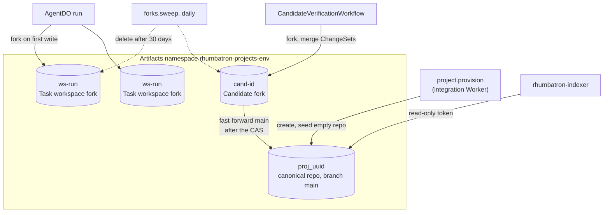
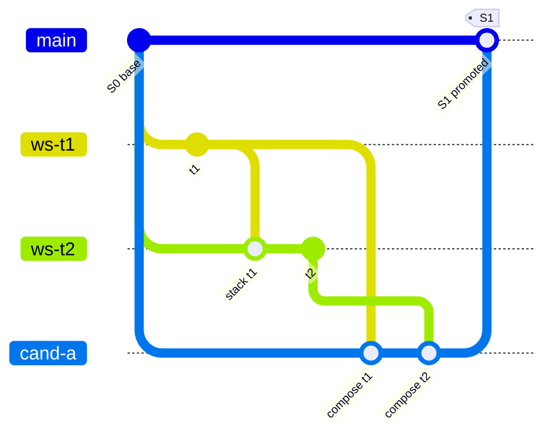
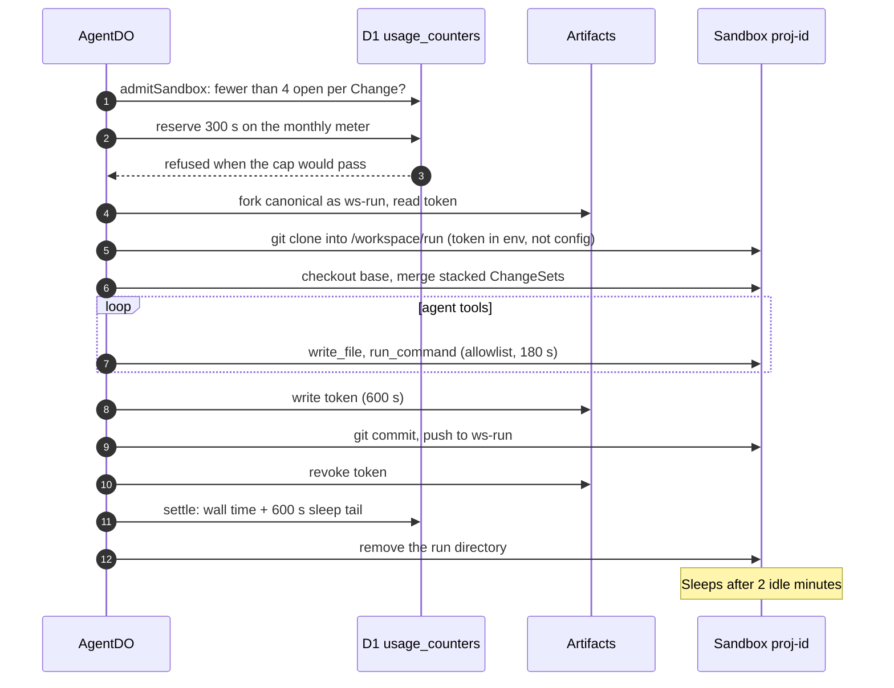
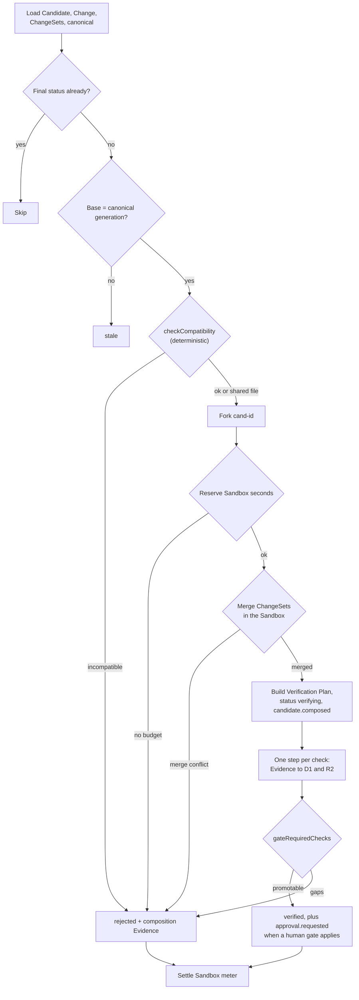
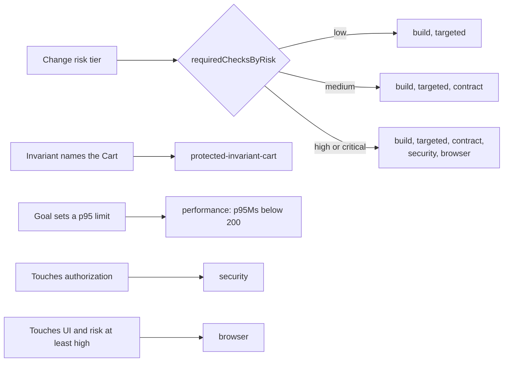
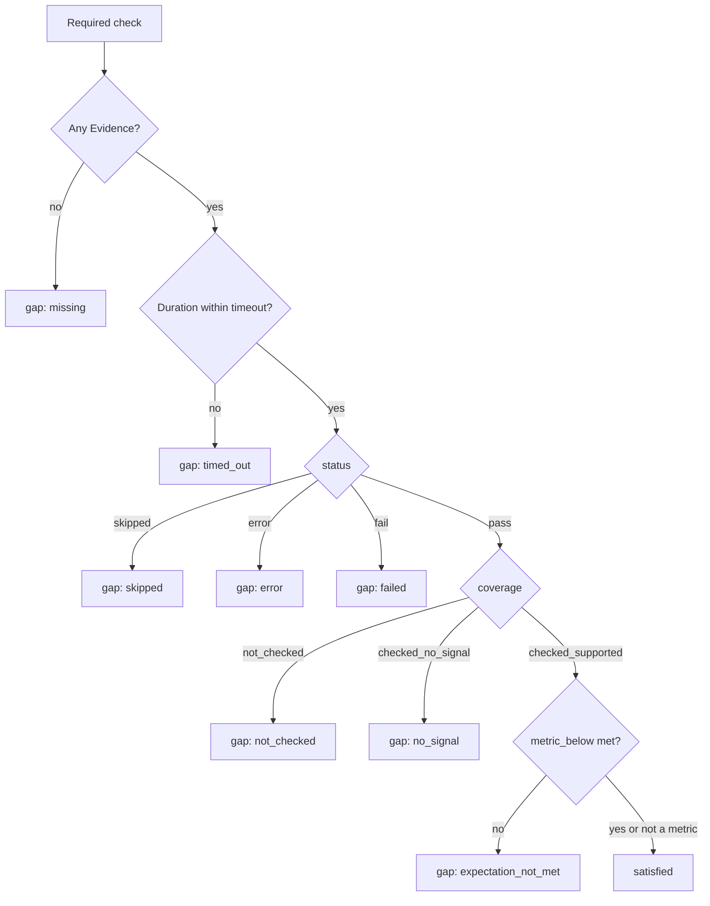
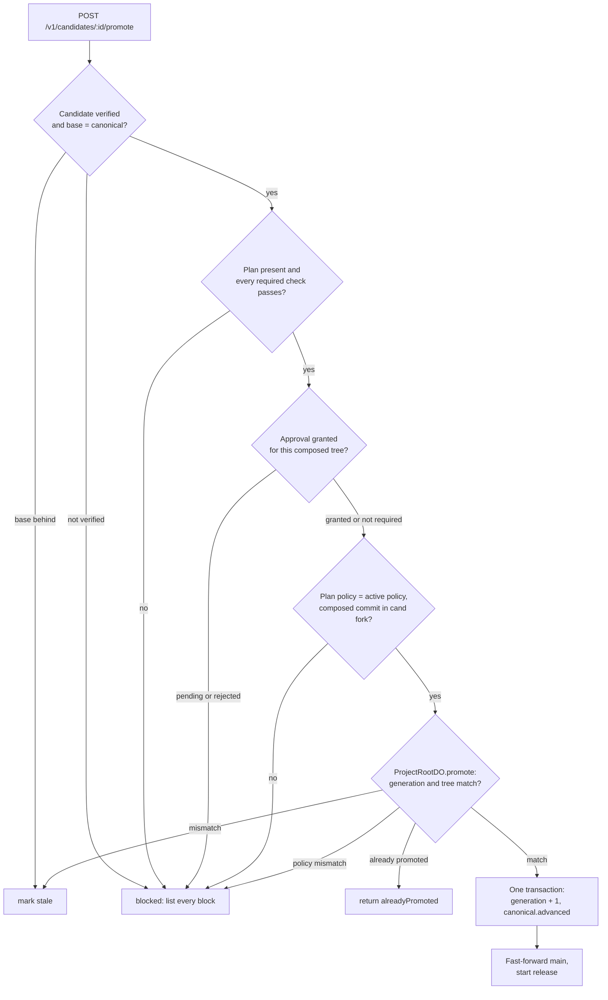

# Source and verification

This page explains where Project source lives, how agents and Candidates get isolated copies, how the Sandbox runs code, how checks become Evidence, and what promotion requires.

Main source files:

- `workers/integration/src/provision.ts`, `canonical-source.ts`, `repo-names.ts`, `project-cleanup.ts`
- `workers/agents/src/workspace.ts`, `stack.ts`
- `workers/integration/src/verification-workflow.ts`, `candidate-sandbox.ts`, `browser-check.ts`
- `packages/evidence/src`: `plan.ts`, `gate.ts`, `promotion.ts`, `compatibility.ts`
- `workers/coordinator/src/promotion-cas.ts`, `project-root-do.ts`

## Artifacts repositories

Cloudflare Artifacts is the canonical source store (ADR 0010).
The namespace is `rhumbatron-projects-<env>`, where `<env>` is `prod`.
The code creates the namespace on first use. Terraform has no resource for it.

Rules:

- Repo names derive from D1 row IDs only: the Project ID, `ws-<run>` for run `run_<run>`, and `cand-<id>` for Candidate `cand_<id>`.
- Cleanup never lists the namespace. It deletes only names it derives from one Project's rows, so it cannot reach another Project.
- Every git access uses a short-lived repo token (600 s). The code revokes the token after use.
- Provisioning stores a file index at `source/<project>/<tree>/index.json` in R2. Agents read that index instead of walking the repo.
- The same step fills the code store. `source/<project>/<tree>/code.json` maps paths to Git blob IDs. The step copies each blob once to `source/<project>/blobs/<blob>`. A promotion copies only the blobs that its previous tree did not have. The code store lists files over 1 MB but does not copy them.
- The code view uses stored patches. An Agent publish stores the `git diff` of its own work at `source/<project>/patches/changesets/<cs>.patch` and sets `patchRef`. A Candidate composition stores the Candidate-vs-base diff at `source/<project>/patches/candidates/<cand>.patch`. Each patch stops at 512 KB, at a line boundary. R2 metadata records `truncated` and the full size.
- All of these objects are under `source/<project>/`. No lifecycle rule expires them, and archive cleanup removes them. Archive cleanup also removes `context/`, `evidence/`, `work-graphs/`, `workspace/`, `apps/`, and `app-previews/` objects of the Project, the D1 content rows, and the Durable Object storage of its shards and agents (see `docs/operations/cleanup.md`).
- A new Project starts at Canonical Generation 0. `AGENTS.md` shows `S1841` for the demo. The code starts at `S0`.

## Composition and promotion in Git terms

A Candidate fork starts at the canonical base commit.
The CandidateVerificationWorkflow merges the ChangeSets in Work Graph order.
Promotion moves canonical `main` forward to the composed commit, fast-forward only.

Notes:

- `gitGraph` draws the last step as a merge. In the code it is a fast-forward push of the composed commit (`canonical-source.ts`). There is no force push.
- The push runs inside the integration Worker with `isomorphic-git` on an in-memory file system. It uses no Sandbox time.
- If the push fails, the CAS still holds. A retry of the promotion repairs the source sync.

## Sandbox lifecycle

The `Sandbox` class is in `rhumbatron-sandbox` (ADR 0012).
There is one Sandbox per Project, with the ID `proj-<uuid>`.
Agent runs and Candidate checks use separate directories in it.
The container application allows one instance.

| Guard | Agent workspace | Candidate checks |
|---|---|---|
| Directory | `/workspace/<run>` | `/workspace/cand-<id>` |
| Reservation on open | 300 s | 900 s |
| Idle tail before sleep | 120 s (`sleepAfter` 2 min) | 120 s (`sleepAfter` 2 min) |
| Concurrency | 4 open workspaces per Change | Checks run one after another in one workflow |
| Monthly meter | `SANDBOX_MONTHLY_SECONDS` (72,000 s = 20 h) | Same meter |

A Sandbox loss does not lose committed work.
The workspace restores from the same fork, base, and stacked merges, and checks the recorded start commit (section 42.5).
Uncommitted edits are lost.
A publish after a loss therefore fails the run instead of publishing partial work.
The Sandbox never receives Terraform, Cloudflare API, or model credentials.

## Verification workflow

CandidateVerificationWorkflow has one instance per Candidate.
It makes no model call.
Every step is idempotent, and every check is its own step with its own timeout.

A check that throws or times out records an `error` with coverage `not_checked`.
That is a gap, never a pass (section 34.4.1).

### Which checks run

`buildVerificationPlan` picks checks from the policy tier and from what the ChangeSets touch.
Verification plans with `DEFAULT_POLICY` (`policy-1`) in `workers/integration/src/candidate-composer.ts`.
D1 `project_policies` (migration 0017) can store a per-Project policy. Promotion and approval read it. Verification does not.

| Check ID | Kind | Command or procedure | Timeout |
|---|---|---|---|
| `build` | build | `bun run typecheck` | 120 s |
| `unit` | unit | `bun test` | 180 s |
| `contract` | contract | Diff the route table (`bun run contract`) against declared contract changes | 120 s |
| `protected-invariant-cart` | protected-invariant | `bun test test/cart.invariant.test.ts` | 120 s |
| `performance` | performance | `bun run bench`, expects metric `p95Ms` below 200 | 120 s |
| `security` | security | `bun test --test-name-pattern authorization` | 180 s |
| `browser` | browser | Section 35 Wishlist flow, or a cart flow, in one Browser Run session | 90 s |

The policy check `targeted` runs the `unit` check. Every plan has `build` and `unit`.
An invariant that keeps existing endpoint behavior adds `contract` and `unit`. Another app-behavior invariant adds `unit`. An invariant that no test can prove becomes a required procedure check, and it stays a visible gap.
A Project with a live app also gets `contract` and a `preview-smoke` check (kind `smoke`, 30 s). The smoke check publishes the Candidate preview and runs the release probes against it.

The browser check opens the composed app through request interception.
The preview host has no public URL.
The check blocks every other request.
One session lasts at most 55 s. A Candidate gets at most 2 browser runs.

The policy does not list the `critical` risk tier, so a `critical` Change uses the strictest listed tier.
A gap in policy never lowers verification.

## Coverage states and the gate

Each Evidence record has a `status` (`pass`, `fail`, `error`, `skipped`) and a `coverage` (`not_checked`, `checked_no_signal`, `checked_supported`).
`gateRequiredChecks` reads the latest record of each required check.

On a tie in completion time, a non-passing record wins.
The UI shows every gap. It never shows a gap as green.
Model findings (conflict reviews) must cite valid Context Packet item IDs. A finding with a bad citation is `unsupported` and cannot change state.

## Promotion preconditions

Promotion has two deterministic layers (ADR 0013).
The integration Worker checks section 36 preconditions 1 to 5 and 8 from authoritative D1 rows and Artifacts.
ProjectRootDO then checks preconditions 6 and 7 and the policy version inside its own transaction.

Approval rules (`packages/evidence/src/promotion.ts`):

- A human gate applies when the plan asks for one (an authorization change) or the policy gates the risk tier (`high`, `critical`).
- A grant counts only for the exact composed tree that the approver saw.
- The first decision is final. A rejection also rejects the Candidate.
- No model decides approval or promotion (section 22.7).

The idempotency key is the Candidate ID plus the expected generation.
A retry after success returns `alreadyPromoted` and repairs the D1 mirror and the source sync.
