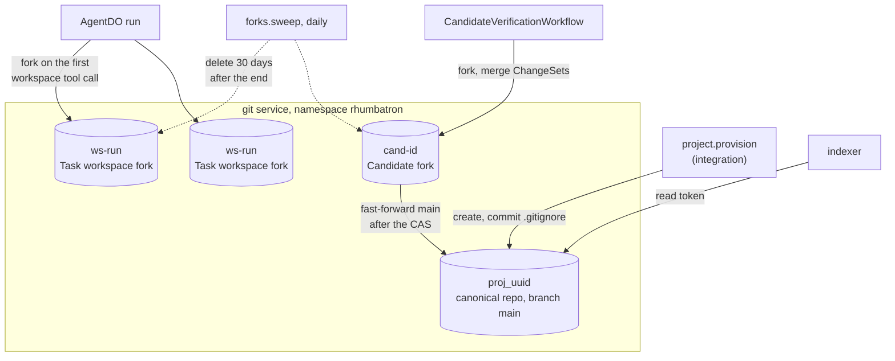
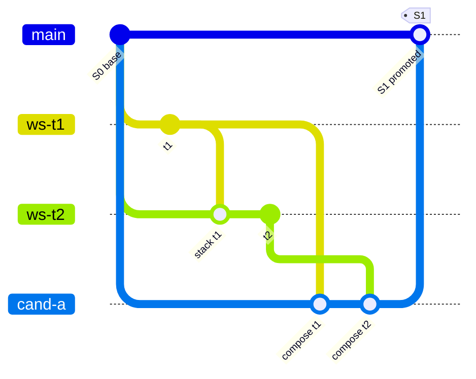
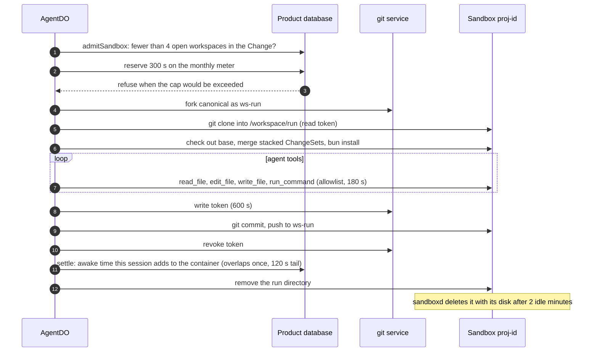
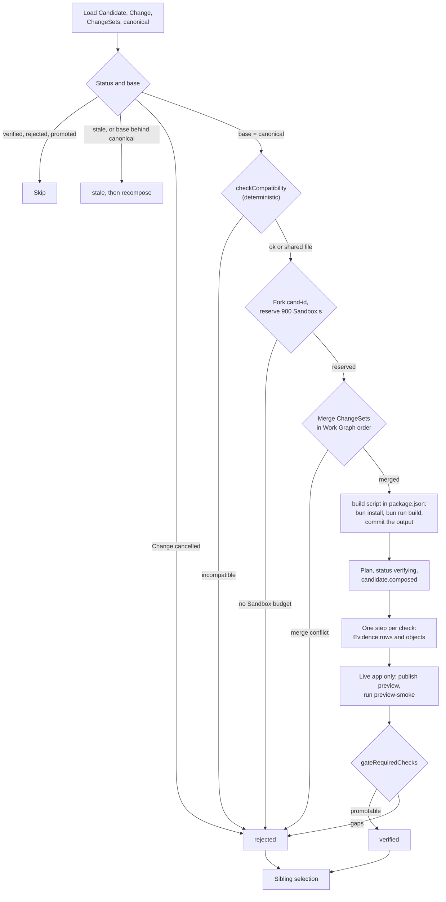
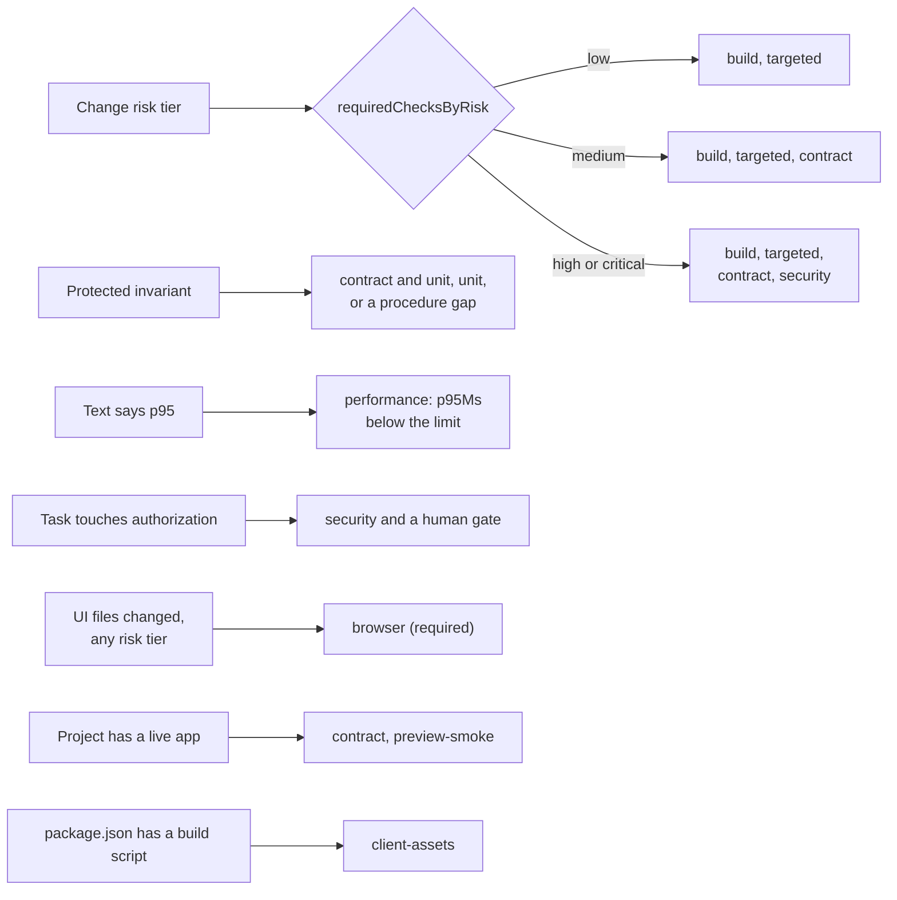
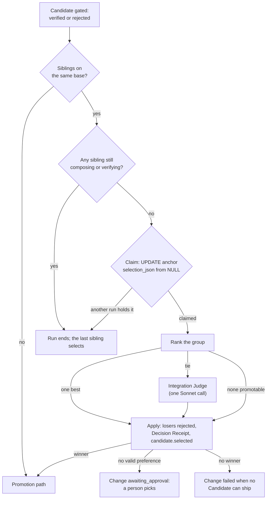
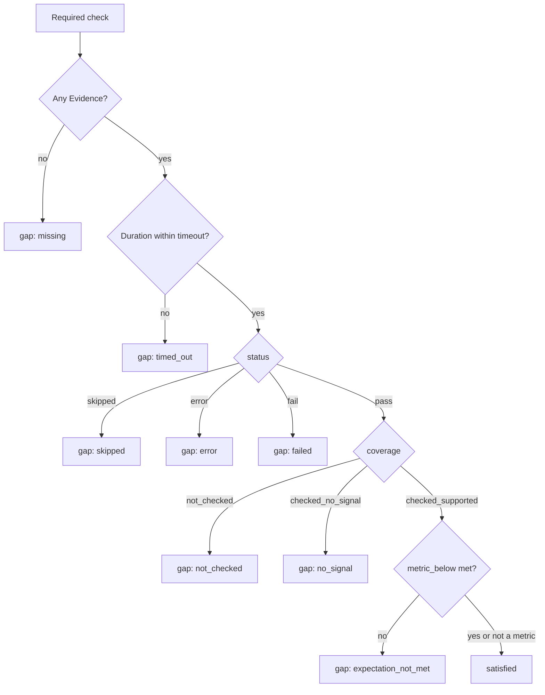
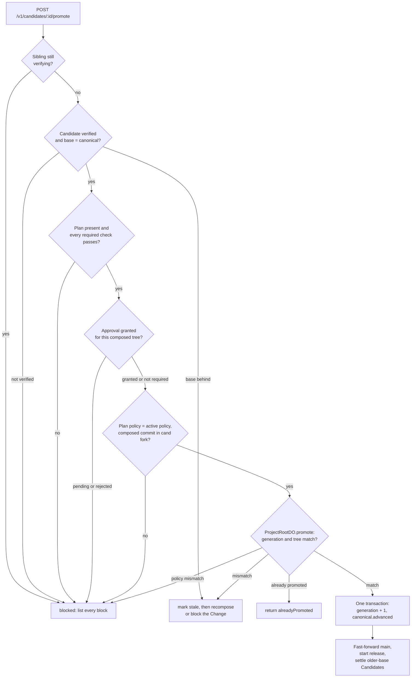

# Source and verification

This page covers Project source in the git service, the Sandbox, checks and Evidence, sibling selection, and promotion.

Main source files:

- `workers/integration/src/provision.ts`, `canonical-source.ts`, `code-store.ts`, `repo-names.ts`, `project-cleanup.ts`
- `workers/agents/src/workspace.ts`, `stack.ts`
- `workers/integration/src/verification-workflow.ts`, `candidate-sandbox.ts`, `browser-check.ts`, `runner-selection.ts`
- `workers/integration/src/candidate-create.ts` (fork rule), `integrate.ts`, `acceptance-check.ts`, `candidate-selection.ts`, `promotion.ts`
- `workers/apps/src/checker.ts`, `checker-program.ts` (checks in the apps service)
- `services/git`, `services/sandboxd`: the git service and the Sandbox host
- `packages/evidence/src`: `plan.ts`, `gate.ts`, `promotion.ts`, `compatibility.ts`
- `workers/coordinator/src/promotion-cas.ts`, `project-root-do.ts`

## Git repositories

The `git` service holds the Project source (ADR 0010, [services/git](../../services/git/README.md)).
Each repository is a bare Git repository on the `git-data` volume. The one namespace is `rhumbatron` (`GIT_NAMESPACE`).
Core reaches the control API through the `ARTIFACTS` binding (`services/git/client.ts`). Git traffic uses smart HTTP.
A fork is a bare clone that borrows the objects of its source through `objects/info/alternates` and keeps its own `main`.

Repository names come from database row IDs only (`repo-names.ts`):

| Repository | Name |
|---|---|
| Canonical | The Project ID, `proj_<uuid>` |
| Task workspace fork | `ws-<run>` for Task run `run_<run>` |
| Candidate fork | `cand-<id>` for Candidate `cand_<id>` |
| Code edit session fork | `edit-<hex>` for session `edit_<hex>` (ADR 0029) |

Rules:

- Cleanup does not list the namespace. It deletes only the names that it derives from the rows of one Project. Thus it cannot delete a repository of a different Project.
- Each Git access uses a repository token that expires after 600 s.
- The token is an HMAC signature over the token ID, the repository, the scope (`read` or `write`), and the expiry. It grants one repository. The code revokes the token after use.
- The daily `forks.sweep` command deletes a fork 30 days after its run or Candidate ends (`FORK_RETENTION_DAYS`).
- The sweep deletes the workspace forks of failed runs, of runs without a ChangeSet, and of finished Changes.
- The sweep deletes the forks of `rejected`, `stale`, and `promoted` Candidates. It deletes a promoted fork only when canonical `main` holds the composed commit.
- A code edit session deletes its fork when it ends. The daily `forks.sweep` command ends overdue sessions and deletes a session fork that a failed delete left.
- Each Project starts at Canonical Generation 0 (`S0`) with one commit that holds only `.gitignore` (ADR 0022).

Source objects in the object store (bucket `rhumbatron-evidence`, binding `EVIDENCE`):

| Object | Key | Writer |
|---|---|---|
| File index | `source/<project>/<tree>/index.json` | Provisioning and each promotion |
| Code manifest (path to Git blob ID) | `source/<project>/<tree>/code.json` | Provisioning and each promotion. Composition also writes the Candidate tree when core has the `APPS` binding. |
| Blob | `source/<project>/blobs/<blob>` | Same as the code manifest. Each blob is copied once. The manifest lists a file over 1 MB, but the store keeps no copy of it. |
| ChangeSet patch | `source/<project>/patches/changesets/<cs>.patch` | Agent publish (`patchRef`) |
| Candidate patch | `source/<project>/patches/candidates/<cand>.patch` | Candidate composition |

- Agents read the file index. They do not walk the repository.
- A patch stops at 512 KB, at a line boundary. The object metadata records `truncated` and the full size.
- Nothing expires `source/`. Project deletion removes it (see [cleanup.md](../operations/cleanup.md)).

## Composition and promotion in Git terms

A Candidate fork starts at the canonical base commit.
The CandidateVerificationWorkflow merges the ChangeSets in Work Graph order.
When the composed `package.json` has a `build` script, composition runs `bun install` and `bun run build`. It then commits the files that the build changed (`Build <candidate>`). See [Live apps](live-apps.md#client-assets-built-by-the-app).
Promotion moves canonical `main` to the composed commit. The move is fast-forward only.

Notes:

- `gitGraph` draws the last step as a merge. The code pushes the composed commit as a fast-forward (`canonical-source.ts`). It never does a force push.
- The push runs in core with `isomorphic-git` on an in-memory file system. It uses no Sandbox time.
- When the push fails, the compare-and-swap result stays. A retry of the promotion pushes again.

## Sandbox lifecycle

`sandboxd` runs each Sandbox as a sibling container through a socket proxy ([services/sandboxd](../../services/sandboxd/README.md)).
Each Project has one Sandbox, with the ID `proj-<uuid>`.
Agent runs and Candidate checks use different directories in it.
At most `SANDBOX_MAX` (4) Sandboxes are live at one time. A call that needs one more fails with `ContainerUnavailableError`.
Each Sandbox has 2 CPUs, 2 GiB of memory, no swap, and 512 processes. The container runtime is `SANDBOX_RUNTIME`: `runc` by default, and `runsc` (gVisor) on a Linux server.
A Sandbox sits on the internal network `rhumbatron_sbx`. It reaches the git service directly and package registries through the `egress` proxy allowlist. It has no other route out.
Only Task kinds `implement`, `migrate`, and `test` open a workspace.

The fork and the checkout happen at the first workspace tool call of the run.
`run_command` accepts only these commands:

- `bun install`, `bun test [paths]`, and `bunx tsc --noEmit`
- `bun run typecheck|test|bench|contract|build`, and `bun run <name>` for a script in the workspace `package.json`
- `git status|diff|log` and `ls`

After `bun run build` (or `bun run build:<x>`), the workspace discards the files that the build wrote. Composition builds them again.

| Guard | Agent workspace | Candidate checks | Code edit session |
|---|---|---|---|
| Directory | `/workspace/<last 24 characters of the run ID>` | `/workspace/cand-<id>` | `/workspace/edit-<hex>` |
| Reservation on open | 300 s | 900 s | 480 s for each command. The open starts no Sandbox. |
| Idle tail before sleep | 120 s (`sleepAfter` 2 min) | 120 s (`sleepAfter` 2 min) | 120 s (`sleepAfter` 2 min) |
| Concurrency | 4 open workspaces per Change | Checks run one after another in one workflow | One command at a time in each session, one open session per person per Project |
| Command user | root, allowlisted commands | root | An unprivileged user of the session, any command, 120 s timeout |
| Monthly meter | `SANDBOX_MONTHLY_SECONDS`: 72,000 s (20 h). A settle charges only the awake time the use adds to the Project's container (`sandbox-meter.ts`). | Same meter | Same meter. At the cap: 429 `sandbox_cap`. |

A code edit session (ADR 0029) starts the Sandbox only at its first command.
After each command, a kill as the session user stops every process of the session. The end of a session does the same while the Sandbox is awake.
The end also removes the session directory. sandboxd then removes the idle Sandbox after 2 minutes.

A Sandbox loss, or an idle removal, keeps all committed work.
The workspace restores from the same fork, base, and stacked merges. Then it compares the result with the recorded start commit.
A Sandbox loss deletes uncommitted edits.
A publish after a loss fails the run. Thus a run never publishes partial work.
The Sandbox gets short-lived Git tokens only. It gets no model credentials and no token of the stack services.

## Verification workflow

CandidateVerificationWorkflow has one instance per Candidate.
Each step is idempotent. Each check is its own step with its own timeout.
The workflow calls a model in two places only:

- The acceptance check: one Haiku call, and one Sonnet call when the Haiku output is not valid.
- The Integration Judge on a tie between sibling Candidates: one Sonnet call.

Both calls count against the Anthropic monthly budget, the daily call cap, and the Change budget.

- A rejection by `checkCompatibility` or by the merge records `composition` Evidence with the reason.
- A composition build that fails records the `build` Evidence (`fail`, `checked_supported`, the output tail). The `build` check then does not run a second time.
- After a passing composition build, the `build` check runs on its normal runner.
- The Candidate patch leaves out the files that the composition build generated.
- A check step that throws records status `error` with coverage `not_checked`. A record with a duration over the check timeout is the gap `timed_out`. A gap is never a pass.
- The Sandbox meter settles after the last check, before preview publication and the gate.
- The preview publishes only when the `build` check (check ID `build`) passed.
- After selection, a Change with no Candidate that can ship ends as `failed`. See [Change lifecycle](change-lifecycle.md#change-status).

### Where checks run

Core has the `APPS` binding, so `build`, `unit`, and `contract` run first in the apps service (`isAppCheckerEligible` in `runner-selection.ts`).
The `APPS.check` RPC loads an isolate through the Worker Loader.
The AppChecker reads the composed tree from the code store in the object store. Each check has at most 30 s, no network, and no binding.
When AppChecker answers `supported: false`, the check runs in the Sandbox. Examples are a missing code store, a bundler error, and a deadline.
Some `unit` checks are `supported: false` before any test runs (`sandboxOnlyFeatures` in `workers/apps/src/checker-program.ts`).
These are tests that read project files (`import.meta.dir`, `__dirname`, `node:fs`), use Bun globals, call `process.cwd()`, or start processes.
A loaded isolate has no project files on disk. Such a test would fail there because of the runner, not because of the code.
A completed failure in the apps service is final. The check does not go to the Sandbox for a second try.
`performance`, `security`, and `browser` always run in the Sandbox.
A `protected-invariant-<n>` check has a procedure and no command. It records a gap and runs nothing.
`acceptance` and `preview-smoke` use no Sandbox.
The Evidence summary ends with `(runner: dynamic-worker)` for a check in the apps service, or `(runner: sandbox)`. `dynamic-worker` is the runner name in code.

### Which checks run

`buildVerificationPlan` (`packages/evidence/src/plan.ts`) selects checks from the policy tier and from what the ChangeSets touch.

- Verification uses the policy of the Project: the `project_policies` row (migration `0017_project_policies.sql`).
- `policyForRun` (`workers/integration/src/policy.ts`) reads the policy once per run.
- The plan, the approval gate, the auto-promotion tiers, and the protected resources of `checkCompatibility` use this policy.
- A Project without a row uses `DEFAULT_POLICY` (`policy-1` in `workers/integration/src/candidate-composer.ts`). `DEFAULT_POLICY` protects no resource.
- Rhumbatron rejects a Candidate as `invariant_violation` when one of its ChangeSets declares a contract or data change on a protected resource of the policy.
- The policy check `targeted` runs the `unit` check. Every plan has `build` and `unit`.
- `DEFAULT_POLICY` lists `low`, `medium`, and `high`. A `critical` Change uses the strictest listed tier. A gap in the policy never lowers verification.
- `DEFAULT_POLICY` also lists `browser` for `high`. The plan adds the browser check only from the UI rule below, at every tier.
- The p95 limit is the number before `ms` in a sentence that says `p95`: in the goal, the acceptance criteria, or the invariants. The default is 200 ms.
- UI files are files under `public/`, or files with the extension `.tsx`, `.jsx`, `.html`, or `.css`.
- Protected invariants are the Work Graph invariants and the goal sentences that say "unchanged", "must remain", or "must not change".
- An invariant that keeps existing endpoint behavior adds `contract` and `unit`.
- Another app-behavior invariant adds `unit`.
- An invariant that no test can prove becomes a required procedure check `protected-invariant-<n>-<slug>`. Examples are email delivery and uptime. It stays a visible gap.
- A latency invariant maps to the `performance` check when the Change has a p95 constraint.
- A Change with acceptance criteria gets the optional `acceptance` check (see [Acceptance check](#acceptance-check)).
- A composed `package.json` with a `build` script adds the required `client-assets` check:
  - Client sources are the files under `src/client/` and the `src/` paths that the build script names. A named file also adds its directory, except `src/` itself.
  - The check fails when a client source changed and no script or style that `public/index.html` references changed. The live app would then serve a stale bundle.
  - The check passes when no client source changed.
  - A page without `public/index.html`, or without a local script or style, passes with that reason.

| Check ID | Kind | Command or procedure | Timeout |
|---|---|---|---|
| `build` | build | Apps service: bundle the app with the `@cloudflare/worker-bundler` library and load it. Sandbox: `bun run typecheck`. A failed composition build is the result | 120 s (30 s in the apps service) |
| `client-assets` | build | Only with a `build` script. Composition compares the composed commit with the base (see above). No runner | 30 s |
| `unit` | unit | Apps service: the project tests. Sandbox: `bun test` | 180 s (30 s in the apps service) |
| `contract` | contract | Compare the route table of the base and of the Candidate with the declared contract changes. Extraction in the apps service, or `bun run contract` in the Sandbox | 120 s (30 s in the apps service) |
| `protected-invariant-<n>-<slug>` | protected-invariant | A procedure for an invariant that no test can prove. No command runs, so it is a required gap | 180 s |
| `performance` | performance | `bun run bench`. Metric `p95Ms` must be below the limit | 120 s |
| `security` | security | `bun test --test-name-pattern authorization`. The app conventions (`APP_CONVENTIONS`) tell agents to name the denial tests this way. No matching test is a gap | 180 s |
| `browser` | browser | Required when UI files change. One session on the Playwright server (see [Browser check](#browser-check)) | 180 s |
| `acceptance` | acceptance | Optional. Haiku judges each acceptance criterion against the Candidate patch and the composed files. Code validates each citation | 180 s |
| `preview-smoke` | smoke | Publish the Candidate preview and run the release probes against it | 30 s |

### Browser check

Every Candidate whose Change changes a UI file gets the `browser` check, at every risk tier. The check is required.
`runBrowserCheck` (`workers/integration/src/browser-check.ts`) runs it.

How the browser reaches the app:

- The check starts the composed app in the Project Sandbox with `bun run dev`.
- Core connects to the `browser` service over WebSocket (`BROWSER_WS_URL`, `ws://browser:3000/`). The service is a Playwright 1.64.1 server.
- All network traffic of the browser goes through request interception.
- The check answers each request to the preview host from the Sandbox (`containerFetch`). It blocks every other request.
- The interceptor follows preview redirects itself (`followRedirects`), up to 5 hops, while the target stays on the preview host.
- A 307 or 308 redirect keeps the method and the body. Any other redirect becomes a `GET` without a body.
- The browser gets only the final response.
- The preview host has no public URL.

The flow is the same for every app. A failed step stops the flow.

1. Open the app: `GET /` answers below 400. The check saves a screenshot.
2. The home page shows visible text.
3. `GET /api/health`, sent from the page, answers 200.
4. Every linked page opens, by a click and by a direct load:
   - The check explores breadth first from the home page, up to `MAX_PAGES` (8) linked pages. It follows same-origin links only, and it skips `/api/` routes.
   - On each page, it fills and submits up to 3 forms. Thus the app makes data, and more links appear.
   - The sample values are `12` (number), `person@example.com` (email), `2026-01-15` (date), `https://example.com` (URL), and `Sample <n>` (other text fields).
   - It ticks each checkbox and selects the second option of each select.
   - It opens each link by a click on the page that links it. It then opens the same path by a direct load.
   - Each page must show text. A page whose whole text starts with "404" or "not found" fails the step.
   - The step fails on any uncaught page script error.
   - The step fails on any 5xx response, and on any 4xx response for a page or asset outside `/api/`. `/favicon.ico` does not count.
   - At the end, the check saves a second screenshot.

An app whose client handles its own routes sets `not_found_handling` to `single-page-application` in its `wrangler.jsonc` (`APP_CONVENTIONS`). A direct load of such a route then serves `public/index.html`.

Limits:

| Limit | Value | Source |
|---|---|---|
| Session length | 120 s (`BROWSER_SESSION_MS`) | `check-semantics.ts` |
| Check timeout | 180 s (`BROWSER_CHECK_TIMEOUT_MS`) | `packages/evidence/src/plan.ts` |
| Runs per Candidate | 2, retries included (`MAX_BROWSER_RUNS_PER_CANDIDATE`) | `check-semantics.ts` |
| Daily browser time | `BROWSER_DAILY_SECONDS`: 3600 s per UTC day in `compose.yaml` and `services/core/src/config.ts`. The code uses 500 s when the binding is absent or not a positive integer | `browser-check.ts` |
| Reservation | 60 s before a session opens, settled to the measured seconds after it closes | `check-semantics.ts` |
| Screenshots | At most 8. Each has a SHA-256 content hash | `browser-check.ts` |

The meters are `usage_counters` rows: `browser-seconds` per UTC day, and `browser-runs` per Candidate.

Results (`classifyBrowser` in `workers/integration/src/check-semantics.ts`):

| Run result | Status | Coverage |
|---|---|---|
| Every step passes | `pass` | `checked_supported` |
| A step finds wrong app behavior | `fail` | `checked_supported` |
| A refused reservation (daily time or runs per Candidate) | `skipped` | `not_checked` |
| No preview, or the browser does not connect | `error` | `not_checked` |
| The session deadline, or a step that cannot observe the app | `error` | `not_checked` |

A failed or missing browser check makes the Candidate unpromotable. The repair loop then starts (see [Acceptance check](#acceptance-check)).

### Acceptance check

The acceptance check tests what the person asked for. Each Candidate of a Change with acceptance criteria gets it.
It is not a gate check. It does not make a Candidate unpromotable, and it does not reject a Candidate.
It ranks sibling Candidates, and it gates auto-promotion.
A failing required check (`build`, `unit`, `contract`, `browser`, `preview-smoke`, and the others in the table) makes a Candidate unpromotable.

Criteria (`acceptanceCriteriaToJudge` in `candidate-composer.ts`):

- The check judges the Change acceptance criteria.
- It also judges the kept criteria of the requests that went live while this request ran. Each one has the mark "Keep (from an earlier request)" (see [Shared Projects](shared-projects.md)).
- Both lists leave out the criteria that other checks cover:
  - A criterion that only states the quality gate ("typecheck and tests pass").
  - A criterion that only guards against breakage ("other pages and API routes behave as before").
  - A latency limit. The `performance` check covers it.
  - Kept behavior ("unchanged", "must remain"). The invariant checks cover it.
- When no criterion is left, the plan has no `acceptance` check.

Input (`acceptanceSource` in `verification-workflow.ts`, and `acceptance-check.ts`), in this order, at most 60,000 characters in total (`ACCEPTANCE_SOURCE_CAP`):

1. The Candidate patch at `source/<project>/patches/candidates/<cand>.patch`, when it belongs to the composed commit. It holds the hunks of changed text files only.
2. The full text of composed files from the Candidate fork, at most 24 files (`composedFileOrder`):
   - the changed app files;
   - `public/index.html`, the local `.js` and `.css` files that it references, `src/app.ts`, and `src/worker.ts`;
   - the other changed files (tests and docs).

The check cuts a file that crosses the limit at a line boundary and marks it `truncated`.
It does not send a binary file or a file larger than 60,000 bytes.
When the fork cannot be read, the patch alone is the input.

Model:

- One Haiku call with the tool `record_acceptance`. Each criterion is `met`, `not_met`, or `unclear`. A `met` cites `{path, quote}`.
- The code reads a citation that names its quote `text` in the same way.
- An output that is not valid gets one Sonnet call. Examples are a wrong schema, a repeated or unknown criterion, and more or fewer than one tool call.
- When Haiku leaves a criterion of the request itself `unclear`, Sonnet judges once. Its answer applies only to the `unclear` results.
- A person gets a question only when Sonnet also cannot tell.
- No browser session runs.

Citations (`citationValid`):

- Code keeps a citation only when the path is a file that the model received and the quote occurs in that text.
- In a composed file, the quote can come from any line. In a patch, the quote must come from added or context lines.
- A removed line proves a removal only when the citation has `removed: true` and no text that the model received contains the quote.
- The patch includes deleted files, cut at 40 lines. Thus a deleted page can be cited.
- The quote has at least 8 characters after whitespace collapses.
- A criterion that code in the base satisfies is `met` with a quote of the composed file.
- A `met` without a valid citation counts as `unclear`.

Evidence:

- `pass` with `checked_supported`: each criterion of the request is `met`, and no kept criterion is `not_met`.
- A kept criterion protects earlier work. `unclear` there means that the check found no regression. It does not block.
- `fail` with `checked_supported` in all other judged cases, with a summary such as "2 of 3 criteria met; not met: calendar view".
- `error` with `not_checked` (a gap): a model error, a refused call (Change budget, daily call cap, monthly budget), or no readable source.
- When an earlier check has no passing result, the Candidate cannot ship. The check then records `skipped` (`not_checked`) and makes no model call.

Repair before a person (`acceptance-repair.ts`):

- Each Change gets at most one repair Task (key `repair`). A later shortfall goes to a person.
- Triggers:
  - The selected Candidate passed every required check, and the acceptance check found `not_met` criteria. `unclear` and gaps do not trigger a repair.
  - A person rejects a gated Candidate with a reason. The reason goes into the objective.
  - A Candidate fails a required check or the preview check (status reason "Required checks not satisfied" or "Preview check failed"). This includes a failed or missing browser check.
- The repair Task depends on every Task whose ChangeSet the Candidate holds. Thus its workspace holds all their work.
- Its objective lists the unmet criteria or the failure. For a failed check, the Task reproduces the failure and makes the code and tests of the request pass with the current app.
- The Change returns to `running`. The next Candidate holds the repair.
- A Decision Receipt (`ACCEPTANCE_REPAIR`) records each repair.

Auto-promotion:

- A selected Candidate auto-promotes (when policy allows) only when its acceptance Evidence is `pass` with `checked_supported`.
- Otherwise `holdForAcceptance` (`candidate-selection.ts`) does these steps:
  1. It adds the human gate to the plan.
  2. It sets the Candidate status reason.
  3. It moves the Change to `awaiting_approval`.
  4. It records `approval.requested` with the reason, for example "Best candidate meets 2 of 3 criteria; not met: calendar view. Approve to ship it or cancel the change."
- A person then approves and ships the Candidate through the normal path, or cancels the Change.

Storage: the per-criterion results go to `candidates.acceptance_json` and to the report object. `criteriaMet`, `criteriaTotal`, and `costUsd` go to `metrics_json`. The cost counts against the Change budget.

## Sibling Candidates and selection

The fork rule (`planCandidateSets`) can give one Change more than one Candidate on the same base generation.
These Candidates are siblings. Their workflows run in parallel. No sibling promotes alone (ADR 0026).

Integrate rule (applied before the fork rule, `workers/integration/src/integrate.ts`):

- Two Tasks of one Change are complementary when their planned semantic resources do not overlap. Examples are `todos:api` and `todos:ui`, and `missions:calendar-ui` and `missions:kanban-ui`.
- Complementary Tasks are parts of one plan.
- A `confirmed` or `fork_required` conflict between them gets the fork decision `integrate` (`integrationFor` in `packages/conflict/src/integrate.ts`). This rule applies at detection and after each model review.
- The dependency direction comes from the first rule that applies:
  1. An existing dependency path.
  2. The UI Task depends on the API Task.
     - A UI Task has a resource whose last segment is `ui`, `frontend`, or `page` (alone or after `-`), or a title that says UI, page, or frontend.
     - An API Task has a resource whose last segment is `api` (alone or after `-`), or a title that says API.
  3. The Task whose Intent uses the contract of the other (`consumedContracts`) depends on it.
  4. The higher Task key depends on the lower.
- Composition applies one integration per round, before any Candidate exists. One database transaction does these steps:
  1. It resolves the conflict (`review_json.integrate`).
  2. It adds the edge to `task_dependencies`.
  3. It rejects the ChangeSets of the dependent Task and of the Tasks built on it, and resolves their other open conflicts.
  4. It resets those Tasks to `pending` with a fresh attempt window.
  5. It moves the Change from `verifying` to `running`.
  6. It records the Decision Receipt `CONFLICT_INTEGRATION`.

  Then the Event `conflict.integrated`, the Challenge resolution (`upheld`), and the dispatch follow. After a lost delivery, the next `candidate.create` repeats them (`recoverIntegrations`).
- The dependent Task runs once more on a stacked workspace that includes the ChangeSet of the other Task.
- Its instruction is to use the real routes, field names, and data shapes of that ChangeSet.
- No Candidate composes until this run completes and the Change records `verification.started` again. The Candidate then holds both ChangeSets.
- An integration occurs once per Task pair. A later conflict on an integrated pair follows the fork rule.
- Only Tasks on overlapping semantic resources with incompatible designs are fork alternatives.

Contract declarations (`parseContractChange` in `packages/conflict/src/declaration.ts`):

- The parser converts the contract lines of an Agent into typed contract changes.
- A route in a declaration keeps only its method and path. Trailing punctuation and a query string (`GET /api/report?month=YYYY-MM`) are not part of the route.
- HTTP method names (`GET`, `POST`, `PUT`, `PATCH`, `DELETE`) are part of a route. They are never change verbs.
- `DELETE /api/todos/:id -> {ok:true}` changes that route. Only wording such as "Removes DELETE /api/todos/:id" is a removal.
- A line that says "None" or "No change" is not a contract change. A line that only uses, consumes, or calls routes is not a contract change.
- The routes of such a line go to the `consumedContracts` of the Intent. Conflict detection never compares them.

Fork rule:

- A fork conflict counts only when both sides have at least one proposed ChangeSet.
- No fork conflict counts: one Candidate with every proposed ChangeSet.
- The first counting conflict is `confirmed`: one Candidate per side. Each Candidate also holds the shared ChangeSets.
- The first counting conflict is `fork_required` (the conflict review said `needs_more_evidence`): the two side Candidates, plus a combined Candidate.
- The combined Candidate holds the shared ChangeSets, both sides, and the ChangeSets that need both sides. It shows whether the sides work together, which is the Evidence that the review asks for.
- A Change has at most `MAX_CANDIDATES` (3) Candidates per round. The ChangeSets of a further counting conflict wait for a later round.

Selection:

- The anchor is the earliest Candidate of the group (`created_at`, then ID).
- One conditional `UPDATE candidates SET selection_json = ... WHERE selection_json IS NULL` on the anchor claims the selection. A retry by the claimant continues. Each other run stops.
- Order:
  1. Only promotable Candidates (each required check passed).
  2. Most acceptance criteria met.
  3. Fewer gaps and optional failures.
  4. More passing checks.
- A tie goes to the Integration Judge:
  - It reads only the Evidence snapshot of the tied Candidates: Evidence summaries and acceptance results. It fetches nothing.
  - Its verdict is closed: `prefer_candidate` (with a Candidate ID), `reject_candidate`, `needs_more_evidence`, or `escalate_to_human`.
  - Code validates the cited Evidence IDs. Only a valid `prefer_candidate` selects a winner.
  - Any other result moves the Change to `awaiting_approval`. A person then promotes one Candidate.
- Each verified loser becomes `rejected` with a reason, for example "Lost to cand_x: met 3 of 3 criteria, this met 2 of 3."
- Each Candidate of the group stores the outcome in `selection_json`. The decision is a Decision Receipt (`CANDIDATE_SELECTION`) and the Event `candidate.selected`.
- Only the winner goes on the promotion path: a canonical check, the acceptance hold, policy `autoPromoteRiskTiers`, the approval gate, and the compare-and-swap. A gated winner gets `approval.requested`.
- A Candidate without siblings goes on the same path.
- A verified winner that cannot auto-promote moves the Change to `awaiting_approval`. The Candidate status reason states why, and `approval.requested` carries the same `reason`:
  - Plan gate (`trigger: "policy"`, from the gate step or the selection): "Policy policy-1 requires a person to approve high-risk changes. Approve to ship it or cancel the change." An authorization change reads "changes to authorization".
  - Policy hold (`trigger: "policy"`, `holdForPerson` in `candidate-selection.ts`): the plan has no gate, but the stored policy gates the tier or does not list it as automatic. A Change with no risk tier also gets this hold. The hold adds the human gate to the plan (`policyHoldReason` in `packages/evidence/src/promotion.ts`).
  - Acceptance hold (`trigger: "acceptance"`), above.
- A manual promotion is blocked (`selection_pending`) while a sibling composes or verifies.

## Coverage states and the gate

Each Evidence record has a `status` (`pass`, `fail`, `error`, `skipped`) and a `coverage` (`not_checked`, `checked_no_signal`, `checked_supported`).
`gateRequiredChecks` reads the latest record of each required check.

When two records have the same completion time, the record that does not pass is the latest.
The UI shows each gap. It never shows a gap as green.
A model finding must cite what the model received:

- A conflict review cites Context Packet item IDs.
- The acceptance check cites quotes of the patch or of the composed files.
- The Integration Judge cites Evidence IDs.

A finding with a bad citation is `unsupported`. It cannot change state.

## Promotion preconditions

Promotion has two deterministic layers (ADR 0013).
The integration code reads the authoritative database rows and the git service. It checks these preconditions:

- The Candidate is verified.
- The required Evidence exists and passes.
- Each required human approval exists.
- The composed commit is in the Candidate fork.
- The plan policy version equals the active policy version.

ProjectRootDO then checks the expected Canonical Generation, the expected canonical tree, and the policy version in its own transaction.
The integration code reports every failed precondition at once.

Approval rules (`packages/evidence/src/promotion.ts`):

- A human gate applies when the plan requires one: an authorization change, or the acceptance hold.
- A human gate also applies when the policy gates the risk tier (`high`, `critical`).
- A grant counts only for the exact composed tree that the approver saw.
- The first decision is final. A rejection also rejects the Candidate.
- No model decides approval or promotion.

The idempotency key is the Candidate ID plus the expected generation.
A retry after success returns `alreadyPromoted`. It repairs the database mirror and the source sync.
