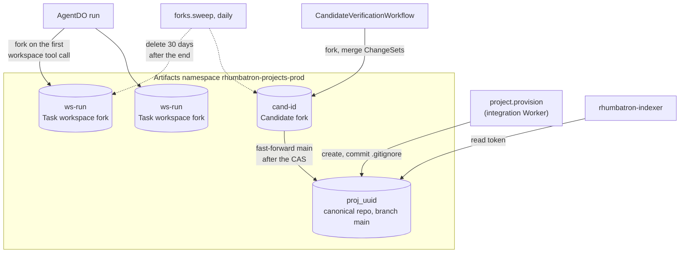
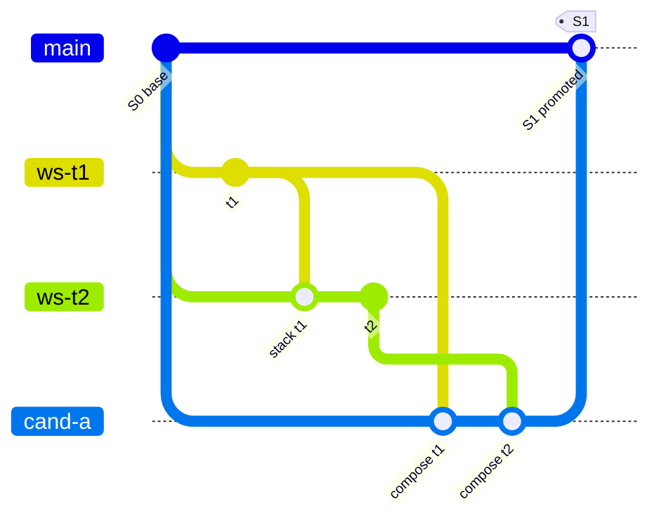
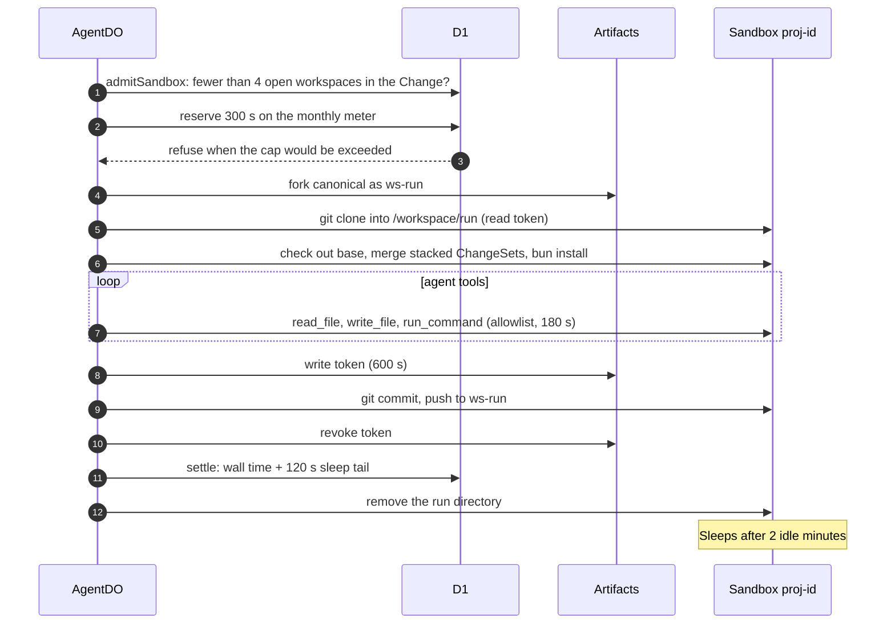
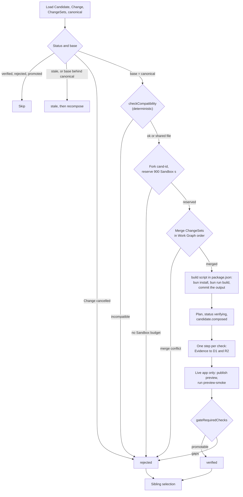
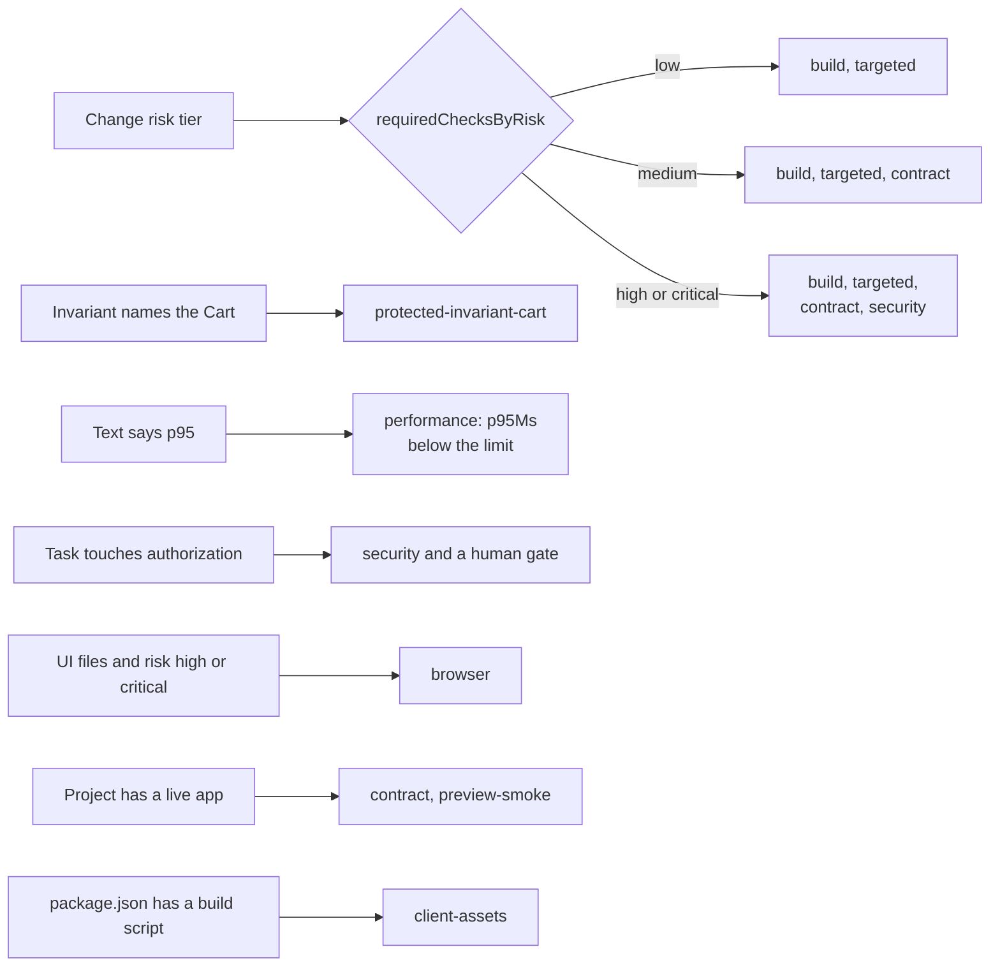
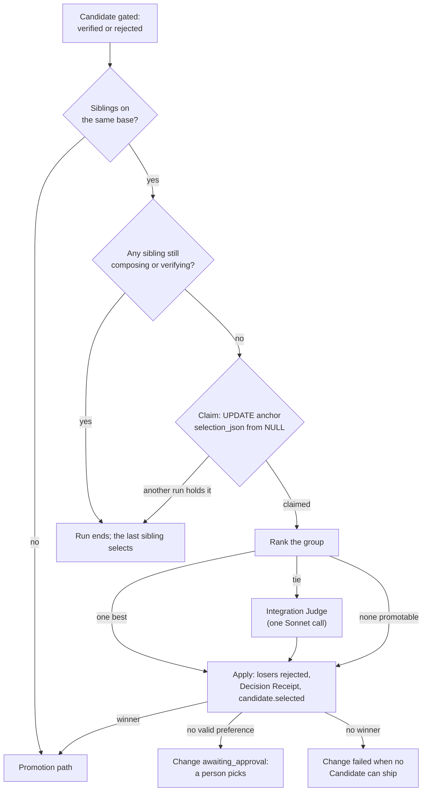
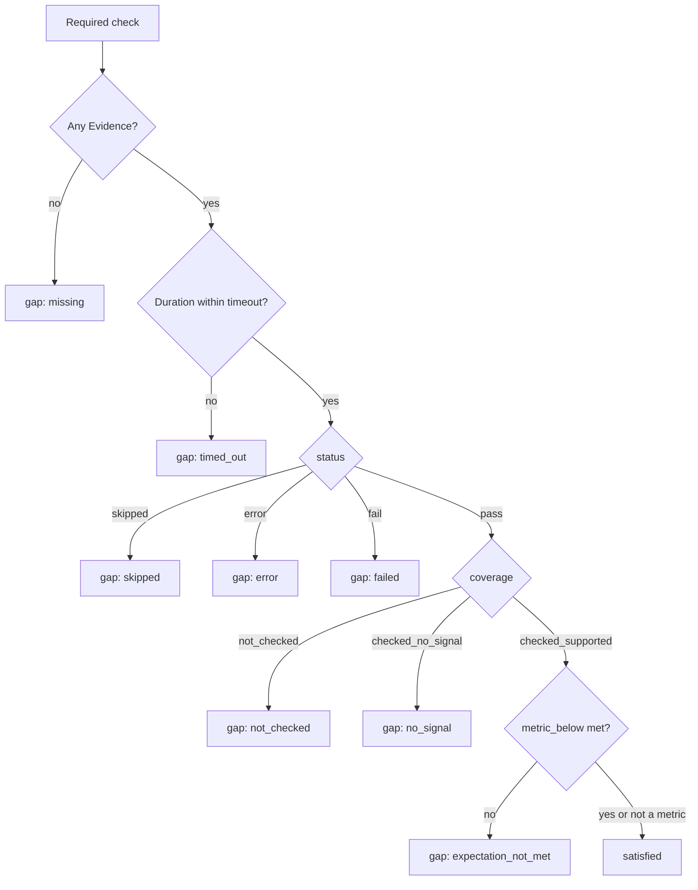
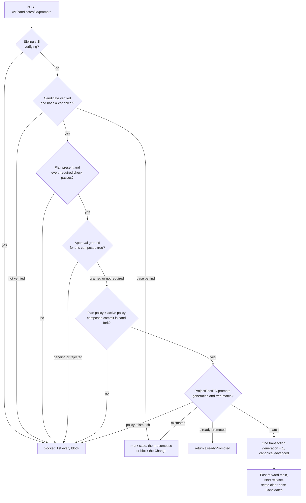

# Source and verification

This page covers Project source in Artifacts, the Sandbox, checks and Evidence, sibling selection, and promotion.

Main source files:

- `workers/integration/src/provision.ts`, `canonical-source.ts`, `code-store.ts`, `repo-names.ts`, `project-cleanup.ts`
- `workers/agents/src/workspace.ts`, `stack.ts`
- `workers/integration/src/verification-workflow.ts`, `candidate-sandbox.ts`, `browser-check.ts`, `runner-selection.ts`
- `workers/integration/src/candidate-create.ts` (fork rule), `integrate.ts`, `acceptance-check.ts`, `candidate-selection.ts`, `promotion.ts`
- `workers/apps/src/checker.ts`, `checker-program.ts` (Dynamic Worker checks)
- `packages/evidence/src`: `plan.ts`, `gate.ts`, `promotion.ts`, `compatibility.ts`
- `workers/coordinator/src/promotion-cas.ts`, `project-root-do.ts`

## Artifacts repositories

Cloudflare Artifacts holds the Project source (ADR 0010).
The namespace is `rhumbatron-projects-prod`.
Terraform declares the `ARTIFACTS` binding. The code creates the namespace on first use. Terraform has no resource for it.

Repository names come from D1 row IDs only (`repo-names.ts`):

| Repository | Name |
|---|---|
| Canonical | The Project ID, `proj_<uuid>` |
| Task workspace fork | `ws-<run>` for Task run `run_<run>` |
| Candidate fork | `cand-<id>` for Candidate `cand_<id>` |
| Code edit session fork | `edit-<hex>` for session `edit_<hex>` (ADR 0029) |

Rules:

- Cleanup does not list the namespace. It deletes only the names that it derives from the rows of one Project. So it cannot delete a repository of a different Project.
- Each Git access uses a repository token that expires after 600 s. The code revokes the token after use.
- The daily `forks.sweep` command deletes a fork 30 days after its run or Candidate ends (`FORK_RETENTION_DAYS`). It deletes workspace forks of failed runs, of runs without a ChangeSet, and of finished Changes. It deletes the forks of `rejected`, `stale`, and `promoted` Candidates. It deletes a promoted fork only when canonical `main` holds the composed commit.
- A code edit session deletes its fork when it ends. The daily `forks.sweep` command ends overdue sessions and deletes a session fork that a failed delete left.
- A new Project starts at Canonical Generation 0 (`S0`) with one commit that holds only `.gitignore` (ADR 0022).

Source objects in R2:

| Object | Key | Writer |
|---|---|---|
| File index | `source/<project>/<tree>/index.json` | Provisioning and each promotion |
| Code manifest (path to Git blob ID) | `source/<project>/<tree>/code.json` | Provisioning and each promotion. Composition also writes the Candidate tree when the integration Worker has the `APPS` binding. |
| Blob | `source/<project>/blobs/<blob>` | Same as the code manifest. Each blob is copied once. A file over 1 MB is listed but not copied. |
| ChangeSet patch | `source/<project>/patches/changesets/<cs>.patch` | Agent publish (`patchRef`) |
| Candidate patch | `source/<project>/patches/candidates/<cand>.patch` | Candidate composition |

- Agents read the file index. They do not walk the repository.
- A patch stops at 512 KB, at a line boundary. R2 metadata records `truncated` and the full size.
- No R2 lifecycle rule expires `source/`. Project deletion removes it (see `docs/operations/cleanup.md`).

## Composition and promotion in Git terms

A Candidate fork starts at the canonical base commit.
The CandidateVerificationWorkflow merges the ChangeSets in Work Graph order.
When the composed `package.json` has a `build` script, composition then runs `bun install` and `bun run build` and commits the files the build changed (`Build <candidate>`). See [Live apps](live-apps.md#client-assets-built-by-the-app).
Promotion moves canonical `main` to the composed commit. The move is fast-forward only.

Notes:

- `gitGraph` draws the last step as a merge. The code pushes the composed commit as a fast-forward (`canonical-source.ts`). It never force-pushes.
- The push runs in the integration Worker with `isomorphic-git` on an in-memory file system. It uses no Sandbox time.
- If the push fails, the compare-and-swap result stays. A retry of the promotion pushes again.

## Sandbox lifecycle

The `Sandbox` class is in `rhumbatron-sandbox` (ADR 0012).
Each Project has one Sandbox, with the ID `proj-<uuid>`.
Agent runs and Candidate checks use different directories in it.
The container application allows one instance (0 when the pause switch is on).
Only Task kinds `implement`, `migrate`, and `test` open a workspace.

The fork and the checkout happen at the first workspace tool call of the run.
`run_command` accepts only `bun install`, `bun test [paths]`, `bun run typecheck|test|bench|contract|build`, `bun run <name>` for a script in the workspace `package.json`, `bunx tsc --noEmit`, `git status|diff|log`, and `ls`.
After `bun run build` (or `bun run build:<x>`), the workspace discards the files that the build wrote. Composition builds them again.

| Guard | Agent workspace | Candidate checks | Code edit session |
|---|---|---|---|
| Directory | `/workspace/<last 24 characters of the run ID>` | `/workspace/cand-<id>` | `/workspace/edit-<hex>` |
| Reservation on open | 300 s | 900 s | 480 s for each command. The open starts no Sandbox. |
| Idle tail before sleep | 120 s (`sleepAfter` 2 min) | 120 s (`sleepAfter` 2 min) | 120 s (`sleepAfter` 2 min) |
| Concurrency | 4 open workspaces per Change | Checks run one after another in one workflow | One command at a time in each session, one open session per person per Project |
| Command user | root, allowlisted commands | root | An unprivileged user of the session, any command, 120 s timeout |
| Monthly meter | `SANDBOX_MONTHLY_SECONDS`: 72,000 s (20 h) | Same meter | Same meter. At the cap: 429 `sandbox_cap`. |

A code edit session (ADR 0029) starts the Sandbox only at its first command. After each command, and when the session ends while the Sandbox is awake, a kill as the session user stops every process of the session. The end also removes the session directory. The Sandbox then sleeps after 2 idle minutes.

A Sandbox loss does not lose committed work.
The workspace restores from the same fork, base, and stacked merges. Then it compares the result with the recorded start commit.
Uncommitted edits are lost.
A publish after a loss fails the run. It does not publish partial work.
The Sandbox gets short-lived Git tokens only. It never gets Terraform, Cloudflare API, or model credentials.

## Verification workflow

CandidateVerificationWorkflow has one instance per Candidate.
Each step is idempotent. Each check is its own step with its own timeout.
The workflow calls a model in two places only:

- The acceptance check: one Haiku call, and one Sonnet call when the Haiku output is not valid.
- The Integration Judge on a tie between sibling Candidates: one Sonnet call.

Both calls count against the Anthropic monthly budget, the daily call cap, and the Change budget.

- A rejection by `checkCompatibility` or by the merge records `composition` Evidence with the reason.
- A composition build that fails records the `build` Evidence (`fail`, `checked_supported`, the output tail). The `build` check then does not run again. A passing composition build leaves the `build` check to its normal runner.
- The Candidate patch leaves out the files that the composition build generated.
- A check step that throws records status `error` with coverage `not_checked`. A record with a duration over the check timeout is the gap `timed_out`. A gap is never a pass.
- The Sandbox meter settles after the last check, before preview publication and the gate.
- The preview publishes only when the `build` check (check ID `build`) passed.
- After selection, a Change with no Candidate that can ship ends as `failed`. See [Change lifecycle](change-lifecycle.md#change-status).

### Where checks run

`build`, `unit`, and `contract` run in a Dynamic Worker through the `APPS.check` RPC when the integration Worker has the `APPS` binding (`isAppCheckerEligible` in `runner-selection.ts`).
The AppChecker reads the composed tree from the R2 code store. Each check has at most 30 s, no network, and no binding.
When AppChecker answers `supported: false` (for example no code store, a bundler error, or a deadline), the check runs in the Sandbox.
A `unit` check whose tests read project files (`import.meta.dir`, `__dirname`, `node:fs`), use Bun globals, call `process.cwd()`, or start processes is `supported: false` before any test runs (`sandboxOnlyFeatures` in `workers/apps/src/checker-program.ts`). A Dynamic Worker has no project files on disk, so such a test would fail there because of the runner.
A completed Dynamic Worker failure is final. It does not go to the Sandbox for a second try.
`protected-invariant-cart`, `performance`, `security`, and `browser` always run in the Sandbox.
`acceptance` and `preview-smoke` use no Sandbox.
The Evidence summary of a check that ran in a Dynamic Worker or the Sandbox ends with `(runner: dynamic-worker)` or `(runner: sandbox)`.

### Which checks run

`buildVerificationPlan` (`packages/evidence/src/plan.ts`) selects checks from the policy tier and from what the ChangeSets touch.

- Verification uses the policy of the Project. The policy is the D1 `project_policies` row (migration 0017). `policyForRun` (`workers/integration/src/policy.ts`) reads it once per run. The plan, the approval gate, the auto-promotion tiers, and the protected resources of `checkCompatibility` use this policy. Without a row, verification uses `DEFAULT_POLICY` (`policy-1` in `workers/integration/src/candidate-composer.ts`). `DEFAULT_POLICY` protects no resource.
- Rhumbatron rejects a Candidate as `invariant_violation` when one of its ChangeSets declares a contract or data change on a protected resource of the Project policy.
- The policy check `targeted` runs the `unit` check. Every plan has `build` and `unit`.
- The policy does not list the `critical` tier. A `critical` Change uses the strictest listed tier. A gap in the policy never lowers verification.
- The p95 limit is the number in the goal, the acceptance criteria, or the invariants. The default is 200 ms.
- UI files are files under `public/` or with the extension `.tsx`, `.jsx`, `.html`, or `.css`.
- An invariant that keeps existing endpoint behavior adds `contract` and `unit`. Another app-behavior invariant adds `unit`. An invariant that no test can prove (for example email delivery or uptime) becomes a required procedure check. It stays a visible gap.
- A Change with acceptance criteria gets the optional `acceptance` check (see below).
- A composed `package.json` with a `build` script adds the required `client-assets` check. Client sources are the files under `src/client/` and the `src/` paths that the build script files name (a named file also adds its directory, except `src/` itself). The check fails when a client source changed but no script or style that `public/index.html` references differs from the base. In that case the live app would serve the old bundle. The check passes when no client source changed. A page without `public/index.html`, or without a local script or style, passes with that reason.

| Check ID | Kind | Command or procedure | Timeout |
|---|---|---|---|
| `build` | build | Dynamic Worker: bundle the app with `@cloudflare/worker-bundler` and load it. Sandbox: `bun run typecheck`. A failed composition build is the result | 120 s (30 s in the Dynamic Worker) |
| `client-assets` | build | Only with a `build` script. Composition compares the composed commit with the base (see above). No runner | 30 s |
| `unit` | unit | Dynamic Worker: the project tests. Sandbox: `bun test` | 180 s (30 s in the Dynamic Worker) |
| `contract` | contract | Compare the route table of the base and of the Candidate with the declared contract changes. Dynamic Worker extraction, or `bun run contract` in the Sandbox | 120 s (30 s in the Dynamic Worker) |
| `protected-invariant-cart` | protected-invariant | `bun test test/cart.invariant.test.ts` | 120 s |
| `performance` | performance | `bun run bench`. Metric `p95Ms` must be below the limit | 120 s |
| `security` | security | `bun test --test-name-pattern authorization`. The app conventions (`APP_CONVENTIONS`) tell agents to name the denial tests this way. No matching test is a gap | 180 s |
| `browser` | browser | One Browser Run session (see below) | 90 s |
| `acceptance` | acceptance | Optional. Haiku judges each acceptance criterion against the Candidate patch and the composed files. Code validates each citation | 180 s |
| `preview-smoke` | smoke | Publish the Candidate preview and run the release probes against it | 30 s |

The browser check starts the composed app in the Sandbox. The browser reaches it only through request interception.
The preview host has no public URL. The check blocks every other request.
The flow is the same for every app: the home page loads and shows text, and `GET /api/health` answers 200.
The check saves up to 8 screenshots to R2 as Evidence.

One session lasts at most 55 s. A Candidate gets at most 2 browser runs.
The `BROWSER_DAILY_SECONDS` meter (960 s per UTC day) applies before a session opens.

### Acceptance check

The acceptance check tests what the person asked for. Each Candidate of a Change with acceptance criteria gets it.
It is not a gate check. It does not make a Candidate unpromotable, and it does not reject a Candidate. It ranks sibling Candidates, and it gates auto-promotion.
A failing required check (`build`, `unit`, `contract`, `preview-smoke`, and the others in the table) still makes a Candidate unpromotable.

- Criteria: the Change acceptance criteria, without the criteria that other checks cover (`acceptanceCriteriaToJudge` in `candidate-composer.ts`). Other checks cover three kinds of criterion: a criterion that only states the quality gate ("typecheck and tests pass"), a latency limit (the `performance` check), and kept behavior ("unchanged", the invariant checks). When no criterion is left, the plan has no `acceptance` check.
- Input (`acceptanceSource` in `verification-workflow.ts` and `acceptance-check.ts`), in this order, at most 60,000 characters in total (`ACCEPTANCE_SOURCE_CAP`):
  1. The Candidate patch at `source/<project>/patches/candidates/<cand>.patch`, when it belongs to the composed commit. Hunks of changed text files only.
  2. The full text of composed files from the Candidate fork, at most 24 files (`composedFileOrder`): the changed app files, then `public/index.html`, the local `.js` and `.css` files that it references, `src/app.ts`, and `src/worker.ts`, then the other changed files (tests and docs).

  A file that crosses the limit is cut at a line boundary and marked `truncated`. A binary file, or a file larger than 60,000 bytes, is not sent. When the fork cannot be read, the patch alone is the input.
- Model: one Haiku call with the tool `record_acceptance`. Each criterion is `met`, `not_met`, or `unclear`. A `met` cites `{path, quote}`. When the output does not give one result per criterion, one Sonnet call follows. No browser session runs.
- Citations (`citationValid`): code keeps a citation only when the path is a file that the model received and the quote occurs in that text. In a composed file, the quote can come from any line. In a patch, the quote must come from added or context lines. A removed line proves nothing. The quote has at least 8 characters, after whitespace is collapsed. A criterion that code in the base already satisfies is `met` with a quote of the composed file. A `met` without a valid citation counts as `unclear`.
- Evidence: `pass` with `checked_supported` only when each criterion is `met`. Otherwise `fail` with `checked_supported` and a summary, for example "2 of 3 criteria met; not met: calendar view". These results are `error` with `not_checked` (a gap): a model error, a refused call (Change budget, daily call cap, monthly budget), and no readable source.
- When an earlier check has no passing result, the Candidate cannot ship. The check then records `skipped` (`not_checked`) and makes no model call.
- Auto-promotion: a selected Candidate auto-promotes (when policy allows) only when its acceptance Evidence is `pass` with `checked_supported`. When a criterion is not met or unclear, or when the check has a gap, `holdForAcceptance` (`candidate-selection.ts`) does these steps:
  1. It adds the human gate to the plan.
  2. It sets the Candidate status reason.
  3. It moves the Change to `awaiting_approval`.
  4. It records `approval.requested` with the reason, for example "Best candidate meets 2 of 3 criteria; not met: calendar view. Approve to ship it or cancel the change."

  A person then approves and ships the Candidate through the normal path, or cancels the Change.
- Storage: the per-criterion results go to `candidates.acceptance_json` and to the R2 report. `criteriaMet`, `criteriaTotal`, and `costUsd` go to `metrics_json`. The cost counts against the Change budget.

## Sibling Candidates and selection

The fork rule (`planCandidateSets`) can give one Change more than one Candidate on the same base generation.
These Candidates are siblings. Their workflows run in parallel. No sibling promotes alone (ADR 0026).

Integrate rule (applied before the fork rule, `workers/integration/src/integrate.ts`):

- Two Tasks of one Change are complementary when their planned semantic resources do not overlap (`todos:api` and `todos:ui`, `missions:calendar-ui` and `missions:kanban-ui`). They are parts of one plan. A `confirmed` or `fork_required` conflict between them gets the fork decision `integrate` (`integrationFor` in `packages/conflict/src/integrate.ts`). This applies at detection and after each model review.
- Order:
  1. An existing dependency path decides.
  2. Else the UI Task depends on the API Task. A UI Task has a resource whose last segment is `ui`, `frontend`, or `page` (alone or after `-`), or a title that says UI, page, or frontend. An API Task has a last segment `api` (alone or after `-`), or a title that says API.
  3. Else the Task whose Intent uses the contract of the other (`consumedContracts`) depends on it.
  4. Else the higher Task key depends on the lower.
- Composition applies one integration per round, before any Candidate exists. One D1 transaction does these steps:
  1. It resolves the conflict (`review_json.integrate`).
  2. It adds the edge to `task_dependencies`.
  3. It rejects the ChangeSets of the dependent Task and of the Tasks built on it, and resolves their other open conflicts.
  4. It resets those Tasks to `pending` with a new attempt window.
  5. It moves the Change from `verifying` to `running`.
  6. It records the Decision Receipt `CONFLICT_INTEGRATION`.

  Then the Event `conflict.integrated`, the Challenge resolution (`upheld`), and the dispatch follow. If a delivery is lost, the next `candidate.create` repeats it (`recoverIntegrations`).
- The dependent Task re-runs once on a stacked workspace that includes the ChangeSet of the other Task. Its instruction is to use the real routes, field names, and data shapes of that ChangeSet. No Candidate composes until the re-run completes and the Change records `verification.started` again. The Candidate then holds both ChangeSets.
- An integration occurs once per Task pair. A later conflict on an integrated pair follows the fork rule. Only Tasks on overlapping semantic resources with incompatible designs are fork alternatives.

Contract declarations: `parseContractChange` (`packages/conflict/src/declaration.ts`) converts the contract lines of an Agent into typed contract changes.
HTTP method names (`GET`, `POST`, `PUT`, `PATCH`, `DELETE`) are part of a route. They are never change verbs. `DELETE /api/todos/:id -> {ok:true}` changes that route. Only wording such as "Removes DELETE /api/todos/:id" is a removal.
A line that says "None" or "No change", or that only uses, consumes, or calls routes, is not a contract change. Its routes go to the `consumedContracts` of the Intent. Conflict detection never compares them.

Fork rule:

- A fork conflict counts only when both sides have at least one proposed ChangeSet.
- No fork conflict counts: one Candidate with every proposed ChangeSet.
- The first counting conflict is `confirmed`: one Candidate per side. Each Candidate also holds the shared ChangeSets.
- The first counting conflict is `fork_required` (the conflict review said `needs_more_evidence`): the two side Candidates, plus a combined Candidate. The combined Candidate holds the shared ChangeSets, both sides, and the ChangeSets that need both sides. It shows whether the sides work together. The review asked for this evidence.
- A Change has at most `MAX_CANDIDATES` (3) Candidates per round. The ChangeSets of a further counting conflict wait for a later round.

Selection:

- The anchor is the earliest Candidate of the group (`created_at`, then ID). One conditional `UPDATE candidates SET selection_json = ... WHERE selection_json IS NULL` on the anchor claims the selection. A retry by the claimant continues. Each other run stops.
- Order:
  1. Only promotable Candidates (each required check passed).
  2. Most acceptance criteria met.
  3. Fewer gaps and optional failures.
  4. More passing checks.
- A tie goes to the Integration Judge. It reads only the Evidence snapshot of the tied Candidates (Evidence summaries and acceptance results). It fetches nothing. Its verdict is closed: `prefer_candidate` (with a Candidate ID), `reject_candidate`, `needs_more_evidence`, or `escalate_to_human`. Code validates the cited Evidence IDs. Only a valid `prefer_candidate` selects a winner. Any other result moves the Change to `awaiting_approval`, and a person promotes one Candidate.
- Each verified loser becomes `rejected` with a reason, for example "Lost to cand_x: met 3 of 3 criteria, this met 2 of 3." Each Candidate of the group stores the outcome in `selection_json`. The decision is a Decision Receipt (`CANDIDATE_SELECTION`) and the Event `candidate.selected`.
- Only the winner goes on the promotion path: a canonical check, the acceptance hold, policy `autoPromoteRiskTiers`, the approval gate (`approval.requested` for a gated winner), and the compare-and-swap. A Candidate without siblings goes on the same path.
- A verified winner that cannot auto-promote moves the Change to `awaiting_approval`. The Candidate status reason states why, and `approval.requested` carries the same `reason`:
  - Plan gate (`trigger: "policy"`, from the gate step or the selection): "Policy policy-1 requires a person to approve high-risk changes. Approve to ship it or cancel the change." An authorization change reads "changes to authorization".
  - Policy hold (`trigger: "policy"`, `holdForPerson` in `candidate-selection.ts`): the plan has no gate. The stored policy gates the tier or does not list it as automatic, or the Change has no risk tier. The hold adds the human gate to the plan (`policyHoldReason` in `packages/evidence/src/promotion.ts`).
  - Acceptance hold (`trigger: "acceptance"`), above.
- A manual promotion is blocked (`selection_pending`) while a sibling composes or verifies.

## Coverage states and the gate

Each Evidence record has a `status` (`pass`, `fail`, `error`, `skipped`) and a `coverage` (`not_checked`, `checked_no_signal`, `checked_supported`).
`gateRequiredChecks` reads the latest record of each required check.

When two records have the same completion time, the record that does not pass is the latest.
The UI shows each gap. It never shows a gap as green.
A model finding must cite what the model received:

- A conflict review cites Context Packet item IDs.
- The acceptance check cites quotes of the patch or of the composed files.
- The Integration Judge cites Evidence IDs.

A finding with a bad citation is `unsupported`. It cannot change state.

## Promotion preconditions

Promotion has two deterministic layers (ADR 0013).
The integration Worker reads authoritative D1 rows and Artifacts. It checks that the Candidate is verified, that the required Evidence exists and passes, that each required human approval exists, and that the composed commit is still in the Candidate fork. It also compares the plan policy version with the active policy version.
ProjectRootDO then checks the expected Canonical Generation, the expected canonical tree, and the policy version in its own transaction.
The integration Worker reports every failed precondition at once.

Approval rules (`packages/evidence/src/promotion.ts`):

- A human gate applies when the plan requires one (an authorization change, or the acceptance hold) or when the policy gates the risk tier (`high`, `critical`).
- A grant counts only for the exact composed tree that the approver saw.
- The first decision is final. A rejection also rejects the Candidate.
- No model decides approval or promotion.

The idempotency key is the Candidate ID plus the expected generation.
A retry after success returns `alreadyPromoted`. It repairs the D1 mirror and the source sync.
