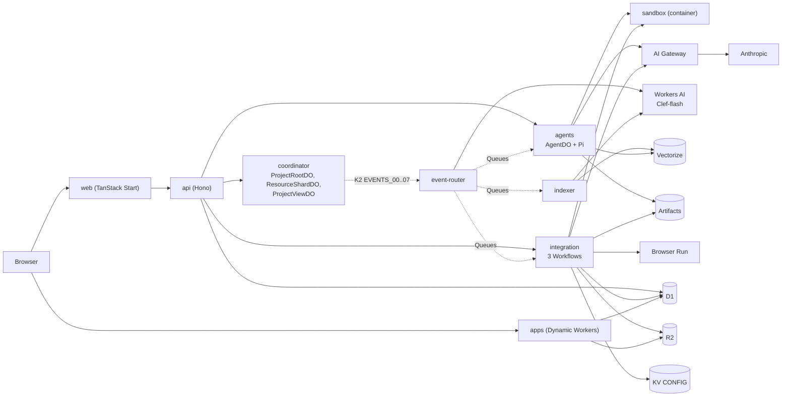

# Tech stack

This page lists every technology that Rhumbatron uses and what each one does.
It comes from the code, the `wrangler.jsonc` files, the `package.json` files, `bun.lock`, and the Terraform roots, not from `AGENTS.md`.
Versions are the pinned versions.

## How the parts connect

Solid arrows are service bindings, Durable Object bindings, or direct calls.
Dotted arrows are Queue messages or K2 records.

## Web

| Technology | Used for | Where |
|---|---|---|
| TanStack Start 1.168, Router 1.170 | Server-rendered React app and routes | `apps/web` |
| React 19.3, Vite 8.3 | UI runtime and build | `apps/web` |
| `@cloudflare/vite-plugin` 1.63 | Builds the web app as a Worker | `apps/web/vite.config.ts` |
| Tailwind CSS 4.3 | Styling | `apps/web` |
| `@cloudflare/kumo` 2.14 | Components (87 files import it) | `apps/web/src/components` |
| TanStack Query 5.104 | Server state and polling of API reads | `apps/web/src` (31 files) |
| Zustand 5.0 | Small client state (the flight view store) | `apps/web/src/components/flight/flight-store.ts` |
| XYFlow (`@xyflow/react` 12.12) | Work Graph, DAG panel, and Product Graph canvas | `work-graph.tsx`, `product-graph-canvas.tsx` |
| Phosphor icons, Fontsource Archivo | Icons and the font | `apps/web` |

## API and auth

| Technology | Used for | Where |
|---|---|---|
| Hono 4.13 | Public product API, body limits, validation | `workers/api` |
| Zod 4.6 | Protocol schemas and request validation | `packages/protocol`, every Worker |
| Clerk (`@clerk/backend` 3.23, `@clerk/tanstack-react-start` 1.7) | User sign-in and token check (ADR 0002). Prod uses a Clerk production instance | `workers/api`, `apps/web` |

## Coordination and events

| Technology | Used for | Where |
|---|---|---|
| Durable Objects with SQLite | `ProjectRootDO` (Canonical State and CAS), `ResourceShardDO` (Claims, Intents, outbox), `ProjectViewDO` (live read model) | `workers/coordinator` |
| Transactional outbox in DO SQLite | Atomic state change plus Event | `workers/coordinator/src/outbox.ts` |
| K2 | Durable Event log: 8 streams, 4 subscriptions, 7-day retention. Terraform creates it through an adapter (ADR 0006) | `workers/event-router`, `scripts/k2-sync.ts` |
| Queues | Commands: agent wake-ups, integration, verification, indexing, release, dead letter | `workers/event-router`, `workers/integration`, `workers/agents` |
| Workflows | `ChangeWorkflow`, `CandidateVerificationWorkflow`, `ReleaseWorkflow` | `workers/integration` |
| Cron Triggers | Event router sweep every minute. Once a day the same tick queues fork and Project cleanup. The `paused` switch turns it off | `workers/event-router` |
| Service bindings and DO RPC | Internal calls between Workers | every `wrangler.jsonc` |

## Agents and models

| Technology | Used for | Where |
|---|---|---|
| Agents SDK (`agents` 0.27) | `AgentDO` base class and `PiHarness` | `workers/agents/src/agent-do.ts` |
| Pi (`@earendil-works/pi-durable` 1.1, `pi-ai` 1.1) | Durable model and tool loop, behind `AgentRuntime` | `workers/agents/src` |
| AI Gateway `rhumbatron-models-<env>` | Proxy for every Anthropic call, with logs and a request rate limit | `infrastructure/terraform/modules/ai` |
| Anthropic (Claude Haiku 5.5, Sonnet 5.5, Opus 5.5) | Root Planner, Agents, conflict review, compaction. See the routing table below | `packages/model-router` |
| `@anthropic-ai/sdk` 0.129 | Client for `complete()` calls (Root Planner, conflict review, compaction) through the gateway | `packages/model-router` |
| Workers AI, Clef-flash | Cheap bounded decisions: ambiguous wake-ups, goal suggestion pills, model route when rules end at `default` | `workers/event-router/src/causal.ts`, `workers/agents/src/suggestions.ts` |
| Workers AI, `bge-small-en-v1.5` | 384-dimension embeddings for Vectorize | `workers/indexer`, `workers/agents/src/retrieval.ts` |
| Context Compiler | Deterministic Context Packet | `packages/context-compiler` |
| Causal Router | Deterministic wake-up decision | `packages/causal-router` |
| Conflict detector | Overlap and compatibility rules | `packages/conflict` |

## Execution and verification

| Technology | Used for | Where |
|---|---|---|
| Cloudflare Sandbox (`@cloudflare/sandbox` 0.12.6) | Linux shell for agents and Candidate checks. One container instance, 2-minute sleep, hour caps | `workers/sandbox`, `workers/agents`, `workers/integration` |
| Containers (image `docker.io/cloudflare/sandbox:0.12.6`) | Runs the Sandbox. Terraform deploys it through an adapter (ADR 0012) | `scripts/sandbox-deploy.ts` |
| Browser Run (`@cloudflare/puppeteer` 1.4) | Browser check of a Candidate, with a daily seconds cap | `workers/integration/src/browser-check.ts` |
| Bun test and project checks | Build, test, contract, security, performance, and invariant checks inside the Sandbox | `workers/integration` |
| `@rhumbatron/evidence` | Coverage states and citation validation | `packages/evidence` |
| Dynamic Workers (Worker Loader, `@cloudflare/worker-bundler` 0.2.6) | Run the generated app of a Project at `<slug>.rhumbatron.com` (ADR 0020) | `workers/apps` |
| Workers Builds | Release of the Acme Shop release target Worker (ADR 0018) | `workers/integration/src/release.ts` |

## Storage

| Technology | Used for | Where |
|---|---|---|
| Artifacts | Source of every Project: canonical repo, Task forks, Candidate forks (namespace `rhumbatron-projects-<env>`) | `workers/agents`, `workers/integration`, `workers/indexer` |
| `isomorphic-git` 1.43, `memfs` 4.80 | Read and write Artifacts repos inside Workers | `workers/integration`, `workers/agents`, `workers/indexer` |
| D1 `rhumbatron-control-<env>` | Product metadata, receipts, counters, app pointers. SQL migrations in `migrations/d1` | `agents`, `api`, `apps`, `event-router`, `indexer`, `integration` |
| R2 `rhumbatron-evidence-<env>` | Evidence, context snapshots, indexes, event archive, app bundles | most Workers |
| KV `rhumbatron-config-<env>` | 5-minute cache of the Project policy (`CONFIG`). D1 is the source of truth | `workers/integration/src/policy.ts` |
| Vectorize `rhumbatron-memory-<env>` | Semantic retrieval after exact lookup. Terraform creates it through an adapter | `workers/indexer`, `workers/agents/src/retrieval.ts` |
| `@babel/parser` 8.0 | Symbol index of changed files | `workers/indexer` |

## Observability

| Technology | Used for | Where |
|---|---|---|
| Workers Logs | Runtime logs. `observability.enabled` is on for every Worker | every `wrangler.jsonc` |
| Analytics Engine | Model calls, Event metrics, wake-ups (`METRICS`, `EVENT_METRICS`) | `workers/agents`, `workers/indexer`, `workers/event-router` |
| AI Gateway logs | Model request logs and cost | AI Gateway |
| `scripts/cost-report.ts`, `scripts/budget-alerts.ts` | Usage report and account budget alerts | `scripts` |

## Infrastructure

| Technology | Used for | Where |
|---|---|---|
| Terraform (Cloudflare provider `~> 5.27`, `external` `~> 2.4`) | Every remote Cloudflare change. Two environment roots plus bootstrap: `envs/global`, `envs/prod` | `infrastructure/terraform` |
| R2 remote state | Terraform state backend | `backend.hcl` per root |
| `terraform_data` adapters | K2, Vectorize, Sandbox Worker, apps Worker, D1 migrations, budget alerts (ADR 0006, 0012) | `scripts/*.ts` |
| Cloudflare DNS | `rhumbatron.com`, `api`, `docs`, wildcard for apps, Clerk records | `modules/dns`, `envs/prod` |
| Zone settings | HTTPS, TLS 1.3, strict SSL | `modules/security` |
| Wrangler 4.149 | Local development, type generation, bundling only | `apps/*`, `workers/*` |
| Pause switch | `locals.paused` stops crons and container work | `envs/prod` |

## Tooling and docs

| Technology | Used for | Where |
|---|---|---|
| Bun 1.3.14 | Package manager, workspaces, script runner | root `package.json` |
| TypeScript 7.0.2 | Language and typecheck | all packages |
| Turborepo 2.11 | Task runner for build, typecheck, tests | `turbo.json` |
| Biome 2.5 | Lint and format | `biome.json` |
| Vitest 5.0 | Critical tests (`*.critical.test.ts`) | packages and Workers |
| Knip 6.40, Sherif 1.13 | Unused code and dependency checks | `bun run check:deps` |
| Lefthook 2.2, commitlint 21 | Pre-commit, commit-msg, and pre-push hooks | `lefthook.yml` |
| Gitleaks | Secret scan in the hook and `bun run check:secrets` | `lefthook.yml` |
| `scripts/check-guardrails.ts` | Enforces Terraform-only and no `wrangler deploy` | `scripts` |
| GitHub Actions | One `ci` workflow: lint, typecheck, critical tests, build, bundle, Terraform validate. It never deploys | `.github/workflows/ci.yml` |
| Astro 7.3, Starlight 0.42, Mermaid 12.1 | This documentation site at `docs.rhumbatron.com` | `apps/docs` |

## Model routing

`routeByRules` in `packages/model-router/src/rules.ts` picks the tier.
`resolveTier` then maps the tier to a model.
`ALLOW_OPUS` is `false` in prod (ADR 0021). Every opus decision runs on Sonnet, and the receipt records `opus_disabled`. Setting the Terraform variable `allow_opus` to `true` runs `claude-opus-5-5` instead.

| Work | Tier chosen | Model that runs | Source |
|---|---|---|
| Root Planner (`plan`, large) | opus | `claude-sonnet-5-5` | `workers/integration/src/root-planner.ts` |
| Destructive migration, design conflict across resources | opus | `claude-sonnet-5-5` | `rules.ts` |
| Normal implementation (medium) and the default | sonnet | `claude-sonnet-5-5` | `rules.ts` |
| Large child implementation | sonnet | `claude-sonnet-5-5` | `rules.ts` |
| Billing and non-trivial authorization floor | sonnet at least | `claude-sonnet-5-5` | `rules.ts` |
| Conflict review and request comparison | sonnet, then opus | `claude-sonnet-5-5` | `workers/agents/src/conflict-review.ts` |
| Small, low-risk first attempt, and summarize, classify, compact, transform | haiku | `claude-haiku-5-5` | `rules.ts` |
| Context compaction of long failure logs | haiku | `claude-haiku-5-5` | `workers/agents/src/context-compaction.ts` |
| Ambiguous wake-up, goal suggestion pills | Clef-flash | `@cf/cloudflare/clef-flash` | `workers/event-router/src/causal.ts` |
| Release authorization | No model | Deterministic policy | `workers/integration/src/release-model.ts` |

Thinking effort is low for haiku, medium for sonnet, and high for opus.
Output caps are 4,000 tokens for haiku and 8,000 for sonnet and opus.
Two failures at one tier escalate the Task one tier.
The caps are 400 agent model calls per day and a monthly Anthropic budget of 10 USD.

## Differences from AGENTS.md section 5

| AGENTS.md says | The code does |
|---|---|
| Claude Opus 5.5 plans and arbitrates | Sonnet 5.5 does this while `ALLOW_OPUS` is `false` (ADR 0021) |
| Model providers: Anthropic or OpenAI | Anthropic only |
| Seven deployables | Nine Workers: the seven, plus `rhumbatron-sandbox` (ADR 0012) and `rhumbatron-apps` (ADR 0020). The docs site is a tenth, assets-only Worker |
| First-party Terraform resources for new products | `terraform_data` adapters for K2, Vectorize, the Sandbox Worker, and the apps Worker |
| Workers Builds releases every Project | Dynamic Workers release every Project (ADR 0020). Workers Builds releases only a Project with a `release_targets` row (ADR 0018) |
| New Projects start from a template | Every Project starts from an empty repository (ADR 0022) |
| Clerk for authentication | Clerk. Prod uses a production instance |
| Component library and charts: kumo and Recharts | kumo. No chart library |
| Several GitHub Actions workflows | One `ci.yml`. Deployment runs locally through Terraform |
| Pi agent loop through `AgentRuntime` | Pi runs through `PiHarness` of the Agents SDK inside `AgentDO` |
