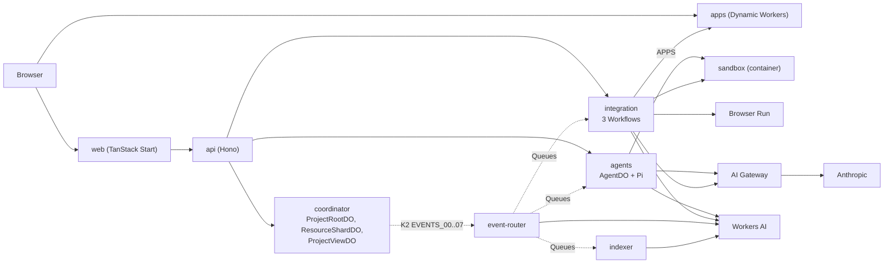

# Tech stack

This page lists each technology that Rhumbatron uses and what it does.
The sources are the code, the `wrangler.jsonc` files, the `package.json` files, `bun.lock`, and the Terraform roots.
Versions are the pinned versions.

## How the parts connect

Solid arrows are service bindings, Durable Object bindings, or direct calls.
Dotted arrows are Queue messages or K2 records.
The [Storage](#storage) table lists the storage bindings.

## Web

| Technology | Used for | Where |
|---|---|---|
| TanStack Start 1.168, Router 1.170 | Server-rendered React app and routes. Route loaders read each signed-in page's primary data on the server, and the HTML carries it (ADR 0027, `src/lib/ssr-data.ts`). Clock times and ages print the same on the server and in the hydration (`src/lib/render-time.ts`). The client entry and the route-chunk preloads start after the first contentful paint, so the stylesheet and fonts load alone; a hidden tab starts at once, and every tab after 5 s at the latest (`src/server.ts`). The chunks preload at low fetch priority. Fingerprinted `/assets/*` files are cached as immutable for one year (`public/_headers`, sent by the Terraform worker module). Text typed before hydration stays (`src/lib/pre-hydration.ts`) | `apps/web` |
| React 19.3, Vite 8.3 | UI runtime and build | `apps/web` |
| `@cloudflare/vite-plugin` 1.63 | Builds the web app as a Worker | `apps/web/vite.config.ts` |
| Tailwind CSS 4.3 | Styling. One stylesheet (`src/styles.css`) carries the fonts, Kumo, Tailwind, the theme and XYFlow's base styles. Below 640px no text is smaller than 12px (ADR 0027) | `apps/web` |
| `@cloudflare/kumo` 2.14 | Components | `apps/web/src/components` |
| TanStack Query 5.104, `@tanstack/react-router-ssr-query` 1.167 | Server state and polling of API reads. The router's SSR integration writes the server-read cache into the HTML; queries stay fresh for 10 s | `apps/web/src` |
| Zustand 5.0 | Small client state: the flight view store and the shared lane time axis | `apps/web/src/components/flight` |
| XYFlow (`@xyflow/react` 12.12) | Work Graph, DAG views on the Agents and Events pages, and the Product Graph canvas | `work-graph.tsx`, `dag/dag-canvas.tsx`, `product-graph-canvas.tsx` |
| CodeMirror 6 (`@codemirror/*`) | Code editor on the Code page and in its edit-session IDE. It loads on the client only, in its own chunk. The IDE is a further chunk that loads only when a session starts | `apps/web/src/components/code`, `apps/web/src/components/code-ide` |
| Phosphor icons, Fontsource Archivo | Icons and the font | `apps/web` |

### Replay and filters

- One replay controller serves the execution timeline on the Project overview and the Agents graph (`src/components/replay`). The `useReplay` hook has two modes. Live is the default. In Live, the view shows the newest state and follows new facts. Replay shows the state at a playhead. Play moves the playhead through the recorded facts at 1x, 2x, 4x, or 8x on `requestAnimationFrame`. At 1x one minute of recorded time plays in one second, and each pause between two facts takes 0.2 to 1.5 s. Under reduced motion the playhead holds at each fact and then steps to the next one. The control bar has play and pause, the speeds, the replay clock, a range with a tick per notable fact, and Live. Space plays or pauses. Left and Right step between facts. Home goes to the first fact. L goes live.
- Timeline replay (`components/timeline/timeline-replay.ts`): an accent playhead sweeps the time axis. Attempt bars and Change spans show up to the playhead. A CSS clip follows the playhead every frame, so the layout stays still. Markers appear when the playhead passes them. The "Needs attention" rail shows the open questions, approval requests, Challenges, and failed commands at the playhead.
- Timeline rows (`components/timeline/use-timeline-disclosure.ts`): each person and each Change row expands and collapses. The browser keeps the choice per Project in `localStorage`. Without a stored choice, every person is open, a Change in flight is open, and a finished Change is collapsed. The server render uses these defaults, and the stored choice applies after hydration.
- Recovered failures (`src/lib/recovery.ts`): one rule for the timeline, Flight Control, the Change page, and the event feeds. A failed attempt that a later attempt of the same Task completed shows "Retried, recovered" in the warning color. A failed attempt that the Task retries shows "Failed, retrying". Only a failure that nothing recovered is red. The rule reads the Task status and its attempts, or the `task.failed` and `task.completed` events.
- Agents replay (`components/agents-page/agents-replay.ts`): Change and Task nodes appear when they were created (`task.created` or `change.compiled` from one page of the Change's oldest events, read once per Change). An agent appears when its first attempt starts. While an attempt runs, the agent shows its tier (H, S, O), a pulse, and a progress line for the recorded duration. Retries and escalations show in its meta line. Conflict edges appear as suspected when detected and take their recorded state at their last update. A strip under the graph shows one lane per agent with the playhead, and the latest steps as text. A polite live region reads the current step.
- Events filters (`components/dag/filter-search.ts`, `components/events-page/events-filter-bar.tsx`): text search over the event type, summary, and IDs; person; Change by its short title; Task or agent; event type group; and time range. The filter lives in the URL (`?q=&person=&change=&task=&group=&range=`), and the List and Graph views share it. `change` also scopes the stream on the server, so "Load older" reads further back in that Change. The other fields filter the loaded events. The bar shows the number of set fields and a Clear button.

## API and auth

| Technology | Used for | Where |
|---|---|---|
| Hono 4.13 | Public product API, body limits, validation | `workers/api` |
| Zod 4.6 | Protocol schemas and request validation | `packages/protocol`, `packages/model-router`, and the `api`, `apps`, `coordinator`, `event-router`, and `integration` Workers |
| Clerk (`@clerk/backend` 3.23, `@clerk/tanstack-react-start` 1.7) | User sign-in and token check (ADR 0002). Prod uses a Clerk production instance. For a signed-out visitor, Clerk loads at the first pointer, touch, key, or focus event (`src/lib/clerk-deferral.ts`) | `workers/api`, `apps/web` |

## Coordination and events

| Technology | Used for | Where |
|---|---|---|
| Durable Objects with SQLite | `ProjectRootDO` (Canonical State and CAS), `ResourceShardDO` (Claims, Intents, outbox), `ProjectViewDO` (live read model) | `workers/coordinator` |
| Transactional outbox in DO SQLite | Atomic state change plus Event | `workers/coordinator/src/outbox.ts` |
| K2 | Durable Event log: 8 streams, 4 subscriptions, 7-day retention. Terraform creates it through an adapter (ADR 0006) | `workers/event-router`, `scripts/k2-sync.ts` |
| Queues | Commands: `agent-wakeups`, `integration`, `verification`, `indexing`, `release`, `dead-letter` | `workers/event-router`, `workers/integration`, `workers/agents` |
| Workflows | `ChangeWorkflow`, `CandidateVerificationWorkflow`, `ReleaseWorkflow` | `workers/integration` |
| Cron Triggers | Event router sweep every minute. Every 5 minutes the tick also queues recovery of Changes stuck in `releasing`. Once a day it queues fork and Project cleanup. The `paused` switch turns the cron off | `workers/event-router/src/index.ts` |
| Service bindings and DO RPC | Internal calls between Workers | every `wrangler.jsonc` |

## Agents and models

| Technology | Used for | Where |
|---|---|---|
| Agents SDK (`agents` 0.27) | `AgentDO` base class and `PiHarness` | `workers/agents/src/agent-do.ts` |
| Pi (`@earendil-works/pi-durable` 1.1, `pi-ai` 1.1) | Durable model and tool loop. `AgentDO` implements `AgentRuntime` (ADR 0009) | `workers/agents/src` |
| AI Gateway `rhumbatron-models-<env>` | Proxy for each Anthropic call: logs, 20 requests per minute, and a 30-day spend limit equal to the monthly Anthropic budget | `infrastructure/terraform/modules/ai` |
| Anthropic (Claude Haiku 5.5, Sonnet 5.5, Opus 5.5) | Root Planner, Agents, intake gate, request review, conflict review, acceptance check, Integration Judge, compaction. See [Model routing](#model-routing) | `packages/model-router` |
| `@anthropic-ai/sdk` 0.129 | Client for `complete()` calls through the gateway | `packages/model-router` |
| Workers AI, Clef-flash (`@cf/cloudflare/clef-flash`) | Bounded decisions: ambiguous wake-ups, goal suggestion pills, intake votes, and the model route when the rules end at `default` | `workers/event-router/src/causal.ts`, `workers/agents/src/suggestions.ts`, `workers/integration/src/intake.ts`, `packages/model-router/src/route.ts` |
| Workers AI, `@cf/baai/bge-small-en-v1.5` | 384-dimension embeddings for Vectorize and the intake gate | `workers/indexer`, `workers/agents/src/retrieval.ts`, `workers/integration/src/intake.ts` |
| Workers AI, `@cf/baai/bge-reranker-base` | Reranks related requests in the intake gate | `workers/integration/src/intake.ts` |
| Context Compiler | Deterministic Context Packet | `packages/context-compiler` |
| Causal Router | Deterministic wake-up decision | `packages/causal-router` |
| Conflict detector | Overlap and compatibility rules | `packages/conflict` |

## Execution and verification

| Technology | Used for | Where |
|---|---|---|
| Cloudflare Sandbox (`@cloudflare/sandbox` 0.12.6) | Linux shell for Agents and Candidate checks. One container instance, sleep after 2 minutes, a monthly hour cap | `workers/sandbox`, `workers/agents`, `workers/integration` |
| Containers (image `docker.io/cloudflare/sandbox:0.12.6`, instance type `basic`) | Runs the Sandbox. Terraform deploys it through an adapter (ADR 0012) | `scripts/sandbox-deploy.ts` |
| Browser Run (`@cloudflare/puppeteer` 1.4) | Browser check of a Candidate, with a daily seconds cap | `workers/integration/src/browser-check.ts` |
| Dynamic Workers (Worker Loader, `@cloudflare/worker-bundler` 0.2.6) | Run the app of each Project at `<slug>.rhumbatron.com` (ADR 0020). Run the `build`, `unit`, and `contract` checks when the code allows it | `workers/apps` |
| Project checks in the Sandbox | `build`, `unit`, and `contract` checks that a Dynamic Worker cannot run, plus `protected-invariant-cart`, `performance`, `security`, and `browser` | `workers/integration` |
| `@rhumbatron/evidence` | Coverage states, citation validation, promotion rules | `packages/evidence` |

## Storage

| Technology | Used for | Where |
|---|---|---|
| Artifacts | Source of each Project: canonical repo, Task forks, Candidate forks (namespace `rhumbatron-projects-<env>`) | `workers/agents`, `workers/integration`, `workers/indexer` |
| `isomorphic-git` 1.43, `memfs` 4.80 | Read and write Artifacts repos inside Workers | `workers/integration`, `workers/agents`, `workers/indexer` |
| D1 `rhumbatron-control-<env>` | Product metadata, receipts, counters, app pointers. SQL migrations are in `migrations/d1` | `agents`, `api`, `apps`, `event-router`, `indexer`, `integration` |
| R2 `rhumbatron-evidence-<env>` | Evidence, context snapshots, indexes, code store, event archive, app bundles | most Workers |
| KV `rhumbatron-config-<env>` | 5-minute cache of the Project policy (`CONFIG`). D1 is the source of truth | `workers/integration/src/policy.ts` |
| Vectorize `rhumbatron-memory-<env>` | Semantic retrieval after exact lookup. Terraform creates it through an adapter (ADR 0003) | `workers/indexer`, `workers/agents/src/retrieval.ts` |
| `@babel/parser` 8.0 | Symbol index of changed files | `workers/indexer` |

## Observability

| Technology | Used for | Where |
|---|---|---|
| Workers Logs | Runtime logs. Logs are on for each Worker | `modules/worker`, `modules/durable-worker`, adapter scripts |
| Analytics Engine | Model calls, Event metrics, wake-ups (`METRICS`, `EVENT_METRICS`) | `workers/agents`, `workers/indexer`, `workers/event-router` |
| AI Gateway logs | Model request logs and cost | AI Gateway |
| `scripts/cost-report.ts`, `scripts/budget-alerts.ts` | Usage report and account budget alerts | `scripts` |

## Infrastructure

| Technology | Used for | Where |
|---|---|---|
| Terraform 1.16 or later (Cloudflare provider `~> 5.27`, `hashicorp/external` `~> 2.4`) | Each remote Cloudflare change. Roots: `bootstrap`, `envs/global`, `envs/prod` | `infrastructure/terraform` |
| R2 remote state | Terraform state backend | `backend.hcl` per root |
| `terraform_data` adapters | K2, Vectorize, Sandbox Worker, apps Worker, D1 migrations, budget alerts (ADR 0003, 0006, 0012, 0020) | `scripts/*.ts` |
| Cloudflare DNS | Worker custom domains `rhumbatron.com`, `www`, `api`, and `docs`. A wildcard record and route for apps. Clerk CNAME records | `modules/worker`, `envs/prod` |
| Zone settings | Always HTTPS, minimum TLS 1.2, TLS 1.3 on, strict SSL | `envs/global`, `modules/security` |
| Wrangler 4.149 | Local development, type generation, and `wrangler deploy --dry-run` bundling only | `apps/*`, `workers/*`, `scripts/build-workers.ts` |
| Pause switch | `locals.paused` removes the cron and sets the Sandbox `max_instances` to 0 | `envs/prod` |

## Tooling and docs

| Technology | Used for | Where |
|---|---|---|
| Bun 1.3.14 | Package manager, workspaces, script runner | root `package.json` |
| TypeScript 7.0.2 | Language and typecheck | all packages |
| Turborepo 2.11 | Task runner for build, typecheck, tests | `turbo.json` |
| Biome 2.5 | Lint and format | `biome.json` |
| Vitest 5.0 | Critical tests (`*.critical.test.ts`) | packages, Workers, `scripts` |
| Playwright 1.63, Lighthouse 12.6 | UI suite (`bun run test:ui`) and signed-in Lighthouse runs against prod | root `package.json`, `scripts/lighthouse.ts` |
| Knip 6.40, Sherif 1.13 | Unused code and dependency checks | `bun run check:deps` |
| Lefthook 2.2, commitlint 21 | Pre-commit, commit-msg, and pre-push hooks | `lefthook.yml` |
| Gitleaks | Secret scan in the pre-commit hook and `bun run check:secrets` | `lefthook.yml` |
| `scripts/check-guardrails.ts` | Enforces Terraform-only deploys and no `wrangler deploy` | `scripts` |
| GitHub Actions | `ci` checks each pull request. `production` deploys each push to `main` through Terraform (ADR 0031) | `.github/workflows/ci.yml`, `.github/workflows/production.yml` |
| Astro 7.3, Starlight 0.42, Mermaid 12.1 | This documentation site at `docs.rhumbatron.com`. Each diagram renders when it comes near the viewport | `apps/docs` |

## Model routing

`routeByRules` in `packages/model-router/src/rules.ts` picks the tier.
`resolveTier` then maps the tier to a model.
`ALLOW_OPUS` is `false` in prod (ADR 0021). Each opus decision runs on Sonnet, and the receipt records `opus_disabled`. Set the Terraform variable `allow_opus` to `true` to run `claude-opus-5-5`.

| Work | Tier chosen | Model that runs | Source |
|---|---|---|---|
| Root Planner (`plan`, large) | opus | `claude-sonnet-5-5` | `workers/integration/src/root-planner.ts` |
| Destructive migration, design conflict across resources | opus | `claude-sonnet-5-5` | `rules.ts` |
| Normal implementation (medium) and the default | sonnet | `claude-sonnet-5-5` | `rules.ts` |
| Large child implementation | sonnet | `claude-sonnet-5-5` | `rules.ts` |
| Billing and non-trivial authorization floor | sonnet at least | `claude-sonnet-5-5` | `rules.ts` |
| Small, low-risk first attempt, and summarize, classify, compact, transform | haiku | `claude-haiku-5-5` | `rules.ts` |
| Context compaction of long failure logs | haiku | `claude-haiku-5-5` | `workers/agents/src/context-compaction.ts` |
| Conflict review | sonnet, then opus only when `ALLOW_OPUS` is `true` | `claude-sonnet-5-5` | `workers/agents/src/conflict-review.ts` |
| Intake gate | Clef-flash votes, then sonnet when needed | `claude-sonnet-5-5` | `workers/integration/src/intake.ts` |
| Request review | sonnet | `claude-sonnet-5-5` | `workers/integration/src/request-policy.ts` |
| Acceptance check | haiku, then sonnet once when the haiku output is not valid | `claude-haiku-5-5`, `claude-sonnet-5-5` | `workers/integration/src/acceptance-check.ts` |
| Integration Judge on a selection tie | sonnet | `claude-sonnet-5-5` | `workers/integration/src/candidate-selection.ts` |
| Ambiguous wake-up, goal suggestion pills | Clef-flash | `@cf/cloudflare/clef-flash` | `causal.ts`, `suggestions.ts` |
| Release decision | No model | Deterministic rules | `workers/integration/src/release-model.ts` |

Thinking effort is low for haiku, medium for sonnet, and high for opus.
Routed Agent steps cap output at 4,000 tokens for haiku and 8,000 tokens for sonnet and opus.
Two failures at one tier move the Task up one tier. Two failures at the top tier stop the Task with limit `max_attempts_per_tier`, and the Change becomes `budget_blocked`.
A transport failure retries once at the same tier and never escalates (`packages/model-router/src/escalation.ts`).
The caps are 400 agent model calls per day and an Anthropic budget of 100 USD per calendar month (`packages/model-router/src/budget.ts`, Terraform `anthropic_monthly_budget_usd`).

## Stack decisions

Each row names one area and the choice that the code makes in it.

| Area | Choice in the code |
|---|---|
| Planning and arbitration | Sonnet 5.5 while `ALLOW_OPUS` is `false` (ADR 0021) |
| Model provider | Anthropic only (ADR 0021) |
| Bounded decision models | Only Clef-flash runs. No code path calls Clef |
| Deployables | Nine Workers, including `rhumbatron-sandbox` (ADR 0012) and `rhumbatron-apps` (ADR 0020). The docs site is a tenth, assets-only Worker |
| Products without a first-party Terraform resource | `terraform_data` adapters for K2, Vectorize, the Sandbox Worker, and the apps Worker |
| Project source at creation | Each Project starts from an empty repository (ADR 0022) |
| Components and charts | kumo. No chart library |
| Tracing | No OpenTelemetry or Cloudflare tracing. Durable Object Workers set `traces.enabled = false` |
| Edge protection | No WAF, rate limiting, Turnstile, or Access. The AI Gateway has a request rate limit |
| CI/CD | `ci.yml` for checks and `production.yml` for the Terraform deploy on each push to `main` |
| Agent runtime | `AgentDO` implements `AgentRuntime` and runs Pi through `PiHarness` of the Agents SDK (ADR 0009) |
