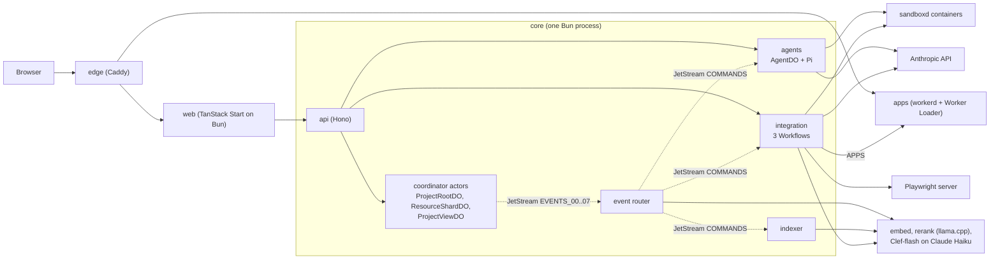

# Tech stack

This page lists each technology that Rhumbatron uses and what it does.
The sources are the code, `compose.yaml`, the Dockerfiles, the `package.json` files, and `bun.lock`.
Versions are the pinned versions.
ADR 0034 records why each backing service is in the stack.

## How the parts connect

Solid arrows are direct calls: in-process calls inside core, or HTTP and WebSocket calls between services.
Dotted arrows are queue messages or event stream records.
The [Storage](#storage) table lists the storage bindings.

## Web

| Technology | Used for | Where |
|---|---|---|
| TanStack Start 1.168, Router 1.170 | Server-rendered React app and routes. Route loaders read each signed-in page's primary data on the server, and the HTML carries it (ADR 0027, `src/lib/ssr-data.ts`). Clock times and ages print the same on the server and in the hydration (`src/lib/render-time.ts`). The client entry and the route-chunk preloads start after the first contentful paint, so the stylesheet and fonts load alone; a hidden tab starts at once, and every tab after 5 s at the latest (`src/server.ts`). The chunks preload at low fetch priority. Fingerprinted `/assets/*` files are cached as immutable for one year (`serve.ts`). Text typed before hydration stays (`src/lib/pre-hydration.ts`) | `apps/web` |
| React 19.3, Vite 8.3 | UI runtime and build | `apps/web` |
| Bun 1.3.14 server | Serves the built web app in the `apps/web/Dockerfile` image: static client files and the TanStack Start server entry (`serve.ts`) | `apps/web` |
| Tailwind CSS 4.3 | Styling. One stylesheet (`src/styles.css`) carries the fonts, Kumo, Tailwind, the theme and XYFlow's base styles. Below 640px no text is smaller than 12px (ADR 0027) | `apps/web` |
| `@cloudflare/kumo` 2.14 | Components | `apps/web/src/components` |
| TanStack Query 5.104, `@tanstack/react-router-ssr-query` 1.167 | Server state and polling of API reads. The router's SSR integration writes the server-read cache into the HTML; queries stay fresh for 10 s | `apps/web/src` |
| Zustand 5.0 | Small client state: the flight view store and the shared lane time axis | `apps/web/src/components/flight` |
| XYFlow (`@xyflow/react` 12.12) | Work Graph, DAG views on the Agents and Events pages, and the Product Graph canvas | `work-graph.tsx`, `dag/dag-canvas.tsx`, `product-graph-canvas.tsx` |
| CodeMirror 6 (`@codemirror/*`) | Code editor on the Code page and in its edit-session IDE. It loads on the client only, in its own chunk. The IDE is a further chunk that loads only when a session starts | `apps/web/src/components/code`, `apps/web/src/components/code-ide` |
| Phosphor icons, Fontsource Archivo | Icons and the font | `apps/web` |

### Replay and filters

- One replay controller serves the execution timeline on the Project overview and the Agents graph (`src/components/replay`). The `useReplay` hook has two modes. Live is the default. In Live, the view shows the latest state and adds each fact as it arrives. Replay shows the state at a playhead. Play moves the playhead through the recorded facts at 1x, 2x, 4x, or 8x on `requestAnimationFrame`. At 1x one minute of recorded time plays in one second, and each pause between two facts takes 0.2 to 1.5 s. Under reduced motion the playhead holds at each fact and then steps to the next one. The control bar has play and pause, the speeds, the replay clock, a range with a tick per notable fact, and Live. Space plays or pauses. Left and Right step between facts. Home goes to the first fact. L goes live.
- Timeline replay (`components/timeline/timeline-replay.ts`): an accent playhead sweeps the time axis. Attempt bars and Change spans show up to the playhead. A CSS clip follows the playhead every frame, so the layout stays still. Markers appear when the playhead passes them. The "Needs attention" rail shows the open questions, approval requests, Challenges, and failed commands at the playhead.
- Timeline rows (`components/timeline/use-timeline-disclosure.ts`): each person and each Change row expands and collapses. The browser keeps the choice per Project in `localStorage`. Without a stored choice, every person is open, a Change in flight is open, and a finished Change is collapsed. The server render uses these defaults, and the stored choice applies after hydration.
- Recovered failures (`src/lib/recovery.ts`): one rule for the timeline, Flight Control, the Change page, and the event feeds. A failed attempt that a later attempt of the same Task completed shows "Retried, recovered" in the warning color. A failed attempt that the Task retries shows "Failed, retrying". Only a failure that nothing recovered is red. The rule reads the Task status and its attempts, or the `task.failed` and `task.completed` events.
- Agents replay (`components/agents-page/agents-replay.ts`): Change and Task nodes appear at their creation time (`task.created` or `change.compiled` from one page of the Change's oldest events, read once per Change). An agent appears when its first attempt starts. While an attempt runs, the agent shows its tier (H, S, O), a pulse, and a progress line for the recorded duration. Retries and escalations show in its meta line. Conflict edges appear as suspected when detected and take their recorded state at their last update. A strip under the graph shows one lane per agent with the playhead, and the latest steps as text. A polite live region reads the current step.
- Events filters (`components/dag/filter-search.ts`, `components/events-page/events-filter-bar.tsx`): text search over the event type, summary, and IDs; person; Change by its short title; Task or agent; event type group; and time range. The filter lives in the URL (`?q=&person=&change=&task=&group=&range=`), and the List and Graph views share it. `change` also scopes the stream on the server, so "Load older" reads further back in that Change. The other fields filter the loaded events. The bar shows the number of set fields and a Clear button.

## API and auth

| Technology | Used for | Where |
|---|---|---|
| Hono 4.13 | Public product API, body limits, validation | `workers/api` |
| Zod 4.6 | Protocol schemas and request validation | `packages/protocol`, `packages/model-router`, and `workers/api`, `apps`, `coordinator`, `event-router`, and `integration` |
| Clerk (`@clerk/backend` 3.23, `@clerk/tanstack-react-start` 1.7) | User sign-in and token check (ADR 0002). The stack uses a Clerk development instance on `rhumbatron.localhost`. For a signed-out visitor, Clerk loads at the first pointer, touch, key, or focus event (`src/lib/clerk-deferral.ts`) | `workers/api`, `apps/web` |

## Coordination and events

| Technology | Used for | Where |
|---|---|---|
| Actor host (`packages/platform/src/actors`) | `ProjectRootDO` (Canonical State and CAS), `ResourceShardDO` (Claims, Intents, outbox), `ProjectViewDO` (live read model), `AgentDO`. One instance per ID, one SQLite file per actor, persisted alarms with retries, input gates, hibernatable WebSockets | `workers/coordinator`, `workers/agents` |
| Transactional outbox in actor SQLite | Atomic state change plus Event | `workers/coordinator/src/outbox.ts` |
| NATS JetStream 2.15.2 (`@nats-io/jetstream` 3.4) | Event log: 8 streams `EVENTS_00` to `EVENTS_07`, 4 durable consumers per stream, 7-day retention. Commands: work-queue stream `COMMANDS` with the queues `agent-wakeups`, `integration`, `verification`, `indexing`, `release`, `dead-letter` | `packages/platform/src/messaging/jetstream.ts`, `workers/event-router` |
| Workflow engine (`packages/platform/src/workflows`) | `ChangeWorkflow`, `CandidateVerificationWorkflow`, `ReleaseWorkflow`. Replay with stored step results, retries with backoff, step timeouts, sleeps, and events, in `workflows.sqlite` | `workers/integration` |
| Sweep timer | Core calls the event router's `scheduled` handler at the start of each minute. Every 5 minutes the tick also queues recovery of Changes stuck in `releasing`. Once a day it queues fork and Project cleanup. Core also runs the object expiry of `services/core/src/expiry.ts` | `services/core/src/main.ts`, `workers/event-router/src/index.ts` |
| In-process entrypoints | Calls between modules in core (`EVENT_ROUTER`, `INTEGRATION`, `AGENTS`) and actor stubs | `services/core/src/main.ts` |
| Runtime module | `bun --preload ./packages/platform/src/preload.ts` maps the `cloudflare:workers` specifier, which the code and the Agents SDK import, to the platform classes | `packages/platform/src/runtime-module.ts` |
| Binding types | Each module in `workers/*` has a tracked `src/bindings.d.ts`. `packages/platform/types/runtime.d.ts` holds the shared runtime interface types that the platform implements | `workers/*/src/bindings.d.ts`, `packages/platform/types` |
| Queue consumer table | One row per queue: module, batch size, retries, dead-letter, concurrency | `services/core/src/consumers.ts` |

## Agents and models

| Technology | Used for | Where |
|---|---|---|
| Agents SDK (`agents` 0.27) | `AgentDO` base class and `PiHarness` | `workers/agents/src/agent-do.ts` |
| Pi (`@earendil-works/pi-durable` 1.1, `pi-ai` 1.1) | Durable model and tool loop. `AgentDO` implements `AgentRuntime` (ADR 0009) | `workers/agents/src` |
| Anthropic API (Claude Haiku 5.5, Sonnet 5.5, Opus 5.5) | Root Planner, Agents, intake gate, request review, conflict review, acceptance check, Integration Judge, compaction. Calls go to `https://api.anthropic.com` directly. See [Model routing](#model-routing) | `packages/model-router` |
| `@anthropic-ai/sdk` 0.129 | Client for `complete()` calls | `packages/model-router` |
| Clef-flash on Claude Haiku | Bounded decisions: ambiguous wake-ups, goal suggestion pills, intake votes, and the model route when the rules end at `default`. `SmallModels` asks Claude Haiku with a forced tool call. The caller abstains when it cannot parse the answer | `packages/platform/src/ai/models.ts`, `workers/event-router/src/causal.ts`, `workers/agents/src/suggestions.ts`, `workers/integration/src/intake.ts`, `packages/model-router/src/route.ts` |
| llama.cpp server `b12110`, `bge-small-en-v1.5` (Q8_0) | 384-dimension embeddings for `MEMORY` and the intake gate (service `embed`) | `workers/indexer`, `workers/agents/src/retrieval.ts`, `workers/integration/src/intake.ts` |
| llama.cpp server `b12110`, `bge-reranker-base` (Q8_0) | Reranks related requests in the intake gate (service `rerank`) | `workers/integration/src/intake.ts` |
| Context Compiler | Deterministic Context Packet | `packages/context-compiler` |
| Causal Router | Deterministic wake-up decision | `packages/causal-router` |
| Conflict detector | Overlap and compatibility rules | `packages/conflict` |

## Execution and verification

| Technology | Used for | Where |
|---|---|---|
| sandboxd (`services/sandboxd`) | Linux shell for Agents, Candidate checks, and code sessions. One sibling container per Sandbox ID (`proj-<id>` per Project), removed after 2 minutes idle, at most 4 live, a monthly seconds cap | `services/sandboxd`, `workers/agents`, `workers/integration` |
| Sandbox image `rhumbatron/sandbox:local` (`oven/bun:1.3.14-debian`, git, jq, curl) | The container that each Sandbox runs | `containers/sandbox/Dockerfile` |
| `wollomatic/socket-proxy` 1.13.2 | Allows only the Docker Engine calls that sandboxd uses | `compose.yaml` |
| Egress proxy | `host:port` allowlist for Sandbox network access | `services/sandboxd/src/egress.ts` |
| `runc`, or gVisor `runsc` on a Linux server | Container runtime of each Sandbox (`SANDBOX_RUNTIME`) | `compose.yaml` |
| Playwright 1.64.1 server, `playwright-core` 1.64.1 | Browser check of every Candidate whose Change touches pages. Core connects to `ws://browser:3000/`. The check has a daily seconds cap | `services/browser`, `workers/integration/src/browser-check.ts` |
| `workerd` 1.20261008.1 with the Worker Loader, `@cloudflare/worker-bundler` 0.2.6 | Run the app of each Project at `<slug>.rhumbatron.localhost` (ADR 0020). Run the `build`, `unit`, and `contract` checks when the code allows it | `services/apps`, `workers/apps` |
| Project checks in the Sandbox | `build`, `unit`, and `contract` checks that the apps service cannot run, plus `protected-invariant-*`, `performance`, `security`, and `browser` | `workers/integration` |
| `@rhumbatron/evidence` | Coverage states, citation validation, promotion rules | `packages/evidence` |

## Storage

| Technology | Used for | Where |
|---|---|---|
| Git service (`services/git`, Bun and the git CLI) | Source of each Project: canonical repository, Task forks, Candidate forks (binding `ARTIFACTS`, namespace `rhumbatron`). Forks share objects through alternates | `services/git`, `workers/agents`, `workers/integration`, `workers/indexer` |
| `isomorphic-git` 1.43, `memfs` 4.80 | Read and write Project repositories over smart HTTP | `workers/integration`, `workers/indexer` |
| SQLite (`bun:sqlite`), `rhumbatron.sqlite` | Product metadata, receipts, counters, app pointers (binding `DB`). SQL migrations are in `migrations/d1` | `packages/platform/src/sql/database.ts` |
| versitygw 1.10.0, `@aws-sdk/client-s3` 3.1163 | Bucket `rhumbatron-evidence` (binding `EVIDENCE`): Evidence, context snapshots, indexes, code store, event archive, app bundles | `packages/platform/src/objects/bucket.ts` |
| `platform_kv` table | 5-minute cache of the Project policy (`CONFIG`). The `project_policies` table is the source of truth | `packages/platform/src/sql/kv.ts`, `workers/integration/src/policy.ts` |
| Vector table | Semantic retrieval after exact lookup (`MEMORY`). Exact cosine search inside one Project | `packages/platform/src/sql/vectors.ts`, `workers/indexer`, `workers/agents/src/retrieval.ts` |
| `@babel/parser` 8.0 | Symbol index of changed files | `workers/indexer` |

## Observability

| Technology | Used for | Where |
|---|---|---|
| JSON log lines on stdout | Runtime logs. Docker keeps them. `bun run stack:logs` follows them | `packages/platform/src/log.ts`, every module |
| `platform_metrics` table | Model calls, Event metrics, wake-ups (`METRICS`, `EVENT_METRICS`), kept 30 days | `packages/platform/src/sql/metrics.ts` |
| Cost API | Meters per Project and for the stack | `GET /v1/projects/:projectId/cost`, `workers/api/src/cost.ts` |

## Infrastructure

| Technology | Used for | Where |
|---|---|---|
| Docker Compose | One stack of 14 services, 8 volumes, and 3 networks | `compose.yaml` |
| Caddy 2.11.7 (`local_certs`) | Edge: TLS from its own local CA, routing by host name, WebSocket proxy, docs files | `services/edge` |
| Bun 1.4.4 image (`oven/bun:1.4.4`) | Base image of `core`. Playwright `connect()` to the `browser` service needs Bun 1.4 | `services/core/Dockerfile` |
| Bun 1.3.14 images (`oven/bun:1.3.14`, `oven/bun:1.3.14-debian`) | Base image of `web`, `git`, `sandboxd`, `egress`, and the Sandbox. Build stage of the `edge` docs site and of the `apps` bundle | `services/*/Dockerfile`, `apps/web/Dockerfile`, `containers/sandbox/Dockerfile` |
| `scripts/local-env.ts` | Writes `.env`: Clerk development keys, the Anthropic key, and random internal tokens | `bun run stack:env` |
| `scripts/trust-local-ca.ts` | Copies Caddy's local CA to `.local-ca.crt` and adds it to the macOS login keychain as a trusted root. `--check` only reports the trust state | `bun run stack:trust`, last step of `bun run stack:up` |

## Tooling and docs

| Technology | Used for | Where |
|---|---|---|
| Bun 1.3.14 | Package manager, workspaces, script runner (`packageManager` `bun@1.3.14`) | root `package.json` |
| TypeScript 7.0.2 | Language and typecheck | all packages |
| Turborepo 2.11 | Task runner for build, typecheck, tests | `turbo.json` |
| Biome 2.5 | Lint and format | `biome.json` |
| Vitest 5.0 | Critical tests (`*.critical.test.ts`) | `packages`, `workers`, `services`, `scripts` |
| Playwright 1.63, Lighthouse 12.6 | UI suite (`bun run test:ui`, `e2e/ui`) and signed-in Lighthouse runs against `https://rhumbatron.localhost`. `e2e/ui/build-app.spec.ts` builds a live app from a blank Project and one instruction | root `package.json`, `playwright.config.ts`, `scripts/lighthouse.ts` |
| Knip 6.40, Sherif 1.13 | Unused code and dependency checks | `bun run check:deps` |
| Lefthook 2.2, commitlint 21 | Pre-commit, commit-msg, and pre-push hooks. The commit scopes name the modules and the Compose services, for example `core`, `platform`, `git`, `sandboxd`, `edge`, and `stack` | `lefthook.yml`, `commitlint.config.ts` |
| Gitleaks | Secret scan in the pre-commit hook and `bun run check:secrets` | `lefthook.yml` |
| `scripts/check-guardrails.ts` | Refuses a tracked local secret file, and a Docker socket mount on any service except the socket proxy | `scripts` |
| GitHub Actions | `ci` runs the checks on each pull request and each push to `main`. It also validates `compose.yaml`. `docs` publishes the docs site to `https://rhumbatron.com` after a push to `main` that changes it | `.github/workflows/ci.yml`, `.github/workflows/docs.yml` |
| Astro 7.3, Starlight 0.42, Mermaid 12.1 | This documentation site at `https://docs.rhumbatron.localhost` and `https://rhumbatron.com`. The `edge` image builds it and Caddy serves the files. The `docs` workflow publishes it to a Cloudflare Worker with static assets only. Each diagram renders when it comes near the viewport | `apps/docs`, `services/edge/Dockerfile`, `apps/docs/wrangler.json` |

## Model routing

`routeByRules` in `packages/model-router/src/rules.ts` picks the tier.
`resolveTier` then maps the tier to a model.
`ALLOW_OPUS` is `false` by default (ADR 0021). Each opus decision then runs on Sonnet, and the receipt records `opus_disabled`. Set `ALLOW_OPUS=true` in `.env` and run `bun run stack:up` again to run `claude-opus-5-5`.

| Work | Tier chosen | Model that runs | Source |
|---|---|---|---|
| Root Planner (`plan`, large) | opus | `claude-sonnet-5-5` | `workers/integration/src/root-planner.ts` |
| Destructive schema change (`destructiveMigration`), design conflict across resources | opus | `claude-sonnet-5-5` | `rules.ts` |
| Normal implementation (medium) and the default | sonnet | `claude-sonnet-5-5` | `rules.ts` |
| Large child implementation | sonnet | `claude-sonnet-5-5` | `rules.ts` |
| Billing and non-trivial authorization floor | sonnet at least | `claude-sonnet-5-5` | `rules.ts` |
| Small, low-risk first attempt, and summarize, classify, compact, transform | haiku | `claude-haiku-5-5` | `rules.ts` |
| Context compaction of long failure logs | haiku | `claude-haiku-5-5` | `workers/agents/src/context-compaction.ts` |
| Conflict review | sonnet, then opus only when `ALLOW_OPUS` is `true` | `claude-sonnet-5-5` | `workers/agents/src/conflict-review.ts` |
| Intake gate | Clef-flash votes, then sonnet when needed | `claude-sonnet-5-5` | `workers/integration/src/intake.ts` |
| Request review | sonnet | `claude-sonnet-5-5` | `workers/integration/src/request-policy.ts` |
| Acceptance check | haiku, then sonnet once when the haiku output is not valid | `claude-haiku-5-5`, `claude-sonnet-5-5` | `workers/integration/src/acceptance-check.ts` |
| Integration Judge on a selection tie | sonnet | `claude-sonnet-5-5` | `workers/integration/src/candidate-selection.ts` |
| Ambiguous wake-up, goal suggestion pills | Clef-flash | `claude-haiku-5-5` (`DECISION_MODEL`) | `causal.ts`, `suggestions.ts`, `packages/platform/src/ai/models.ts` |
| Release decision | No model | Deterministic rules | `workers/integration/src/release-model.ts` |

Thinking effort is low for haiku, medium for sonnet, and high for opus.
The Pi loop caps output at 8,000 tokens per call on every tier (`workers/agents/src/models.ts`).
Two failures at one tier move the Task up one tier. Two failures at the top tier stop the Task with limit `max_attempts_per_tier`, and the Change becomes `budget_blocked`.
A transport failure retries once at the same tier and never escalates (`packages/model-router/src/escalation.ts`).
The caps are 1,000 agent model calls per day and an Anthropic budget of `ANTHROPIC_MONTHLY_BUDGET_USD` per calendar month, default 100 USD (`packages/model-router/src/budget.ts`, `compose.yaml`).

## Stack decisions

Each row names one area and the choice that the code makes in it.

| Area | Choice in the code |
|---|---|
| Runtime | One Docker Compose stack on one host (ADR 0034) |
| The `opus` tier (route kinds `plan`, `architecture`, and `arbitration`) | Sonnet 5.5 while `ALLOW_OPUS` is `false` (ADR 0021) |
| Model provider | Anthropic only (ADR 0021) |
| Bounded decision models | Clef-flash, on Claude Haiku |
| Services in core | API, coordinator, agents, integration, event router, and indexer share one Bun process. The apps service is a separate `workerd` process (ADR 0020) |
| Project source at creation | Each Project starts from an empty repository (ADR 0022) |
| Components | Kumo |
| Edge | Caddy with TLS from its local CA |
| CI | `ci.yml` runs the checks. An operator starts the stack |
| Agent runtime | `AgentDO` implements `AgentRuntime` and runs Pi through `PiHarness` of the Agents SDK (ADR 0009) |
