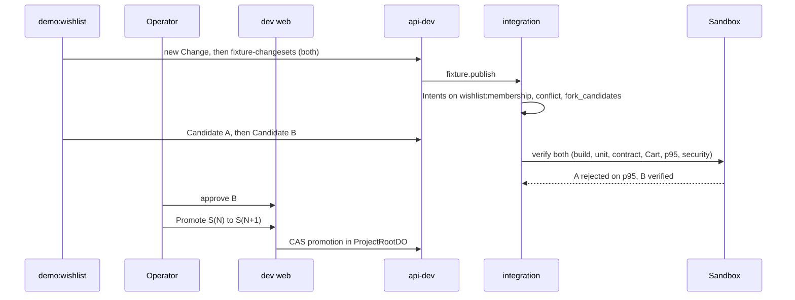

# Demo runbook

The AGENTS.md section 55 sequence, mapped to the dev UI (`https://dev.rhumbatron.com`) and API (`https://api-dev.rhumbatron.com`).

Deploys use Terraform only: `bun run cf:bundle`, `bun run tf:plan:dev`, `bun run tf:apply:dev`, and `bun run tf:drift`. Production (`https://rhumbatron.com`) is live, but the demo scripts target dev, so the demo runs on dev.

Two paths feed the sequence:

- `bun run demo:live` runs a real model-driven Change (Root Planner, agents, automatic Candidate). Use it for steps 5 to 13.
- `bun run demo:wishlist` publishes the fixture Designs A and B without a model call ([wishlist-fixture.md](wishlist-fixture.md)). Use it for steps 14 to 30.

## Before the demo

1. Ensure dev is unpaused: `locals.paused = false` in `infrastructure/terraform/envs/dev/main.tf`. Apply with Terraform ([pause-resume.md](../operations/pause-resume.md)). Pause dev compute after testing.
2. Run smoke checks: `bun run smoke:dev` and `bun run smoke:sandbox`.
3. Create or reset demo project: `bun run demo:project`. This prepares the `acme-shop-demo` Project with seeded Acme Shop source in Artifacts and prints the Project ID.
4. Prepare scripted demo: `bun run demo:wishlist`. This sets up fixture designs A and B with a semantic conflict on `wishlist:membership`. Candidate A fails p95 by design. Candidate B passes and promotes after approval.
5. Optional failure injection: `bun run inject` ([failure-injection.md](failure-injection.md)).
6. Optional cleanup: `bun run cleanup:projects`.

Cost and limits:
- Sandbox: 5 hours per month per environment.
- Browser Run: 250 seconds per day per environment.
- Gemini on Vertex: AI Gateway caps it at 40 USD (dev) and 10 USD (prod) per 30 days.
- Check usage with `bun run cost:report` ([costs.md](../operations/costs.md)).

## UI routes

- `/`: Projects list. Header contains notification bell.
- `/projects/<id>`: Project overview.
- `/changes/<id>`: Change details, acceptance criteria, invariants, candidates.
- `/changes/<id>/flight`: Flight Control (execution DAG, agent swimlanes, workspace lanes, codebase heatmap, candidate arena, preview wall, evidence explorer, decisions, events, time machine, command palette Cmd+K).
- `/candidates/<id>`: Candidate verification evidence, approval, promotion.
- `/compare/<changeId>`: Candidate comparison matrix.
- `/projects/<id>/{agents,events,verification,workspace,costs,graph}`: Dedicated project management and monitoring views.

## Sequence

| # | Section 55 step | Where | What to show |
|---|---|---|---|
| 1 | Open `rhumbatron.com` | `/` | Projects table. Header shows notification bell. |
| 2 | Open `Acme Shop` | `/` -> `/projects/$projectId` | Click Acme Shop to view Project overview. |
| 3 | Show Canonical Generation `S1841` | `/projects/$projectId` | Stat strip "Canonical generation" and "Canonical source". Projects start at `S0`, and each promotion adds one. `S1841` is the AGENTS.md example; the live demo shows the real number. |
| 4 | Show production health | `/projects/$projectId` | Project status. Live deployment health is not available yet: the Workers Builds release is blocked until its Artifacts connection exists. |
| 5 | Enter the shared Wishlist goal | `/projects/$projectId`, "New change" | Submit goal: `Add shared wishlists. Users can create a wishlist, share it with a link, and let collaborators add or remove products. Keep existing cart behavior unchanged. Keep API p95 below 200 ms.` |
| 6 | Show generated acceptance criteria | `/changes/$changeId` or `/changes/$changeId/flight` | "Acceptance criteria" section, populated by Root Planner. |
| 7 | Show protected Cart invariant | `/changes/$changeId` or `/changes/$changeId/flight` | "Protected invariants" section. |
| 8 | Show p95 constraint | `/changes/$changeId` or `/changes/$changeId/flight` | p95 criterion: under 200 ms. |
| 9 | Show Work Graph creation | `/changes/$changeId/flight` | Execution DAG in Flight Control. |
| 10 | Show selected Agents | `/changes/$changeId/flight` or `/projects/$projectId/agents` | Agent swimlanes show woken Task agents. |
| 11 | Show that the full Agent pool does not wake | `/changes/$changeId/flight` | Only ready Tasks have active lanes; pending Tasks remain idle. |
| 12 | Show Artifact Workspace creation | `/changes/$changeId/flight` or `/projects/$projectId/workspace` | Workspace lanes show isolated Artifact forks for active Tasks. |
| 13 | Show parallel implementation progress | `/changes/$changeId/flight` | Agent swimlanes, workspace lanes, and codebase heatmap show live progress. |
| 14 | Show the design conflict | `/changes/$changeId` or `/changes/$changeId/flight` | Conflict detected on semantic resource `wishlist:membership`. Model conflict review (Sonnet and Opus escalation). |
| 15 | Open conflict details | `/changes/$changeId` or `/changes/$changeId/flight` Decisions | Conflict card: semantic resource `wishlist:membership`, both Intents, and the Candidate fork decision. |
| 16 | Show the two incompatible assumptions | `/changes/$changeId` Conflict card | Mutable membership table (`mutable_table`) vs append-only membership event log (`append_only`). |
| 17 | Show two Candidate futures | `/changes/$changeId/flight` Candidate arena, or `/changes/$changeId` Candidates | Candidate rows for Design A and Design B. |
| 18 | Run Candidate verification | `/candidates/$candidateId` | Sandbox verification status and verification evidence. |
| 19 | Show Candidate A fail p95 | `/compare/$changeId` | Candidate A fails p95 (> 200 ms) by design. Not promotable. |
| 20 | Show Candidate B pass required checks | `/compare/$changeId` -> `/candidates/$candidateId` | Candidate B passes build, unit, contract, Cart invariant, p95, and authorization security checks. |
| 21 | Open Browser Run evidence | `/candidates/$candidateId` | Browser Run verification evidence row. |
| 22 to 25 | Wishlist share, collaborator add, revoke, denied write | `/candidates/$candidateId` | Browser verification steps and evidence artifacts. |
| 26 | Show Cart invariant pass | `/candidates/$candidateId` | `protected-invariant-cart` row: pass. |
| 27 | Show human approval gate | `/candidates/$candidateId` | Approval policy triggers for authorization-sensitive actions. |
| 28 | Approve | Approval dialog | Dialog shows Candidate, composed tree, transition, policy, approver, and required checks. Submit approval with reason. |
| 29 | Show CAS promotion | `/candidates/$candidateId` | Click "Promote S(N) → S(N+1)". ProjectRootDO runs compare-and-swap. |
| 30 | Show `canonical.advanced` Event | `/projects/$projectId/events` or `/changes/$changeId/flight` Events | Canonical generation advances by one. |
| 31 to 32 | Show build start and deployment complete | none | Not available yet. Release via Workers Builds (P11-07/08) is blocked ([release.md](../operations/release.md)). |
| 33 to 34 | Open production app; shared Wishlist works | none | Not available yet. Depends on the blocked release. |
| 35 | End on the convergence visualization | `/changes/$changeId/flight` | Flight Control time machine and replay: `12 possible changes -> 2 candidates -> 1 verified future -> S1842`. |

## Reliability and troubleshooting

- Dead-letter queue: The consumer provides Retry and Dismiss actions for failed tasks.
- Concurrency limits: Section 44 caps Change execution at 8 active agents, 4 Sandboxes per Change, and 2 attempts per tier.
- Advisory Claims: Agents use advisory Claims to signal intent on semantic resources without blocking.
- Stale promotions: Compare-and-swap rejects promotion if canonical state advanced under another Candidate.
- Missing checks: Incomplete or timed-out checks (`not_checked`) are never treated as a pass.
- Spend cap: AI Gateway caps Gemini on Vertex at 40 USD per 30 days on dev. Sandbox is capped at 5 hours per month per environment.
- Leftover compute: Run `bun run cost:report` to check active resources and spend. Run `bun run cleanup:projects` to clean test projects.
