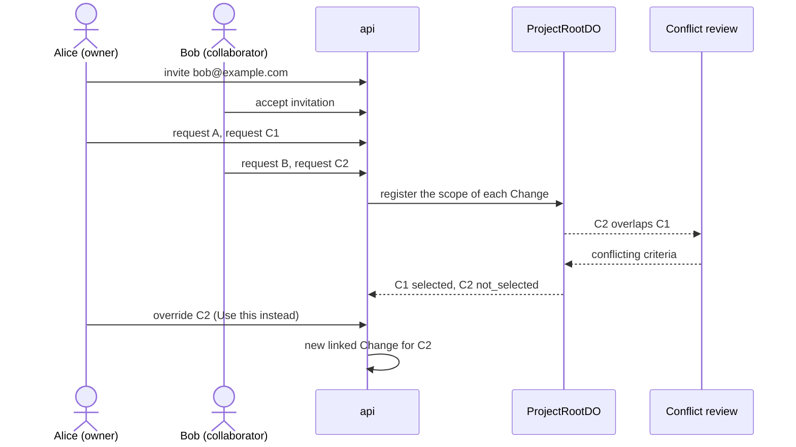

# Shared requests demo

This runbook shows two people who change one live Project at the same time. Alice owns the Project and Bob is a collaborator. Four requests run in parallel, and one pair of requests conflicts. The design is in [shared-projects.md](../architecture/shared-projects.md). The API is in [protocols](../protocols/README.md).

Use production (`https://rhumbatron.com`). You need two accounts with different email addresses and two browser profiles. Alice must own a Project whose live app is a daily planner: one section per day with checklist items.

## Requests

| Name | Requester | Text |
|---|---|---|
| A | Alice | `Show how many items are left next to each day's heading` |
| B | Bob | `Add a Clear completed button to each day that deletes that day's checked items.` |
| C1 | Alice | `Change the page background to dark navy with white text.` |
| C2 | Bob | `Change the page background to light yellow.` |

C1 and C2 ask for different backgrounds, so they conflict. A and B do not conflict with any other request.

## Steps

1. Sign in as Alice. Open the live Project.
2. Click Share. Enter the email of Bob. Click Send.
3. Make sure that the Share dialog shows a pending invitation for Bob.
4. Sign in as Bob in the second browser profile.
5. Open the Projects page. Find "Shared with you". Make sure that the invitation names Alice and the Project.
6. Click Accept. Make sure that the Project opens and shows the role `collaborator`.
7. Make sure that Bob does not see Approve, Promote, Share, or Remove buttons.
8. Within one minute, send the requests: Alice sends A, then C1. Bob sends B, then C2.
9. Open the Change page of each request. Make sure that the Requests panel shows the requester of each Change.

Alice and Bob must send the four requests within about one minute. The conflict check compares each Change with the earlier Changes that have a scope.

## Expected result

| Request | Result |
|---|---|
| A | Ships. |
| B | Ships. |
| C1 | Ships. |
| C2 | Status `not_selected`. |

For C2, check these items:

1. The Change page shows "Not selected" once, with the reason "conflicts with Alice's request (owner priority)".
2. The Conflicting requests card shows both goals, both requesters, and the criteria that conflict.
3. The card links to C1.
4. Bob sees the same card on his page.
5. The Changes A, B, and C1 reach `completed`, and the live app shows the three features.

If Bob calls an owner-only route, the API returns 403.

## Owner override

1. Sign in as Alice. Open the Change C2.
2. On the Conflicting requests card, click "Use this instead".
3. Make sure that a new Change opens. It has the goal and the requester of C2.
4. Make sure that the new Change links to C2 (`supersedesChangeId`) and that its outcome kind is `replaces`.
5. If C1 has not promoted, make sure that C1 is cancelled with the reason that the owner replaced it. If C1 has promoted, the new Change builds on the promoted state.
6. Wait for the new Change to finish. Open the live app and make sure that the light yellow background shows.

An override works only on a Change with the status `not_selected` or `awaiting_owner`. Any other status returns 409. Bob cannot override. The API returns 403.

## Cost

- Each request has a budget of about 1 USD.
- A Sonnet review runs for each pair of overlapping requests. One review costs about one cent.
- The demo has one overlapping pair, so it adds about one cent.
- Model spend counts against the monthly cap of 100 USD for prod (ADR 0021). Run `bun run cost:report` before and after the demo ([costs.md](../operations/costs.md)).

## Cleanup

1. Sign in as Alice. Open the Share dialog. Remove Bob from the members list.
2. Revoke any invitation that is still pending.
3. Remove the demo Project when you no longer need it. Only the owner can do this.
4. Run `bun run cost:report` and make sure that no compute is active.
