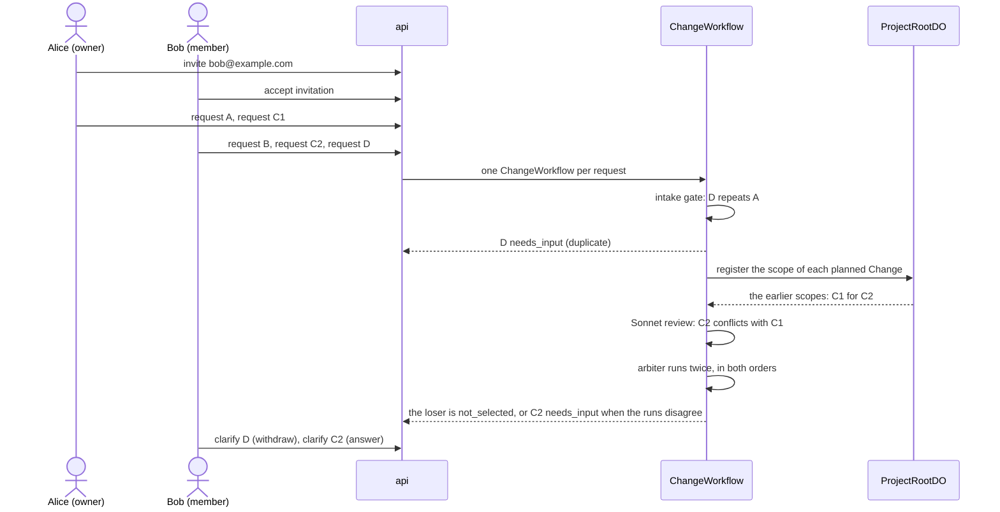

# Shared requests demo

This runbook shows two people who change one live Project at the same time. Alice owns the Project. Bob is a member. Before the demo, Alice turns off "Member requests need review" in Settings, so Bob's requests go to the system at once (ADR 0028). Five requests run in parallel. One pair conflicts, and one request repeats another. The system decides between the requests, and a role never decides (ADR 0025). The design is in [shared-projects.md](../architecture/shared-projects.md). The API is in [protocols](../protocols/README.md).

Use prod (`https://rhumbatron.com`). You need two accounts with different email addresses and two browser profiles. Alice must own a Project whose live app is a daily planner, with one section per day and checklist items in each section.

## Requests

| Name | Requester | Text |
|---|---|---|
| A | Alice | `Show how many items are left next to each day's heading` |
| B | Bob | `Add a Clear completed button to each day that deletes that day's checked items.` |
| C1 | Alice | `Change the page background to dark navy with white text.` |
| C2 | Bob | `Change the page background to light yellow.` |
| D | Bob | `Add a count of items left` |

C1 and C2 ask for different backgrounds, so they conflict. D repeats A. A and B do not conflict with another request.

## Steps

1. Sign in as Alice. Open the live Project.
2. Click Share. Enter the email of Bob. Click Invite.
3. Make sure that the Share dialog shows a pending invitation for Bob.
4. Sign in as Bob in the second browser profile.
5. Open the Projects page. Find "Shared with you". Make sure that the invitation names Alice and the Project.
6. Click Accept. Make sure that the Project opens and shows Members, not Share.
7. Make sure that Bob does not see Approve, Promote, Share, or Remove buttons.
8. Send the requests within one minute. Alice sends A, then C1. Bob sends B, then C2, then D.
9. Open the Project overview. Make sure that the "Requested by" column of the Changes table names the requester of each Change.

The conflict check compares each Change with the earlier Changes that registered a scope and are still open.

## Expected result

| Request | Result |
|---|---|
| A | Ships. |
| B | Ships. |
| C1 | Ships when both arbiter runs prefer C1. Status `not_selected` when both runs prefer C2. |
| C2 | Status `not_selected` when both arbiter runs prefer C1. Ships when both runs prefer C2. Status `needs_input` with kind `conflict` when the runs disagree. |
| D | Status `needs_input` with kind `duplicate` (or `unclear`) before planning. |

For the conflict, check these items:

1. A `not_selected` Change shows the reason once. The reason names the winning request and quotes the arbiter rationale. `decidedBy` is `system:arbiter`.
2. A `needs_input` Change shows the question with both backgrounds. Bob and Alice both get the notification.
3. The "Conflicting requests" card shows both goals, both requesters, the criteria that conflict, and a link to the other request.
4. The winning Changes reach `completed`, and the live app shows their features.

For D, check that the question quotes the criterion of A that already counts the items left, and that D has no Task.

If Bob calls a route for the owner and the admins, the API returns 403.

## Answer the questions

1. Sign in as Bob. Open the Change D. Click Withdraw. Make sure that D is `cancelled` with the reason "Withdrawn by the requester".
2. If C2 is `needs_input`, open it. Answer the question, for example "Use light yellow only on the weekend sections". Make sure that C2 goes back to `compiling` and plans with the answer.
3. Sign in as Alice. Make sure that Alice can answer a question on a Change of Bob.
4. Make sure that Bob cannot raise a budget or cancel a Change of Alice. The API returns 403.

A Change gets at most 3 rounds of questions. Rhumbatron cancels a Change that gets no answer for 7 days.

## Cost

- Each request gets the Project default budget. That budget is 3 USD when the Project sets none ([protocols](../protocols/README.md#project-settings)).
- The intake gate makes one Clef-flash call per request. For a related request, it adds two Sonnet coverage runs, one in each order.
- A Sonnet review runs for each pair of overlapping requests, at most 4 for each Change. A conflict adds two arbiter runs.
- Model spend counts against the prod cap of 100 USD per calendar month (ADR 0021). Run `bun run cost:report` before and after the demo ([costs.md](../operations/costs.md)).

## Cleanup

1. Sign in as Alice. Open the Share dialog. Remove Bob from the members list.
2. Revoke each invitation that is still pending.
3. Delete the demo Project when you do not need it. Only the owner can do this.
4. Run `bun run cost:report`. Make sure that no compute is active.
