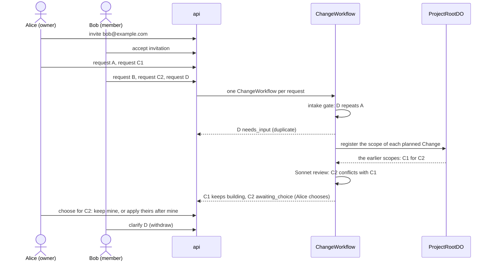

# Shared requests demo

This runbook shows two people who change one live Project at the same time. Alice owns the Project. Bob is a member. Before the demo, Alice turns off "Member requests need review" in Settings, so Bob's requests go to the system at once (ADR 0028). Five requests run in parallel. One pair conflicts, and one request repeats another. No role decides between the requests. The system compares them, and in a conflict between two people the earlier requester chooses (ADR 0025, ADR 0032). The design is in [shared-projects.md](../architecture/shared-projects.md). The API is in [protocols](../protocols/README.md).

Use prod (`https://rhumbatron.com`). You need two accounts with different email addresses and two browser profiles. Alice must own a Project whose live app is a daily planner, with one section per day and checklist items in each section.

## Requests

| Name | Requester | Text |
|---|---|---|
| A | Alice | `Show how many items are left next to each day's heading` |
| B | Bob | `Add a Clear completed button to each day that deletes that day's checked items.` |
| C1 | Alice | `Change the page background to dark navy with white text.` |
| C2 | Bob | `Change the page background to light yellow.` |
| D | Bob | `Add a count of items left` |

C1 and C2 ask for different backgrounds, so they conflict. D repeats A. A and B do not conflict with another request.

## Steps

1. Sign in as Alice. Open the live Project.
2. Click Share. Enter the email of Bob. Click Invite.
3. Make sure that the Share dialog shows a pending invitation for Bob.
4. Sign in as Bob in the second browser profile.
5. Open the Projects page. Find "Shared with you". Make sure that the invitation names Alice and the Project.
6. Click Accept. Make sure that the Project opens and shows Members, not Share.
7. Make sure that Bob does not see Approve, Promote, Share, or Remove buttons.
8. Send the requests within one minute. Alice sends A, then C1. Bob sends B, then C2, then D.
9. Open the Project overview. Make sure that the "Requested by" column of the Changes table names the requester of each Change.

The conflict check compares each Change with the earlier Changes that registered a scope and are still open.

## Expected result

| Request | Result |
|---|---|
| A | Ships. |
| B | Ships. |
| C1 | Ships. It is the earlier request, so it keeps building. |
| C2 | Status `awaiting_choice` until Alice chooses. "Keep mine": status `not_selected`. "Apply theirs after mine": status `queued`, then it plans after C1 ships and ships on top of it. |
| D | Status `needs_input` with kind `duplicate` (or `unclear`) before planning. |

For the conflict, check these items:

1. C2 reads "Waiting for Alice to choose" on its Change page and on the Board. It has no Task while it waits.
2. Alice gets `request_choice_needed`. C1 shows "Bob's request conflicts with yours" with both backgrounds and the buttons "Keep mine" and "Apply theirs after mine". Bob and the admins see who chooses, but no buttons.
3. After "Keep mine", C2 is `not_selected` with the reason `Not selected: Alice chose to keep their version of "<C1>".` After "Apply theirs after mine", Bob gets `request_choice_made`, and C2 plans on the tree that has C1.
4. The "Conflicting requests" card shows both goals, both requesters, the criteria that conflict, and a link to the other request.
5. The Changes that ship reach `completed`, and the live app shows their features.

For D, check that the question quotes the criterion of A that already counts the items left, and that D has no Task.

If Bob calls a route for the owner and the admins, the API returns 403.

## Answer the questions

1. Sign in as Bob. Open the Change D. Click Withdraw. Make sure that D is `cancelled` with the reason "Withdrawn by the requester".
2. Make sure that Bob cannot choose for C2. The API returns 403.
3. Sign in as Alice. Open C1 and choose "Apply theirs after mine". Make sure that C2 is `queued`, then plans after C1 ships.
4. Make sure that Bob cannot raise a budget or cancel a Change of Alice. The API returns 403.

The intake gate asks at most one round for a request. A Change gets at most 3 rounds of questions in total. Rhumbatron cancels a Change that gets no answer for 7 days.

## Cost

- Each request gets the Project default budget. That budget is 3 USD when the Project sets none ([protocols](../protocols/README.md#project-settings)).
- The intake gate makes one Clef-flash call per request. For each related request that Clef-flash does not clear, it adds two Sonnet coverage runs, one in each order. A request that Clef-flash does not clear as buildable adds one Sonnet clarity call.
- A Sonnet review runs for each pair of overlapping requests, at most 4 for each Change. A conflict between two people adds no model call. "Apply theirs after mine" adds one plan of C2.
- Model spend counts against the prod cap of 100 USD per calendar month (ADR 0021). Run `bun run cost:report` before and after the demo ([costs.md](../operations/costs.md)).

## Cleanup

1. Sign in as Alice. Open the Share dialog. Remove Bob from the members list.
2. Revoke each invitation that is still pending.
3. Delete the demo Project when you do not need it. Only the owner can do this.
4. Run `bun run cost:report`. Make sure that no compute is active.
