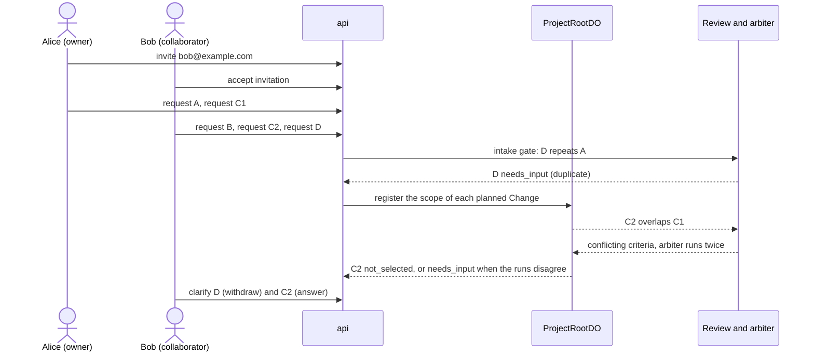

# Shared requests demo

This runbook shows two people who change one live Project at the same time. Alice owns the Project and Bob is a collaborator. Four requests run in parallel, one pair of requests conflicts, and one request repeats another. The system decides; a role never does (ADR 0025). The design is in [shared-projects.md](../architecture/shared-projects.md). The API is in [protocols](../protocols/README.md).

Use production (`https://rhumbatron.com`). You need two accounts with different email addresses and two browser profiles. Alice must own a Project whose live app is a daily planner: one section per day with checklist items.

## Requests

| Name | Requester | Text |
|---|---|---|
| A | Alice | `Show how many items are left next to each day's heading` |
| B | Bob | `Add a Clear completed button to each day that deletes that day's checked items.` |
| C1 | Alice | `Change the page background to dark navy with white text.` |
| C2 | Bob | `Change the page background to light yellow.` |
| D | Bob | `Add a count of items left` |

C1 and C2 ask for different backgrounds, so they conflict. D repeats A. A and B do not conflict with any other request.

## Steps

1. Sign in as Alice. Open the live Project.
2. Click Share. Enter the email of Bob. Click Send.
3. Make sure that the Share dialog shows a pending invitation for Bob.
4. Sign in as Bob in the second browser profile.
5. Open the Projects page. Find "Shared with you". Make sure that the invitation names Alice and the Project.
6. Click Accept. Make sure that the Project opens and shows the role `collaborator`.
7. Make sure that Bob does not see Approve, Promote, Share, or Remove buttons.
8. Within one minute, send the requests: Alice sends A, then C1. Bob sends B, then C2, then D.
9. Open the Change page of each request. Make sure that the Requests panel shows the requester of each Change.

Alice and Bob must send the four requests within about one minute. The conflict check compares each Change with the earlier Changes that have a scope.

## Expected result

| Request | Result |
|---|---|
| A | Ships. |
| B | Ships. |
| C1 | Ships, unless the arbiter prefers C2. |
| C2 | Status `not_selected` when both arbiter runs prefer C1, else `needs_input` with kind `conflict`. |
| D | Status `needs_input` with kind `duplicate` (or `unclear`) before any planning. |

For C2, check these items:

1. A `not_selected` Change shows the reason once. It names Alice's request and quotes the arbiter rationale. `decidedBy` is `system:arbiter`.
2. A `needs_input` Change shows the question with both backgrounds, and Bob and Alice both get the notification.
3. The Conflicting requests card shows both goals, both requesters, the criteria that conflict, and links to C1.
4. The Changes A, B, and C1 reach `completed`, and the live app shows the three features.

For D, check that the question quotes the criterion of A that already counts the items left, and that no Task exists for D.

If Bob calls an owner-only route, the API returns 403.

## Answer the questions

1. Sign in as Bob. Open the Change D. Click Withdraw. Make sure that D is `cancelled` with the reason "Withdrawn by the requester" and the outcome `duplicate`.
2. If C2 is `needs_input`, open it. Answer the question, for example "Use light yellow only on the weekend sections". Make sure that C2 returns to `compiling` and then plans with the answer.
3. Sign in as Alice. Make sure that Alice can answer a question on Bob's Change, and that Bob cannot raise a budget or cancel Alice's Change (the API returns 403).

A Change gets at most 3 rounds of questions. After 7 days without an answer it is cancelled.

## Cost

- Each request has a budget of about 1 USD.
- A Sonnet review runs for each pair of overlapping requests. One review costs about one cent. A conflict adds two arbiter runs.
- The intake gate costs one Clef-flash call per request and two Sonnet coverage runs when a related request is found.
- The demo adds about ten cents.
- Model spend counts against the monthly cap of 100 USD for prod (ADR 0021). Run `bun run cost:report` before and after the demo ([costs.md](../operations/costs.md)).

## Cleanup

1. Sign in as Alice. Open the Share dialog. Remove Bob from the members list.
2. Revoke any invitation that is still pending.
3. Remove the demo Project when you no longer need it. Only the owner can do this.
4. Run `bun run cost:report` and make sure that no compute is active.
