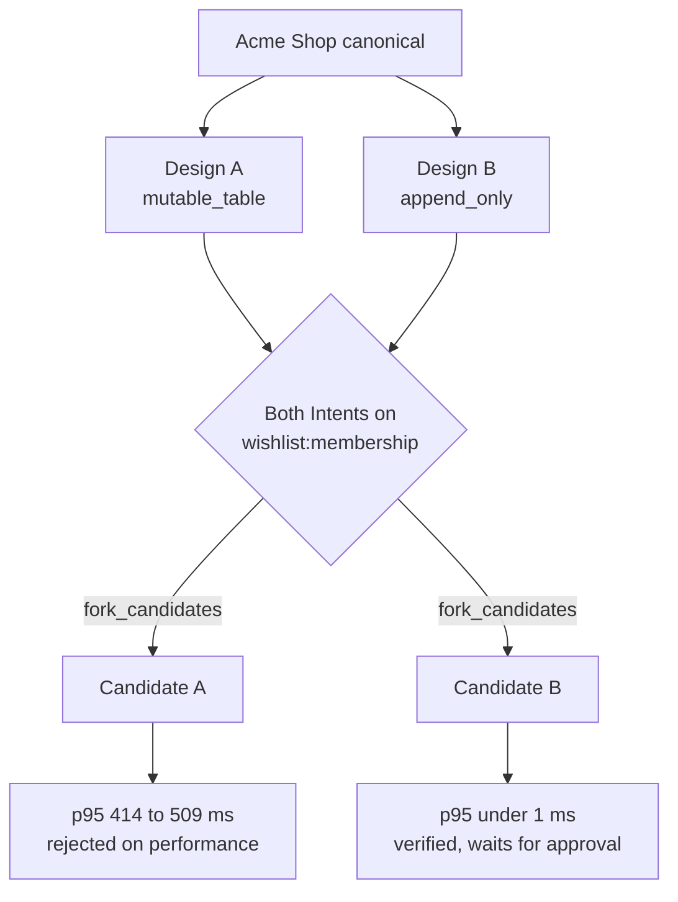

# Wishlist design-conflict fixture (P9-08)

This fixture is the repeatable source of the demo conflict (AGENTS.md sections 4, 32.4, 54, 55).
It holds two complete implementations of shared wishlists on top of `fixtures/acme-shop`. Rhumbatron
publishes them as real ChangeSets without a model call. Executable Evidence decides the winner.

## Designs

| | Design A | Design B |
|---|---|---|
| Data model | Normalized mutable tables. Remove and revoke update `wishlist_collaborators` rows in place. | Append-only membership event log. Each event updates a materialized current-member set. |
| Read path | Every request computes access from the collaborator table. That is one scan per check, and one check per item for `addedByRole`. | Reads use the materialized set: one map lookup per check. |
| Task key | `wishlist-membership-table` | `wishlist-membership-log` |

The two designs share the HTTP contract, the page `public/wishlist.html`, the acceptance and
authorization tests, and the benchmark (`fixtures/wishlist/files/shared`). Only
`src/wishlist/model.ts` and one model test differ. Both Intents name `wishlist:membership` and
declare incompatible storage models (`mutable_table` and `append_only`). The deterministic
detector therefore reports a confirmed conflict with `fork_candidates`.

## Why Design A fails

`bench/wishlist.bench.ts` loads the same seeded dataset for both designs: 30,001 wishlists,
2,000 products, about 360,000 memberships and 240,000 items. It then sends the traffic of a busy
shared list to the newest list, which has 42 members and 120 items. The traffic is 80% reads and
20% item adds and removes, as a collaborator. Design A does about 120 scans of the 360,000-row
membership table per read. This cost comes from recomputing access from the table. The benchmark
contains no sleep. Design B does 120 map lookups. `bun run bench` runs the cart and wishlist benchmarks and reports the
slowest endpoint's p95 as the API p95.

Measured on an Apple Silicon laptop (a local run of both designs):

| Check | Design A | Design B |
|---|---|---|
| build (`bun run typecheck`) | pass | pass |
| unit (`bun test`) | 25 pass | 25 pass |
| contract | 8 added, all declared | 8 added, all declared |
| protected Cart invariant | 10 pass | 10 pass |
| security (`--test-name-pattern authorization`) | 6 pass | 6 pass |
| performance (p95 < 200 ms) | 414 to 509 ms: fail | 0.07 to 0.10 ms: pass |

The Project Sandbox (`basic`, 1/4 vCPU) is slower. There, A is slower still, and B stays far
below the budget. The wishlist benchmark stops after 15 s with at least 12 samples, so A stays
inside the 120 s check timeout.

With the page in `public/`, the Candidate plan also has the Browser Run check (risk `high`, UI
touched). The shop root has no `data-testid="wishlist"`, so the browser check runs its section
35 API scenario. This contract satisfies that scenario.

## Pipeline

1. `POST /v1/changes/:changeId/fixture-changesets` `{"design": "a" | "b" | "both"}`. The route
   answers 404 unless `FIXTURES_ENABLED` is `"true"` or `ENVIRONMENT` is `local`
   (`workers/api/src/fixtures.ts`). Terraform sets `FIXTURES_ENABLED = "true"` in prod.
   The route requires auth, Project membership, an active Project, and a Change in `created`
   (unplanned) or `verifying`. It queues `fixture.publish` on the integration Queue. `GET` on the
   same path shows the published designs.
2. The integration Worker (`workers/integration/src/fixture-changesets.ts`) does these actions
   for each design:
   - It records a Work Graph Task (`completed`, model policy `fixture`, `touchesAuthorization`).
   - It forks the canonical repo into `ws-<run>`.
   - It commits the design on the canonical commit with isomorphic-git. The commit date is fixed,
     so a retry is a no-op.
   - It inserts a `task_runs` row (tier `fixture`, zero model calls) and a `proposed` ChangeSet.

   It sets the Change to `verifying` with risk `high`, the acceptance criteria, and the Cart
   invariant. It then declares both Intents on the Change's ResourceShardDO. It records the
   conflict and its Challenge with the agents' detector and conflict ID rule. Events use actor
   `system:fixture`.
3. `POST /v1/changes/:changeId/candidates` takes an optional `{"changeSetIds": [...]}` subset, so
   design A and design B become separate Candidates. Without a body it composes every proposed
   ChangeSet.

Each Workspace fork has a `task_runs` row, so Project cleanup and the fork sweep delete it.

## Setup

1. Create the Acme Shop Project with `POST /v1/fixtures/projects` (see [runbook.md](runbook.md)).
2. Create a Change on it with `startPlanning: false`, so the Root Planner does not run.
3. Send `POST /v1/changes/:changeId/fixture-changesets` with `{"design": "both"}`.

## Limits

- The shop's store is in memory per isolate. On the deployed shop Worker, wishlist state and
  share links are lost on an isolate restart. Isolates do not share them.
- The fixture applies to the Acme Shop baseline. A promotion can change `src/app.ts`,
  `src/store.ts`, `package.json`, `README.md`, or `public/index.html`. After that, publishing
  stops with an anchor error and does not commit a wrong patch.
