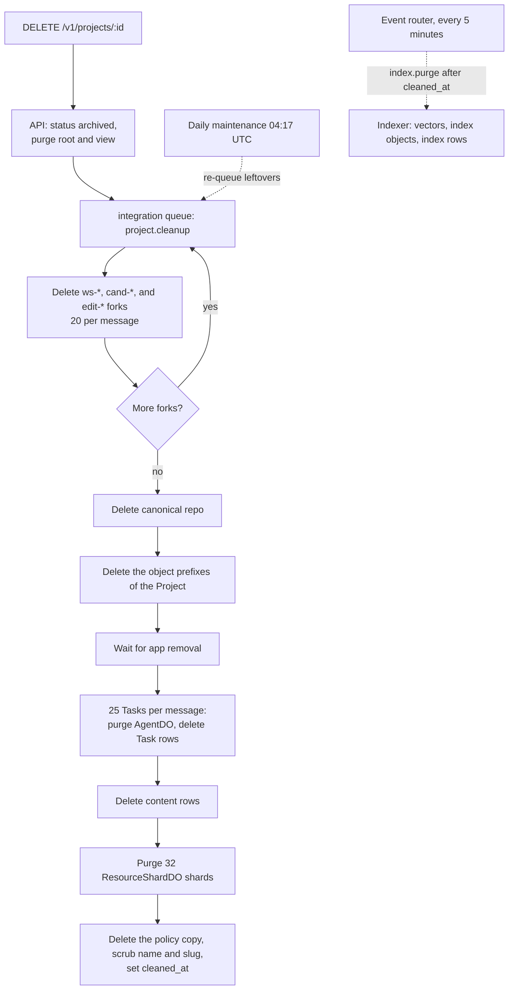

# Resource Cleanup and Retention Runbook

This runbook covers smoke Project cleanup, Project deletion, the daily fork sweep, and retention. Cleanup keeps the `git-data`, `objects-data`, and `core-data` volumes small ([ADR 0010](../adr/0010-artifacts-project-source.md)).

## 1. Smoke Project cleanup

`scripts/smoke.ts` makes temporary Projects in the stack. `scripts/cleanup-projects.ts` deletes them through `DELETE /v1/projects/:id` on `https://api.rhumbatron.localhost`, as the Clerk smoke user.

- The script selects the active Projects of the smoke user with a slug that matches `/^(smoke|sandbox)-\d+$/`.
- It keeps every other Project, for example a demo Project.
- `--all` selects every active Project of the smoke user.
- `scripts/e2e.ts` and `scripts/journeys.ts` delete their own Projects at the end of each run.

Do this procedure:

1. Set `CLERK_SECRET_KEY` and `CLERK_SMOKE_USER_ID` for the Clerk development instance.
2. Set `NODE_EXTRA_CA_CERTS=.local-ca.crt` ([local-stack.md](./local-stack.md)).

3. List the matches. This command changes nothing.
   ```sh
   bun run cleanup:projects --dry-run
   ```
4. Delete the matches.
   ```sh
   bun run cleanup:projects
   ```

## 2. Project deletion

Only the owner can delete a Project. `DELETE /v1/projects/:id` does three steps:

1. It sets the Project to `archived` in the product database.
2. It purges the `ProjectRootDO` and `ProjectViewDO` actors of the Project.
3. It queues `project.cleanup` on the `integration` command queue.

Then `cleanupProject` in `workers/integration/src/project-cleanup.ts` deletes all the data that the Project made.



Cleanup skips a Project that is not `archived`. Each queue message does a bounded part of the work. The next delivery continues from the point where the last delivery stopped. Every step is safe to repeat. Cleanup does the steps in this order:

1. Purge `ProjectRootDO` and `ProjectViewDO` again. Mark every `app_deployments` row `removed`.
2. Delete every Workspace fork (`ws-*`), Candidate fork (`cand-*`), and code edit session fork (`edit-*`) that `task_runs`, `candidates`, and `code_sessions` record, 20 per message.
3. Delete the canonical repository (`ARTIFACTS.delete(projectId)`).
4. Delete every object in the evidence bucket under these prefixes, each followed by the Project ID: `source/`, `context/`, `apps/`, `app-previews/`, `evidence/`, `work-graphs/`, and `workspace/`.
5. Wait until `removeApp` on the apps service clears the app data stores.
6. For each batch of 25 Tasks, purge the `AgentDO` of each Task, then delete the `task_dependencies`, `decision_receipts`, `task_runs`, and `tasks` rows.
7. Delete the rows of `evidence_index`, `approvals`, `conflicts`, `changesets`, `candidates`, `change_decisions`, `live_removals`, `changes`, `request_conflicts`, `goal_suggestions`, `project_policies`, `project_members`, `project_invitations`, `agents`, `dead_letters`, `releases`, `project_events`, `code_session_files`, `code_session_commands`, `code_sessions`, and `sandbox_awake`. Each statement deletes at most 500 rows. Each message runs at most 40 statements.
8. Purge the 32 `ResourceShardDO` shards (Claims, Intents, Challenges, outbox). This step is the last step, so a late Claim cannot fill a shard again.
9. Delete the policy copy in `CONFIG`. Set the name to `Deleted project` and the slug to `deleted-<id>`. Set `cleaned_at`.

The indexer deletes the vectors in `MEMORY`, the `index/` objects, and the `project_indexes` and `project_vectors` rows (`index.purge`). Every 5 minutes, the event router sends `index.purge` for each archived Project that has `cleaned_at` and an index row. The daily maintenance also sends it. The indexer deletes the rows last, so the sweep stops when the purge is complete.

Cleanup keeps these records.

| Kept | Reason |
|---|---|
| The `projects` row (ID, organization, status, generation, timestamps), with the name and slug scrubbed | Archive record. The slug is free to use again. |
| One `app_deployments` row for the production app host | The host answers `410`. The row has the host label and the `removed` status only. |
| `usage_counters` | The Anthropic, Sandbox, browser, and build meters are global rows. A deletion cannot free budget. The budget meters of the Project and its Changes (`project-usd-micro:<id>`, `change-usd-micro:<id>`) hold only an ID and an amount, and they stay. |
| The `events/` archive in the object store, and the event streams | All Projects share them. The event streams keep Events for 7 days. Core deletes archive objects after 365 days. |
| Organization, user, and membership rows; `notification_reads`; `processed_events` | They are not Project data. |
| The Project Sandbox | sandboxd removes it with its disk after 2 idle minutes, so it holds no data. |

## 3. Daily fork sweep

`sweepForks` in `workers/integration/src/project-cleanup.ts` deletes the forks of active Projects that no Candidate can need again. It deletes a fork 30 days after its run or Candidate finishes (`FORK_RETENTION_DAYS`).

- Workspace forks (`ws-*`): runs that failed, runs that completed without a ChangeSet, and runs of a Change that is `completed`, `cancelled`, or `failed`.
- Candidate forks (`cand-*`): Candidates that are `rejected`, `stale`, or `promoted`. The sweep deletes a promoted fork only after it confirms that canonical `main` contains the composed commit.
- Code edit sessions: the sweep ends each open session that is 10 minutes idle or 2 hours old (`expireCodeSessions` in `workers/integration/src/code-sessions.ts`). It ends at most 50 sessions and deletes at most 50 left forks per run. It deletes the session fork and the edits. It also deletes a session fork that a failed delete left. A session that passes a limit also ends at its next request.

The sweep deletes at most 20 repositories per message. It sets `fork_deleted_at` in the product database, so a retry deletes nothing twice.

The event router's per-minute sweep queues one `forks.sweep` each day at 04:17 UTC (`workers/event-router/src/maintenance.ts`). The same tick queues `project.cleanup` again for at most 10 archived Projects with leftovers. It also queues `index.build` for at most 10 active Projects without a ready index. Core runs the sweep at the start of each minute (`services/core/src/main.ts`). The sweep runs only while the stack runs.

## 4. Retention

Core runs the object expiry of `services/core/src/expiry.ts` on the object store (`objects`, versitygw). The expiry deletes an object by its key prefix and its upload time:

| Prefix | Age at deletion |
|---|---|
| `app-previews/` | 7 days |
| `tmp/` | 7 days |
| `events/` | 365 days |

Project cleanup and app removal delete the other objects.

| Resource | Scope | Retention | Managed by |
|---|---|---|---|
| Task and Candidate forks | `ws-*`, `cand-*` | 30 days after the run or Candidate finishes | `sweepForks` |
| Code edit session forks | `edit-*` | Until the session ends (at most 2 hours, or the next daily sweep) | `endSession`, `expireCodeSessions` |
| Project repositories | One per Project, named by the Project ID | Until the Project is deleted | `cleanupProject` |
| Preview rows and app data stores | `app_deployments` rows of `preview:*` channels | 7 days | `expirePreviews` in `workers/integration/src/app-release.ts` |
| Preview bundles | `app-previews/` | 7 days, or sooner when the Project is deleted or its app is removed | `expireObjects`, `cleanupProject`, `removeApp` |
| Temporary objects | `tmp/` | 7 days | `expireObjects` |
| Evidence | `evidence/` | Until the Project is deleted | `cleanupProject` |
| Project objects | `source/`, `context/`, `apps/`, `work-graphs/`, `workspace/` | Until the Project is deleted | `cleanupProject` |
| Event archive | `events/` | 365 days | `expireObjects` |
| Event streams | `EVENTS_00` to `EVENTS_07` | 7 days | JetStream `max_age` |
| Command stream | `COMMANDS` | Until a consumer acknowledges the command, at most 14 days | JetStream work-queue retention, `max_age` |
| Admin audit rows | `admin_audit` | 365 days | `workers/api/src/access.ts` |
| Metrics rows | `METRICS`, `EVENT_METRICS` | 30 days | `packages/platform/src/sql/metrics.ts`, at core start |

`docker compose down -v` deletes every volume, and with it all of the data above ([local-stack.md](./local-stack.md)).
