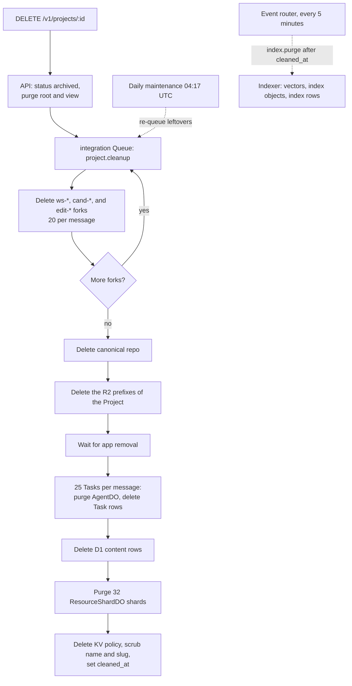

# Resource Cleanup and Retention Runbook

This runbook covers smoke Project cleanup, Project deletion, the daily fork sweep, and R2 retention. Cleanup keeps Artifacts, R2, and D1 usage within the free and included limits ([ADR 0010](../adr/0010-artifacts-project-source.md)).

## 1. Smoke Project cleanup

`scripts/smoke.ts` creates temporary Projects on prod. `scripts/cleanup-projects.ts` deletes them through `DELETE /v1/projects/:id` on `https://api.rhumbatron.com`, as the Clerk smoke user.

- The script selects the active Projects of the smoke user with a slug that matches `/^(smoke|sandbox)-\d+$/`.
- It keeps every other Project, for example a demo Project.
- `--all` selects every active Project of the smoke user.
- `scripts/e2e.ts` and `scripts/journeys.ts` delete their own Projects at the end of each run.

Set `CLERK_SECRET_KEY` and `CLERK_SMOKE_USER_ID` for the prod Clerk instance (see the root `README.md`). Then:

1. List the matches. This command changes nothing.
   ```sh
   bun run cleanup:projects --dry-run
   ```
2. Delete the matches.
   ```sh
   bun run cleanup:projects
   ```

## 2. Project deletion

Only the owner can delete a Project. `DELETE /v1/projects/:id` sets the Project to `archived` in D1, purges its `ProjectRootDO` and `ProjectViewDO`, and queues `project.cleanup` on the integration Queue. Then `cleanupProject` in `workers/integration/src/project-cleanup.ts` deletes everything that the Project created.



Cleanup skips a Project that is not `archived`. Each queue message does a bounded part of the work. The next delivery continues where the last one stopped. Every step is safe to repeat. Cleanup does the steps in this order:

1. Purge `ProjectRootDO` and `ProjectViewDO` again. Mark every `app_deployments` row `removed`.
2. Delete every Workspace fork (`ws-*`), Candidate fork (`cand-*`), and code edit session fork (`edit-*`) that `task_runs`, `candidates`, and `code_sessions` record, 20 per message.
3. Delete the canonical repository (`ARTIFACTS.delete(projectId)`).
4. Delete every object in the evidence bucket under these prefixes, each followed by the Project ID: `source/`, `context/`, `apps/`, `app-previews/`, `evidence/`, `work-graphs/`, and `workspace/`.
5. Wait until `removeApp` on the apps Worker clears the app data stores.
6. For each batch of 25 Tasks, purge the `AgentDO` of each Task, then delete the `task_dependencies`, `decision_receipts`, `task_runs`, and `tasks` rows.
7. Delete the rows of `evidence_index`, `approvals`, `conflicts`, `changesets`, `candidates`, `change_decisions`, `changes`, `request_conflicts`, `goal_suggestions`, `project_policies`, `project_members`, `project_invitations`, `agents`, `dead_letters`, `releases`, `project_events`, `code_session_files`, `code_session_commands`, and `code_sessions`. Each statement deletes at most 500 rows. Each message runs at most 40 statements.
8. Purge the 32 `ResourceShardDO` shards (Claims, Intents, Challenges, outbox). This step is last, so a late Claim cannot fill a shard again.
9. Delete the KV policy copy. Set the name to `Deleted project` and the slug to `deleted-<id>`. Set `cleaned_at`.

The indexer Worker deletes the Vectorize vectors, the `index/` objects, and the `project_indexes` and `project_vectors` rows (`index.purge`). Every 5 minutes, the event router sends `index.purge` for each archived Project that has `cleaned_at` and still has an index row. The daily maintenance also sends it. The indexer deletes the rows last, so the sweep stops when the purge is complete.

Cleanup keeps these records.

| Kept | Reason |
|---|---|
| The `projects` row (ID, organization, status, generation, timestamps), with the name and slug scrubbed | Archive record. The slug is free to use again. |
| One `app_deployments` row for the production app host | The host answers `410`. The row has the host label and the `removed` status only. |
| `usage_counters` | The Anthropic, Sandbox, Browser Run, and build meters are global rows. A deletion cannot free budget. The budget meters of the Project and its Changes (`project-usd-micro:<id>`, `change-usd-micro:<id>`) hold only an ID and an amount, and they stay. |
| The R2 `events/` archive and K2 events | All Projects share them. The R2 lifecycle rule deletes `events/` after 365 days. K2 keeps events for 7 days. |
| Organization, user, and membership rows; `notification_reads`; `processed_events` | They are not Project data. |
| The Project Sandbox container | It keeps no data after its 2-minute sleep. A wake only to destroy it uses Sandbox hours. |

## 3. Daily fork sweep

`sweepForks` in `workers/integration/src/project-cleanup.ts` deletes the forks of active Projects that no Candidate can need again. A fork is deleted 30 days after its run or Candidate finishes (`FORK_RETENTION_DAYS`).

- Workspace forks (`ws-*`): runs that failed, runs that completed without a ChangeSet, and runs of a Change that is `completed`, `cancelled`, or `failed`.
- Candidate forks (`cand-*`): Candidates that are `rejected`, `stale`, or `promoted`. A promoted fork is deleted only after the sweep confirms that canonical `main` contains the composed commit.
- Code edit sessions: the sweep ends each open session that is 10 minutes idle or 2 hours old (`expireCodeSessions` in `workers/integration/src/code-sessions.ts`, at most 50 sessions and 50 left forks per run). It deletes the session fork and the edits. It also deletes a session fork that a failed delete left. A session also ends at its next request after a limit.

The sweep deletes at most 20 repositories per message. It sets `fork_deleted_at` in D1, so a retry deletes nothing twice.

The event router cron queues one `forks.sweep` each day at 04:17 UTC (`workers/event-router/src/maintenance.ts`). The same tick re-queues `project.cleanup` for at most 10 archived Projects with leftovers. It also queues `index.build` for at most 10 active Projects that have no ready index. While `paused = true`, the cron does not run ([pause-resume.md](./pause-resume.md)).

## 4. Retention

| Resource | Scope | Retention | Managed by |
|---|---|---|---|
| Artifacts forks | `ws-*`, `cand-*` | 30 days after the run or Candidate finishes | `sweepForks` |
| Code edit session forks | `edit-*` | Until the session ends (at most 2 hours, or the next daily sweep) | `endSession`, `expireCodeSessions` |
| Canonical repositories | One per Project, named by the Project ID | Until the Project is deleted | `cleanupProject` |
| R2 event archive | `events/` | 365 days | R2 lifecycle rule (`envs/prod`, `modules/state`) |
| R2 Evidence | `evidence/` | Until the Project is deleted | `cleanupProject` |
| R2 temporary objects | `tmp/` | 7 days | R2 lifecycle rule |
| R2 preview bundles | `app-previews/` | 7 days | R2 lifecycle rule |
| R2 Project objects | `source/`, `context/`, `apps/`, `work-graphs/`, `workspace/` | Until the Project is deleted | `cleanupProject` |
| R2 incomplete multipart uploads | All prefixes | 1 day | R2 lifecycle rule |
