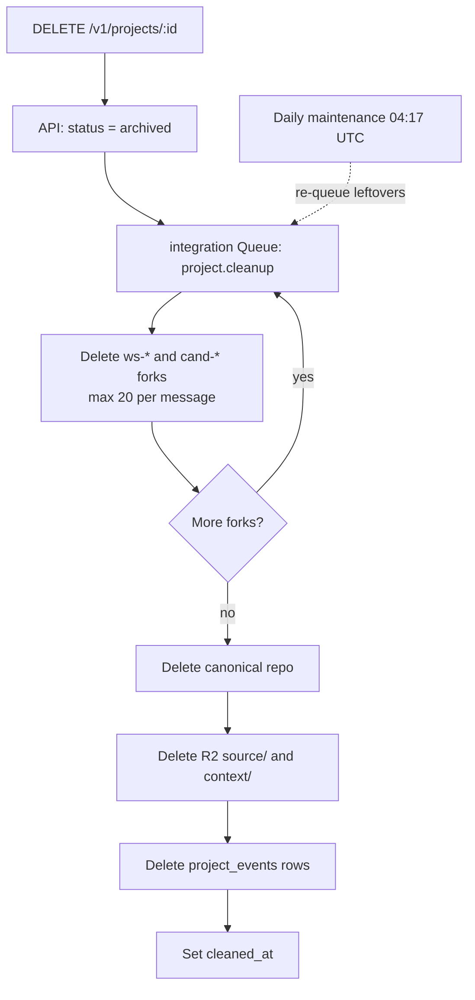

# Resource Cleanup and Retention Runbook

Operations guide for smoke test cleanup, project archiving, automated fork sweeping, and R2 object retention.

## Purpose

Rhumbatron manages Git repositories in Cloudflare Artifacts, scratch contexts in R2, and database records in D1. Regular cleanup keeps usage safely within Cloudflare free and included resource tiers (`AGENTS.md` sections 7 and 43, [ADR 0010](../adr/0010-artifacts-project-source.md)).

---

## 1. Smoke Project Cleanup (`cleanup:projects`)

Ephemeral projects created by automated smoke tests (`scripts/smoke.ts`) on `dev` are purged using `scripts/cleanup-projects.ts`.

- **Target Match**: Matches slugs conforming to `/^(smoke|sandbox)-\d+$/`.
- **Protected Slugs**: Explicitly keeps designated demo projects, including `acme-shop-demo`.

### Dry Run

Inspect which projects match without deleting anything:

```sh
bun run cleanup:projects --dry-run
```

Outputs listed projects, count of matched smoke projects, and kept projects.

### Real Execution

```sh
bun run cleanup:projects
```

Invokes `DELETE /v1/projects/:id` for each matched project using the Clerk smoke user credentials.

---

## 2. Project Archiving (`DELETE /v1/projects/:id`)

When a project is deleted via the API or UI, the API marks it `archived` in D1 and queues `project.cleanup` for the integration Worker (`workers/integration/src/project-cleanup.ts`):



1. **State Update**: The API has already set project status to `archived` in D1. Cleanup skips a Project that is not archived.
2. **Order of Deletion** (bounded per queue message):
   - **Workspace and Candidate Forks**: Deletes all active forks (`ws-*` and `cand-*`) recorded in D1 (`task_runs` and `candidates`) via `ARTIFACTS.delete()`.
   - **Canonical Repository**: Deletes the canonical project repository in Cloudflare Artifacts (`ARTIFACTS.delete(projectId)`).
   - **R2 Storage**: Lists and deletes all objects under prefixes `source/${projectId}/` and `context/${projectId}/`.
   - **Feed Purge**: Removes `project_events` rows for the project, and updates `projects.cleaned_at = now()`.
3. **Preserved Records**: Project rows remain in D1 with status `archived` and `cleaned_at` set for historical audit logs. Evidence objects in R2 are preserved until expired by bucket lifecycle rules.

---

## 3. Daily Fork Sweep (`forks.sweep`)

Active projects accumulate ephemeral forks during task execution and candidate verification. The daily sweep (`sweepForks` in `workers/integration/src/project-cleanup.ts`) prunes unneeded forks once retention expires:

- **Retention Periods** ([ADR 0017](../adr/0017-prod-environment.md)):
  - Dev: 7 days after completion.
  - Prod: 30 days after completion.
- **Forks Swept**:
  - **Workspace Forks (`ws-*`)**:
    - Task runs that failed.
    - Task runs that completed without producing a ChangeSet.
    - Task runs whose parent Change has ended (`completed`, `cancelled`, or `failed`).
  - **Candidate Forks (`cand-*`)**:
    - Candidates in `rejected` or `stale` states.
    - Candidates in `promoted` state, verified only after canonical `main` is confirmed to contain the composed commit.
- **Limits**: Deletes up to 20 repositories per message, updating `fork_deleted_at` in D1 to guarantee idempotency.
- **Schedule**: The event router's every-minute cron queues one `forks.sweep` per day at 04:17 UTC (`workers/event-router/src/maintenance.ts`). The same tick re-queues `project.cleanup` for up to 10 archived Projects with leftovers. While `paused = true`, the cron and therefore the sweep do not run.

---

## 4. Artifacts and R2 Retention Policy

| Resource | Scope / Prefix | Dev Retention | Prod Retention | Managed By |
|---|---|---|---|---|
| Artifacts Forks | `ws-*`, `cand-*` | 7 days post-run | 30 days post-run | `sweepForks` (D1 / Artifacts) |
| Canonical Repos | `proj_*` | Until project archive | Until project archive | `cleanupProject` |
| R2 Events Archive | `events/` | 30 days | 365 days | R2 bucket lifecycle rule |
| R2 Evidence | `evidence/` | 30 days | Indefinite (`null`) | R2 bucket lifecycle rule |
| R2 Temporary | `tmp/` | 7 days | 7 days | R2 bucket lifecycle rule |
| R2 Source / Context | `source/`, `context/` | Deleted on project archive | Deleted on project archive | `cleanupProject` |
