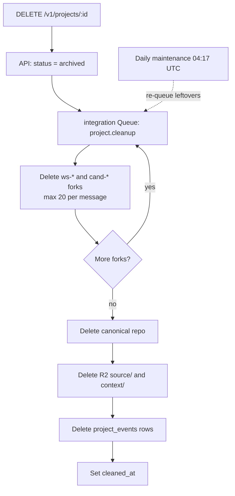

# Resource Cleanup and Retention Runbook

This runbook covers smoke-test cleanup, Project archive, the daily fork sweep, and R2 object retention.

## Purpose

Rhumbatron keeps Git repositories in Cloudflare Artifacts, scratch contexts in R2, and database records in D1. Regular cleanup keeps usage within the Cloudflare free and included tiers (`AGENTS.md` sections 7 and 43, [ADR 0010](../adr/0010-artifacts-project-source.md)).

---

## 1. Smoke Project Cleanup (`cleanup:projects`)

Automated smoke tests (`scripts/smoke.ts`) make temporary Projects on `dev`. `scripts/cleanup-projects.ts` deletes them.

- **Target match**: The script selects slugs that match `/^(smoke|sandbox)-\d+$/`.
- **Protected slugs**: The script keeps the named demo Projects, including `acme-shop-demo`.

### Dry Run

List the matching Projects without deleting anything:

```sh
bun run cleanup:projects --dry-run
```

The output shows the listed Projects, the count of matched smoke Projects, and the kept Projects.

### Real Execution

```sh
bun run cleanup:projects
```

The script calls `DELETE /v1/projects/:id` for each matched Project with the Clerk smoke user credentials.

---

## 2. Project Archiving (`DELETE /v1/projects/:id`)

When a user deletes a Project through the API or UI, the API marks it `archived` in D1. The API then queues `project.cleanup` for the integration Worker (`workers/integration/src/project-cleanup.ts`).



1. **State update**: The API has already set the Project status to `archived` in D1. Cleanup skips a Project that is not archived.
2. **Order of deletion** (bounded per queue message):
   - **Workspace and Candidate forks**: Cleanup deletes all active forks (`ws-*` and `cand-*`) that D1 records in `task_runs` and `candidates`. It uses `ARTIFACTS.delete()`.
   - **Canonical repository**: Cleanup deletes the canonical Project repository in Cloudflare Artifacts (`ARTIFACTS.delete(projectId)`).
   - **R2 storage**: Cleanup lists and deletes all objects under the prefixes `source/${projectId}/` and `context/${projectId}/`.
   - **Feed purge**: Cleanup removes the `project_events` rows for the Project and sets `projects.cleaned_at = now()`.
3. **Kept records**: Project rows stay in D1 with status `archived` and `cleaned_at` set, for the audit history. Evidence objects stay in R2 until the bucket lifecycle rules expire them.

---

## 3. Daily Fork Sweep (`forks.sweep`)

Active Projects collect temporary forks while Tasks run and Candidates verify. The daily sweep (`sweepForks` in `workers/integration/src/project-cleanup.ts`) deletes unneeded forks after their retention expires.

- **Retention periods** ([ADR 0017](../adr/0017-prod-environment.md)):
  - Dev: 7 days after completion.
  - Prod: 30 days after completion.
- **Forks swept**:
  - **Workspace forks (`ws-*`)**:
    - Task runs that failed.
    - Task runs that completed without producing a ChangeSet.
    - Task runs whose parent Change has ended (`completed`, `cancelled`, or `failed`).
  - **Candidate forks (`cand-*`)**:
    - Candidates in `rejected` or `stale` states.
    - Candidates in `promoted` state. The sweep deletes these only after it confirms that canonical `main` contains the composed commit.
- **Limits**: The sweep deletes up to 20 repositories per message. It sets `fork_deleted_at` in D1, so a retry is idempotent.
- **Schedule**: The event router's every-minute cron queues one `forks.sweep` per day at 04:17 UTC (`workers/event-router/src/maintenance.ts`). The same tick re-queues `project.cleanup` for up to 10 archived Projects with leftovers. While `paused = true`, the cron does not run, so the sweep does not run.

---

## 4. Artifacts and R2 Retention Policy

| Resource | Scope / Prefix | Dev Retention | Prod Retention | Managed By |
|---|---|---|---|---|
| Artifacts Forks | `ws-*`, `cand-*` | 7 days post-run | 30 days post-run | `sweepForks` (D1 / Artifacts) |
| Canonical Repos | `proj_*` | Until project archive | Until project archive | `cleanupProject` |
| R2 Events Archive | `events/` | 30 days | 365 days | R2 bucket lifecycle rule |
| R2 Evidence | `evidence/` | 30 days | Indefinite (`null`) | R2 bucket lifecycle rule |
| R2 Temporary | `tmp/` | 7 days | 7 days | R2 bucket lifecycle rule |
| R2 Source / Context | `source/`, `context/` | Deleted on project archive | Deleted on project archive | `cleanupProject` |
