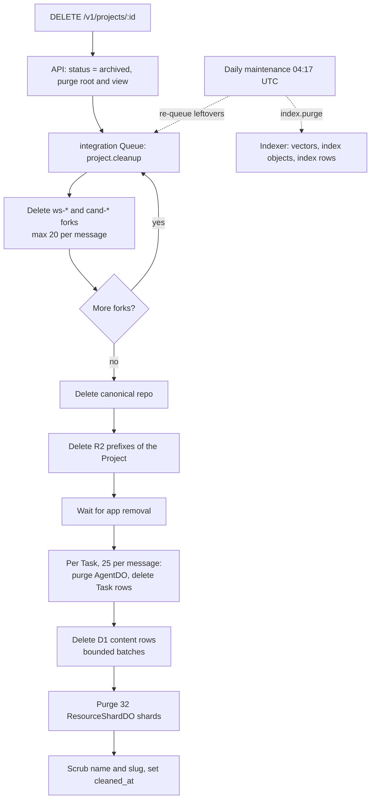

# Resource Cleanup and Retention Runbook

This runbook covers smoke-test cleanup, Project archive, the daily fork sweep, and R2 object retention.

## Purpose

Rhumbatron keeps Git repositories in Cloudflare Artifacts, scratch contexts in R2, and database records in D1. Regular cleanup keeps usage within the Cloudflare free and included tiers (`AGENTS.md` sections 7 and 43, [ADR 0010](../adr/0010-artifacts-project-source.md)).

---

## 1. Smoke Project Cleanup (`cleanup:projects`)

Automated smoke tests (`scripts/smoke.ts`) make temporary Projects on `dev`. `scripts/cleanup-projects.ts` deletes them.

- **Target match**: The script selects slugs that match `/^(smoke|sandbox)-\d+$/`.
- **Protected slugs**: The script keeps the named demo Projects, including `acme-shop-demo`.

### Dry Run

List the matching Projects without deleting anything:

```sh
bun run cleanup:projects --dry-run
```

The output shows the listed Projects, the count of matched smoke Projects, and the kept Projects.

### Real Execution

```sh
bun run cleanup:projects
```

The script calls `DELETE /v1/projects/:id` for each matched Project with the Clerk smoke user credentials.

---

## 2. Project Archiving (`DELETE /v1/projects/:id`)

When a user deletes a Project through the API or UI, the API marks it `archived` in D1 and purges its ProjectRootDO and ProjectViewDO. The API then queues `project.cleanup` for the integration Worker (`workers/integration/src/project-cleanup.ts`). Cleanup deletes everything that the Project created.



1. **State update**: The API has already set the Project status to `archived` in D1. Cleanup skips a Project that is not archived.
2. **Order of deletion** (bounded per queue message; each delivery continues where the last one stopped):
   - **Read model**: Cleanup purges ProjectRootDO and ProjectViewDO again. This is safe to repeat.
   - **Workspace and Candidate forks**: Cleanup deletes all forks (`ws-*` and `cand-*`) that D1 records in `task_runs` and `candidates`. It uses `ARTIFACTS.delete()`.
   - **Canonical repository**: Cleanup deletes the canonical Project repository (`ARTIFACTS.delete(projectId)`).
   - **R2 objects**: Cleanup lists and deletes all objects under these prefixes of the evidence bucket, each followed by the Project ID: `source/`, `context/`, `apps/`, `app-previews/`, `evidence/`, `work-graphs/`, and `workspace/`.
   - **Live app**: On prod, `removeApp` wipes the app data stores first, and cleanup waits for it. On dev, cleanup removes the preview and version rows itself.
   - **Tasks and agents**: For each batch of 25 Tasks, cleanup purges the AgentDO of each Task, then deletes the `task_runs`, `decision_receipts`, `task_dependencies`, and `tasks` rows of the batch.
   - **D1 content rows**: Cleanup deletes the rows of `evidence_index`, `approvals`, `conflicts`, `changesets`, `candidates`, `changes`, `request_conflicts`, `goal_suggestions`, `project_policies`, `project_members`, `project_invitations`, `agents`, `dead_letters`, `releases`, `release_targets`, and `project_events`. It deletes at most 500 rows per statement and 40 statements per message.
   - **Shards**: Cleanup purges the 32 ResourceShardDO shards (claims, Intents, Challenges, outbox). It does this last, so a late Claim cannot refill a shard.
   - **Final step**: Cleanup deletes the KV policy copy, replaces the Project name and slug with `Deleted project` and `deleted-<id>`, and sets `cleaned_at`.
3. **Indexes**: The indexer Worker deletes the Vectorize vectors, the `index/` objects, and the `project_indexes` and `project_vectors` rows (`index.purge`). The daily maintenance sends `index.purge` for an archived Project until no index row remains.
4. **Kept records**:

| Kept | Reason |
|---|---|
| `projects` row (ID, organization, status, generation, timestamps), with name and slug scrubbed | Archive record. The slug is free to use again. |
| One `app_deployments` row for the production app host | The host keeps answering `410`. The row has the host label and `removed` status only. |
| `usage_counters` | The monthly Anthropic budget (ADR 0021) and the Sandbox, Browser, and build meters are global rows. A delete cannot free budget. |
| R2 `events/` audit archive and K2 events | They are shared by all Projects. They expire by lifecycle rule (30 days dev, 365 days prod) and K2 retention (7 days). |
| Organization, user, and membership rows; `notification_reads`; `processed_events` | They are not Project data. |
| Project Sandbox container | It keeps no data after its 2-minute sleep. Waking it to destroy it would spend the Sandbox hour cap. |
| Worker script of a release target (Acme Shop fixture on dev) | It is Terraform-owned. Cleanup deletes the `release_targets` row only. |

---

## 3. Daily Fork Sweep (`forks.sweep`)

Active Projects collect temporary forks while Tasks run and Candidates verify. The daily sweep (`sweepForks` in `workers/integration/src/project-cleanup.ts`) deletes unneeded forks after their retention expires.

- **Retention periods** ([ADR 0017](../adr/0017-prod-environment.md)):
  - Dev: 7 days after completion.
  - Prod: 30 days after completion.
- **Forks swept**:
  - **Workspace forks (`ws-*`)**:
    - Task runs that failed.
    - Task runs that completed without producing a ChangeSet.
    - Task runs whose parent Change has ended (`completed`, `cancelled`, or `failed`).
  - **Candidate forks (`cand-*`)**:
    - Candidates in `rejected` or `stale` states.
    - Candidates in `promoted` state. The sweep deletes these only after it confirms that canonical `main` contains the composed commit.
- **Limits**: The sweep deletes up to 20 repositories per message. It sets `fork_deleted_at` in D1, so a retry is idempotent.
- **Schedule**: The event router's every-minute cron queues one `forks.sweep` per day at 04:17 UTC (`workers/event-router/src/maintenance.ts`). The same tick re-queues `project.cleanup` for up to 10 archived Projects with leftovers. While `paused = true`, the cron does not run, so the sweep does not run.

---

## 4. Artifacts and R2 Retention Policy

| Resource | Scope / Prefix | Dev Retention | Prod Retention | Managed By |
|---|---|---|---|---|
| Artifacts Forks | `ws-*`, `cand-*` | 7 days post-run | 30 days post-run | `sweepForks` (D1 / Artifacts) |
| Canonical Repos | `proj_*` | Until project archive | Until project archive | `cleanupProject` |
| R2 Events Archive | `events/` | 30 days | 365 days | R2 bucket lifecycle rule |
| R2 Evidence | `evidence/` | 30 days, or on project archive | Indefinite (`null`), or on project archive | R2 bucket lifecycle rule, `cleanupProject` |
| R2 Temporary | `tmp/` | 7 days | 7 days | R2 bucket lifecycle rule |
| R2 Project objects | `source/`, `context/`, `apps/`, `app-previews/`, `evidence/`, `work-graphs/`, `workspace/` | Deleted on project archive | Deleted on project archive | `cleanupProject` |
