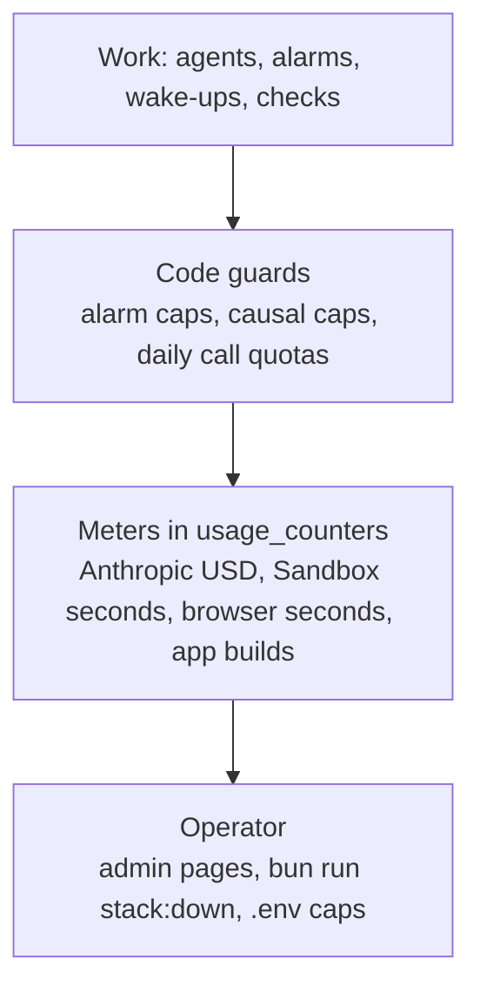

# Costs, Quotas, and Budget Caps Runbook

This runbook tells what costs money, what the caps are, and what to do when a cap trips.

The stack runs on one computer. The only paid service is the Anthropic API ([ADR 0021](../adr/0021-anthropic-model-provider.md)). Every other service is open source and runs in Docker ([ADR 0034](../adr/0034-docker-compose-stack.md)). The local caps protect the computer, not a bill.

## 1. Read the spend

- The platform admin reads the meters on `/admin` (`GET /v1/admin/overview` and `GET /v1/admin/costs`). Each person reads their own spend on the Account page (`GET /v1/me/costs`). See [ADR 0033](../adr/0033-platform-admin-and-access.md).
- A Project's cost page reads `GET /v1/projects/:projectId/cost`.
- The admin totals add up to the Anthropic meter `anthropic-usd-micro`. The user meters (`user-usd-micro:<userId>`) and the Project meters (`project-usd-micro:<projectId>`) count only the model calls that a request pays for. The rest of the Anthropic meter shows as "Not attributed": the model calls that no request pays for.
  - Overview: the model spend of the month, the part attributed to users, and the part not attributed.
  - Users and Projects: a footer with the sum of all meters of the list, the "Not attributed" part, and their sum (the Anthropic meter), this month and all time.
  - Costs grouped by user or by Project: the monthly meters for whole months, plus a "Not attributed" row.
  - Costs grouped by model or by day: the `task_runs` rows, plus an "Other model calls (no per-call record)" row when the range is whole months. That row holds the Root Planner, the intake check, conflict reviews, the acceptance check, the Integration Judge, the calls that no request pays for, and the runs of deleted Projects. For any other range, the `source` line gives the meter total.
- The Anthropic Console shows the spend of the API key.

## 2. Caps

| Cap | Value | Set by |
|---|---|---|
| Anthropic spend | 100 USD per calendar month | `ANTHROPIC_MONTHLY_BUDGET_USD` in `.env` (default `100`) |
| Sandbox time | 72,000 seconds (20 hours) per UTC month | `SANDBOX_MONTHLY_SECONDS` in `.env` (default `72000`) |
| Browser checks | 3,600 seconds per UTC day | `BROWSER_DAILY_SECONDS` in `.env` (default `3600`) |
| Agent model calls | 1,000 per UTC day | `AGENT_DAILY_CALL_CAP` in `packages/model-router/src/budget.ts` |
| Model calls per Task run | 16 for Haiku, 32 for Sonnet and Opus | `MAX_CALLS_PER_RUN` in the same file |
| Clef-flash questions | 200 per UTC day, shared counter `clef-flash` | The event router, the agents, and the intake gate |
| Goal suggestions | 100 per UTC day | `SUGGESTION_DAILY_CAP` in `workers/agents/src/suggestions.ts` |
| App builds | 60 per UTC day | `APP_BUILDS_PER_DAY` in `workers/integration/src/app-release.ts` |
| Previews | 3 per Change | `MAX_PREVIEWS_PER_CHANGE` in `packages/protocol/src/app.ts` |

All meters are rows of `usage_counters` in the product database.

### Anthropic (`ANTHROPIC_MONTHLY_BUDGET_USD`)

- The meter is the counter `anthropic-usd-micro`, in micro-USD per calendar month.
- Every model call of the model router first reserves an estimate in one conditional SQL statement. The reservation then settles to the exact cost from the usage fields of the response, with cache reads and writes. A refused reservation stops the work. Anthropic is the only provider.
- Core gives the cap to every module. Code without the value uses 10 USD (`ANTHROPIC_MONTHLY_BUDGET_FALLBACK_USD` in `packages/model-router/src/budget.ts`).
- Clef and Clef-flash questions go to Claude Haiku from `packages/platform/src/ai/models.ts`, with at most 1,024 output tokens each. The Anthropic meter does not count them. The daily `clef-flash` and goal suggestion quotas limit them.
- `ALLOW_OPUS` is `false` by default. Then the opus tier runs on Sonnet 5.5, and the Decision Receipt records the downgrade.

### Sandbox (`SANDBOX_MONTHLY_SECONDS`)

- Agent Workspaces (`workers/agents/src/workspace.ts`), Candidate checks (`workers/integration/src/candidate-sandbox.ts`), and Code page edit session commands (`workers/integration/src/code-sessions.ts`, [ADR 0029](../adr/0029-code-edit-sessions.md)) share the meter.
- Each Project has one Sandbox, `proj-<project>`. sandboxd removes it with its disk after 2 idle minutes (`SANDBOX_IDLE_MS`). At most 4 Sandboxes are live at one time (`SANDBOX_MAX`).
- Each use reserves seconds before the Sandbox starts. A reservation that passes the cap is refused.
- When a use ends, it refunds its reservation. It charges only the time that it adds to the awake block of the Sandbox (`sandbox_awake`), plus one 120-second idle tail (`workers/integration/src/sandbox-meter.ts`). Agents, checks, and commands that overlap in one Sandbox count once.
- A code edit session starts the Sandbox only at its first command. Each command reserves 480 seconds and runs at most 120 seconds. A session ends after 10 idle minutes or 2 hours.

### Browser checks (`BROWSER_DAILY_SECONDS`)

- Every Candidate whose Change touches pages gets the required browser check, at every risk tier (`packages/evidence/src/plan.ts`).
- A check opens one session on the `browser` service. The session lasts at most 120 seconds (`BROWSER_SESSION_MS`). The check timeout is 180 seconds.
- A Candidate gets at most 2 browser runs, retries included (`MAX_BROWSER_RUNS_PER_CANDIDATE` in `workers/integration/src/check-semantics.ts`).
- Before a session opens, the check reserves 60 seconds on the `browser-seconds` meter. After the session closes, the reservation settles to the measured seconds.
- When the value is not a positive integer, the check uses 500 seconds per day (`BROWSER_DAILY_SECONDS` constant in `check-semantics.ts`).
- The admin overview shows the cap.

### Budget scopes

A person selects the budget that pays for a request ([ADR 0030](../adr/0030-budget-scopes.md)).

| Scope | Cap | Who sets it | Where |
|---|---|---|---|
| `change` ("This request") | `changes.budget_usd`, up to 100 USD. The Project default applies when the request has none. | The requester. An owner or admin raises it. | New change form, Change page |
| `project` ("Project budget") | `projects.monthly_budget_usd`, 1 to 100 USD per calendar month. | The owner or an admin. | Settings > Defaults |
| `account` ("My budget") | `users.monthly_budget_usd`, 1 to 100 USD per calendar month, across every Project. | Each user for themselves. | Account page (`/account`) |

- A Change with scope `project` or `account` has no cap of its own. A request for such a Change without that monthly budget fails with 400 `no_budget_set`.
- The Project budget and the requester budget always apply as ceilings, for every scope. The stack budget (`ANTHROPIC_MONTHLY_BUDGET_USD`) applies to every metered call.
- Meters in `usage_counters`, in micro-USD: `change-usd-micro:<changeId>` (`day` = `total`), `project-usd-micro:<projectId>` and `user-usd-micro:<userId>` (`day` = `YYYY-MM`), and `anthropic-usd-micro`. Each meter counts every call, also when no cap is set.
- Every model call that a Change pays for reserves its estimate on all meters of the Change in one batch, all or nothing. The call then settles each meter to the exact cost. These calls are the agent runs, the Root Planner, the intake review, the request review, conflict review, context compaction, the acceptance check, and the Integration Judge (`packages/model-router/src/budget-meters.ts`).
- When a meter refuses, Rhumbatron sends no call. A Change in `compiling` or `running` becomes `budget_blocked` with `blocked_limit` `change_budget`, `project_budget`, `account_budget`, or `monthly_model_spend`. When several meters refuse, `blocked_limit` names the narrowest budget. `blocked_reason` names the budget, its amount, the month, and who can raise it. Example: "Stopped: the project budget of $100.00 for October is used up. An owner or admin can raise it in Settings."
- During verification, a refused acceptance check is a gap that names the budget. The Candidate then goes to a person. A refused Integration Judge call sends the Candidate selection to a person.
- A higher budget resumes the stopped Changes:
  - A higher Change budget on the Change page resumes that Change.
  - A higher Project budget in Settings resumes all Changes of the Project that the Project budget stopped.
  - A higher user budget on the Account page resumes all Changes of that requester that their budget stopped.
- A Change that a budget stopped during planning plans again. The admission checks run again. A budget that is still used up stops the Change again.

## 3. When a cap trips

| Cap | What happens | Operator action |
|---|---|---|
| Anthropic monthly budget | The meter refuses the reservation, or Anthropic refuses for spend or billing. The Task is `blocked`. The Change is `budget_blocked` with the limit `monthly_model_spend`. | 1. Read `/admin` and the Anthropic Console. 2. The meter starts again at the next UTC calendar month. 3. To raise the cap, set `ANTHROPIC_MONTHLY_BUDGET_USD` in `.env` and run `docker compose up -d`. |
| Request budget (`change_budget`) | The Change meter refuses the reservation, or a Task's share of the request budget runs out. The Change is `budget_blocked`. | An owner or admin raises the request budget on the Change page. |
| Project monthly budget (`project_budget`) | The Project meter refuses the reservation. Every Change of the Project that calls a model stops. | An owner or admin raises or removes the Project monthly budget in Settings. The stopped Changes resume. The meter starts again at the next UTC calendar month. |
| User monthly budget (`account_budget`) | The requester meter refuses the reservation. Every Change of that requester stops, in every Project. | The requester raises or removes their monthly budget on the Account page. The stopped Changes resume. |
| Agent model calls (1,000 per day) | The Task stops. The Change is `budget_blocked` with the limit `daily_model_calls`. | Look for looping Tasks. The meter starts again at 00:00 UTC. A person can raise the Change budget to resume. |
| Sandbox (72,000 s per month) | The meter refuses each Sandbox start. An agent gets "The monthly Sandbox budget is used up". Candidate verification rejects the Candidate with "Monthly Sandbox budget reached; no check ran." A Code page terminal command gets 429 `sandbox_cap`. File edits and submit continue to work. | Look for long tests. The meter starts again at the next UTC calendar month. To stop all work, run `bun run stack:down`. |
| Browser checks (3,600 s per day) | The browser check does not start. It records `not_checked`. This is a gap in a required check, so the Candidate cannot promote. | Wait for the next UTC day, then verify the Candidate again. To raise the cap, set `BROWSER_DAILY_SECONDS` in `.env` and run `docker compose up -d`. |
| App builds (60 per day) | The build is refused with "The daily app build cap (60) is reached." | Wait for the next UTC day. |
| Clef-flash questions (200 per day) | The caller abstains and uses its deterministic fallback. | No action. The quota starts again at 00:00 UTC. |
