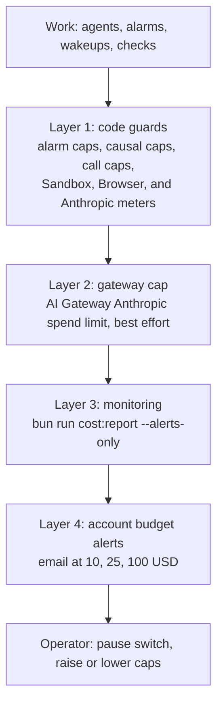
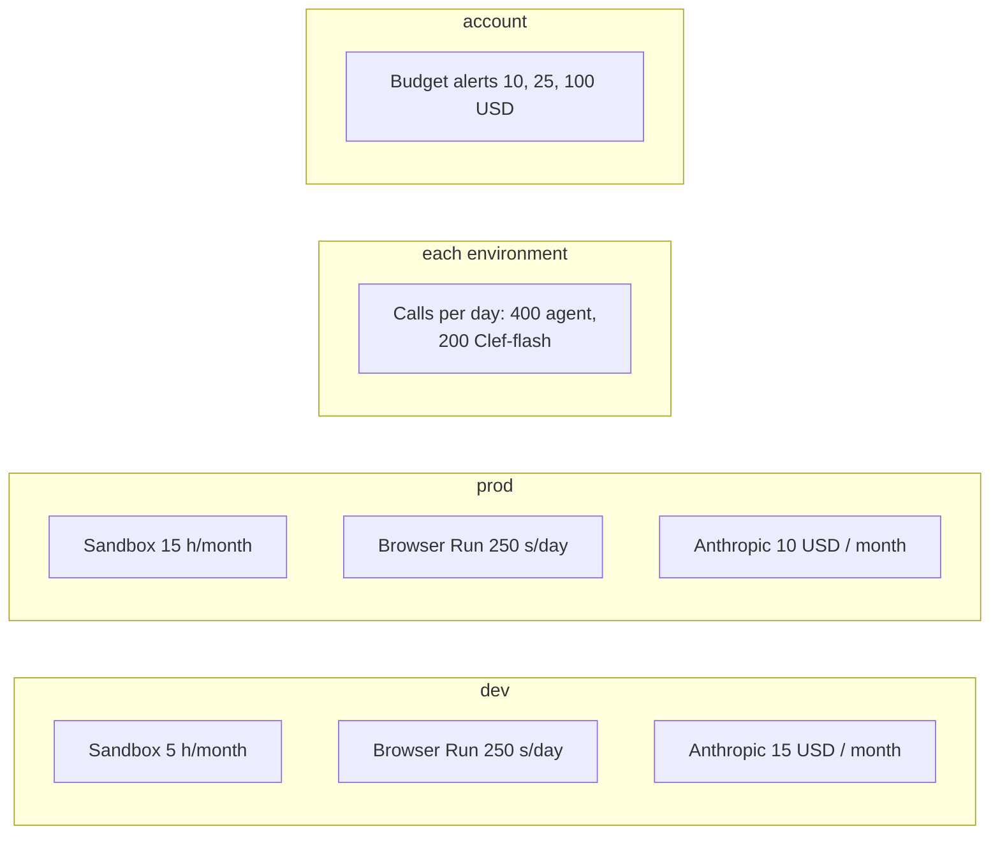

# Costs, Quotas, and Budget Caps Runbook

This runbook covers cost reports, infrastructure quotas, model budgets, and limit enforcement.

## Principles

Rhumbatron treats cost as an architecture constraint (`AGENTS.md` section 7 and rule 50). Each environment must run within the Cloudflare free and included limits and its capped Anthropic budget.

Cloudflare has no hard spend cap. Rhumbatron uses layered guards. [ADR 0019](../adr/0019-runaway-billing-guards.md) defines the code guards, the monitoring, and the account budget alerts. A monthly Anthropic budget per environment, enforced in code, bounds model spend ([ADR 0021](../adr/0021-anthropic-model-provider.md)).



---

## 1. Cost Reporting (`cost:report`)

Run `scripts/cost-report.ts` to see current usage and remaining quotas:

```sh
bun run cost:report
```

- **Authentication**: The script loads `CLOUDFLARE_MONITOR_TOKEN` (read-only, Keychain `rhumbatron-cloudflare-monitor-token`). It also loads `CLOUDFLARE_D1_TOKEN` (Keychain `rhumbatron-cloudflare-api-token`) for D1 read queries only. The script never writes or changes resources.
- **Scope**: Account-wide usage and leftover resources, plus the dev meters (`usage_counters`) compared with the dev caps, and the Anthropic spend this month on dev and prod against $15, $10, and the $25 total.
- **Status thresholds**:
  - `OK`: < 60% of allowance used.
  - `WARN`: 60% to 84% of allowance used.
  - `ALERT`: >= 85% of allowance used. The script exits with code 1, so other scripts can alert.
- **Alerts only**:
  ```sh
  bun run cost:report --alerts-only
  ```

---

## 2. Infrastructure and Service Caps



### Sandbox Container Usage (`SANDBOX_MONTHLY_SECONDS`)

- **Total allowance**: 20 container hours/month total (72,000 seconds), inside the ~25 included basic-instance hours of Workers Paid.
- **Split across environments** ([ADR 0017](../adr/0017-prod-environment.md)):
  - Dev: `SANDBOX_MONTHLY_SECONDS = 18000` (5 hours)
  - Prod: `SANDBOX_MONTHLY_SECONDS = 54000` (15 hours)
- **Idle timeout**: Agent Workspace Sandboxes sleep after 2 idle minutes (`workers/agents/src/workspace.ts`). Candidate check Sandboxes sleep after 2 idle minutes (`workers/integration/src/candidate-sandbox.ts`).
- **Period**: The D1 meter counts per UTC calendar month.
- **Instance count**: `max_instances = 1` per environment.

### Browser Run (`BROWSER_DAILY_SECONDS`)

- **Total free allowance**: 10 minutes/day (600 seconds/day). The guard stops at 500 seconds/day total.
- **Split across environments** ([ADR 0017](../adr/0017-prod-environment.md)):
  - Dev: `BROWSER_DAILY_SECONDS = 250` (250 seconds/day)
  - Prod: `BROWSER_DAILY_SECONDS = 250` (250 seconds/day)
- **Per-session limits**: 55 seconds maximum per check. At most 2 browser checks per Candidate.

### Anthropic Spend (`ANTHROPIC_MONTHLY_BUDGET_USD`)

- **Ceiling**: Code enforces it on each environment's D1 meter (`usage_counters`, counter `anthropic-usd-micro` per calendar month, in micro-USD) ([ADR 0021](../adr/0021-anthropic-model-provider.md)).
  - Dev: 15 USD per calendar month.
  - Prod: 10 USD per calendar month.
  - Total: 25 USD per month. Terraform rejects a higher value in either environment.
- **How**: Every model call reserves an estimate first (one conditional D1 statement), then settles to its exact cost from the response usage fields, cache reads and writes included. A refused reservation is a budget stop. No other provider is tried.
- **Second line**: The AI Gateway spend limit on the `anthropic` provider uses the same value per 30 days. Cloudflare documents it for BYOK and Unified Billing requests, so it may not count requests that carry their own key.
- **Worker binding**: The agents, integration, and API Workers get the value through the `ANTHROPIC_MONTHLY_BUDGET_USD` plain text binding.

### Model Call Quotas and Routing (`MODEL_PROVIDER`, `ALLOW_OPUS`)

`packages/model-router/src/budget.ts` declares these caps. The Clef-flash cap is in `workers/event-router/src/causal.ts`.

- **Daily agent call cap**: 400 calls/day (`AGENT_DAILY_CALL_CAP = 400`).
- **Workers AI Clef-flash**: 200 calls/day (under the 10,000 daily Neurons allowance).
- **`MODEL_PROVIDER`**: `anthropic` on dev and prod. OpenRouter and Gemini on Vertex AI are removed, so there is no GCP spend.
- **`ALLOW_OPUS`**: `false` by default. The opus tier then runs on Sonnet 5.5, and the Decision Receipt records the downgrade. Set `allow_opus = true` in Terraform only with the owner's approval.

---

## 3. What to Do When a Cap Trips

| Tripped cap | Observed behavior | Operator action |
|---|---|---|
| **Anthropic monthly budget ($15 dev / $10 prod)** | The meter refuses the reservation, or the gateway or Anthropic refuses for spend or billing. The Task is `blocked` and the Change `budget_blocked` (`monthly_model_spend`). | 1. Run `bun run cost:report` and check the AI Gateway logs.<br>2. The meter resets at the start of the next UTC calendar month.<br>3. A larger budget needs the owner's approval, a new validation bound in `envs/<env>/variables.tf`, a plan, and an apply. |
| **Agent Daily Calls (400 calls/day)** | Agent runs pause and reject further model calls. | Look for looping agent Tasks or unusual prompt churn. The cap resets at 00:00 UTC. |
| **Sandbox Monthly Seconds (18,000 s)** | The Sandbox refuses new containers. Tasks that need a container fail. | Look for unclosed containers or long-running tests. The meter resets at the start of each UTC calendar month. To save budget, set `paused = true`. |
| **Account budget alert (10, 25, 100 USD)** | The account emails the owner. Nothing stops by itself. | Run `bun run cost:report`, find the source, and set `paused = true` in the affected environment. |
| **Browser Run Daily Seconds (250 s)** | Browser Run rejects sessions, or sessions fail. | Candidate browser checks fail or fall back to non-browser checks. The daily quota resets at 00:00 UTC. |
