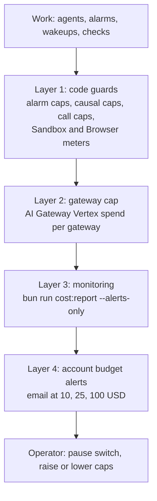
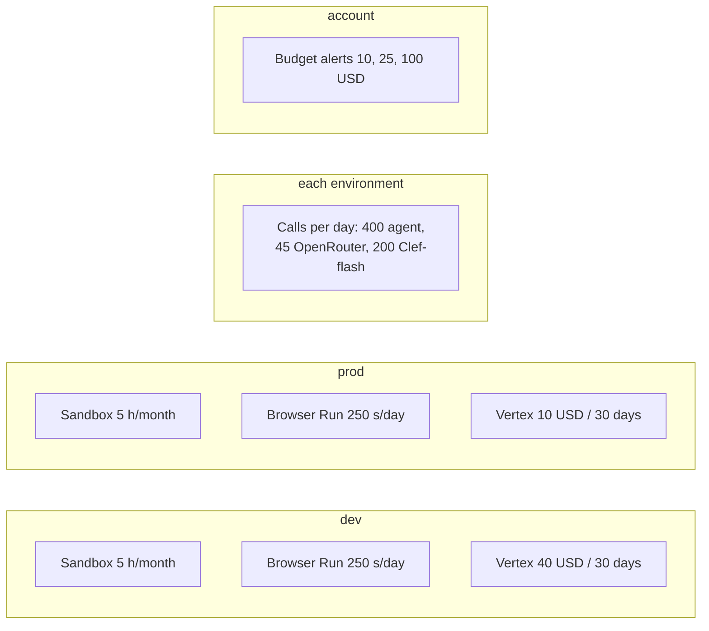

# Costs, Quotas, and Budget Caps Runbook

This runbook covers cost reports, infrastructure quotas, AI Gateway budgets, and limit enforcement.

## Principles

Rhumbatron treats cost as an architecture constraint (`AGENTS.md` section 7 and rule 50). Each environment must run within the Cloudflare free and included limits and the capped external LLM budgets.

Cloudflare has no hard spend cap. Rhumbatron uses layered guards. [ADR 0019](../adr/0019-runaway-billing-guards.md) defines the code guards, the monitoring, and the account budget alerts. The AI Gateway cap bounds model spend ([ADR 0016](../adr/0016-gemini-overflow.md), [ADR 0017](../adr/0017-prod-environment.md)).



---

## 1. Cost Reporting (`cost:report`)

Run `scripts/cost-report.ts` to see current usage and remaining quotas:

```sh
bun run cost:report
```

- **Authentication**: The script loads `CLOUDFLARE_MONITOR_TOKEN` (read-only, Keychain `rhumbatron-cloudflare-monitor-token`). It also loads `CLOUDFLARE_D1_TOKEN` (Keychain `rhumbatron-cloudflare-api-token`) for D1 read queries only. The script never writes or changes resources.
- **Scope**: Account-wide usage and leftover resources, plus the dev meters (`usage_counters`) compared with the dev caps.
- **Status thresholds**:
  - `OK`: < 60% of allowance used.
  - `WARN`: 60% to 84% of allowance used.
  - `ALERT`: >= 85% of allowance used. The script exits with code 1, so other scripts can alert.
- **Alerts only**:
  ```sh
  bun run cost:report --alerts-only
  ```

---

## 2. Infrastructure and Service Caps



### Sandbox Container Usage (`SANDBOX_MONTHLY_SECONDS`)

- **Total allowance**: 10 container hours/month total (HOM-192, 36,000 seconds).
- **Split across environments** ([ADR 0017](../adr/0017-prod-environment.md)):
  - Dev: `SANDBOX_MONTHLY_SECONDS = 18000` (5 hours)
  - Prod: `SANDBOX_MONTHLY_SECONDS = 18000` (5 hours)
- **Idle timeout**: Agent Workspace Sandboxes sleep after 10 idle minutes (`workers/agents/src/workspace.ts`). Candidate check Sandboxes sleep after 2 idle minutes (`workers/integration/src/candidate-sandbox.ts`).
- **Period**: The D1 meter counts per UTC calendar month.
- **Instance count**: `max_instances = 1` per environment.

### Browser Run (`BROWSER_DAILY_SECONDS`)

- **Total free allowance**: 10 minutes/day (600 seconds/day). The guard stops at 500 seconds/day total.
- **Split across environments** ([ADR 0017](../adr/0017-prod-environment.md)):
  - Dev: `BROWSER_DAILY_SECONDS = 250` (250 seconds/day)
  - Prod: `BROWSER_DAILY_SECONDS = 250` (250 seconds/day)
- **Per-session limits**: 55 seconds maximum per check. At most 2 browser checks per Candidate.

### Vertex AI Spend (`VERTEX_SPEND_LIMIT_USD`)

- **Ceiling**: The Cloudflare AI Gateway enforces it on the `google-vertex-ai` provider ([ADR 0016](../adr/0016-gemini-overflow.md), [ADR 0017](../adr/0017-prod-environment.md)).
  - Dev gateway (`rhumbatron-models-dev`): 40 USD per 30 days.
  - Prod gateway (`rhumbatron-models-prod`): 10 USD per 30 days.
  - Total account Vertex spend cap: ~50 USD per 30 days across the shared GCP project.
- **Worker binding**: The agents and API Workers get the same value through the `VERTEX_SPEND_LIMIT_USD` plain text binding. They use it in budget-stop text and dashboard reports.

### Model Call Quotas and Routing (`MODEL_PROVIDER`)

`packages/model-router/src/budget.ts` and `provider.ts` declare these caps. The Clef-flash cap is in `workers/event-router/src/causal.ts`.

- **Daily agent call cap**: 400 calls/day across all providers (`AGENT_DAILY_CALL_CAP = 400`).
- **OpenRouter daily cap**: 45 calls/day (`OPENROUTER_DAILY_CALL_CAP = 45`). This stays under the OpenRouter limit of 50 free calls per day ([ADR 0007](../adr/0007-openrouter-free-models.md)).
- **Workers AI Clef-flash**: 200 calls/day (under the 10,000 daily Neurons allowance).
- **`MODEL_PROVIDER` switch**:
  - `dev` defaults to `vertex`.
  - `prod` defaults to `openrouter`.
  - `MODEL_PROVIDER=vertex` (or `preferVertex: true`) sends calls directly to Gemini on Vertex AI.
  - When `openrouter` is active, the router calls free models until it reaches 45 calls or an upstream rate limit. After that, runs overflow to Gemini via Vertex AI ([ADR 0016](../adr/0016-gemini-overflow.md)).

---

## 3. What to Do When a Cap Trips

| Tripped cap | Observed behavior | Operator action |
|---|---|---|
| **OpenRouter 45 calls/day** | OpenRouter returns quota / rate limit. | No action. The router overflows to Gemini on Vertex AI ([ADR 0016](../adr/0016-gemini-overflow.md)). The cap resets at 00:00 UTC. |
| **Vertex Spend Cap ($40 dev / $10 prod)** | The gateway returns 429/402. The router stops further model calls (`vertex_spend_limit`). | 1. Check GCP Billing and the AI Gateway logs.<br>2. If the project owner approves a larger budget, change `vertex_spend_limit_usd` in `envs/<env>/main.tf`.<br>3. Run the plan, and then apply it. |
| **Agent Daily Calls (400 calls/day)** | Agent runs pause and reject further model calls. | Look for looping agent Tasks or unusual prompt churn. The cap resets at 00:00 UTC. |
| **Sandbox Monthly Seconds (18,000 s)** | The Sandbox refuses new containers. Tasks that need a container fail. | Look for unclosed containers or long-running tests. The meter resets at the start of each UTC calendar month. To save budget, set `paused = true`. |
| **Account budget alert (10, 25, 100 USD)** | The account emails the owner. Nothing stops by itself. | Run `bun run cost:report`, find the source, and set `paused = true` in the affected environment. |
| **Browser Run Daily Seconds (250 s)** | Browser Run rejects sessions, or sessions fail. | Candidate browser checks fail or fall back to non-browser checks. The daily quota resets at 00:00 UTC. |
