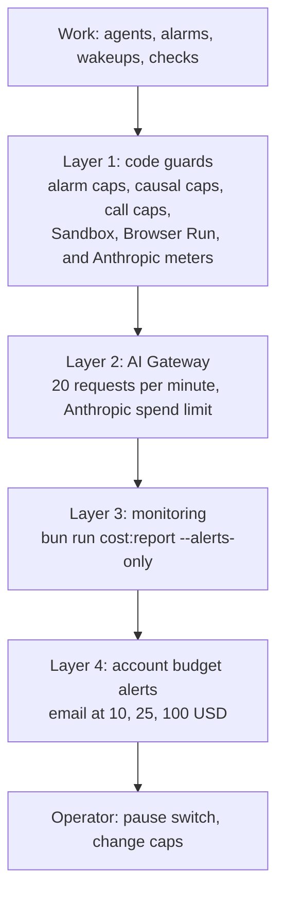
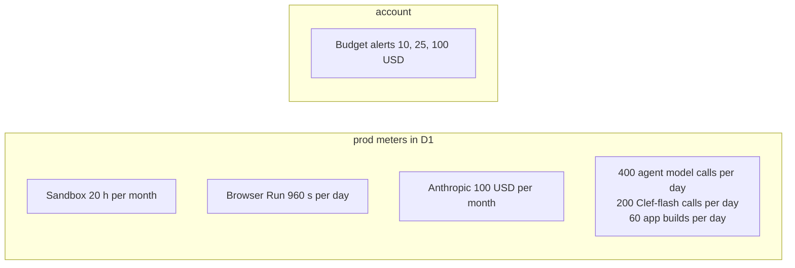

# Costs, Quotas, and Budget Caps Runbook

This runbook covers the cost report, the caps, and what to do when a cap trips. Prod runs within the Cloudflare free and included limits and a capped Anthropic budget (`AGENTS.md` section 7 and rule 50).

Cloudflare has no hard spend cap, so Rhumbatron uses layers of guards. [ADR 0019](../adr/0019-runaway-billing-guards.md) defines the code guards, the monitoring, and the account budget alerts. [ADR 0021](../adr/0021-anthropic-model-provider.md) defines the Anthropic budget.



## 1. Cost report

```sh
bun run cost:report
bun run cost:report --alerts-only
```

- `scripts/cost-report.ts` reads the account usage with `CLOUDFLARE_MONITOR_TOKEN` (read-only, Keychain `rhumbatron-cloudflare-monitor-token`). It reads the D1 meters with `CLOUDFLARE_D1_TOKEN` (Keychain `rhumbatron-cloudflare-api-token`). It never writes.
- It reports account usage, leftover resources (containers, Workflow instances, forks, archived Projects), the prod meters in `usage_counters` against the prod caps, and the Anthropic spend of this month against the 100 USD budget.
- Levels: `OK` below 60 %, `WARN` from 60 % to below 85 %, `ALERT` at 85 % or more. When a line is `ALERT`, the script exits with code 1.

## 2. Caps



`locals.caps` and `local.cap_bindings` in `infrastructure/terraform/envs/prod/main.tf` set the Sandbox and Browser Run caps at 80 % of the Workers Paid included allowance. Each Worker reads its cap from a plain-text binding and enforces it on the D1 meter (`usage_counters`).

### Sandbox (`SANDBOX_MONTHLY_SECONDS`)

- Cap: `72000` seconds (20 hours) per UTC calendar month. This is 80 % of the 25 included basic-instance hours.
- One container instance (`max_instances = 1`), instance type `basic`.
- Agent Workspaces (`workers/agents/src/workspace.ts`) and Candidate checks (`workers/integration/src/candidate-sandbox.ts`) share the meter. Both sleep after 2 idle minutes.
- Each use reserves seconds before the container starts. A reservation that passes the cap is refused.

### Browser Run (`BROWSER_DAILY_SECONDS`)

- Cap: `960` seconds per UTC day. This is 80 % of the 10 included browser hours per month.
- One session per check, closed after at most 55 seconds. At most 2 browser runs per Candidate (`workers/integration/src/check-semantics.ts`).
- Only a Change with risk `high` or `critical` that touches pages gets the browser check (`packages/evidence/src/plan.ts`).

### Anthropic (`ANTHROPIC_MONTHLY_BUDGET_USD`)

- Cap: 100 USD per calendar month (`var.anthropic_monthly_budget_usd` in `envs/prod/variables.tf`). Terraform rejects a value above 100.
- The meter is the `usage_counters` counter `anthropic-usd-micro` (micro-USD per calendar month).
- Every model call reserves an estimate first in one conditional D1 statement. It then settles to the exact cost from the response usage fields, cache reads and writes included. A refused reservation stops the work. No other provider is tried.
- The agents, integration, and API Workers get the cap through the `ANTHROPIC_MONTHLY_BUDGET_USD` binding. A Worker without the binding uses 10 USD (`packages/model-router/src/budget.ts`).
- Second line: the AI Gateway `rhumbatron-models-prod` has a spend limit of the same value per 30 days on the `anthropic` provider, and a rate limit of 20 requests per minute (`modules/ai`). Cloudflare documents the spend limit for BYOK and Unified Billing requests. It can miss requests that carry their own key, so the D1 meter is the stop that code relies on.

### Model call quotas and routing

- Agent model calls: 400 per UTC day (`AGENT_DAILY_CALL_CAP` in `packages/model-router/src/budget.ts`).
- Model calls per Task run: 16 for Haiku, 32 for Sonnet and Opus (`MAX_CALLS_PER_RUN`).
- Clef-flash on Workers AI: 200 calls per UTC day on the shared counter `clef-flash`. The event router, the agents, and the intake gate use it. Workers AI includes 10,000 Neurons per day.
- `MODEL_PROVIDER`: `anthropic`. Terraform rejects any other value.
- `ALLOW_OPUS`: `false`. The opus tier then runs on Sonnet 5.5, and the Decision Receipt records the downgrade. Set `allow_opus = true` only with the owner's approval.

### Live apps

- App builds: 60 per UTC day (`APP_BUILDS_PER_DAY` in `workers/integration/src/app-release.ts`).
- Previews: at most 3 per Change. Preview bundles expire after 7 days.

## 3. When a cap trips

| Cap | What happens | Operator action |
|---|---|---|
| Anthropic monthly budget (100 USD) | The meter refuses the reservation, or the gateway or Anthropic refuses for spend or billing. The Task is `blocked`. The Change is `budget_blocked` with the limit `monthly_model_spend`. | 1. Run `bun run cost:report` and read the AI Gateway logs.<br>2. The meter starts again at the next UTC calendar month.<br>3. A higher budget needs the owner's approval, a new validation bound in `envs/prod/variables.tf`, a plan, and an apply. |
| Agent model calls (400 per day) | The Task stops. The Change is `budget_blocked` with the limit `daily_model_calls`. | Look for looping Tasks. The meter starts again at 00:00 UTC. A person can raise the Change budget to resume. |
| Sandbox (72,000 s per month) | New Sandbox starts are refused. An agent gets "The monthly Sandbox budget is used up". Candidate checks that need the Sandbox do not run. | Look for long tests or open containers. The meter starts again at the next UTC calendar month. To stop all Sandbox starts, set `paused = true`. |
| Browser Run (960 s per day) | The browser check does not start. It records `not_checked`, a gap for the required check, so the Candidate cannot promote. | Wait for the next UTC day, then verify the Candidate again. |
| App builds (60 per day) | The build is refused with "The daily app build cap (60) is reached." | Wait for the next UTC day. |
| Account budget alert (10, 25, 100 USD) | The account sends an email. Nothing stops. | Run `bun run cost:report`, find the source, and set `paused = true` in `envs/prod` ([pause-resume.md](./pause-resume.md)). |
