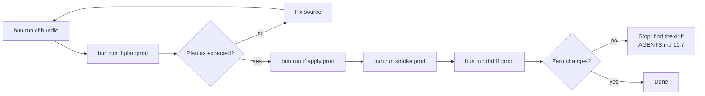

# Deployment Runbook

This runbook deploys Rhumbatron infrastructure and Worker bundles with Terraform.

## Principles

1. **Terraform-only control plane**: Terraform alone manages all remote Cloudflare resources, Workers, bindings, and configurations ([ADR 0004](../adr/0004-resource-organization-and-bootstrap-credentials.md), [ADR 0017](../adr/0017-prod-environment.md)). Never deploy with `wrangler deploy` or with Cloudflare dashboard writes.
2. **Keychain credentials**: `scripts/tf.ts` loads credentials from the macOS Keychain into environment variables. Never commit secrets to Git or to Terraform state files.
3. **No `-auto-approve`**: Always make and read the saved plan file before you apply. `scripts/tf.ts` refuses the flag.

`bun run tf <bootstrap|global|prod> <terraform args...>` runs Terraform in one root with that root's Keychain credentials. The `tf:*` scripts wrap it.



---

## 1. Bundle Workers (`cf:bundle`)

Bundle the Worker code locally before you plan or deploy:

```sh
bun run cf:bundle
```

- The script compiles all deployables through Turbo: `apps/web`, `workers/api`, `workers/coordinator`, `workers/agents`, `workers/event-router`, `workers/integration`, `workers/indexer`, and `workers/sandbox`.
- It writes `dist/bundles/manifest.json` with the bundle file lists and SHA-256 hashes.
- Bundles do not depend on the environment. Terraform bindings supply the environment configuration.

---

## 2. Deploy

Prod is the only remote environment ([ADR 0024](../adr/0024-retire-dev-environment.md)). Run local checks first (`bun run check`), because every change deploys to prod.

### Production (`prod`)

```sh
bun run cf:bundle
bun run tf:plan:prod    # writes prod.tfplan
bun run tf:apply:prod   # applies prod.tfplan
bun run tf:drift:prod   # verifies clean plan for prod
```

### Global Singletons (`global`)

The `envs/global` root manages account-wide and zone-wide singletons. These are the DNS zone lookup, the zone TLS settings (Strict SSL), and the account budget alerts at 10, 25, and 100 USD (ADR 0019). The prod web Worker does the `www` to apex redirect. No zone rule does it.

```sh
bun run tf global plan -out=global.tfplan
bun run tf global apply global.tfplan
```

`bun run tf:drift` checks `global` and `prod` together.

---

## 3. Configuration Switches

Set these switches in `infrastructure/terraform/envs/prod/main.tf`.

### `bootstrap` Switch

- **Location**: `locals { bootstrap = false }` in `envs/prod/main.tf`.
- **Purpose**: The switch breaks the circular dependency between `coordinator_worker` and `event_router_worker` ([ADR 0005](../adr/0005-durable-object-worker-deploys.md), [ADR 0017](../adr/0017-prod-environment.md)). It also selects the first Durable Object migrations.
- **First apply on a new environment**:
  1. Set `bootstrap = true`.
  2. Plan and apply (`bun run tf:plan:prod` && `bun run tf:apply:prod`).
     - This apply leaves out the coordinator's `EVENT_ROUTER` service binding.
     - This apply uploads the initial Durable Object migration (`new_tag = "v1"` with SQLite classes).
  3. Set `bootstrap = false`.
  4. Plan and apply again.
     - This apply adds the `EVENT_ROUTER` low-latency nudge binding to the coordinator.
     - This apply sets the migration steady state to `old_tag = "v1", new_tag = "v1"`.

### `attach_apex` Switch

- **Location**: `locals { attach_apex = true }` in `envs/prod/main.tf`. The cutover is complete. The value is `true`, and the apex serves the prod web Worker.
- **Purpose**: The switch attaches the apex domains (`rhumbatron.com` and `www.rhumbatron.com`) to the production web Worker ([ADR 0017](../adr/0017-prod-environment.md)).
- **Cutover sequence**:
  1. Keep `attach_apex = false` during the initial deployment. If a DNS record exists for the hostname, Cloudflare rejects the Worker custom domain.
  2. Delete the legacy DNS records at `rhumbatron.com`.
  3. Set `attach_apex = true`.
  4. Run the plan, and then apply it. The apply attaches the apex custom domain.

---

## 4. D1 Migrations Deploy Order

A deployment can include new D1 migrations (`migrations/d1/*.sql`). The Worker components `api_worker` and `integration_worker` depend on `terraform_data.d1_migrations`, because new Worker code can query new tables or columns.

If the deployment includes new D1 migrations, apply them first. This prevents runtime errors during rollout:

```sh
bun run tf prod apply -target=terraform_data.d1_migrations
```

After the migrations succeed, run the normal full plan and apply:

```sh
bun run tf:plan:prod && bun run tf:apply:prod
```

---

## 5. Transient HTTP Errors

During a Terraform run, a Cloudflare API call can fail with a transient network or gateway error:

```text
Error: failed to make http request: ...
```

- **Cause**: A transient HTTP connection reset, a Cloudflare edge timeout, or a short gateway failure.
- **Resolution**: Do not change resources by hand. Terraform keeps the state of completed resources, and the resources are declarative. Run the plan and apply command again:

```sh
bun run tf:plan:prod && bun run tf:apply:prod
```
